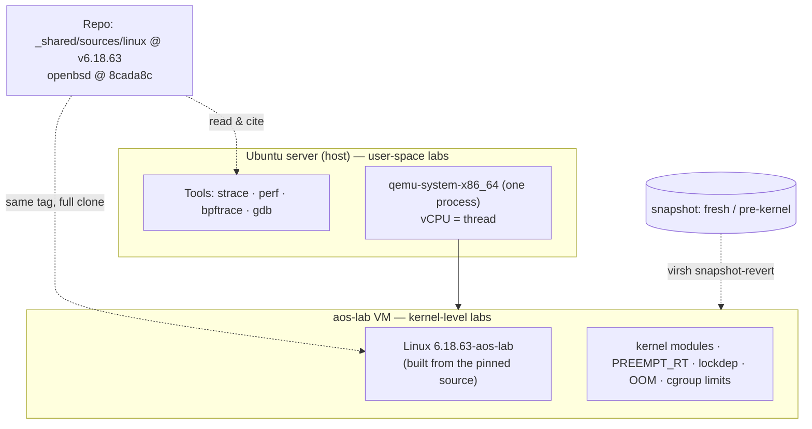

# 00 — Setup: lab machines, tools, and reading kernel source

> Course: Advanced Operating Systems · Term 1 · Pins: Linux **v6.18.63**, OpenBSD **`8cada8c`** · Arch: **x86-64**
> Time: ~4 h · Persian version: [`guide.fa.md`](guide.fa.md) · Decks: [`slides/`](slides/)

## Learning goals

- Run every lab on the right machine: user-space on the server, kernel-level in a disposable VM.
- Install and **verify** the tracing tool set against the running kernel.
- Boot a kernel built from **exactly** the source you read (v6.18.63).
- Find, quote, and cite real kernel code in under a minute (`git grep`, `ctags`, `cite.sh`, Elixir).

## Glossary

| Term | Meaning |
|---|---|
| **Hypervisor** | Software that runs virtual machines. Here: KVM (in the Linux kernel) + QEMU (user-space device emulation) |
| **KVM** | Kernel-based Virtual Machine: the kernel module that uses VT-x/AMD-V so a guest's instructions run directly on the CPU |
| **libvirt / `virsh`** | Management layer over QEMU/KVM: define, start, snapshot, console |
| **cloud-init** | First-boot configuration of a cloud image (user, SSH key, packages) |
| **qcow2 overlay** | Copy-on-write disk that stores only the blocks that differ from a base image |
| **Nested virtualization** | Running KVM *inside* a KVM guest. Needed for Module 6 |
| **Sparse checkout** | Git checkout of only some directories of a repository |
| **Shallow clone** | Clone with truncated history (`--depth 1`: only the newest commit) |
| **BTF** | BPF Type Format: compact type info for the kernel, so `bpftrace` can read `struct task_struct` fields |
| **ftrace** | The kernel's built-in function tracer (`/sys/kernel/tracing`). `trace-cmd` is its front end |
| **kallsyms** | `/proc/kallsyms`: every kernel symbol and its address |
| **`localmodconfig`** | Kernel config target that disables every module not currently loaded |

## 1. Big picture: two machines, two kinds of labs



| Lab type | Where | Examples |
|---|---|---|
| Observe a normal kernel (`strace`, `perf stat`, `/proc`, bpftrace) | server | M1 syscall tracing, M2 `perf sched`, M4 page faults |
| Change or break the kernel (modules, RT, lockdep, OOM, crash-consistency) | **VM only** | M3 lockdep, M5 `dm-flakey`, M6 mini container, M7 `cyclictest` |
| Nested KVM | VM with nesting on | M6 lab 4 (`/dev/kvm` client) |

**Rule:** if a lab says *VM only*, take a snapshot first, and never run it on the server.

## 2. If your server can't run KVM

`create-vm.sh` stops with `CPU has no VT-x/AMD-V flag` on most VPSes. In that case:

1. **Your own PC (Windows):** install the same Ubuntu 24.04 VM in Hyper-V or VirtualBox, then follow labs 02 and 03 inside it. For VirtualBox, [`labs/01-create-vm/create-vm-virtualbox.ps1`](labs/01-create-vm/create-vm-virtualbox.ps1) builds the VM in one command; it is the course's own test VM. It has no hardware PMU counters and no nested `/dev/kvm` when Hyper-V is active (see the lab README). Enable nested virtualization with `Set-VMProcessor -VMName aos-lab -ExposeVirtualizationExtensions $true` in Hyper-V.
2. **WSL2 is *not* enough** for the kernel-level labs. It runs Microsoft's kernel, and module loading, `PREEMPT_RT`, and `perf sched` are limited there. It's fine for reading source and compiling the C labs.
3. **No VirtualBox and no Docker? Use plain QEMU.** `make qemu-vm CMD=create` builds the same VM with only Python and QEMU (Windows: `winget install SoftwareFreedomConservancy.QEMU`). It needs no seed ISO, so no Docker or WSL. Without hardware acceleration (KVM on Linux, HVF on Intel Macs, WHPX on Windows: turn on *Windows Hypervisor Platform* in Windows Features) it still works but is 10 to 50 times slower. Other commands: `make qemu-vm CMD=start|stop|status|ssh|snapshot|restore`. This path is newer than the other two: if it fails, read `.cache/vm/aos-lab/qemu.log` and use VirtualBox or libvirt instead.
4. **Still no VM? Docker, then the browser lab. But a VM is better whenever you can.**
   - **Docker** runs the **user-space labs** (C programs, `strace`, threads, pipes). It cannot run the kernel-level labs: a container shares the host's kernel, so you cannot boot v6.18.63 or load modules.
   - **The browser lab** boots a small **32-bit** Linux 6.8 inside your browser for 10 guided mini-labs (processes, memory, signals, files). Clone the repository and run it: `git clone <repository-url>`, `cd` into it, then `make browser-lab` (about 13 MB is downloaded once). It has no compiler, `strace`, `perf` or `ftrace`, so it shows the ideas but does not replace the real labs. See `_shared/browser-lab/README.md`.
   - Order of preference: **VM** (every lab) → **Docker** (user-space labs) → **browser lab** (concepts only).

## 3. Labs, in order

| Lab | Goal | Time |
|---|---|---|
| [01-create-vm](labs/01-create-vm/README.md) | `aos-lab` VM with serial console and `fresh` snapshot | 30 min |
| [02-install-tools](labs/02-install-tools/README.md) | every tool installed and **working** on server + VM | 30 min |
| [03-build-kernel](labs/03-build-kernel/README.md) | VM boots `6.18.63-aos-lab` (BTF, ftrace, kallsyms) | 45 min + build |

## 4. Reading real kernel source

The repo has both codebases as shallow, sparse submodules (see `_shared/sources/README.md`). After cloning:

```bash
bash _shared/sources/setup-sources.sh      # once
```

### 4.1 Find a definition

```bash
cd _shared/sources/linux
git grep -n "^pid_t kernel_clone"          # fastest; searches only tracked files
git grep -n "SYSCALL_DEFINE3(read,"        # syscall definitions use a macro, not "sys_read("
```

The second one matters: `sys_read` never appears as a plain function. It's generated by `SYSCALL_DEFINE3(read, ...)` in `fs/read_write.c`. Searching for the macro is a skill you'll use in every module.

### 4.2 Jump around with ctags / cscope

```bash
cd _shared/sources/linux
ctags -R --languages=C,Asm -f .tags kernel mm fs include arch/x86 ipc block io_uring net security virt lib
cscope -b -q -k -R -s kernel -s mm -s fs -s include -s arch/x86    # -k: don't use /usr/include
# vim: :set tags=.tags  then Ctrl-]   ·   VS Code: install the "C/C++" extension and open the folder
```

`.tags` and `cscope.*` are build artifacts. Don't commit them.

### 4.3 Quote and cite: `cite.sh`

Never type kernel code from memory. Print it from the checkout:

```bash
bash _shared/sources/cite.sh linux   arch/x86/entry/syscall_64.c do_syscall_64 14
bash _shared/sources/cite.sh openbsd sys/kern/kern_fork.c fork1 6
bash _shared/sources/cite.sh linux   arch/x86/entry/syscalls/syscall_64.tbl L12 3
```

Real output (run on this repo's checkout):

```text
linux/arch/x86/entry/syscall_64.c · do_syscall_64() · v6.18.63 · L87-100
   87  __visible noinstr bool do_syscall_64(struct pt_regs *regs, int nr)
   88  {
   89  	add_random_kstack_offset();
   90  	nr = syscall_enter_from_user_mode(regs, nr);
   91
   92  	instrumentation_begin();
   93
   94  	if (!do_syscall_x64(regs, nr) && !do_syscall_x32(regs, nr) && nr != -1) {
   95  		/* Invalid system call, but still a system call. */
   96  		regs->ax = __x64_sys_ni_syscall(regs);
   97  	}
   98
   99  	instrumentation_end();
  100  	syscall_exit_to_user_mode(regs);
```

Line by line (Module 1 explains each one in depth):

| Line | What it does |
|---|---|
| 87 | `noinstr`: no tracing hooks. Entry code runs before the kernel is in a traceable state. `nr` is the syscall number from `rax` |
| 89 | randomizes the kernel stack offset for each syscall, which makes stack-based exploits harder |
| 90 | the generic "enter the kernel from user mode" work: context tracking, seccomp, ptrace, syscall tracepoints |
| 92, 99 | mark the region where instrumentation (tracing, KASAN) *is* allowed |
| 94 | dispatch through the 64-bit table, then the x32 table. `-1` means "skipped on purpose" (e.g. by seccomp) |
| 96 | unknown number → `sys_ni_syscall` returns `-ENOSYS` |
| 100 | the mirror of line 90 on the way back: signals, rescheduling, exit tracing |

OpenBSD's entry point for comparison (Module 1 builds the full table):

```text
openbsd/sys/kern/kern_fork.c · fork1() · 8cada8c · L350-355
  350  int
  351  fork1(struct proc *curp, int flags, void (*func)(void *), void *arg,
  352      register_t *retval, struct proc **rnewprocp)
  353  {
  354  	struct process *curpr = curp->p_p;
  355  	struct process *pr;
```

Already visible: OpenBSD uses **KNF** style (return type on its own line), and splits a *process* (`struct process`) from its *threads* (`struct proc`). Linux has a single `task_struct` for both. That difference returns in Module 2.

### 4.4 Citation format (all courses)

```
linux/<path> · <function>() · v6.18.63
openbsd/<path> · <function>() · 8cada8c
```

Online links (only after confirming the file is in the local checkout):
`https://elixir.bootlin.com/linux/v6.18.63/source/<path>#L<line>` · `https://github.com/openbsd/src/blob/8cada8c/<path>#L<line>`

### 4.5 A file isn't in the sparse checkout?

```bash
git -C _shared/sources/linux sparse-checkout add drivers/char      # e.g. for a char-device lab
```

Never `git fetch --unshallow` these submodules. For history work, make a separate clone outside the repo.

## 5. Safety rules (whole course)

1. Kernel modules, `PREEMPT_RT`, lockdep, OOM, and filesystem-corruption labs run **in the VM only**.
2. Snapshot before every *VM only* lab: `sudo virsh snapshot-create-as aos-lab before-<lab>`.
3. Don't set `perf_event_paranoid=-1` or `kptr_restrict=0` on a machine other people use. Lab 02 sets lab-friendly values: they're fine on your own lab VM and server, not on production.
4. Run code from a lab only after you've read it, including the solutions in this repo.

## 6. Done when

- [ ] `ssh` into `aos-lab` works and `virsh snapshot-list aos-lab` shows `fresh`
- [ ] `verify-tools.sh` exits `0` on the server and in the VM
- [ ] `uname -r` in the VM prints `6.18.63-aos-lab`
- [ ] `cite.sh` prints `do_syscall_64()` from your checkout
- [ ] You can explain *why* `do_syscall_64` doesn't appear in `available_filter_functions` (lab 03 extension)

Next: **Module 01: Architecture & Kernel Structure**.
