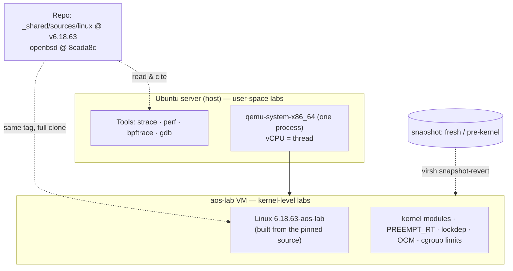

<div dir="rtl">

# ۰۰ — راه‌اندازی: ماشین‌های آزمایشگاه، ابزارها و خواندن سورس کرنل

> درس: سیستم‌عامل پیشرفته · ترم ۱ · نسخه‌های ثابت: Linux **v6.18.63** و OpenBSD **`8cada8c`** · معماری: **x86-64**
> زمان: حدود ۴ ساعت · نسخهٔ انگلیسی: [`guide.en.md`](guide.en.md) · اسلایدها: [`slides/`](slides/)

## هدف‌های یادگیری

- هر آزمایش را روی ماشین درست اجرا کنید: کارهای <span dir="ltr">user-space</span> روی سرور، و کارهای سطح کرنل در یک VM یک‌بارمصرف.
- ابزارهای ردیابی (tracing) را نصب کنید و **مطمئن شوید** روی کرنل در حال اجرا واقعاً کار می‌کنند.
- کرنلی را بوت کنید که **دقیقاً** از همان سورسی ساخته شده که می‌خوانید (v6.18.63).
- در کمتر از یک دقیقه کد واقعی کرنل را پیدا کنید، نقل کنید و ارجاع بدهید (`git grep`، `ctags`، `cite.sh`، Elixir).

## واژه‌نامه

| اصطلاح | تعریف |
|---|---|
| **Hypervisor** | نرم‌افزاری که ماشین مجازی اجرا می‌کند. اینجا یعنی KVM (داخل کرنل لینوکس) به‌اضافهٔ QEMU (شبیه‌سازی سخت‌افزار در فضای کاربر). |
| **KVM** | ماژول کرنل لینوکس که با کمک VT-x یا AMD-V اجازه می‌دهد دستورهای سیستم مهمان مستقیم روی CPU اجرا شوند. |
| **libvirt / `virsh`** | لایهٔ مدیریتی روی QEMU/KVM برای تعریف، روشن‌کردن، snapshot و کنسول VM. |
| **cloud-init** | تنظیم خودکار image ابری در اولین بوت: ساخت کاربر، کلید SSH و نصب بسته‌ها. |
| **qcow2 overlay** | دیسکی با روش copy-on-write که فقط بلوک‌های متفاوت با image پایه را ذخیره می‌کند. |
| **Nested virtualization** | اجرای KVM *داخل* یک VM که خودش روی KVM است. برای ماژول ۶ لازم است. |
| **Sparse checkout** | گرفتن فقط بعضی پوشه‌های یک مخزن git. |
| **Shallow clone** | کلون با تاریخچهٔ کوتاه‌شده؛ با `--depth 1` فقط آخرین commit می‌آید. |
| **BTF** | فرمت فشردهٔ اطلاعات نوع‌ها در کرنل. با آن `bpftrace` می‌تواند فیلدهای `struct task_struct` را بخواند. |
| **ftrace** | ردیاب توابع داخلی کرنل در `/sys/kernel/tracing`. ابزار `trace-cmd` رابط آن است. |
| **kallsyms** | فایل `/proc/kallsyms` که همهٔ نمادهای کرنل و آدرسشان را فهرست می‌کند. |
| **`localmodconfig`** | هدف پیکربندی کرنل که هر ماژولی را که الان بارگذاری نشده خاموش می‌کند. |

## ۱. تصویر کلی: دو ماشین، دو نوع آزمایش

</div>



<div dir="rtl">

| نوع آزمایش | کجا | نمونه |
|---|---|---|
| مشاهدهٔ یک کرنل معمولی (`strace`، `perf stat`، `/proc`، bpftrace) | سرور | ردیابی syscall در ماژول ۱، `perf sched` در ماژول ۲، page fault در ماژول ۴ |
| تغییر یا خراب‌کردن کرنل (ماژول، RT، lockdep، OOM، سازگاری فایل‌سیستم پس از crash) | **فقط VM** | lockdep در ماژول ۳، `dm-flakey` در ماژول ۵، container دست‌ساز در ماژول ۶، `cyclictest` در ماژول ۷ |
| KVM تودرتو | VM با nesting روشن | آزمایش ۴ ماژول ۶ (برنامه‌ای که مستقیم با `/dev/kvm` کار می‌کند) |

**قانون:** اگر آزمایشی نوشته «فقط VM»، اول snapshot بگیرید و هرگز آن را روی سرور اجرا نکنید.

## ۲. اگر سرور شما KVM ندارد

اسکریپت `create-vm.sh` روی بیشتر VPSها با پیام `CPU has no VT-x/AMD-V flag` متوقف می‌شود. در این حالت:

۱. **کامپیوتر شخصی خودتان (ویندوز):** همان VM با Ubuntu 24.04 را در Hyper-V یا VirtualBox بسازید و آزمایش‌های ۰۲ و ۰۳ را داخل آن انجام دهید. برای VirtualBox، اسکریپت <bdi dir="ltr">labs/01-create-vm/create-vm-virtualbox.ps1</bdi> با یک دستور VM را می‌سازد؛ VM آزمایشی خود این درس هم با همین اسکریپت ساخته شده است. اگر Hyper-V فعال باشد، شمارنده‌های سخت‌افزاری PMU و <bdi dir="ltr">/dev/kvm</bdi> تودرتو در دسترس نیستند (README آزمایش را ببینید). برای nesting در Hyper-V این دستور را بزنید:

</div>

```powershell
Set-VMProcessor -VMName aos-lab -ExposeVirtualizationExtensions $true
```

<div dir="rtl">

۲. **WSL2 کافی *نیست*.** WSL2 کرنل خود مایکروسافت را اجرا می‌کند و بارگذاری ماژول، `PREEMPT_RT` و `perf sched` در آن محدود است. برای خواندن سورس و کامپایل آزمایش‌های C مشکلی ندارد.
۳. **نه VirtualBox دارید و نه Docker؟ از QEMU ساده استفاده کنید.** دستور `make qemu-vm CMD=create` همان VM را فقط با Python و QEMU می‌سازد (در ویندوز: `winget install SoftwareFreedomConservancy.QEMU`). ISO برای seed نمی‌سازد، پس Docker یا WSL لازم نیست. بدون شتاب‌دهی سخت‌افزاری (KVM در Linux، HVF در مک‌های اینتل، WHPX در ویندوز: گزینهٔ *Windows Hypervisor Platform* را در Windows Features روشن کنید) باز هم کار می‌کند ولی ۱۰ تا ۵۰ برابر کندتر است. دستورهای دیگر: `make qemu-vm CMD=start|stop|status|ssh|snapshot|restore`. این مسیر تازه‌تر از دو مسیر دیگر است: اگر خطا داد فایل `.cache/vm/aos-lab/qemu.log` را بخوانید و به‌جای آن از VirtualBox یا libvirt استفاده کنید.
۴. **هنوز VM ندارید؟ Docker، بعد آزمایشگاه مرورگر. ولی هر وقت می‌توانید VM بهتر است.**
   - **Docker** آزمایش‌های **user-space** (برنامه‌های C، `strace`، thread، pipe) را اجرا می‌کند. آزمایش‌های سطح کرنل را نمی‌تواند اجرا کند: container از کرنل میزبان استفاده می‌کند، پس نمی‌شود v6.18.63 را boot کرد یا module بارگذاری کرد.
   - **آزمایشگاه مرورگر** یک Linux 6.8 کوچک و **۳۲ بیتی** را داخل مرورگر شما برای ۱۰ آزمایش کوچک راهنمادار (process، حافظه، signal، فایل) boot می‌کند. مخزن را clone کنید و اجرا کنید: `git clone <repository-url>`، وارد پوشه شوید و `make browser-lab` را بزنید (یک بار حدود ۱۳ مگابایت دانلود می‌شود). compiler و `strace` و `perf` و `ftrace` ندارد؛ پس ایده‌ها را نشان می‌دهد ولی جای آزمایش‌های واقعی را نمی‌گیرد. فایل `_shared/browser-lab/README.md` را ببینید.
   - ترتیب ترجیح: **VM** (همهٔ آزمایش‌ها) ← **Docker** (آزمایش‌های user-space) ← **آزمایشگاه مرورگر** (فقط مفاهیم).

## ۳. آزمایش‌ها به ترتیب

| آزمایش | هدف | زمان |
|---|---|---|
| [01-create-vm](labs/01-create-vm/README.md) | VM با نام `aos-lab`، کنسول سریال و snapshot به نام `fresh` | ۳۰ دقیقه |
| [02-install-tools](labs/02-install-tools/README.md) | همهٔ ابزارها روی سرور و VM نصب‌اند و **کار می‌کنند** | ۳۰ دقیقه |
| [03-build-kernel](labs/03-build-kernel/README.md) | VM با کرنل `6.18.63-aos-lab` بوت می‌شود (BTF، ftrace، kallsyms) | ۴۵ دقیقه به‌اضافهٔ زمان build |

## ۴. خواندن سورس واقعی کرنل

هر دو کدبیس در مخزن به‌صورت submodule کم‌عمق و sparse هستند (توضیحش در `_shared/sources/README.md`). بعد از clone یک بار این را اجرا کنید:

</div>

```bash
bash _shared/sources/setup-sources.sh      # once
```

<div dir="rtl">

### ۴.۱ پیدا کردن تعریف یک تابع

</div>

```bash
cd _shared/sources/linux
git grep -n "^pid_t kernel_clone"          # fastest; searches only tracked files
git grep -n "SYSCALL_DEFINE3(read,"        # syscall definitions use a macro, not "sys_read("
```

<div dir="rtl">

دستور دوم نکتهٔ مهمی دارد. `sys_read` هیچ‌جا به شکل یک تابع معمولی نوشته نشده است؛ ماکروی `SYSCALL_DEFINE3(read, ...)` در `fs/read_write.c` آن را می‌سازد. جستجو بر اساس ماکرو مهارتی است که در همهٔ ماژول‌ها لازمتان می‌شود.

### ۴.۲ جابه‌جایی در کد با ctags و cscope

</div>

```bash
cd _shared/sources/linux
ctags -R --languages=C,Asm -f .tags kernel mm fs include arch/x86 ipc block io_uring net security virt lib
cscope -b -q -k -R -s kernel -s mm -s fs -s include -s arch/x86    # -k: don't use /usr/include
# vim: :set tags=.tags  then Ctrl-]   ·   VS Code: install the "C/C++" extension and open the folder
```

<div dir="rtl">

فایل‌های `.tags` و `cscope.*` خروجی build هستند؛ آن‌ها را commit نکنید.

### ۴.۳ نقل و ارجاع با `cite.sh`

کد کرنل را هیچ‌وقت از حافظه ننویسید؛ آن را مستقیم از checkout چاپ کنید:

</div>

```bash
bash _shared/sources/cite.sh linux   arch/x86/entry/syscall_64.c do_syscall_64 14
bash _shared/sources/cite.sh openbsd sys/kern/kern_fork.c fork1 6
bash _shared/sources/cite.sh linux   arch/x86/entry/syscalls/syscall_64.tbl L12 3
```

<div dir="rtl">

خروجی واقعی (اجراشده روی checkout همین مخزن):

</div>

```text
linux/arch/x86/entry/syscall_64.c · do_syscall_64() · v6.18.63 · L87-100
   87  __visible noinstr bool do_syscall_64(struct pt_regs *regs, int nr)
   88  {
   89  	add_random_kstack_offset();
   90  	nr = syscall_enter_from_user_mode(regs, nr);
   91
   92  	instrumentation_begin();
   93
   94  	if (!do_syscall_x64(regs, nr) && !do_syscall_x32(regs, nr) && nr != -1) {
   95  		/* Invalid system call, but still a system call. */
   96  		regs->ax = __x64_sys_ni_syscall(regs);
   97  	}
   98
   99  	instrumentation_end();
  100  	syscall_exit_to_user_mode(regs);
```

<div dir="rtl">

توضیح خط به خط (ماژول ۱ هر کدام را عمیق‌تر باز می‌کند):

| خط | چه می‌کند |
|---|---|
| ۸۷ | `noinstr` یعنی هیچ hook ردیابی روی این تابع نیست، چون کد ورود به کرنل قبل از آنکه کرنل آمادهٔ ردیابی شود اجرا می‌شود. `nr` شمارهٔ syscall است که از رجیستر `rax` می‌آید. |
| ۸۹ | محل شروع پشتهٔ کرنل را در هر syscall تصادفی می‌کند تا حمله‌هایی که به چیدمان پشته تکیه دارند سخت‌تر شوند. |
| ۹۰ | کارهای عمومی «ورود از فضای کاربر به کرنل» را انجام می‌دهد: context tracking، seccomp، ptrace و tracepointهای syscall (در `kernel/entry/syscall-common.c`). |
| ۹۲ و ۹۹ | محدوده‌ای را مشخص می‌کنند که در آن instrumentation (مثل ردیابی و KASAN) *مجاز* است. |
| ۹۴ | فراخوانی را اول از جدول ۶۴ بیتی و بعد از جدول x32 پیدا می‌کند. مقدار `-1` یعنی syscall عمداً رد شده است، مثلاً توسط seccomp. |
| ۹۶ | اگر شماره ناشناخته باشد، `sys_ni_syscall` مقدار `-ENOSYS` برمی‌گرداند. |
| ۱۰۰ | قرینهٔ خط ۹۰ در مسیر برگشت: رسیدگی به signalها، زمان‌بندی دوباره و ردیابی خروج. |

برای مقایسه، نقطهٔ شروع fork در OpenBSD (جدول کامل مقایسه در ماژول ۱ ساخته می‌شود):

</div>

```text
openbsd/sys/kern/kern_fork.c · fork1() · 8cada8c · L350-355
  350  int
  351  fork1(struct proc *curp, int flags, void (*func)(void *), void *arg,
  352      register_t *retval, struct proc **rnewprocp)
  353  {
  354  	struct process *curpr = curp->p_p;
  355  	struct process *pr;
```

<div dir="rtl">

همین چند خط دو تفاوت را نشان می‌دهد. OpenBSD از سبک **KNF** پیروی می‌کند (نوع بازگشتی در خطی جدا). همچنین *پردازه* (`struct process`) را از *نخ‌هایش* (`struct proc`) جدا نگه می‌دارد، در حالی که لینوکس برای هر دو فقط یک `task_struct` دارد. این تفاوت در ماژول ۲ دوباره مطرح می‌شود.

### ۴.۴ قالب ارجاع (در همهٔ درس‌ها)

</div>

```
linux/<path> · <function>() · v6.18.63
openbsd/<path> · <function>() · 8cada8c
```

<div dir="rtl">

پیوندهای آنلاین را فقط وقتی بگذارید که مطمئن شده‌اید فایل در checkout محلی وجود دارد:

</div>

```
https://elixir.bootlin.com/linux/v6.18.63/source/<path>#L<line>
https://github.com/openbsd/src/blob/8cada8c/<path>#L<line>
```

<div dir="rtl">

### ۴.۵ فایلی در sparse checkout نیست؟

</div>

```bash
git -C _shared/sources/linux sparse-checkout add drivers/char      # e.g. for a char-device lab
```

<div dir="rtl">

هرگز روی این submoduleها `git fetch --unshallow` نزنید. برای کارهایی که تاریخچه لازم دارند، یک clone جدا بیرون از مخزن بسازید.

## ۵. قانون‌های ایمنی (برای کل درس)

۱. آزمایش‌های ماژول کرنل، `PREEMPT_RT`، lockdep، OOM و خراب‌کردن فایل‌سیستم **فقط در VM** اجرا می‌شوند.
۲. قبل از هر آزمایش «فقط VM» یک snapshot بگیرید:

</div>

```bash
sudo virsh snapshot-create-as aos-lab before-<lab>
```

<div dir="rtl">

۳. روی ماشینی که دیگران هم از آن استفاده می‌کنند `perf_event_paranoid=-1` یا `kptr_restrict=0` نگذارید. مقدارهایی که آزمایش ۰۲ تنظیم می‌کند فقط برای VM و سرور آزمایشی خودتان مناسب‌اند، نه برای production.
۴. هر کدی را فقط بعد از خواندنش اجرا کنید؛ حتی راه‌حل‌های همین مخزن.

## ۶. وقتی تمام است که…

- [ ] با `ssh` به `aos-lab` وصل می‌شوید و `virsh snapshot-list aos-lab` نام `fresh` را نشان می‌دهد.
- [ ] `verify-tools.sh` هم روی سرور و هم در VM با کد `0` تمام می‌شود.
- [ ] در VM، دستور `uname -r` مقدار `6.18.63-aos-lab` را چاپ می‌کند.
- [ ] `cite.sh` تابع `do_syscall_64()` را از checkout شما چاپ می‌کند.
- [ ] می‌توانید توضیح دهید *چرا* `do_syscall_64` در `available_filter_functions` نیست (تمرین تکمیلی آزمایش ۰۳).

بعدی: **ماژول ۰۱ — معماری و ساختار کرنل**.

</div>
