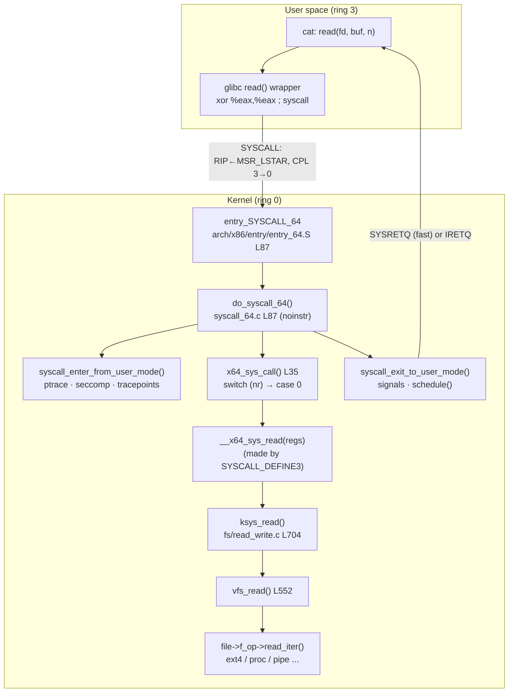

# 01 — Kernel walkthrough: one `read()` from user space into Linux and back

> Pins: Linux **v6.18.63** (`_shared/sources/linux/`), OpenBSD **`8cada8c`** (`_shared/sources/openbsd/`). **ARCH-SPECIFIC (x86-64)** throughout.
> Every excerpt below was printed from the local checkout with `bash _shared/sources/cite.sh <repo> <path> <symbol|Lnnn>` and is copied unchanged. Persian version: [`kernel-walkthrough.fa.md`](kernel-walkthrough.fa.md). Lesson: [`lesson.en.md`](lesson.en.md).

## 0. The call chain



| Step | File · symbol | Line | Elixir |
|---|---|---|---|
| MSR set at boot | `arch/x86/kernel/cpu/common.c` · `idt_syscall_init()` | L2232 | [link](https://elixir.bootlin.com/linux/v6.18.63/source/arch/x86/kernel/cpu/common.c#L2232) |
| Assembly entry | `arch/x86/entry/entry_64.S` · `entry_SYSCALL_64` | L87 | [link](https://elixir.bootlin.com/linux/v6.18.63/source/arch/x86/entry/entry_64.S#L87) |
| C entry | `arch/x86/entry/syscall_64.c` · `do_syscall_64()` | L87 | [link](https://elixir.bootlin.com/linux/v6.18.63/source/arch/x86/entry/syscall_64.c#L87) |
| Dispatch | `arch/x86/entry/syscall_64.c` · `x64_sys_call()` | L35 | [link](https://elixir.bootlin.com/linux/v6.18.63/source/arch/x86/entry/syscall_64.c#L35) |
| Number table | `arch/x86/entry/syscalls/syscall_64.tbl` | L12 (`read`) | [link](https://elixir.bootlin.com/linux/v6.18.63/source/arch/x86/entry/syscalls/syscall_64.tbl#L12) |
| Stub generator | `arch/x86/include/asm/syscall_wrapper.h` · `__SYS_STUBx` | L91 | [link](https://elixir.bootlin.com/linux/v6.18.63/source/arch/x86/include/asm/syscall_wrapper.h#L91) |
| The syscall | `fs/read_write.c` · `SYSCALL_DEFINE3(read, …)` | L722 | [link](https://elixir.bootlin.com/linux/v6.18.63/source/fs/read_write.c#L722) |
| VFS | `fs/read_write.c` · `vfs_read()` | L552 | [link](https://elixir.bootlin.com/linux/v6.18.63/source/fs/read_write.c#L552) |
| Device IRQ | `arch/x86/kernel/irq.c` · `common_interrupt` | L318 | [link](https://elixir.bootlin.com/linux/v6.18.63/source/arch/x86/kernel/irq.c#L318) |
| Generic IRQ | `kernel/irq/handle.c` · `__handle_irq_event_percpu()` | L177 | [link](https://elixir.bootlin.com/linux/v6.18.63/source/kernel/irq/handle.c#L177) |
| Context switch | `kernel/sched/core.c` · `context_switch()` | L5293 | [link](https://elixir.bootlin.com/linux/v6.18.63/source/kernel/sched/core.c#L5293) |
| Stack switch | `arch/x86/entry/entry_64.S` · `__switch_to_asm` | L177 | [link](https://elixir.bootlin.com/linux/v6.18.63/source/arch/x86/entry/entry_64.S#L177) |
| Register state | `arch/x86/kernel/process_64.c` · `__switch_to()` | L611 | [link](https://elixir.bootlin.com/linux/v6.18.63/source/arch/x86/kernel/process_64.c#L611) |

---

## 1. Boot: telling the CPU where `syscall` lands

**Why it matters:** the `syscall` instruction carries no target address. The CPU jumps to whatever the kernel wrote into the `IA32_LSTAR` MSR. That write happens once per CPU at boot.

`linux/arch/x86/kernel/cpu/common.c · idt_syscall_init() · v6.18.63` (L2232–2234, then L2257–2265)

```c
static inline void idt_syscall_init(void)
{
	wrmsrq(MSR_LSTAR, (unsigned long)entry_SYSCALL_64);
```
```c
	wrmsrq(MSR_SYSCALL_MASK,
	       X86_EFLAGS_CF|X86_EFLAGS_PF|X86_EFLAGS_AF|
	       X86_EFLAGS_ZF|X86_EFLAGS_SF|X86_EFLAGS_TF|
	       X86_EFLAGS_IF|X86_EFLAGS_DF|X86_EFLAGS_OF|
	       X86_EFLAGS_IOPL|X86_EFLAGS_NT|X86_EFLAGS_RF|
	       X86_EFLAGS_AC|X86_EFLAGS_ID);
}
```

| Line | Meaning |
|---|---|
| `wrmsrq(MSR_LSTAR, … entry_SYSCALL_64)` | the 64-bit `syscall` target. After this, every `syscall` in ring 3 jumps to `entry_SYSCALL_64` in ring 0. |
| `MSR_SYSCALL_MASK` | RFLAGS bits the CPU **clears** on entry. `X86_EFLAGS_IF` is in the list, so the kernel starts with **interrupts off**. `AC` cleared means SMAP is enforced (no accidental user-memory access). `TF` cleared means a single-stepping user doesn't single-step the kernel. |

`syscall_init()` (L2268) also writes `MSR_STAR` (the code/stack segment selectors) and skips `idt_syscall_init()` when **FRED** is enabled (L2280–2281). FRED is a new entry mechanism on recent Intel CPUs (`arch/x86/entry/entry_fred.c`). **VERSION-DEPENDENT / ARCH-SPECIFIC:** our VirtualBox guest does not use FRED, so everything below is the classic path.

## 2. `entry_SYSCALL_64`: the first kernel instructions

**Why it matters:** right after `syscall`, the CPU is in ring 0 but still on the **user stack**, with user `GS` and (with PTI) user page tables. These ~20 instructions make the kernel safe to run C.

`linux/arch/x86/entry/entry_64.S · entry_SYSCALL_64 · v6.18.63` (L87–121, comments L50–85 describe the register ABI)

```asm
SYM_CODE_START(entry_SYSCALL_64)
	UNWIND_HINT_ENTRY
	ENDBR

	swapgs
	/* tss.sp2 is scratch space. */
	movq	%rsp, PER_CPU_VAR(cpu_tss_rw + TSS_sp2)
	SWITCH_TO_KERNEL_CR3 scratch_reg=%rsp
	movq	PER_CPU_VAR(cpu_current_top_of_stack), %rsp

SYM_INNER_LABEL(entry_SYSCALL_64_safe_stack, SYM_L_GLOBAL)
	ANNOTATE_NOENDBR

	/* Construct struct pt_regs on stack */
	pushq	$__USER_DS				/* pt_regs->ss */
	pushq	PER_CPU_VAR(cpu_tss_rw + TSS_sp2)	/* pt_regs->sp */
	pushq	%r11					/* pt_regs->flags */
	pushq	$__USER_CS				/* pt_regs->cs */
	pushq	%rcx					/* pt_regs->ip */
SYM_INNER_LABEL(entry_SYSCALL_64_after_hwframe, SYM_L_GLOBAL)
	pushq	%rax					/* pt_regs->orig_ax */

	PUSH_AND_CLEAR_REGS rax=$-ENOSYS
```

| Line | Meaning |
|---|---|
| `ENDBR` | CET indirect-branch-tracking landing pad. |
| `swapgs` | swaps user `GS.base` with the kernel one stored in `MSR_KERNEL_GS_BASE`. After it, `PER_CPU_VAR(...)` (a `%gs:` access) reaches **this CPU's** per-CPU data. |
| `movq %rsp, …TSS_sp2` | park the user stack pointer in a per-CPU scratch slot. `syscall` does not touch `rsp` (comment L65–66), so the kernel must. |
| `SWITCH_TO_KERNEL_CR3` | with PTI (Meltdown mitigation) the user page tables map almost no kernel memory; this macro (`calling.h` L173) loads the kernel `CR3`. It is patched to a `jmp` when PTI is off. |
| `movq …cpu_current_top_of_stack, %rsp` | switch to **this task's kernel stack**. From here on, a kernel stack exists. |
| five `pushq` | build by hand the same frame the CPU pushes on an interrupt (`ss, sp, flags, cs, ip`), so the rest of the kernel sees one `struct pt_regs` format. `rcx` = user RIP and `r11` = user RFLAGS because `syscall` saved them there. |
| `pushq %rax` → `orig_ax` | the syscall number, kept even after `ax` is overwritten by the return value (this is what `strace` and `ptrace` read). |
| `PUSH_AND_CLEAR_REGS rax=$-ENOSYS` | save the other GPRs and **zero** them (no user values left in registers for speculative gadgets). `ax` starts as `-ENOSYS`, the answer for an unknown number. |

The next lines (L111–121) pass `%rsp` (the `pt_regs` pointer) in `%rdi`, sign-extend `eax` into `%rsi` (the syscall number is an `int`), run Spectre mitigations (`IBRS_ENTER`, `UNTRAIN_RET`, `CLEAR_BRANCH_HISTORY`) and `call do_syscall_64`. On return, `testb %al, %al` picks **SYSRET** (fast) or the general **IRET** path; the SYSRET exit is at L166 (`sysretq`).

## 3. `do_syscall_64()`: the C entry

**Why it matters:** this is where "a syscall" becomes generic kernel work: tracing hooks, dispatch, and the return-to-user work loop that delivers signals and can **reschedule**.

`linux/arch/x86/entry/syscall_64.c · do_syscall_64() · v6.18.63` (L86–100)

```c
/* Returns true to return using SYSRET, or false to use IRET */
__visible noinstr bool do_syscall_64(struct pt_regs *regs, int nr)
{
	add_random_kstack_offset();
	nr = syscall_enter_from_user_mode(regs, nr);

	instrumentation_begin();

	if (!do_syscall_x64(regs, nr) && !do_syscall_x32(regs, nr) && nr != -1) {
		/* Invalid system call, but still a system call. */
		regs->ax = __x64_sys_ni_syscall(regs);
	}

	instrumentation_end();
	syscall_exit_to_user_mode(regs);
```

| Line | Meaning |
|---|---|
| `noinstr` | `#define noinstr __noinstr_section(".noinstr.text")` (`include/linux/compiler_types.h` L417). No ftrace/kprobe hooks: the kernel is not yet in a state where tracing is safe. That's why `do_syscall_64` is absent from `available_filter_functions` (lab 05). |
| `add_random_kstack_offset()` | randomizes the kernel stack offset per syscall (hardening). |
| `syscall_enter_from_user_mode()` | tells RCU/lockdep we left user mode, **enables interrupts**, then, only if a work flag is set, runs `syscall_trace_enter()` (`kernel/entry/syscall-common.c` L20): **ptrace** (strace), **seccomp**, the `sys_enter` **tracepoint**, audit. It may change `nr` (seccomp can return `-1` to skip the call). |
| `instrumentation_begin/end` | the window where tracing **is** allowed. |
| `do_syscall_x64` / `do_syscall_x32` | try the 64-bit table, then the x32 one; `nr == -1` means "already handled/skipped". |
| `__x64_sys_ni_syscall` | "not implemented" → `-ENOSYS`. An unknown number still pays the full entry/exit cost (lab 04 extension). |
| `syscall_exit_to_user_mode()` | the exit work loop (`kernel/entry/common.c` L19, `exit_to_user_mode_loop`): `schedule()` if `_TIF_NEED_RESCHED` is set (L30–31), signal delivery (L40). **A syscall return is a preemption point.** |

The rest of the function (L102–140) decides SYSRET vs IRET. Two of the checks:

`linux/arch/x86/entry/syscall_64.c · do_syscall_64() · v6.18.63` (L112–118)

```c
	/* SYSRET requires RCX == RIP and R11 == EFLAGS */
	if (unlikely(regs->cx != regs->ip || regs->r11 != regs->flags))
		return false;

	/* CS and SS must match the values set in MSR_STAR */
	if (unlikely(regs->cs != __USER_CS || regs->ss != __USER_DS))
		return false;
```

`sysret` restores RIP from `rcx` and RFLAGS from `r11`, so it can only be used if nobody (ptrace, signal setup) changed `regs->ip`/`flags` to something else. L128 also refuses non-canonical RIPs: on Intel, `sysret` to a non-canonical address faults **in ring 0 on the user stack**, a known privilege-escalation pattern.

## 4. The table and the dispatcher

**Why it matters:** the number in `rax` is the ABI. It is defined in one text file and turned into C at build time.

`linux/arch/x86/entry/syscalls/syscall_64.tbl · v6.18.63` (L5–15, L51)

```text
# The format is:
# <number> <abi> <name> <entry point> [<compat entry point> [noreturn]]
#
# The __x64_sys_*() stubs are created on-the-fly for sys_*() system calls
#
# The abi is "common", "64" or "x32" for this file.
#
0	common	read			sys_read
1	common	write			sys_write
2	common	open			sys_open
3	common	close			sys_close
...
39	common	getpid			sys_getpid
```

`linux/arch/x86/entry/syscall_64.c · x64_sys_call() · v6.18.63` (L34–41, L53–67)

```c
#define __SYSCALL(nr, sym) case nr: return __x64_##sym(regs);
long x64_sys_call(const struct pt_regs *regs, unsigned int nr)
{
	switch (nr) {
	#include <asm/syscalls_64.h>
	default: return __x64_sys_ni_syscall(regs);
	}
}
```
```c
static __always_inline bool do_syscall_x64(struct pt_regs *regs, int nr)
{
	/*
	 * Convert negative numbers to very high and thus out of range
	 * numbers for comparisons.
	 */
	unsigned int unr = nr;

	if (likely(unr < NR_syscalls)) {
		unr = array_index_nospec(unr, NR_syscalls);
		regs->ax = x64_sys_call(regs, unr);
		return true;
	}
	return false;
}
```

| Line | Meaning |
|---|---|
| `.tbl` columns | number, ABI (`common` = 64-bit and x32), name, C entry. `fstat` maps to `sys_newfstat`, so the name and the entry can differ (lab 01 prints both). |
| `#define __SYSCALL(nr, sym) case nr: …` | the build generates `asm/syscalls_64.h` from the `.tbl` as a list of `__SYSCALL(0, sys_read)` lines; here each becomes a `case`. |
| `switch (nr)` | **not** an indirect call through `sys_call_table[]`. The comment at L23–27 says the table is kept only for tracing. A `switch` compiles to direct calls, so no attacker-trainable indirect branch sits on the syscall path. VERSION-DEPENDENT: older kernels (and most textbooks) show `sys_call_table[nr](regs)`; the switch came in 2024 as a Branch History Injection mitigation (exact release UNVERIFIED here: check with `git log -S x64_sys_call -- arch/x86/entry/syscall_64.c` in a blob-less clone). |
| `unsigned int unr = nr` | negative numbers become huge, so one `<` check rejects both. |
| `array_index_nospec()` | clamps the index **even under speculation** (Spectre v1). |
| `regs->ax = …` | the return value goes into the saved `rax`, which `POP_REGS` restores before `sysretq`. |

## 5. From `SYSCALL_DEFINE3(read, …)` to `vfs_read()`

**Why it matters:** you will never find a function literally named `sys_read(` in the source. A macro builds three functions from one definition.

`linux/fs/read_write.c · ksys_read() + SYSCALL_DEFINE3(read) · v6.18.63` (L704–725)

```c
ssize_t ksys_read(unsigned int fd, char __user *buf, size_t count)
{
	CLASS(fd_pos, f)(fd);
	ssize_t ret = -EBADF;

	if (!fd_empty(f)) {
		loff_t pos, *ppos = file_ppos(fd_file(f));
		if (ppos) {
			pos = *ppos;
			ppos = &pos;
		}
		ret = vfs_read(fd_file(f), buf, count, ppos);
		if (ret >= 0 && ppos)
			fd_file(f)->f_pos = pos;
	}
	return ret;
}

SYSCALL_DEFINE3(read, unsigned int, fd, char __user *, buf, size_t, count)
{
	return ksys_read(fd, buf, count);
}
```

| Line | Meaning |
|---|---|
| `SYSCALL_DEFINE3(read, …)` | expands (x86, `syscall_wrapper.h` L223) into `__x64_sys_read(const struct pt_regs *regs)`, `__se_sys_read(long, long, long)` (sign-extension/cast layer) and `__do_sys_read(unsigned int, char __user *, size_t)` (this body). |
| `char __user *buf` | `__user` is a sparse annotation: this pointer is a **user** address and must never be dereferenced directly. |
| `CLASS(fd_pos, f)(fd)` | scope-based cleanup (`fdget_pos`/`fdput_pos` automatically): looks the fd up in the task's file table and takes the position lock. |
| `ret = -EBADF` | errors are **negative errno**. glibc turns `-9` into `-1` + `errno = 9` (lab 02 shows both). |
| `vfs_read(…)` | the VFS layer (Module 5): permission checks, `access_ok(buf, count)`, then `file->f_op->read` or `->read_iter`. |

The argument decoding is one macro:

`linux/arch/x86/include/asm/syscall_wrapper.h · SC_X86_64_REGS_TO_ARGS · v6.18.63` (L56–59)

```c
#define SC_X86_64_REGS_TO_ARGS(x, ...)					\
	__MAP(x,__SC_ARGS						\
		,,regs->di,,regs->si,,regs->dx				\
		,,regs->r10,,regs->r8,,regs->r9)			\
```

So argument 4 comes from **`r10`**, not `rcx` as in the normal C calling convention: `syscall` already used `rcx` for the return address (`entry_64.S` comment L75: "r10 arg3 (needs to be moved to rcx to conform to C ABI)"). Lab 02's extension makes you hit this.

## 6. Interrupts and exceptions: the IDT

**Why it matters:** a syscall is a *requested* entry. Interrupts (device, timer, IPI) and exceptions (page fault, divide error, breakpoint) are *unrequested* entries through the **IDT**. The IDT entry's DPL decides whether user code may trigger it with `int N`.

`linux/arch/x86/kernel/idt.c · INTG / SYSG / def_idts · v6.18.63` (L32–38, L84–86)

```c
/* Interrupt gate */
#define INTG(_vector, _addr)				\
	G(_vector, _addr, DEFAULT_STACK, GATE_INTERRUPT, DPL0, __KERNEL_CS)

/* System interrupt gate */
#define SYSG(_vector, _addr)				\
	G(_vector, _addr, DEFAULT_STACK, GATE_INTERRUPT, DPL3, __KERNEL_CS)
```
```c
static const __initconst struct idt_data def_idts[] = {
	INTG(X86_TRAP_DE,		asm_exc_divide_error),
	ISTG(X86_TRAP_NMI,		asm_exc_nmi, IST_INDEX_NMI),
```

| Line | Meaning |
|---|---|
| `INTG(...)`, `DPL0` | an interrupt gate that user code can't reach with `int N` (that would raise `#GP`). The CPU can still deliver it from ring 3 (a fault or an IRQ). |
| `SYSG(...)`, `DPL3` | user code **may** execute `int3` (`X86_TRAP_BP`, L65) and `into` (`X86_TRAP_OF`, L119). Debuggers use `int3`. |
| `GATE_INTERRUPT` | the CPU clears `IF` on entry, same as `syscall` does through `MSR_SYSCALL_MASK`. |
| `ISTG(..., IST_INDEX_NMI)` | NMI, `#DF`, `#MC`, `#DB` run on a dedicated **Interrupt Stack Table** stack, since they can arrive when the current stack is unusable. |
| `X86_TRAP_PF` → `asm_exc_page_fault` | installed on x86-64 from `early_pf_idts[]` (L246) as an `INTG`; handled by `exc_page_fault` in `arch/x86/mm/fault.c` L1483 (Module 4). |

Device interrupts go through vectors 32–255 to one C handler:

`linux/arch/x86/kernel/irq.c · common_interrupt · v6.18.63` (L314–328)

```c
/*
 * common_interrupt() handles all normal device IRQ's (the special SMP
 * cross-CPU interrupts have their own entry points).
 */
DEFINE_IDTENTRY_IRQ(common_interrupt)
{
	struct pt_regs *old_regs = set_irq_regs(regs);

	/* entry code tells RCU that we're not quiescent.  Check it. */
	RCU_LOCKDEP_WARN(!rcu_is_watching(), "IRQ failed to wake up RCU");

	if (unlikely(!call_irq_handler(vector, regs)))
		apic_eoi();

	set_irq_regs(old_regs);
}
```

`call_irq_handler()` (L273) reads `vector_irq[vector]` (per CPU) to find the `struct irq_desc`, then `generic_handle_irq_desc()` calls the flow handler (`handle_edge_irq`, `handle_fasteoi_irq` in `kernel/irq/chip.c`, L823/L736), which calls `handle_irq_event()`:

`linux/kernel/irq/handle.c · __handle_irq_event_percpu() · v6.18.63` (L177–205)

```c
irqreturn_t __handle_irq_event_percpu(struct irq_desc *desc)
{
	irqreturn_t retval = IRQ_NONE;
	unsigned int irq = desc->irq_data.irq;
	struct irqaction *action;

	record_irq_time(desc);

	for_each_action_of_desc(desc, action) {
		irqreturn_t res;

		/*
		 * If this IRQ would be threaded under force_irqthreads, mark it so.
		 */
		if (irq_settings_can_thread(desc) &&
		    !(action->flags & (IRQF_NO_THREAD | IRQF_PERCPU | IRQF_ONESHOT)))
			lockdep_hardirq_threaded();

		trace_irq_handler_entry(irq, action);

		if (static_branch_unlikely(&irqhandler_duration_check_enabled)) {
			u64 ts_start = local_clock();

			res = action->handler(irq, action->dev_id);
			irqhandler_duration_check(ts_start, irq, action);
		} else {
			res = action->handler(irq, action->dev_id);
```

| Line | Meaning |
|---|---|
| `for_each_action_of_desc` | a shared IRQ line can have several `irqaction`s (several drivers); each one is asked. |
| `trace_irq_handler_entry(irq, action)` | **the** `irq:irq_handler_entry` tracepoint that lab 03 counts with `perf stat -e 'irq:*'`. |
| `action->handler(irq, action->dev_id)` | the driver's top half, registered with `request_irq()`. Runs with interrupts off. |
| `IRQ_WAKE_THREAD` (L213–223) | the handler asks for its **threaded** bottom half (`irq/NN-name` kernel thread) to run later. |

`handle_irq_event_percpu()` (L236) then calls `add_interrupt_randomness()` (interrupt timing feeds the RNG) and `note_interrupt()` (spurious-IRQ detection). The per-CPU counters printed in `/proc/interrupts` are incremented by the flow handlers (`kstat_incr_irqs_this_cpu()`).

## 7. Context switch: `context_switch()` → `__switch_to_asm` → `__switch_to()`

**Why it matters:** this is the only place where one task stops and another starts on a CPU. It switches **two** things: the address space (`CR3`) and the kernel stack + registers.

`linux/kernel/sched/core.c · context_switch() · v6.18.63` (L5314–5333)

```c
	if (!next->mm) {                                // to kernel
		enter_lazy_tlb(prev->active_mm, next);

		next->active_mm = prev->active_mm;
		if (prev->mm)                           // from user
			mmgrab_lazy_tlb(prev->active_mm);
		else
			prev->active_mm = NULL;
	} else {                                        // to user
		membarrier_switch_mm(rq, prev->active_mm, next->mm);
		/*
		 * sys_membarrier() requires an smp_mb() between setting
		 * rq->curr / membarrier_switch_mm() and returning to userspace.
		 *
		 * The below provides this either through switch_mm(), or in
		 * case 'prev->active_mm == next->mm' through
		 * finish_task_switch()'s mmdrop().
		 */
		switch_mm_irqs_off(prev->active_mm, next->mm, next);
		lru_gen_use_mm(next->mm);
```

| Line | Meaning |
|---|---|
| `if (!next->mm)` | a **kernel thread** has no user address space. It borrows the previous one (`active_mm`) = **lazy TLB**: no `CR3` write, no TLB flush. |
| `switch_mm_irqs_off(...)` | for a user task: `arch/x86/mm/tlb.c` L782. It ends in `load_new_mm_cr3()` → `write_cr3()` (L581). With PCID, TLB entries stay tagged by ASID instead of being flushed (Module 4). Threads of one process share `mm`; the `prev == next` branch (L840) normally skips the `CR3` write. |
| `switch_to(prev, next, prev)` | (L5349) `arch/x86/include/asm/switch_to.h` L49: `((last) = __switch_to_asm((prev), (next)))`. |

`linux/arch/x86/entry/entry_64.S · __switch_to_asm · v6.18.63` (L177–192)

```asm
SYM_FUNC_START(__switch_to_asm)
	ANNOTATE_NOENDBR
	/*
	 * Save callee-saved registers
	 * This must match the order in inactive_task_frame
	 */
	pushq	%rbp
	pushq	%rbx
	pushq	%r12
	pushq	%r13
	pushq	%r14
	pushq	%r15

	/* switch stack */
	movq	%rsp, TASK_threadsp(%rdi)
	movq	TASK_threadsp(%rsi), %rsp
```

| Line | Meaning |
|---|---|
| six `pushq` | only the **callee-saved** registers. Everything else was already saved by the C compiler at the call site, or lives in `pt_regs` at the top of the task's kernel stack. |
| `movq %rsp, TASK_threadsp(%rdi)` | `prev->thread.sp = rsp`. `prev` is now "frozen" in the middle of this function. |
| `movq TASK_threadsp(%rsi), %rsp` | **the switch.** From this instruction on we run on `next`'s kernel stack. |
| (L209–216) six `popq` then `jmp __switch_to` | pops `next`'s saved registers (pushed when **it** was switched out) and tail-jumps to C. When `__switch_to` returns, it returns into `next`'s old call to `context_switch()`. |

`linux/arch/x86/kernel/process_64.c · __switch_to() · v6.18.63` (L669–675)

```c
	/*
	 * Switch the PDA and FPU contexts.
	 */
	raw_cpu_write(current_task, next_p);
	raw_cpu_write(cpu_current_top_of_stack, task_top_of_stack(next_p));

	/* Reload sp0. */
	update_task_stack(next_p);
```

| Line | Meaning |
|---|---|
| `current_task` | the per-CPU variable behind `current`. |
| `cpu_current_top_of_stack` | **the value `entry_SYSCALL_64` loads into `%rsp`** (section 2). This line is why the next syscall on this CPU lands on `next`'s kernel stack. |
| `update_task_stack()` | on x86-64 a no-op except under Xen PV: `TSS.sp0` always points to the per-CPU entry trampoline stack (`switch_to.h` L71), and the entry code then moves to `cpu_current_top_of_stack`. |
| earlier (L620–664) | `switch_fpu()` (FPU state is saved lazily, restored on return to user), `save_fsgs()`/`x86_fsgsbase_load()` (thread-local storage base `FS`), `load_TLS()`. |

`__switch_to` is marked `__notrace_funcgraph` (L610): function_graph cannot trace it, because the "return" goes to a different task than the "call".

---

## 8. OpenBSD comparison

### 8.1 The syscall table

<table><tr><th>Linux — <code>arch/x86/entry/syscalls/syscall_64.tbl</code> · v6.18.63 (L12–15)</th><th>OpenBSD — <code>sys/kern/syscalls.master</code> · 8cada8c (L49–53)</th></tr>
<tr><td>

```text
0	common	read			sys_read
1	common	write			sys_write
2	common	open			sys_open
3	common	close			sys_close
```

</td><td>

```text
0	UNIMPL		syscall
1	STD		{ void sys_exit(int rval); }
2	STD		{ int sys_fork(void); }
3	STD NOLOCK	{ ssize_t sys_read(int fd, void *buf, size_t nbyte); }
```

</td></tr></table>

- Linux numbers are **per architecture** (x86-64 `read` = 0, i386 `read` = 3, arm64 uses the generic table). OpenBSD has **one machine-independent** table; `read` is 3 everywhere, the old 4.4BSD number.
- OpenBSD's master file carries the C prototype and the flag `NOLOCK` (call without the big kernel lock). Linux's table carries only the name: arguments come from `SYSCALL_DEFINEn`.
- OpenBSD 0 is `UNIMPL syscall`: the indirect `syscall(2)` entry has been removed, so a program can't hide which call it makes. glibc's `syscall(3)` on Linux is the opposite: any number from anywhere.

### 8.2 The assembly entry

<table><tr><th>Linux — <code>entry_64.S</code> · <code>entry_SYSCALL_64</code> (L91–95)</th><th>OpenBSD — <code>sys/arch/amd64/amd64/locore.S</code> · <code>Xsyscall</code> (L543–554)</th></tr>
<tr><td>

```asm
	swapgs
	/* tss.sp2 is scratch space. */
	movq	%rsp, PER_CPU_VAR(cpu_tss_rw + TSS_sp2)
	SWITCH_TO_KERNEL_CR3 scratch_reg=%rsp
	movq	PER_CPU_VAR(cpu_current_top_of_stack), %rsp
```

</td><td>

```asm
GENTRY(Xsyscall)
	endbr64
	swapgs
	movq	%rax,CPUVAR(SCRATCH)
	SYSCALL_ENTRY			/* create trapframe */
	sti

	movq	CPUVAR(CURPROC),%r14
	movq	%rsp,P_MD_REGS(%r14)	# save pointer to frame
	andl	$~MDP_IRET,P_MD_FLAGS(%r14)
	movq	%rsp,%rdi
	call	syscall
```

</td></tr></table>

The same hardware forces the same first moves: `swapgs`, park a register in per-CPU scratch, load the kernel stack, build a frame (`pt_regs` vs `struct trapframe`). OpenBSD's Meltdown variant `XUsyscall_meltdown` (L516–533) is a separate page mapped in the user page tables that just loads the kernel `CR3`, the same idea as Linux PTI's `SWITCH_TO_KERNEL_CR3`. OpenBSD does `sti` in assembly; Linux enables interrupts later in C (`syscall_enter_from_user_mode`).

### 8.3 The C dispatcher

`openbsd/sys/arch/amd64/amd64/trap.c · syscall() · 8cada8c` (L794–822)

```c
	code = frame->tf_rax;
	args = (register_t *)&frame->tf_rdi;

	if (code <= 0 || code >= SYS_MAXSYSCALL)
		goto bad;
	callp = sysent + code;

	rval[0] = 0;
	rval[1] = 0;

	error = mi_syscall(p, code, callp, args, rval);

	switch (error) {
	case 0:
		frame->tf_rax = rval[0];
		frame->tf_rflags &= ~PSL_C;	/* carry bit */
		break;
	case ERESTART:
		/* Back up over the syscall instruction (2 bytes) */
		frame->tf_rip -= 2;
		break;
	case EJUSTRETURN:
		/* nothing to do */
		break;
	default:
	bad:
		frame->tf_rax = error;
		frame->tf_rflags |= PSL_C;	/* carry bit */
		break;
```

`openbsd/sys/sys/syscall_mi.h · mi_syscall() · 8cada8c` (L164–178)

```c
	if ((error = pin_check(p, code)))
		return (error);

	pledged = (p->p_p->ps_flags & PS_PLEDGE);
	if (pledged && (error = pledge_syscall(p, code, &tval))) {
		KERNEL_LOCK();
		error = pledge_fail(p, error, tval);
		KERNEL_UNLOCK();
		return (error);
	}
	if (lock)
		KERNEL_LOCK();
	error = (*callp->sy_call)(p, argp, retval);
	if (lock)
		KERNEL_UNLOCK();
```

| Line | Meaning |
|---|---|
| `callp = sysent + code` | an **indirect call through a table** (`sy_call`), the classic design Linux replaced with a `switch`. |
| `PSL_C` carry bit | OpenBSD returns **positive errno + carry flag set**; libc checks the carry. Linux returns **negative errno in `rax`**, no flag. |
| `frame->tf_rip -= 2` | `ERESTART`: back up over the 2-byte `syscall` opcode to re-execute it after a signal. Linux does the same via `-ERESTARTSYS` handling in signal delivery. |
| `pin_check()` | **pinsyscalls**: the kernel checks that this syscall number was issued from the exact address in libc/ld.so registered for it (L55–104). Linux has no equivalent. |
| `pledge_syscall()` | pledge(2) promises checked on **every** call (Module 7; Linux counterpart: seccomp in `syscall_trace_enter`). |
| `KERNEL_LOCK()` unless `NOLOCK` | the big kernel lock is still taken for calls not marked `NOLOCK` in `syscalls.master`. Linux removed its BKL in v2.6.39. |

### 8.4 Context switch

`openbsd/sys/arch/amd64/amd64/locore.S · cpu_switchto · 8cada8c` (L265–278)

```asm
ENTRY(cpu_switchto)
	pushq	%rbx
	pushq	%rbp
	pushq	%r12
	pushq	%r13
	pushq	%r14
	pushq	%r15

	movq	%rdi, %r13
	movq	%rsi, %r12

	/* Record new proc. */
	movb	$SONPROC,P_STAT(%r12)	# p->p_stat = SONPROC
	SET_CURPROC(%r12,%rcx)
```

Same callee-saved pushes as `__switch_to_asm`. The difference: OpenBSD does the whole switch (stack, FPU `fxsave64`, segment reset, `CR3` via the pmap) in one assembly function (L265–466), while Linux splits it into generic C (`context_switch()`), a 40-line assembly stack swap, and arch C (`__switch_to()`).

### 8.5 Trade-offs

| Design choice | Linux v6.18.63 | OpenBSD 8cada8c | Trade-off |
|---|---|---|---|
| Syscall numbering | per-arch `.tbl` (x86-64 `read`=0) | one MI `syscalls.master` (`read`=3) | Linux: arch freedom, numbers frozen forever per arch (the userspace ABI is never broken). OpenBSD: one table to audit, and no promise of binary compatibility across releases. |
| Dispatch | `switch` in `x64_sys_call()` | indirect call `sysent[code].sy_call` | `switch` avoids indirect-branch (Spectre-v2) mitigation cost; a table is simpler and smaller. |
| Error return | `-errno` in `rax` | `errno` in `rax` + carry flag | Same information. Linux needs no flag register; the range −4095..−1 is reserved. |
| Who may call | anyone, any address (`syscall(3)`) | pinsyscalls: only the registered libc call site per number | OpenBSD kills ROP-style "syscall from anywhere"; Linux keeps raw `syscall` for JITs, Go, static binaries, seccomp handles policy. |
| Per-call policy | seccomp-BPF (opt-in filter, slow-path only) | pledge (opt-in promises) + pin check always | BPF filters are flexible and costly to write; pledge is simple and coarse. |
| Locking | no global lock | `KERNEL_LOCK()` unless `NOLOCK` | Linux scales on many cores; OpenBSD trades scalability for simpler, auditable code, removing the lock call by call. |
| Interrupt handler | `irqaction` list, optional threaded handler | `intr_handler()` takes `kernel_lock` unless `IPL_MPSAFE` (`intr.c` L553–560) | same pattern: Linux finished the migration, OpenBSD is mid-way. |
| Context switch | C + small asm + arch C | one asm function | Linux: shared generic logic across 20+ archs. OpenBSD: everything for amd64 in one readable place. |

## 9. How to check yourself

```bash
cd _shared/sources
bash cite.sh linux arch/x86/entry/syscall_64.c do_syscall_64 15
bash cite.sh linux arch/x86/entry/entry_64.S L87 35
git -C linux grep -n "SYSCALL_DEFINE3(read,"
bash cite.sh openbsd sys/arch/amd64/amd64/trap.c syscall 48
# on the VM
grep -w -e do_syscall_64 -e x64_sys_call -e __x64_sys_read /proc/kallsyms
grep -c -w do_syscall_64 /sys/kernel/tracing/available_filter_functions   # 0 (noinstr)
```
