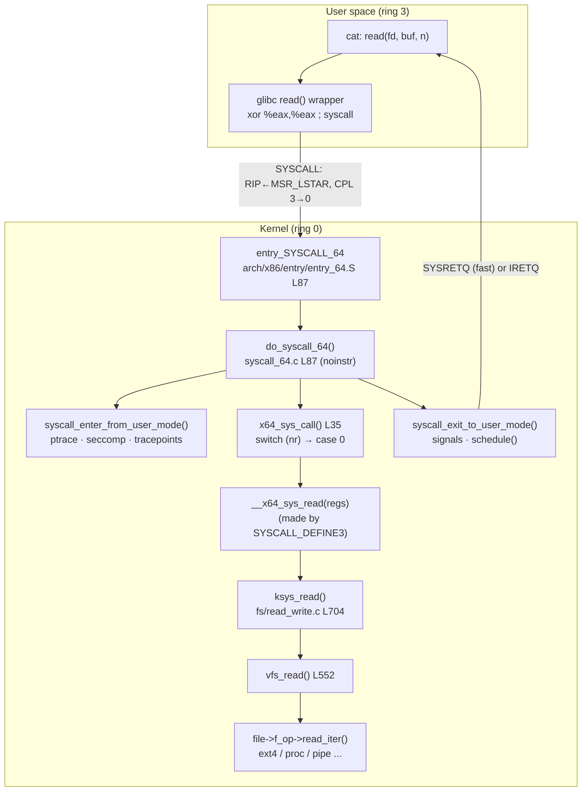

<div dir="rtl">

# ۰۱ — Kernel walkthrough: یک `read()` از فضای کاربر تا داخل لینوکس و برگشت

> نسخه‌های ثابت: Linux **v6.18.63** (`_shared/sources/linux/`) و OpenBSD **`8cada8c`** (`_shared/sources/openbsd/`). کل این فایل **ARCH-SPECIFIC (x86-64)** است.
> همهٔ بخش‌های کد با `bash _shared/sources/cite.sh <repo> <path> <symbol|Lnnn>` از checkout محلی چاپ و بدون تغییر کپی شده‌اند. نسخهٔ انگلیسی: [`kernel-walkthrough.en.md`](kernel-walkthrough.en.md). درس: [`lesson.fa.md`](lesson.fa.md).

## ۰. زنجیرهٔ فراخوانی

</div>



<div dir="rtl">

| گام | فایل · نماد | خط | Elixir |
|---|---|---|---|
| تنظیم MSR هنگام بوت | `arch/x86/kernel/cpu/common.c` · `idt_syscall_init()` | L2232 | [پیوند](https://elixir.bootlin.com/linux/v6.18.63/source/arch/x86/kernel/cpu/common.c#L2232) |
| ورود اسمبلی | `arch/x86/entry/entry_64.S` · `entry_SYSCALL_64` | L87 | [پیوند](https://elixir.bootlin.com/linux/v6.18.63/source/arch/x86/entry/entry_64.S#L87) |
| ورود C | `arch/x86/entry/syscall_64.c` · `do_syscall_64()` | L87 | [پیوند](https://elixir.bootlin.com/linux/v6.18.63/source/arch/x86/entry/syscall_64.c#L87) |
| توزیع | `arch/x86/entry/syscall_64.c` · `x64_sys_call()` | L35 | [پیوند](https://elixir.bootlin.com/linux/v6.18.63/source/arch/x86/entry/syscall_64.c#L35) |
| جدول شماره‌ها | `arch/x86/entry/syscalls/syscall_64.tbl` | L12 (`read`) | [پیوند](https://elixir.bootlin.com/linux/v6.18.63/source/arch/x86/entry/syscalls/syscall_64.tbl#L12) |
| سازندهٔ stub | `arch/x86/include/asm/syscall_wrapper.h` · `__SYS_STUBx` | L91 | [پیوند](https://elixir.bootlin.com/linux/v6.18.63/source/arch/x86/include/asm/syscall_wrapper.h#L91) |
| خود syscall | `fs/read_write.c` · `SYSCALL_DEFINE3(read, …)` | L722 | [پیوند](https://elixir.bootlin.com/linux/v6.18.63/source/fs/read_write.c#L722) |
| VFS | `fs/read_write.c` · `vfs_read()` | L552 | [پیوند](https://elixir.bootlin.com/linux/v6.18.63/source/fs/read_write.c#L552) |
| IRQ دستگاه | `arch/x86/kernel/irq.c` · `common_interrupt` | L318 | [پیوند](https://elixir.bootlin.com/linux/v6.18.63/source/arch/x86/kernel/irq.c#L318) |
| IRQ عمومی | `kernel/irq/handle.c` · `__handle_irq_event_percpu()` | L177 | [پیوند](https://elixir.bootlin.com/linux/v6.18.63/source/kernel/irq/handle.c#L177) |
| Context switch | `kernel/sched/core.c` · `context_switch()` | L5293 | [پیوند](https://elixir.bootlin.com/linux/v6.18.63/source/kernel/sched/core.c#L5293) |
| تعویض پشته | `arch/x86/entry/entry_64.S` · `__switch_to_asm` | L177 | [پیوند](https://elixir.bootlin.com/linux/v6.18.63/source/arch/x86/entry/entry_64.S#L177) |
| وضعیت رجیسترها | `arch/x86/kernel/process_64.c` · `__switch_to()` | L611 | [پیوند](https://elixir.bootlin.com/linux/v6.18.63/source/arch/x86/kernel/process_64.c#L611) |

---

## ۱. بوت: به CPU بگوییم `syscall` کجا فرود بیاید

**چرا مهم است:** دستور `syscall` هیچ آدرس مقصدی با خودش ندارد. CPU به آدرسی می‌پرد که کرنل در MSR به نام `IA32_LSTAR` نوشته است. این نوشتن یک بار برای هر CPU و هنگام بوت انجام می‌شود.

`linux/arch/x86/kernel/cpu/common.c · idt_syscall_init() · v6.18.63` (خط‌های L2232–2234 و بعد L2257–2265)

</div>

```c
static inline void idt_syscall_init(void)
{
	wrmsrq(MSR_LSTAR, (unsigned long)entry_SYSCALL_64);
```
```c
	wrmsrq(MSR_SYSCALL_MASK,
	       X86_EFLAGS_CF|X86_EFLAGS_PF|X86_EFLAGS_AF|
	       X86_EFLAGS_ZF|X86_EFLAGS_SF|X86_EFLAGS_TF|
	       X86_EFLAGS_IF|X86_EFLAGS_DF|X86_EFLAGS_OF|
	       X86_EFLAGS_IOPL|X86_EFLAGS_NT|X86_EFLAGS_RF|
	       X86_EFLAGS_AC|X86_EFLAGS_ID);
}
```

<div dir="rtl">

| خط | معنا |
|---|---|
| `wrmsrq(MSR_LSTAR, … entry_SYSCALL_64)` | مقصد `syscall` در حالت ۶۴ بیتی. از این به بعد هر `syscall` در ring 3 به `entry_SYSCALL_64` در ring 0 می‌پرد. |
| `MSR_SYSCALL_MASK` | بیت‌هایی از RFLAGS که CPU هنگام ورود **پاک** می‌کند. `X86_EFLAGS_IF` در فهرست است، پس کرنل با **interruptهای خاموش** شروع می‌کند. پاک شدن `AC` یعنی SMAP فعال است (دسترسی تصادفی به حافظهٔ کاربر ممنوع). پاک شدن `TF` یعنی کاربری که single-step می‌کند، کرنل را single-step نمی‌کند. |

`syscall_init()` (خط L2268) مقدار `MSR_STAR` (selectorهای کد و پشته) را هم می‌نویسد و وقتی **FRED** فعال باشد `idt_syscall_init()` را صدا نمی‌زند (L2280–2281). FRED سازوکار ورود جدیدی در CPUهای جدید Intel است (`arch/x86/entry/entry_fred.c`). **VERSION-DEPENDENT / ARCH-SPECIFIC:** مهمان VirtualBox ما از FRED استفاده نمی‌کند، پس همهٔ ادامهٔ این فایل مسیر کلاسیک است.

## ۲. `entry_SYSCALL_64`: اولین دستورهای کرنل

**چرا مهم است:** درست بعد از `syscall`، CPU در ring 0 است ولی هنوز روی **پشتهٔ کاربر**، با `GS` کاربر و (اگر PTI روشن باشد) جدول صفحهٔ کاربر. این حدود ۲۰ دستور کرنل را برای اجرای کد C امن می‌کنند.

`linux/arch/x86/entry/entry_64.S · entry_SYSCALL_64 · v6.18.63` (خط‌های L87–121؛ توضیح ABI رجیسترها در L50–85)

</div>

```asm
SYM_CODE_START(entry_SYSCALL_64)
	UNWIND_HINT_ENTRY
	ENDBR

	swapgs
	/* tss.sp2 is scratch space. */
	movq	%rsp, PER_CPU_VAR(cpu_tss_rw + TSS_sp2)
	SWITCH_TO_KERNEL_CR3 scratch_reg=%rsp
	movq	PER_CPU_VAR(cpu_current_top_of_stack), %rsp

SYM_INNER_LABEL(entry_SYSCALL_64_safe_stack, SYM_L_GLOBAL)
	ANNOTATE_NOENDBR

	/* Construct struct pt_regs on stack */
	pushq	$__USER_DS				/* pt_regs->ss */
	pushq	PER_CPU_VAR(cpu_tss_rw + TSS_sp2)	/* pt_regs->sp */
	pushq	%r11					/* pt_regs->flags */
	pushq	$__USER_CS				/* pt_regs->cs */
	pushq	%rcx					/* pt_regs->ip */
SYM_INNER_LABEL(entry_SYSCALL_64_after_hwframe, SYM_L_GLOBAL)
	pushq	%rax					/* pt_regs->orig_ax */

	PUSH_AND_CLEAR_REGS rax=$-ENOSYS
```

<div dir="rtl">

| خط | معنا |
|---|---|
| `ENDBR` | محل فرود مجاز برای پرش غیرمستقیم در CET (ردیابی پرش‌های غیرمستقیم). |
| `swapgs` | مقدار `GS.base` کاربر را با مقدار کرنل که در `MSR_KERNEL_GS_BASE` است عوض می‌کند. بعد از آن، `PER_CPU_VAR(...)` (که دسترسی با `%gs:` است) به دادهٔ per-CPU **همین CPU** می‌رسد. |
| `movq %rsp, …TSS_sp2` | اشاره‌گر پشتهٔ کاربر را در یک خانهٔ موقت per-CPU کنار می‌گذارد. `syscall` به `rsp` دست نمی‌زند (توضیح L65–66)، پس کرنل خودش باید این کار را بکند. |
| `SWITCH_TO_KERNEL_CR3` | با PTI (وصلهٔ Meltdown)، جدول صفحهٔ کاربر تقریباً هیچ بخشی از حافظهٔ کرنل را map نمی‌کند؛ این ماکرو (`calling.h` خط L173) `CR3` کرنل را بار می‌کند. وقتی PTI خاموش است، به یک `jmp` تبدیل می‌شود. |
| `movq …cpu_current_top_of_stack, %rsp` | رفتن به **پشتهٔ کرنل همین task**. از اینجا به بعد پشتهٔ کرنل داریم. |
| پنج `pushq` | همان قابی را که CPU در interrupt روی پشته می‌گذارد (`ss, sp, flags, cs, ip`) دستی می‌سازد تا بقیهٔ کرنل فقط یک قالب `struct pt_regs` ببیند. `rcx` همان RIP کاربر و `r11` همان RFLAGS کاربر است، چون `syscall` آن‌ها را آنجا گذاشته. |
| `pushq %rax` ← `orig_ax` | شمارهٔ syscall که حتی بعد از اینکه `ax` با مقدار برگشتی بازنویسی شود، باقی می‌ماند (همان چیزی که `strace` و `ptrace` می‌خوانند). |
| `PUSH_AND_CLEAR_REGS rax=$-ENOSYS` | بقیهٔ رجیسترهای عمومی را ذخیره و **صفر** می‌کند (هیچ مقدار کاربری برای gadgetهای حدسی در رجیسترها نمی‌ماند). `ax` با `-ENOSYS` شروع می‌شود که پاسخ شمارهٔ ناشناخته است. |

خط‌های بعدی (L111–121) مقدار `%rsp` (اشاره‌گر `pt_regs`) را در `%rdi` می‌گذارند، `eax` را با گسترش علامت در `%rsi` می‌گذارند (شمارهٔ syscall یک `int` است)، وصله‌های Spectre را اجرا می‌کنند (`IBRS_ENTER`، `UNTRAIN_RET`، `CLEAR_BRANCH_HISTORY`) و `call do_syscall_64` می‌کنند. در برگشت، `testb %al, %al` بین مسیر **SYSRET** (سریع) و مسیر عمومی **IRET** انتخاب می‌کند؛ خروج SYSRET در خط L166 (`sysretq`) است.

## ۳. `do_syscall_64()`: ورود به C

**چرا مهم است:** اینجا «یک syscall» به کار عمومی کرنل تبدیل می‌شود: hookهای ردیابی، توزیع، و حلقهٔ کار برگشت به کاربر که signal را تحویل می‌دهد و ممکن است **زمان‌بندی دوباره** کند.

`linux/arch/x86/entry/syscall_64.c · do_syscall_64() · v6.18.63` (L86–100)

</div>

```c
/* Returns true to return using SYSRET, or false to use IRET */
__visible noinstr bool do_syscall_64(struct pt_regs *regs, int nr)
{
	add_random_kstack_offset();
	nr = syscall_enter_from_user_mode(regs, nr);

	instrumentation_begin();

	if (!do_syscall_x64(regs, nr) && !do_syscall_x32(regs, nr) && nr != -1) {
		/* Invalid system call, but still a system call. */
		regs->ax = __x64_sys_ni_syscall(regs);
	}

	instrumentation_end();
	syscall_exit_to_user_mode(regs);
```

<div dir="rtl">

| خط | معنا |
|---|---|
| `noinstr` | `#define noinstr __noinstr_section(".noinstr.text")` (`include/linux/compiler_types.h` خط L417). هیچ hook از نوع ftrace یا kprobe نیست: کرنل هنوز در وضعیتی نیست که ردیابی امن باشد. برای همین `do_syscall_64` در `available_filter_functions` نیست (آزمایش ۰۵). |
| `add_random_kstack_offset()` | جابه‌جایی پشتهٔ کرنل را برای هر syscall تصادفی می‌کند (سخت‌سازی). |
| `syscall_enter_from_user_mode()` | به RCU و lockdep می‌گوید از حالت کاربر خارج شدیم، **interruptها را روشن می‌کند**، و فقط اگر پرچم کاری تنظیم شده باشد `syscall_trace_enter()` (`kernel/entry/syscall-common.c` خط L20) را اجرا می‌کند: **ptrace** (یعنی strace)، **seccomp**، **tracepoint** به نام `sys_enter` و audit. ممکن است `nr` را عوض کند (seccomp می‌تواند `-1` برگرداند تا فراخوانی رد شود). |
| `instrumentation_begin/end` | پنجره‌ای که ردیابی در آن **مجاز است**. |
| `do_syscall_x64` / `do_syscall_x32` | اول جدول ۶۴ بیتی، بعد جدول x32 را امتحان می‌کند؛ `nr == -1` یعنی «قبلاً رسیدگی یا رد شده». |
| `__x64_sys_ni_syscall` | یعنی «پیاده‌سازی نشده» و `-ENOSYS` برمی‌گرداند. شمارهٔ ناشناخته هم هزینهٔ کامل ورود و خروج را می‌پردازد (تمرین تکمیلی آزمایش ۰۴). |
| `syscall_exit_to_user_mode()` | حلقهٔ کار خروج (`kernel/entry/common.c` خط L19، `exit_to_user_mode_loop`): اگر `_TIF_NEED_RESCHED` تنظیم باشد `schedule()` (L30–31) و تحویل signal (L40). **برگشت از syscall نقطهٔ preemption است.** |

بقیهٔ تابع (L102–140) بین SYSRET و IRET تصمیم می‌گیرد. دو تا از بررسی‌ها:

`linux/arch/x86/entry/syscall_64.c · do_syscall_64() · v6.18.63` (L112–118)

</div>

```c
	/* SYSRET requires RCX == RIP and R11 == EFLAGS */
	if (unlikely(regs->cx != regs->ip || regs->r11 != regs->flags))
		return false;

	/* CS and SS must match the values set in MSR_STAR */
	if (unlikely(regs->cs != __USER_CS || regs->ss != __USER_DS))
		return false;
```

<div dir="rtl">

`sysret` مقدار RIP را از `rcx` و RFLAGS را از `r11` برمی‌گرداند، پس فقط وقتی قابل استفاده است که هیچ‌کس (ptrace یا آماده‌سازی signal) `regs->ip`/`flags` را عوض نکرده باشد. خط L128 آدرس RIP غیرکانونی را هم رد می‌کند: در Intel، اجرای `sysret` به آدرس غیرکانونی **در ring 0 و روی پشتهٔ کاربر** fault می‌دهد که الگوی شناخته‌شده‌ای برای ارتقای دسترسی است.

## ۴. جدول و توزیع‌کننده

**چرا مهم است:** شمارهٔ داخل `rax` خودِ ABI است. این شماره‌ها در یک فایل متنی تعریف شده‌اند و هنگام build به C تبدیل می‌شوند.

`linux/arch/x86/entry/syscalls/syscall_64.tbl · v6.18.63` (L5–15 و L51)

</div>

```text
# The format is:
# <number> <abi> <name> <entry point> [<compat entry point> [noreturn]]
#
# The __x64_sys_*() stubs are created on-the-fly for sys_*() system calls
#
# The abi is "common", "64" or "x32" for this file.
#
0	common	read			sys_read
1	common	write			sys_write
2	common	open			sys_open
3	common	close			sys_close
...
39	common	getpid			sys_getpid
```

<div dir="rtl">

`linux/arch/x86/entry/syscall_64.c · x64_sys_call() · v6.18.63` (L34–41 و L53–67)

</div>

```c
#define __SYSCALL(nr, sym) case nr: return __x64_##sym(regs);
long x64_sys_call(const struct pt_regs *regs, unsigned int nr)
{
	switch (nr) {
	#include <asm/syscalls_64.h>
	default: return __x64_sys_ni_syscall(regs);
	}
}
```
```c
static __always_inline bool do_syscall_x64(struct pt_regs *regs, int nr)
{
	/*
	 * Convert negative numbers to very high and thus out of range
	 * numbers for comparisons.
	 */
	unsigned int unr = nr;

	if (likely(unr < NR_syscalls)) {
		unr = array_index_nospec(unr, NR_syscalls);
		regs->ax = x64_sys_call(regs, unr);
		return true;
	}
	return false;
}
```

<div dir="rtl">

| خط | معنا |
|---|---|
| ستون‌های `.tbl` | شماره، ABI (`common` یعنی هم ۶۴ بیتی و هم x32)، نام، تابع C. `fstat` به `sys_newfstat` می‌رسد، پس نام و نقطهٔ ورود می‌توانند فرق کنند (آزمایش ۰۱ هر دو را چاپ می‌کند). |
| `#define __SYSCALL(nr, sym) case nr: …` | build از روی `.tbl` فایل `asm/syscalls_64.h` را به شکل فهرستی از خط‌های `__SYSCALL(0, sys_read)` می‌سازد؛ اینجا هر خط یک `case` می‌شود. |
| `switch (nr)` | فراخوانی غیرمستقیم از طریق `sys_call_table[]` **نیست**. توضیح خط‌های L23–27 می‌گوید جدول فقط برای ردیابی نگه داشته شده. `switch` به فراخوانی‌های مستقیم کامپایل می‌شود، پس هیچ پرش غیرمستقیم قابل‌آموزش برای مهاجم در مسیر syscall نیست. VERSION-DEPENDENT: کرنل‌های قدیمی‌تر (و بیشتر کتاب‌ها) `sys_call_table[nr](regs)` را نشان می‌دهند؛ `switch` در سال ۲۰۲۴ به‌عنوان وصلهٔ Branch History Injection آمد (نسخهٔ دقیق UNVERIFIED است؛ با `git log -S x64_sys_call -- arch/x86/entry/syscall_64.c` در یک clone از نوع blob-less بررسی کنید). |
| `unsigned int unr = nr` | عددهای منفی خیلی بزرگ می‌شوند، پس یک مقایسهٔ `<` هر دو حالت را رد می‌کند. |
| `array_index_nospec()` | اندیس را **حتی در اجرای حدسی** محدود می‌کند (Spectre v1). |
| `regs->ax = …` | مقدار برگشتی در `rax` ذخیره‌شده قرار می‌گیرد که `POP_REGS` پیش از `sysretq` آن را برمی‌گرداند. |

## ۵. از `SYSCALL_DEFINE3(read, …)` تا `vfs_read()`

**چرا مهم است:** هرگز تابعی با نام دقیق `sys_read(` در سورس پیدا نمی‌کنید. یک ماکرو از یک تعریف سه تابع می‌سازد.

`linux/fs/read_write.c · ksys_read() + SYSCALL_DEFINE3(read) · v6.18.63` (L704–725)

</div>

```c
ssize_t ksys_read(unsigned int fd, char __user *buf, size_t count)
{
	CLASS(fd_pos, f)(fd);
	ssize_t ret = -EBADF;

	if (!fd_empty(f)) {
		loff_t pos, *ppos = file_ppos(fd_file(f));
		if (ppos) {
			pos = *ppos;
			ppos = &pos;
		}
		ret = vfs_read(fd_file(f), buf, count, ppos);
		if (ret >= 0 && ppos)
			fd_file(f)->f_pos = pos;
	}
	return ret;
}

SYSCALL_DEFINE3(read, unsigned int, fd, char __user *, buf, size_t, count)
{
	return ksys_read(fd, buf, count);
}
```

<div dir="rtl">

| خط | معنا |
|---|---|
| `SYSCALL_DEFINE3(read, …)` | در x86 (`syscall_wrapper.h` خط L223) به سه تابع باز می‌شود: `__x64_sys_read(const struct pt_regs *regs)`، تابع `__se_sys_read(long, long, long)` (لایهٔ گسترش علامت و تبدیل نوع) و `__do_sys_read(unsigned int, char __user *, size_t)` (همین بدنه). |
| `char __user *buf` | `__user` برچسبی برای ابزار sparse است: این اشاره‌گر یک آدرس **کاربر** است و هرگز نباید مستقیم dereference شود. |
| `CLASS(fd_pos, f)(fd)` | پاک‌سازی خودکار بر اساس scope (یعنی `fdget_pos`/`fdput_pos` خودکار): fd را در جدول فایل task پیدا می‌کند و قفل موقعیت را می‌گیرد. |
| `ret = -EBADF` | خطاها **errno منفی** هستند. glibc مقدار `-9` را به `-1` و `errno = 9` تبدیل می‌کند (آزمایش ۰۲ هر دو را نشان می‌دهد). |
| `vfs_read(…)` | لایهٔ VFS (ماژول ۵): بررسی دسترسی، `access_ok(buf, count)`، بعد `file->f_op->read` یا `->read_iter`. |

باز کردن آرگومان‌ها فقط یک ماکرو است:

`linux/arch/x86/include/asm/syscall_wrapper.h · SC_X86_64_REGS_TO_ARGS · v6.18.63` (L56–59)

</div>

```c
#define SC_X86_64_REGS_TO_ARGS(x, ...)					\
	__MAP(x,__SC_ARGS						\
		,,regs->di,,regs->si,,regs->dx				\
		,,regs->r10,,regs->r8,,regs->r9)			\
```

<div dir="rtl">

پس آرگومان چهارم از **`r10`** می‌آید، نه از `rcx` که در قرارداد فراخوانی عادی C است: `syscall` قبلاً `rcx` را برای آدرس برگشت استفاده کرده (توضیح `entry_64.S` خط L75: «r10 arg3 (needs to be moved to rcx to conform to C ABI)»). تمرین تکمیلی آزمایش ۰۲ شما را دقیقاً به همین می‌رساند.

## ۶. interrupt و exception: جدول IDT

**چرا مهم است:** syscall یک ورود *درخواستی* است. interruptها (دستگاه، تایمر، IPI) و exceptionها (page fault، خطای تقسیم، breakpoint) ورودهای *ناخواسته* از طریق **IDT** هستند. مقدار DPL در هر ورودی IDT تعیین می‌کند آیا کد کاربر می‌تواند با `int N` آن را فعال کند.

`linux/arch/x86/kernel/idt.c · INTG / SYSG / def_idts · v6.18.63` (L32–38 و L84–86)

</div>

```c
/* Interrupt gate */
#define INTG(_vector, _addr)				\
	G(_vector, _addr, DEFAULT_STACK, GATE_INTERRUPT, DPL0, __KERNEL_CS)

/* System interrupt gate */
#define SYSG(_vector, _addr)				\
	G(_vector, _addr, DEFAULT_STACK, GATE_INTERRUPT, DPL3, __KERNEL_CS)
```
```c
static const __initconst struct idt_data def_idts[] = {
	INTG(X86_TRAP_DE,		asm_exc_divide_error),
	ISTG(X86_TRAP_NMI,		asm_exc_nmi, IST_INDEX_NMI),
```

<div dir="rtl">

| خط | معنا |
|---|---|
| `INTG(...)` با `DPL0` | گیتی که کد کاربر نمی‌تواند با `int N` به آن برسد (این کار `#GP` می‌دهد). ولی CPU همچنان می‌تواند آن را از ring 3 تحویل دهد (یک fault یا یک IRQ). |
| `SYSG(...)` با `DPL3` | کد کاربر **اجازه دارد** `int3` (`X86_TRAP_BP`، خط L65) و `into` (`X86_TRAP_OF`، خط L119) را اجرا کند. debuggerها از `int3` استفاده می‌کنند. |
| `GATE_INTERRUPT` | CPU هنگام ورود `IF` را پاک می‌کند، همان‌طور که `syscall` از طریق `MSR_SYSCALL_MASK` این کار را می‌کند. |
| `ISTG(..., IST_INDEX_NMI)` | NMI و `#DF` و `#MC` و `#DB` روی یک پشتهٔ اختصاصی از **Interrupt Stack Table** اجرا می‌شوند، چون ممکن است وقتی برسند که پشتهٔ فعلی قابل استفاده نیست. |
| `X86_TRAP_PF` ← `asm_exc_page_fault` | در x86-64 از `early_pf_idts[]` (خط L246) به شکل یک `INTG` نصب می‌شود و `exc_page_fault` در `arch/x86/mm/fault.c` خط L1483 به آن رسیدگی می‌کند (ماژول ۴). |

interruptهای دستگاه از بردارهای ۳۲ تا ۲۵۵ به یک handler در C می‌رسند:

`linux/arch/x86/kernel/irq.c · common_interrupt · v6.18.63` (L314–328)

</div>

```c
/*
 * common_interrupt() handles all normal device IRQ's (the special SMP
 * cross-CPU interrupts have their own entry points).
 */
DEFINE_IDTENTRY_IRQ(common_interrupt)
{
	struct pt_regs *old_regs = set_irq_regs(regs);

	/* entry code tells RCU that we're not quiescent.  Check it. */
	RCU_LOCKDEP_WARN(!rcu_is_watching(), "IRQ failed to wake up RCU");

	if (unlikely(!call_irq_handler(vector, regs)))
		apic_eoi();

	set_irq_regs(old_regs);
}
```

<div dir="rtl">

`call_irq_handler()` (خط L273) مقدار `vector_irq[vector]` را (برای هر CPU جدا) می‌خواند تا `struct irq_desc` را پیدا کند. بعد `generic_handle_irq_desc()` تابع جریان را صدا می‌زند (`handle_edge_irq` و `handle_fasteoi_irq` در `kernel/irq/chip.c`، خط‌های L823 و L736) و آن هم `handle_irq_event()` را:

`linux/kernel/irq/handle.c · __handle_irq_event_percpu() · v6.18.63` (L177–205)

</div>

```c
irqreturn_t __handle_irq_event_percpu(struct irq_desc *desc)
{
	irqreturn_t retval = IRQ_NONE;
	unsigned int irq = desc->irq_data.irq;
	struct irqaction *action;

	record_irq_time(desc);

	for_each_action_of_desc(desc, action) {
		irqreturn_t res;

		/*
		 * If this IRQ would be threaded under force_irqthreads, mark it so.
		 */
		if (irq_settings_can_thread(desc) &&
		    !(action->flags & (IRQF_NO_THREAD | IRQF_PERCPU | IRQF_ONESHOT)))
			lockdep_hardirq_threaded();

		trace_irq_handler_entry(irq, action);

		if (static_branch_unlikely(&irqhandler_duration_check_enabled)) {
			u64 ts_start = local_clock();

			res = action->handler(irq, action->dev_id);
			irqhandler_duration_check(ts_start, irq, action);
		} else {
			res = action->handler(irq, action->dev_id);
```

<div dir="rtl">

| خط | معنا |
|---|---|
| `for_each_action_of_desc` | یک خط IRQ مشترک ممکن است چند `irqaction` داشته باشد (چند درایور)؛ از همه پرسیده می‌شود. |
| `trace_irq_handler_entry(irq, action)` | **همان** tracepoint به نام `irq:irq_handler_entry` که آزمایش ۰۳ با `perf stat -e 'irq:*'` می‌شمارد. |
| `action->handler(irq, action->dev_id)` | نیمهٔ بالایی (top half) درایور که با `request_irq()` ثبت شده و با interruptهای خاموش اجرا می‌شود. |
| `IRQ_WAKE_THREAD` (L213–223) | handler درخواست می‌کند که نیمهٔ پایینی **نخ‌دار** آن (نخ کرنل `irq/NN-name`) بعداً اجرا شود. |

سپس `handle_irq_event_percpu()` (خط L236) تابع `add_interrupt_randomness()` (زمان‌بندی interruptها به مولد عدد تصادفی خوراک می‌دهد) و `note_interrupt()` (تشخیص IRQ ساختگی) را صدا می‌زند. شمارنده‌های per-CPU که در `/proc/interrupts` چاپ می‌شوند را توابع جریان افزایش می‌دهند (`kstat_incr_irqs_this_cpu()`).

## ۷. Context switch: `context_switch()` ← `__switch_to_asm` ← `__switch_to()`

**چرا مهم است:** این تنها جایی است که یک task روی CPU متوقف می‌شود و task دیگری شروع می‌کند. **دو** چیز عوض می‌شود: فضای آدرس (`CR3`) و پشتهٔ کرنل به‌همراه رجیسترها.

`linux/kernel/sched/core.c · context_switch() · v6.18.63` (L5314–5333)

</div>

```c
	if (!next->mm) {                                // to kernel
		enter_lazy_tlb(prev->active_mm, next);

		next->active_mm = prev->active_mm;
		if (prev->mm)                           // from user
			mmgrab_lazy_tlb(prev->active_mm);
		else
			prev->active_mm = NULL;
	} else {                                        // to user
		membarrier_switch_mm(rq, prev->active_mm, next->mm);
		/*
		 * sys_membarrier() requires an smp_mb() between setting
		 * rq->curr / membarrier_switch_mm() and returning to userspace.
		 *
		 * The below provides this either through switch_mm(), or in
		 * case 'prev->active_mm == next->mm' through
		 * finish_task_switch()'s mmdrop().
		 */
		switch_mm_irqs_off(prev->active_mm, next->mm, next);
		lru_gen_use_mm(next->mm);
```

<div dir="rtl">

| خط | معنا |
|---|---|
| `if (!next->mm)` | یک **نخ کرنل** فضای آدرس کاربر ندارد. فضای قبلی (`active_mm`) را قرض می‌گیرد، یعنی **lazy TLB**: نه نوشتن `CR3`، نه خالی کردن TLB. |
| `switch_mm_irqs_off(...)` | برای task کاربر: `arch/x86/mm/tlb.c` خط L782. در نهایت به `load_new_mm_cr3()` ← `write_cr3()` (خط L581) می‌رسد. با PCID، ورودی‌های TLB به‌جای پاک شدن با ASID برچسب می‌خورند (ماژول ۴). نخ‌های یک پردازه `mm` مشترک دارند؛ شاخهٔ `prev == next` (خط L840) معمولاً نوشتن `CR3` را رد می‌کند. |
| `switch_to(prev, next, prev)` | (خط L5349) در `arch/x86/include/asm/switch_to.h` خط L49 تعریف شده: `((last) = __switch_to_asm((prev), (next)))`. |

`linux/arch/x86/entry/entry_64.S · __switch_to_asm · v6.18.63` (L177–192)

</div>

```asm
SYM_FUNC_START(__switch_to_asm)
	ANNOTATE_NOENDBR
	/*
	 * Save callee-saved registers
	 * This must match the order in inactive_task_frame
	 */
	pushq	%rbp
	pushq	%rbx
	pushq	%r12
	pushq	%r13
	pushq	%r14
	pushq	%r15

	/* switch stack */
	movq	%rsp, TASK_threadsp(%rdi)
	movq	TASK_threadsp(%rsi), %rsp
```

<div dir="rtl">

| خط | معنا |
|---|---|
| شش `pushq` | فقط رجیسترهای **callee-saved**. بقیه را کامپایلر C در محل فراخوانی ذخیره کرده، یا در `pt_regs` بالای پشتهٔ کرنل task هستند. |
| `movq %rsp, TASK_threadsp(%rdi)` | یعنی `prev->thread.sp = rsp`. حالا `prev` وسط همین تابع «یخ زده» است. |
| `movq TASK_threadsp(%rsi), %rsp` | **خودِ سوئیچ.** از این دستور به بعد روی پشتهٔ کرنل `next` اجرا می‌کنیم. |
| (L209–216) شش `popq` و بعد `jmp __switch_to` | رجیسترهای ذخیره‌شدهٔ `next` (که هنگام خارج شدن **خودش** push شده بودند) را pop می‌کند و با tail-jump به C می‌رود. وقتی `__switch_to` برمی‌گردد، به فراخوانی قدیمی `context_switch()` در `next` برمی‌گردد. |

`linux/arch/x86/kernel/process_64.c · __switch_to() · v6.18.63` (L669–675)

</div>

```c
	/*
	 * Switch the PDA and FPU contexts.
	 */
	raw_cpu_write(current_task, next_p);
	raw_cpu_write(cpu_current_top_of_stack, task_top_of_stack(next_p));

	/* Reload sp0. */
	update_task_stack(next_p);
```

<div dir="rtl">

| خط | معنا |
|---|---|
| `current_task` | متغیر per-CPU که پشت `current` است. |
| `cpu_current_top_of_stack` | **همان مقداری که `entry_SYSCALL_64` در `%rsp` بار می‌کند** (بخش ۲). به‌خاطر همین خط، syscall بعدی روی این CPU روی پشتهٔ کرنل `next` فرود می‌آید. |
| `update_task_stack()` | در x86-64 جز زیر Xen PV کاری نمی‌کند: `TSS.sp0` همیشه به پشتهٔ trampoline ورودِ هر CPU اشاره می‌کند (`switch_to.h` خط L71) و کد ورود بعداً به `cpu_current_top_of_stack` می‌رود. |
| خط‌های قبلی (L620–664) | `switch_fpu()` (وضعیت FPU را اینجا ذخیره می‌کند و بازگرداندنش را تا برگشت به کاربر عقب می‌اندازد)، `save_fsgs()`/`x86_fsgsbase_load()` (پایهٔ `FS` برای thread-local storage) و `load_TLS()`. |

`__switch_to` با `__notrace_funcgraph` علامت خورده است (خط L610): function_graph نمی‌تواند آن را ردیابی کند، چون «برگشت» آن به task دیگری غیر از «فراخوانی‌کننده» می‌رود.

---

## ۸. مقایسه با OpenBSD

### ۸.۱ جدول syscall

</div>

<table><tr><th>Linux — <code>arch/x86/entry/syscalls/syscall_64.tbl</code> · v6.18.63 (L12–15)</th><th>OpenBSD — <code>sys/kern/syscalls.master</code> · 8cada8c (L49–53)</th></tr>
<tr><td>

```text
0	common	read			sys_read
1	common	write			sys_write
2	common	open			sys_open
3	common	close			sys_close
```

</td><td>

```text
0	UNIMPL		syscall
1	STD		{ void sys_exit(int rval); }
2	STD		{ int sys_fork(void); }
3	STD NOLOCK	{ ssize_t sys_read(int fd, void *buf, size_t nbyte); }
```

</td></tr></table>

<div dir="rtl">

- شماره‌های لینوکس **برای هر معماری جداست** (`read` در x86-64 برابر ۰، در i386 برابر ۳، و arm64 از جدول عمومی استفاده می‌کند). OpenBSD **یک جدول مستقل از ماشین** دارد؛ `read` همه‌جا ۳ است، یعنی همان شمارهٔ قدیمی 4.4BSD.
- فایل اصلی OpenBSD نمونهٔ اولیهٔ C و پرچم `NOLOCK` (اجرا بدون قفل بزرگ کرنل) را هم دارد. جدول لینوکس فقط نام را دارد و آرگومان‌ها از `SYSCALL_DEFINEn` می‌آیند.
- شمارهٔ ۰ در OpenBSD برابر `UNIMPL syscall` است: ورودی غیرمستقیم `syscall(2)` حذف شده تا برنامه نتواند پنهان کند کدام فراخوانی را انجام می‌دهد. `syscall(3)` در glibc لینوکس برعکس است: هر شماره‌ای، از هر جایی.

### ۸.۲ ورود اسمبلی

</div>

<table><tr><th>Linux — <code>entry_64.S</code> · <code>entry_SYSCALL_64</code> (L91–95)</th><th>OpenBSD — <code>sys/arch/amd64/amd64/locore.S</code> · <code>Xsyscall</code> (L543–554)</th></tr>
<tr><td>

```asm
	swapgs
	/* tss.sp2 is scratch space. */
	movq	%rsp, PER_CPU_VAR(cpu_tss_rw + TSS_sp2)
	SWITCH_TO_KERNEL_CR3 scratch_reg=%rsp
	movq	PER_CPU_VAR(cpu_current_top_of_stack), %rsp
```

</td><td>

```asm
GENTRY(Xsyscall)
	endbr64
	swapgs
	movq	%rax,CPUVAR(SCRATCH)
	SYSCALL_ENTRY			/* create trapframe */
	sti

	movq	CPUVAR(CURPROC),%r14
	movq	%rsp,P_MD_REGS(%r14)	# save pointer to frame
	andl	$~MDP_IRET,P_MD_FLAGS(%r14)
	movq	%rsp,%rdi
	call	syscall
```

</td></tr></table>

<div dir="rtl">

سخت‌افزار یکسان، اولین حرکت‌های یکسانی را تحمیل می‌کند: `swapgs`، کنار گذاشتن یک رجیستر در خانهٔ موقت per-CPU، بار کردن پشتهٔ کرنل و ساختن یک قاب (`pt_regs` در برابر `struct trapframe`). نسخهٔ Meltdown در OpenBSD یعنی `XUsyscall_meltdown` (L516–533) صفحهٔ جداگانه‌ای است که در جدول صفحهٔ کاربر map شده و فقط `CR3` کرنل را بار می‌کند؛ همان ایدهٔ `SWITCH_TO_KERNEL_CR3` در PTI لینوکس. OpenBSD دستور `sti` را در اسمبلی اجرا می‌کند؛ لینوکس interruptها را بعداً در C روشن می‌کند (`syscall_enter_from_user_mode`).

### ۸.۳ توزیع‌کننده در C

`openbsd/sys/arch/amd64/amd64/trap.c · syscall() · 8cada8c` (L794–822)

</div>

```c
	code = frame->tf_rax;
	args = (register_t *)&frame->tf_rdi;

	if (code <= 0 || code >= SYS_MAXSYSCALL)
		goto bad;
	callp = sysent + code;

	rval[0] = 0;
	rval[1] = 0;

	error = mi_syscall(p, code, callp, args, rval);

	switch (error) {
	case 0:
		frame->tf_rax = rval[0];
		frame->tf_rflags &= ~PSL_C;	/* carry bit */
		break;
	case ERESTART:
		/* Back up over the syscall instruction (2 bytes) */
		frame->tf_rip -= 2;
		break;
	case EJUSTRETURN:
		/* nothing to do */
		break;
	default:
	bad:
		frame->tf_rax = error;
		frame->tf_rflags |= PSL_C;	/* carry bit */
		break;
```

<div dir="rtl">

`openbsd/sys/sys/syscall_mi.h · mi_syscall() · 8cada8c` (L164–178)

</div>

```c
	if ((error = pin_check(p, code)))
		return (error);

	pledged = (p->p_p->ps_flags & PS_PLEDGE);
	if (pledged && (error = pledge_syscall(p, code, &tval))) {
		KERNEL_LOCK();
		error = pledge_fail(p, error, tval);
		KERNEL_UNLOCK();
		return (error);
	}
	if (lock)
		KERNEL_LOCK();
	error = (*callp->sy_call)(p, argp, retval);
	if (lock)
		KERNEL_UNLOCK();
```

<div dir="rtl">

| خط | معنا |
|---|---|
| `callp = sysent + code` | یک **فراخوانی غیرمستقیم از طریق جدول** (`sy_call`)، همان طراحی کلاسیکی که لینوکس با `switch` جایگزین کرد. |
| بیت carry یعنی `PSL_C` | OpenBSD **errno مثبت و بیت carry روشن** برمی‌گرداند و libc بیت carry را بررسی می‌کند. لینوکس **errno منفی در `rax`** برمی‌گرداند، بدون پرچم. |
| `frame->tf_rip -= 2` | حالت `ERESTART`: به اندازهٔ دو بایت opcode دستور `syscall` عقب می‌رود تا بعد از signal دوباره اجرا شود. لینوکس همین کار را با رسیدگی به `-ERESTARTSYS` هنگام تحویل signal می‌کند. |
| `pin_check()` | **pinsyscalls**: کرنل بررسی می‌کند این شمارهٔ syscall دقیقاً از همان آدرسی در libc یا ld.so صادر شده که برایش ثبت شده (L55–104). لینوکس معادلی ندارد. |
| `pledge_syscall()` | قول‌های pledge(2) در **هر** فراخوانی بررسی می‌شوند (ماژول ۷؛ معادل لینوکس: seccomp در `syscall_trace_enter`). |
| `KERNEL_LOCK()` مگر با `NOLOCK` | قفل بزرگ کرنل هنوز برای فراخوانی‌هایی که در `syscalls.master` علامت `NOLOCK` ندارند گرفته می‌شود. لینوکس BKL خود را در v2.6.39 حذف کرد. |

### ۸.۴ Context switch

`openbsd/sys/arch/amd64/amd64/locore.S · cpu_switchto · 8cada8c` (L265–278)

</div>

```asm
ENTRY(cpu_switchto)
	pushq	%rbx
	pushq	%rbp
	pushq	%r12
	pushq	%r13
	pushq	%r14
	pushq	%r15

	movq	%rdi, %r13
	movq	%rsi, %r12

	/* Record new proc. */
	movb	$SONPROC,P_STAT(%r12)	# p->p_stat = SONPROC
	SET_CURPROC(%r12,%rcx)
```

<div dir="rtl">

همان push رجیسترهای callee-saved مثل `__switch_to_asm`. تفاوت: OpenBSD کل سوئیچ (پشته، FPU با `fxsave64`، بازنشانی segmentها، `CR3` از طریق pmap) را در یک تابع اسمبلی انجام می‌دهد (L265–466)، در حالی که لینوکس آن را به C عمومی (`context_switch()`)، یک جابه‌جایی پشتهٔ ۴۰ خطی در اسمبلی، و C وابسته به معماری (`__switch_to()`) تقسیم کرده است.

### ۸.۵ Trade-offها

| انتخاب طراحی | Linux v6.18.63 | OpenBSD 8cada8c | Trade-off |
|---|---|---|---|
| شماره‌گذاری syscall | `.tbl` جدا برای هر معماری (`read`=0 در x86-64) | یک `syscalls.master` مستقل از ماشین (`read`=3) | لینوکس: آزادی برای هر معماری؛ شماره‌ها برای همیشه ثابت (ABI فضای کاربر هرگز شکسته نمی‌شود). OpenBSD: یک جدول برای ممیزی، بدون قول سازگاری باینری بین نسخه‌ها. |
| توزیع | `switch` در `x64_sys_call()` | فراخوانی غیرمستقیم `sysent[code].sy_call` | `switch` هزینهٔ وصله‌های پرش غیرمستقیم (Spectre-v2) را ندارد؛ جدول ساده‌تر و کوچک‌تر است. |
| برگرداندن خطا | `-errno` در `rax` | `errno` در `rax` به‌اضافهٔ بیت carry | اطلاعات یکسان. لینوکس به رجیستر پرچم نیاز ندارد؛ بازهٔ ‎−4095..−1 رزرو است. |
| چه کسی می‌تواند فراخوانی کند | هر کس، از هر آدرسی (`syscall(3)`) | pinsyscalls: برای هر شماره فقط محل فراخوانی ثبت‌شده در libc | OpenBSD حمله‌هایی از نوع ROP یعنی «syscall از هر جا» را می‌کُشد؛ لینوکس `syscall` خام را برای JITها، Go و باینری‌های static نگه می‌دارد و seccomp سیاست را اعمال می‌کند. |
| سیاست برای هر فراخوانی | seccomp-BPF (فیلتر اختیاری، فقط در مسیر کند) | pledge (قول اختیاری) + بررسی pin همیشه | فیلترهای BPF انعطاف‌پذیرند ولی نوشتنشان سخت است؛ pledge ساده و درشت‌دانه است. |
| قفل | قفل سراسری ندارد | `KERNEL_LOCK()` مگر با `NOLOCK` | لینوکس روی تعداد زیادی هسته مقیاس‌پذیر است؛ OpenBSD مقیاس‌پذیری را با کد ساده‌تر و قابل ممیزی معاوضه می‌کند و قفل را فراخوانی به فراخوانی برمی‌دارد. |
| handler وقفه | فهرست `irqaction`، handler نخ‌دار اختیاری | `intr_handler()` مگر با `IPL_MPSAFE` قفل `kernel_lock` را می‌گیرد (`intr.c` خط‌های L553–560) | همان الگو: لینوکس مهاجرت را تمام کرده و OpenBSD وسط راه است. |
| Context switch | C + اسمبلی کوچک + C معماری | یک تابع اسمبلی | لینوکس: منطق عمومی مشترک بین بیش از ۲۰ معماری. OpenBSD: همه‌چیز amd64 در یک جای خوانا. |

## ۹. خودتان بررسی کنید

</div>

```bash
cd _shared/sources
bash cite.sh linux arch/x86/entry/syscall_64.c do_syscall_64 15
bash cite.sh linux arch/x86/entry/entry_64.S L87 35
git -C linux grep -n "SYSCALL_DEFINE3(read,"
bash cite.sh openbsd sys/arch/amd64/amd64/trap.c syscall 48
# on the VM
grep -w -e do_syscall_64 -e x64_sys_call -e __x64_sys_read /proc/kallsyms
grep -c -w do_syscall_64 /sys/kernel/tracing/available_filter_functions   # 0 (noinstr)
```
