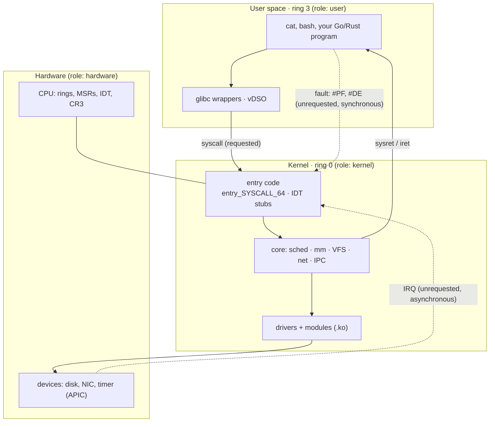
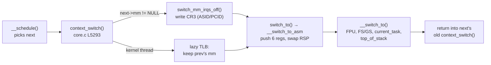

# 01 — Architecture & Kernel Structure

> Course: Advanced Operating Systems · Term 1 · Pins: Linux **v6.18.63**, OpenBSD **`8cada8c`** · Arch: **x86-64** (ARCH-SPECIFIC unless stated)
> Time: ~13 h (lesson 2 h · notes 4 h · walkthrough 2 h · labs 5 h) · Persian: [`lesson.fa.md`](lesson.fa.md) · Slides: [`slides/`](slides/)
> **Depends on:** Module 00 (the `aos-lab` VM, the tools, `cite.sh`). **Used by:** Module 02 (context switch, `task_struct`), Module 04 (privilege levels, `CR3`, page-fault exception), Module 05 (`vfs_read`), Module 07 (seccomp sits in the syscall entry path).

## Learning objectives

- Explain why an OS needs two CPU privilege levels and what exactly the CPU checks (`CPL`, page `U/S` bit, gate `DPL`).
- Classify every way into the kernel: system call, exception (fault/trap/abort), hardware interrupt, IPI, and name the x86-64 mechanism for each (`syscall`/MSR, IDT vector).
- Follow one `read()` from the libc wrapper through `entry_SYSCALL_64` → `do_syscall_64()` → `x64_sys_call()` → `vfs_read()` and back, in the real v6.18.63 source.
- Say what a context switch saves and switches (callee-saved registers, kernel stack, `CR3`), and where in the source.
- Compare monolithic, microkernel, hybrid and exokernel designs, and place Linux and OpenBSD on that map with their trade-offs.
- Measure it: syscall cost, vDSO vs real syscall, interrupt rates, and a function-graph trace of `vfs_read`.

## Glossary

| Term | Definition |
|---|---|
| **Kernel** | The program that runs in the CPU's privileged mode and owns the hardware; everything else asks it for service. |
| **User mode / kernel mode** | The two privilege levels Linux uses: ring 3 (applications) and ring 0 (kernel). |
| **Ring / `CPL`** | x86 privilege level 0–3. The Current Privilege Level is the low 2 bits of the `CS` selector. |
| **System call (syscall)** | A deliberate, numbered request from user code to the kernel, entered with the `syscall` instruction on x86-64. |
| **`syscall` / `sysret`** | x86-64 instructions for the fast entry to ring 0 and the fast return to ring 3. |
| **MSR** | Model-Specific Register, written with `wrmsr`; `IA32_LSTAR` holds the `syscall` target address. |
| **Interrupt** | An asynchronous signal from a device, a timer or another CPU (IPI); it arrives between instructions. |
| **Exception** | A synchronous event caused by the current instruction: a **fault** (re-executed, e.g. page fault), a **trap** (reported after, e.g. `int3`), or an **abort** (fatal, e.g. machine check). |
| **IDT** | Interrupt Descriptor Table: 256 gates; each says which kernel address handles vector N and which ring may raise it with `int N`. |
| **`pt_regs`** | The struct on the kernel stack holding the user registers saved at entry. |
| **Context switch** | Stopping one task on a CPU and resuming another: kernel stack, registers and possibly the address space (`CR3`). |
| **`CR3`** | The control register that points to the current top-level page table. Writing it switches the address space. |
| **vDSO** | A small shared library the kernel maps into every process so some calls (`clock_gettime`) run without entering the kernel. |
| **PTI** | Page Table Isolation (Meltdown fix): separate user/kernel page tables, so each entry and exit switches `CR3`. |
| **Monolithic kernel** | All core services (scheduler, memory, FS, drivers, network) run in one privileged address space. |
| **Microkernel** | Only IPC, scheduling and address spaces in the kernel; drivers and file systems are user-space servers. |
| **Loadable module** | Kernel code (`.ko`) linked into the running monolithic kernel at run time; it runs in ring 0 with full privilege. |
| **`noinstr`** | Linux annotation that puts a function in `.noinstr.text`, where tracing hooks are not allowed. |

## 1. Big picture



There are exactly three ways into ring 0, and every one ends in the same place: a saved `pt_regs` on the task's kernel stack, then C code, then a return path that may switch to another task.

## 2. Concepts

### 2.1 Why does the CPU need two modes at all?

If any program could write `CR3`, disable interrupts (`cli`) or program the disk controller, one bug would take down everything. So the CPU enforces privilege in hardware:

| Check | Where the CPU looks | What fails |
|---|---|---|
| Privileged instruction (`cli`, `mov %cr3`, `wrmsr`, `hlt`) | `CPL` must be 0 | `#GP` exception → kernel sends `SIGSEGV` |
| Memory access | page-table entry `U/S` bit (+ SMAP/SMEP) | `#PF` exception |
| `int N` from user code | gate `DPL` in the IDT entry ≥ `CPL` | `#GP` |
| I/O ports (`in`/`out`) | `IOPL` in RFLAGS / TSS I/O bitmap | `#GP` |

x86 has four rings; Linux and OpenBSD use only 0 and 3 (the page tables only know "user" and "supervisor"). → note [02-privilege-rings-cpl](notes/02-privilege-rings-cpl.en.md).

### 2.2 What happens when a program calls `read()`?

```mermaid
sequenceDiagram
  participant P as cat (ring 3)
  participant L as glibc read()
  participant C as CPU
  participant E as entry_SYSCALL_64
  participant D as do_syscall_64()
  participant V as ksys_read → vfs_read
  P->>L: read(3, buf, 131072)
  L->>C: rax=0, rdi=3, rsi=buf, rdx=131072; syscall
  C->>E: rcx=user RIP, r11=RFLAGS, CPL=0, RIP=MSR_LSTAR
  E->>E: swapgs, kernel stack, build pt_regs
  E->>D: do_syscall_64(regs, 0)
  D->>D: syscall_enter_from_user_mode (ptrace, seccomp)
  D->>V: x64_sys_call → __x64_sys_read(regs)
  V-->>D: bytes read (or -errno) in regs->ax
  D->>D: syscall_exit_to_user_mode (signals, maybe schedule())
  D-->>E: true = SYSRET is safe
  E-->>P: sysretq: back to the instruction after syscall
```

Three things to remember:

1. **The ABI is registers.** Number in `rax`; arguments in `rdi, rsi, rdx, r10, r8, r9`; result in `rax`; `rcx` and `r11` are destroyed. Errors come back as `-4095..-1`; glibc converts them to `-1` + `errno`.
2. **The kernel builds the same `pt_regs` for every entry.** That's why `strace`, signals and `ptrace` work the same for syscalls, faults and interrupts.
3. **Return is a scheduling point.** Before `sysret`, the kernel checks "does anyone need this CPU more?" (`_TIF_NEED_RESCHED`). → notes [04-syscall-path](notes/04-syscall-path.en.md); walkthrough §2–§5.

### 2.3 Interrupt, exception, trap, fault: what's the difference?

| | Cause | Timing | Example (vector) | Return to |
|---|---|---|---|---|
| **Syscall** | `syscall` instruction | synchronous, requested | `read` (not via IDT on x86-64) | next instruction |
| **Fault** | current instruction can't complete | synchronous | page fault `#PF` (14), `#GP` (13), `#DE` (0) | **same** instruction (retry) |
| **Trap** | instruction finished, report it | synchronous | breakpoint `int3` `#BP` (3) | next instruction |
| **Abort** | hardware can't recover | synchronous | machine check `#MC` (18), double fault `#DF` (8) | no return |
| **Interrupt** | device / timer / other CPU | **asynchronous** | local timer (`LOC`), NIC, disk; IPIs (`RES`, `CAL`, `TLB`) | interrupted instruction |

All of them except `syscall` go through the **IDT**. `/proc/interrupts` counts interrupts; exceptions show up as `page-faults` in `perf stat` and as tracepoints (`exceptions:page_fault_user`). → note [03-interrupts-exceptions-traps](notes/03-interrupts-exceptions-traps.en.md); lab 03.

### 2.4 Why is `clock_gettime()` 10× cheaper than `getpid()`?

Because it usually never enters the kernel. The **vDSO** is code + a data page (time values the kernel updates on each tick) mapped into every process. `clock_gettime(CLOCK_MONOTONIC)` reads the TSC and that page in ring 3. If the clock source can't be read from user mode, the vDSO falls back to a real `syscall`. Lab 04 measures the three costs: empty loop < vDSO < real syscall.

### 2.5 What does a context switch actually switch?



User registers are already saved in `pt_regs` (the task entered the kernel to get here). The switch itself saves only **6 callee-saved registers** and swaps the **kernel stack pointer**; `CR3` changes only if the next task has a different `mm`. Threads of the same process skip the `CR3` write. → note [05-context-switch](notes/05-context-switch.en.md); walkthrough §7. Cost measurement is Module 02 lab 3.

### 2.6 Monolithic, microkernel, hybrid: where do Linux and OpenBSD sit?

| | Monolithic (Linux, OpenBSD, FreeBSD) | Microkernel (seL4, QNX, MINIX 3) | Hybrid (XNU, Windows NT) | Exokernel / library OS (MIT Aegis, Unikraft-style) |
|---|---|---|---|---|
| In ring 0 | everything: sched, mm, FS, net, drivers | IPC, scheduling, address spaces | microkernel core + most services in kernel space | only secure multiplexing of hardware |
| A driver bug | can crash/compromise the kernel | restarts one user-space server | usually like monolithic | stays in the application's libOS |
| Cost of a "read" | 1 syscall | ≥ 2 IPC messages (client → FS server → disk driver) | 1 trap | library call, maybe no trap |
| Extensibility | loadable modules (`.ko`), eBPF | add servers | kexts / drivers | per-app libOS |

Linux is **monolithic but modular**: `.ko` modules are linked into the same address space at run time, and eBPF adds verified code without a module. → note [01-kernel-types](notes/01-kernel-types.en.md).

### 2.7 Where is everything in the Linux tree?

| Directory | What lives there | This module touches |
|---|---|---|
| `arch/x86/` | entry code, IDT, context-switch asm, page-table code for x86 | `entry/`, `kernel/`, `mm/tlb.c` |
| `kernel/` | scheduler, fork, signals, generic IRQ, entry work loop | `sched/core.c`, `irq/handle.c`, `entry/` |
| `mm/` | memory management (Module 4) | — |
| `fs/` | VFS + file systems (Module 5) | `read_write.c` |
| `include/linux/` | shared headers, macros | `syscalls.h`, `compiler_types.h` |
| `drivers/`, `net/`, `block/` | devices, networking, block layer | — |

→ note [06-linux-source-tree-map](notes/06-linux-source-tree-map.en.md).

## 3. Where this lives in Linux

The [kernel walkthrough](kernel-walkthrough.en.md) reads, line by line: `idt_syscall_init()` (MSR setup) → `entry_SYSCALL_64` → `do_syscall_64()` → `x64_sys_call()` and `syscall_64.tbl` → `SYSCALL_DEFINE3(read)` → `vfs_read()`; then the IDT (`idt.c`), `common_interrupt` and `__handle_irq_event_percpu()`; then `context_switch()` → `__switch_to_asm` → `__switch_to()`; and compares each with OpenBSD's `syscalls.master`, `Xsyscall`, `syscall()`/`mi_syscall()` and `cpu_switchto`.

| Lab | What you'll see on the VM |
|---|---|
| [01 strace map](labs/01-strace-map/README.md) | every syscall of `cat` → number → `__x64_sys_*` symbol in `/proc/kallsyms` |
| [02 raw syscall](labs/02-raw-syscall/README.md) | the register ABI with inline asm; `-errno` vs `errno` |
| [03 interrupts](labs/03-interrupts/README.md) | `/proc/interrupts` deltas, `irq:*` tracepoints, faults vs interrupts |
| [04 syscall cost](labs/04-syscall-cost/README.md) | ns per call: loop vs vDSO vs syscall, with and without `strace` |
| [05 ftrace vfs_read](labs/05-ftrace-vfs-read/README.md) | function-graph of one `vfs_read()` down to the file system |

## 4. Common misconceptions

| Misconception | Reality |
|---|---|
| "A syscall is a context switch." | A syscall is a **mode switch** in the same task: same `task_struct`, same `CR3` (without PTI). A context switch changes the task. A syscall *may* lead to one (blocking `read`, or `need_resched` on exit). |
| "The kernel is a process." | The kernel is code + data mapped in every process's address space, entered by traps. Kernel *threads* (`kworker`, `ksoftirqd`) are tasks, but "the kernel" isn't one. |
| "Linux dispatches syscalls via `sys_call_table[nr]()`." | Not on x86-64 v6.18: `x64_sys_call()` is a `switch` (syscall_64.c L35). The table survives only for tracing. VERSION-DEPENDENT. |
| "`int 0x80` is how Linux syscalls work." | That's the 32-bit legacy path (IDT vector `0x80` → `do_int80_emulation()`, `arch/x86/entry/syscall_32.c` L129). 64-bit code uses `syscall`; the IDT is not involved. |
| "Microkernels are always slow." | Early Mach was. L4/seL4 IPC is a few hundred cycles; the cost is in the *number* of crossings, not one crossing. |
| "Loadable modules make Linux a microkernel." | Modules run in ring 0 in the kernel address space with no isolation. A module bug is a kernel bug. |
| "Interrupts and exceptions are the same thing." | Both use the IDT, but exceptions are synchronous (caused by *this* instruction), interrupts are asynchronous. |
| "`getpid()` is cached in libc so it's free." | glibc removed the PID cache in 2.25. On Ubuntu 24.04 (glibc 2.39) `getpid()` is a real syscall (lab 02 shows it under `strace`). |

## 5. Self-check

1. Which three registers does `syscall` overwrite or read implicitly, and why must the kernel save `rsp` itself?
2. Why is argument 4 in `r10` and not `rcx`?
3. Name the exception class (fault / trap / abort) of: page fault, `int3`, double fault. Which one re-executes the instruction?
4. `do_syscall_64` never appears in ftrace output. Give the exact reason and the file/line that causes it.
5. What does `x64_sys_call()` do when `nr` = 1000? Trace it to the value `rax` holds back in user space.
6. In `context_switch()`, when is `CR3` **not** written? Give two cases.
7. Which line in `__switch_to()` decides which kernel stack the *next* `syscall` on this CPU will use?
8. Name one design reason OpenBSD's syscall path is slower than Linux's and one security property it gets in exchange.

Answers are in the [quiz](quiz.en.md) (questions overlap) and in the [walkthrough](kernel-walkthrough.en.md).
