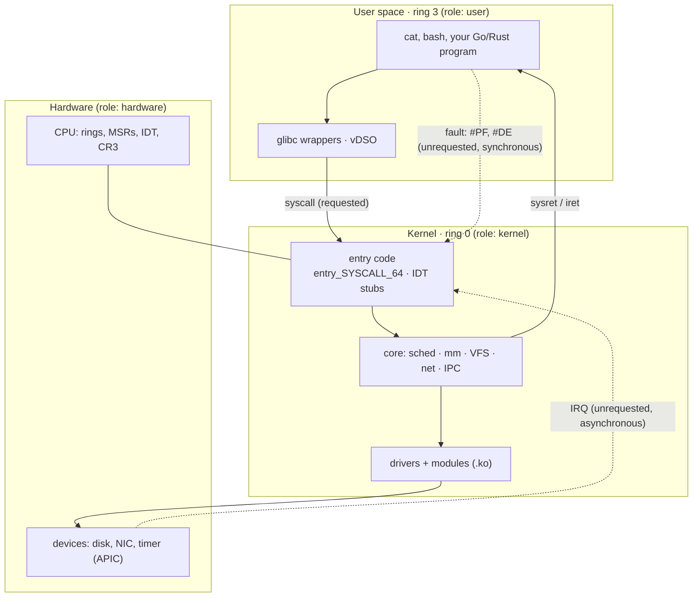
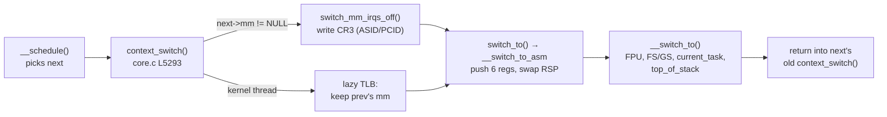

<div dir="rtl">

# ۰۱ — معماری و ساختار کرنل

> درس: سیستم‌عامل پیشرفته · ترم ۱ · نسخه‌های ثابت: Linux **v6.18.63** و OpenBSD **`8cada8c`** · معماری: **x86-64** (هر جا خلافش گفته نشده، ARCH-SPECIFIC است)
> زمان: حدود ۱۳ ساعت (درس ۲ · یادداشت‌ها ۴ · walkthrough ۲ · آزمایش‌ها ۵) · نسخهٔ انگلیسی: [`lesson.en.md`](lesson.en.md) · اسلایدها: [`slides/`](slides/)
> **پیش‌نیاز:** ماژول ۰۰ (VM با نام `aos-lab`، ابزارها، `cite.sh`). **ماژول‌هایی که به این وابسته‌اند:** ماژول ۰۲ (context switch و `task_struct`)، ماژول ۰۴ (سطح دسترسی، `CR3`، exception نقص صفحه)، ماژول ۰۵ (`vfs_read`)، ماژول ۰۷ (seccomp در مسیر ورود syscall قرار دارد).

## هدف‌های یادگیری

- توضیح دهید چرا سیستم‌عامل به دو سطح دسترسی در CPU نیاز دارد و CPU دقیقاً چه چیزی را بررسی می‌کند (`CPL`، بیت `U/S` صفحه، `DPL` گیت).
- همهٔ راه‌های ورود به کرنل را دسته‌بندی کنید: system call، exception (از نوع fault/trap/abort)، interrupt سخت‌افزاری و IPI؛ و سازوکار x86-64 هر کدام را نام ببرید (`syscall` و MSR، بردار IDT).
- یک `read()` را از wrapper کتابخانهٔ libc تا `entry_SYSCALL_64` ← `do_syscall_64()` ← `x64_sys_call()` ← `vfs_read()` و برگشت، در سورس واقعی v6.18.63 دنبال کنید.
- بگویید context switch چه چیزهایی را ذخیره و عوض می‌کند (رجیسترهای callee-saved، پشتهٔ کرنل، `CR3`) و این کار کجای سورس است.
- طراحی‌های monolithic، microkernel، hybrid و exokernel را مقایسه کنید و جایگاه Linux و OpenBSD را با trade-offهایشان نشان دهید.
- اندازه بگیرید: هزینهٔ syscall، مقایسهٔ vDSO با syscall واقعی، نرخ interruptها و trace از نوع function-graph برای `vfs_read`.

## واژه‌نامه

| اصطلاح | تعریف |
|---|---|
| **Kernel** | برنامه‌ای که در حالت ممتاز CPU اجرا می‌شود و صاحب سخت‌افزار است؛ بقیهٔ برنامه‌ها از آن خدمت می‌خواهند. |
| **User mode / kernel mode** | دو سطح دسترسی که لینوکس استفاده می‌کند: ring 3 برای برنامه‌ها و ring 0 برای کرنل. |
| **Ring / `CPL`** | سطح دسترسی x86 از ۰ تا ۳. Current Privilege Level همان دو بیت پایین selector در `CS` است. |
| **System call (syscall)** | درخواستی عمدی و شماره‌دار از کد کاربر به کرنل که در x86-64 با دستور `syscall` وارد می‌شود. |
| **`syscall` / `sysret`** | دستورهای x86-64 برای ورود سریع به ring 0 و برگشت سریع به ring 3. |
| **MSR** | رجیستر Model-Specific که با `wrmsr` نوشته می‌شود؛ `IA32_LSTAR` آدرس مقصد `syscall` را نگه می‌دارد. |
| **Interrupt** | سیگنالی ناهمگام از یک دستگاه، تایمر یا CPU دیگر (IPI) که بین دو دستور می‌رسد. |
| **Exception** | رویدادی همگام که دستور فعلی باعثش شده: **fault** (دستور دوباره اجرا می‌شود، مثل page fault)، **trap** (بعد از دستور گزارش می‌شود، مثل `int3`) یا **abort** (مرگبار، مثل machine check). |
| **IDT** | جدول Interrupt Descriptor با ۲۵۶ گیت؛ هر گیت می‌گوید کدام آدرس کرنل بردار N را رسیدگی می‌کند و از کدام ring می‌شود با `int N` فعالش کرد. |
| **`pt_regs`** | ساختاری روی پشتهٔ کرنل که رجیسترهای کاربر را هنگام ورود نگه می‌دارد. |
| **Context switch** | متوقف کردن یک task روی CPU و ادامه دادن task دیگر: پشتهٔ کرنل، رجیسترها و شاید فضای آدرس (`CR3`). |
| **`CR3`** | رجیستر کنترلی که به جدول صفحهٔ سطح بالای فعلی اشاره می‌کند؛ نوشتن در آن فضای آدرس را عوض می‌کند. |
| **vDSO** | کتابخانهٔ کوچکی که کرنل در هر پردازه map می‌کند تا بعضی فراخوانی‌ها (مثل `clock_gettime`) بدون ورود به کرنل اجرا شوند. |
| **PTI** | Page Table Isolation (وصلهٔ Meltdown): جدول صفحهٔ جدا برای کاربر و کرنل؛ پس هر ورود و خروج `CR3` را عوض می‌کند. |
| **Monolithic kernel** | همهٔ سرویس‌های اصلی (زمان‌بند، حافظه، فایل‌سیستم، درایور، شبکه) در یک فضای آدرس ممتاز اجرا می‌شوند. |
| **Microkernel** | فقط IPC، زمان‌بندی و فضای آدرس در کرنل است؛ درایورها و فایل‌سیستم‌ها سرورهایی در فضای کاربرند. |
| **Loadable module** | کد کرنل (`.ko`) که هنگام اجرا به کرنل monolithic لینک می‌شود؛ در ring 0 و با دسترسی کامل اجرا می‌شود. |
| **`noinstr`** | برچسبی در لینوکس که تابع را در بخش `.noinstr.text` می‌گذارد؛ آنجا hookهای ردیابی مجاز نیستند. |

## ۱. تصویر کلی

</div>



<div dir="rtl">

دقیقاً سه راه برای رسیدن به ring 0 وجود دارد و همه به یک جا ختم می‌شوند: یک `pt_regs` ذخیره‌شده روی پشتهٔ کرنلِ همان task، بعد کد C، و بعد مسیر برگشتی که ممکن است به task دیگری سوئیچ کند.

## ۲. مفاهیم

### ۲.۱ اصلاً چرا CPU به دو حالت نیاز دارد؟

اگر هر برنامه‌ای می‌توانست `CR3` را بنویسد، interruptها را خاموش کند (`cli`) یا کنترلر دیسک را برنامه‌ریزی کند، یک باگ کل سیستم را از کار می‌انداخت. پس CPU سطح دسترسی را در سخت‌افزار اعمال می‌کند:

| بررسی | CPU کجا را نگاه می‌کند | اگر رعایت نشود |
|---|---|---|
| دستور ممتاز (`cli`، `mov %cr3`، `wrmsr`، `hlt`) | `CPL` باید ۰ باشد | exception از نوع `#GP` ← کرنل `SIGSEGV` می‌فرستد |
| دسترسی به حافظه | بیت `U/S` در ورودی جدول صفحه (به‌اضافهٔ SMAP/SMEP) | exception از نوع `#PF` |
| اجرای `int N` در کد کاربر | `DPL` گیت در IDT باید ≥ `CPL` باشد | `#GP` |
| پورت‌های I/O (`in`/`out`) | `IOPL` در RFLAGS یا bitmap ورودی/خروجی در TSS | `#GP` |

x86 چهار ring دارد ولی Linux و OpenBSD فقط ۰ و ۳ را استفاده می‌کنند (جدول صفحه فقط «user» و «supervisor» را می‌شناسد). ← یادداشت [02-privilege-rings-cpl](notes/02-privilege-rings-cpl.fa.md).

### ۲.۲ وقتی برنامه `read()` را صدا می‌زند چه اتفاقی می‌افتد؟

</div>

```mermaid
sequenceDiagram
  participant P as cat (ring 3)
  participant L as glibc read()
  participant C as CPU
  participant E as entry_SYSCALL_64
  participant D as do_syscall_64()
  participant V as ksys_read → vfs_read
  P->>L: read(3, buf, 131072)
  L->>C: rax=0, rdi=3, rsi=buf, rdx=131072; syscall
  C->>E: rcx=user RIP, r11=RFLAGS, CPL=0, RIP=MSR_LSTAR
  E->>E: swapgs, kernel stack, build pt_regs
  E->>D: do_syscall_64(regs, 0)
  D->>D: syscall_enter_from_user_mode (ptrace, seccomp)
  D->>V: x64_sys_call → __x64_sys_read(regs)
  V-->>D: bytes read (or -errno) in regs->ax
  D->>D: syscall_exit_to_user_mode (signals, maybe schedule())
  D-->>E: true = SYSRET is safe
  E-->>P: sysretq: back to the instruction after syscall
```

<div dir="rtl">

سه نکته را به خاطر بسپارید:

۱. **ABI یعنی رجیسترها.** شماره در `rax`؛ آرگومان‌ها در `rdi, rsi, rdx, r10, r8, r9`؛ نتیجه در `rax`؛ `rcx` و `r11` از بین می‌روند. خطا به شکل عددی بین `-4095` و `-1` برمی‌گردد و glibc آن را به `-1` و مقدار `errno` تبدیل می‌کند.
۲. **کرنل برای هر ورودی همان `pt_regs` را می‌سازد.** برای همین `strace`، signal و `ptrace` برای syscall، fault و interrupt یکسان کار می‌کنند.
۳. **برگشت، نقطهٔ زمان‌بندی است.** کرنل پیش از `sysret` بررسی می‌کند «آیا کسی بیشتر به این CPU نیاز دارد؟» (`_TIF_NEED_RESCHED`). ← یادداشت [04-syscall-path](notes/04-syscall-path.fa.md)؛ walkthrough بخش‌های ۲ تا ۵.

### ۲.۳ تفاوت interrupt، exception، trap و fault چیست؟

| | علت | زمان | مثال (بردار) | برگشت به |
|---|---|---|---|---|
| **Syscall** | دستور `syscall` | همگام، درخواستی | `read` (در x86-64 از IDT نمی‌گذرد) | دستور بعدی |
| **Fault** | دستور فعلی نمی‌تواند تمام شود | همگام | page fault یا `#PF` (۱۴)، `#GP` (۱۳)، `#DE` (۰) | **همان** دستور (اجرای دوباره) |
| **Trap** | دستور تمام شد، گزارشش بده | همگام | breakpoint با `int3`، یعنی `#BP` (۳) | دستور بعدی |
| **Abort** | سخت‌افزار نمی‌تواند بازیابی کند | همگام | machine check یا `#MC` (۱۸)، double fault یا `#DF` (۸) | برگشتی نیست |
| **Interrupt** | دستگاه / تایمر / CPU دیگر | **ناهمگام** | تایمر محلی (`LOC`)، کارت شبکه، دیسک؛ IPIها (`RES`، `CAL`، `TLB`) | دستوری که قطع شد |

همه به‌جز `syscall` از **IDT** می‌گذرند. `/proc/interrupts` فقط interruptها را می‌شمارد؛ exceptionها در `perf stat` به شکل `page-faults` و به شکل tracepoint (`exceptions:page_fault_user`) دیده می‌شوند. ← یادداشت [03-interrupts-exceptions-traps](notes/03-interrupts-exceptions-traps.fa.md)؛ آزمایش ۰۳.

### ۲.۴ چرا `clock_gettime()` ده برابر ارزان‌تر از `getpid()` است؟

چون معمولاً اصلاً وارد کرنل نمی‌شود. **vDSO** یک تکه کد به‌اضافهٔ یک صفحهٔ داده است (مقادیر زمانی که کرنل در هر tick به‌روز می‌کند) که در هر پردازه map می‌شود. `clock_gettime(CLOCK_MONOTONIC)` شمارندهٔ TSC و همان صفحه را در ring 3 می‌خواند. اگر منبع ساعت از حالت کاربر خواندنی نباشد، vDSO به یک `syscall` واقعی برمی‌گردد. آزمایش ۰۴ هر سه هزینه را اندازه می‌گیرد: حلقهٔ خالی < vDSO < syscall واقعی.

### ۲.۵ context switch دقیقاً چه چیزی را عوض می‌کند؟

</div>



<div dir="rtl">

رجیسترهای کاربر از قبل در `pt_regs` ذخیره شده‌اند (task برای رسیدن به اینجا وارد کرنل شده است). خود سوئیچ فقط **۶ رجیستر callee-saved** را ذخیره می‌کند و **اشاره‌گر پشتهٔ کرنل** را عوض می‌کند؛ `CR3` فقط وقتی عوض می‌شود که task بعدی `mm` دیگری داشته باشد. نخ‌های یک پردازه نوشتن `CR3` را رد می‌کنند. ← یادداشت [05-context-switch](notes/05-context-switch.fa.md)؛ walkthrough بخش ۷. اندازه‌گیری هزینه در آزمایش ۳ ماژول ۰۲ است.

### ۲.۶ Monolithic، microkernel، hybrid: جای Linux و OpenBSD کجاست؟

| | Monolithic (Linux، OpenBSD، FreeBSD) | Microkernel (seL4، QNX، MINIX 3) | Hybrid (XNU، Windows NT) | Exokernel / library OS (Aegis در MIT، سبک Unikraft) |
|---|---|---|---|---|
| در ring 0 | همه‌چیز: زمان‌بند، حافظه، FS، شبکه، درایور | IPC، زمان‌بندی، فضای آدرس | هستهٔ microkernel به‌اضافهٔ بیشتر سرویس‌ها در فضای کرنل | فقط تقسیم امن سخت‌افزار |
| باگ در یک درایور | می‌تواند کرنل را از کار بیندازد یا نفوذپذیر کند | یک سرور در فضای کاربر را ری‌استارت می‌کند | معمولاً مثل monolithic | داخل libOS همان برنامه می‌ماند |
| هزینهٔ یک «read» | یک syscall | دست‌کم ۲ پیام IPC (کلاینت ← سرور FS ← درایور دیسک) | یک trap | یک فراخوانی کتابخانه، شاید بدون trap |
| گسترش‌پذیری | ماژول‌های `.ko` و eBPF | افزودن سرور | kext / درایور | libOS مخصوص هر برنامه |

Linux **monolithic ولی ماژولار** است: ماژول‌های `.ko` هنگام اجرا به همان فضای آدرس لینک می‌شوند و eBPF بدون ماژول، کد تأییدشده اضافه می‌کند. ← یادداشت [01-kernel-types](notes/01-kernel-types.fa.md).

### ۲.۷ هر چیز کجای درخت لینوکس است؟

| پوشه | محتوا | در این ماژول |
|---|---|---|
| `arch/x86/` | کد ورود، IDT، اسمبلی context switch، کد جدول صفحه برای x86 | `entry/`، `kernel/`، `mm/tlb.c` |
| `kernel/` | زمان‌بند، fork، signal، IRQ عمومی، حلقهٔ کار ورود/خروج | `sched/core.c`، `irq/handle.c`، `entry/` |
| `mm/` | مدیریت حافظه (ماژول ۴) | — |
| `fs/` | VFS و فایل‌سیستم‌ها (ماژول ۵) | `read_write.c` |
| `include/linux/` | headerها و ماکروهای مشترک | `syscalls.h`، `compiler_types.h` |
| `drivers/`، `net/`، `block/` | دستگاه‌ها، شبکه، لایهٔ block | — |

← یادداشت [06-linux-source-tree-map](notes/06-linux-source-tree-map.fa.md).

## ۳. این‌ها کجای لینوکس است

[kernel walkthrough](kernel-walkthrough.fa.md) خط به خط این‌ها را می‌خواند: `idt_syscall_init()` (تنظیم MSR) ← `entry_SYSCALL_64` ← `do_syscall_64()` ← `x64_sys_call()` و `syscall_64.tbl` ← `SYSCALL_DEFINE3(read)` ← `vfs_read()`؛ بعد IDT (`idt.c`)، `common_interrupt` و `__handle_irq_event_percpu()`؛ بعد `context_switch()` ← `__switch_to_asm` ← `__switch_to()`؛ و هر کدام را با `syscalls.master`، `Xsyscall`، `syscall()`/`mi_syscall()` و `cpu_switchto` در OpenBSD مقایسه می‌کند.

| آزمایش | روی VM چه می‌بینید |
|---|---|
| [01 نقشهٔ strace](labs/01-strace-map/README.md) | هر syscall برنامهٔ `cat` ← شماره ← نماد `__x64_sys_*` در `/proc/kallsyms` |
| [02 syscall خام](labs/02-raw-syscall/README.md) | ABI رجیستری با inline asm؛ تفاوت `-errno` و `errno` |
| [03 interruptها](labs/03-interrupts/README.md) | تفاضل `/proc/interrupts`، tracepointهای `irq:*`، fault در برابر interrupt |
| [04 هزینهٔ syscall](labs/04-syscall-cost/README.md) | نانوثانیه برای هر فراخوانی: حلقه، vDSO و syscall، با و بدون `strace` |
| [05 ftrace روی vfs_read](labs/05-ftrace-vfs-read/README.md) | function-graph یک `vfs_read()` تا فایل‌سیستم |

## ۴. برداشت‌های غلط رایج

| برداشت غلط | واقعیت |
|---|---|
| «syscall یعنی context switch.» | syscall یک **mode switch** در همان task است: همان `task_struct`، همان `CR3` (بدون PTI). context switch، task را عوض می‌کند. syscall *ممکن است* به آن منجر شود (`read` مسدودکننده یا `need_resched` هنگام خروج). |
| «کرنل یک پردازه است.» | کرنل کد و داده‌ای است که در فضای آدرس همهٔ پردازه‌ها map شده و با trap وارد آن می‌شوند. *نخ‌های* کرنل (`kworker`، `ksoftirqd`) task هستند، اما «کرنل» یک task نیست. |
| «لینوکس syscall را با `sys_call_table[nr]()` توزیع می‌کند.» | در x86-64 نسخهٔ v6.18 نه: `x64_sys_call()` یک `switch` است (syscall_64.c خط ۳۵). جدول فقط برای ردیابی مانده. VERSION-DEPENDENT. |
| «`int 0x80` روش syscall در لینوکس است.» | این مسیر قدیمی ۳۲ بیتی است (بردار `0x80` در IDT ← `do_int80_emulation()` در `arch/x86/entry/syscall_32.c` خط ۱۲۹). کد ۶۴ بیتی از `syscall` استفاده می‌کند و IDT درگیر نیست. |
| «microkernelها همیشه کندند.» | Mach اولیه کند بود. IPC در L4/seL4 چند صد چرخه است؛ هزینه در *تعداد* عبورهاست، نه یک عبور. |
| «ماژول‌ها لینوکس را microkernel می‌کنند.» | ماژول‌ها در ring 0 و در فضای آدرس کرنل و بدون هیچ جداسازی اجرا می‌شوند. باگ ماژول یعنی باگ کرنل. |
| «interrupt و exception یکی‌اند.» | هر دو از IDT استفاده می‌کنند، اما exception همگام است (*همین* دستور باعثش شده) و interrupt ناهمگام. |
| «`getpid()` در libc کش می‌شود، پس رایگان است.» | glibc از نسخهٔ ۲.۲۵ کش PID را حذف کرد. در Ubuntu 24.04 (glibc 2.39) `getpid()` یک syscall واقعی است (آزمایش ۰۲ آن را زیر `strace` نشان می‌دهد). |

## ۵. پرسش‌های خودآزمایی

۱. دستور `syscall` کدام سه رجیستر را به‌طور ضمنی می‌خواند یا بازنویسی می‌کند، و چرا کرنل باید خودش `rsp` را ذخیره کند؟
۲. چرا آرگومان چهارم در `r10` است و نه `rcx`؟
۳. نوع هر کدام را بگویید (fault / trap / abort): page fault، `int3`، double fault. کدام دستور را دوباره اجرا می‌کند؟
۴. `do_syscall_64` هرگز در خروجی ftrace دیده نمی‌شود. دلیل دقیق و فایل/خطی را که باعث آن است بگویید.
۵. وقتی `nr` برابر ۱۰۰۰ باشد، `x64_sys_call()` چه می‌کند؟ تا مقداری که `rax` در فضای کاربر دارد دنبالش کنید.
۶. در `context_switch()` چه وقتی `CR3` **نوشته نمی‌شود**؟ دو حالت بگویید.
۷. کدام خط در `__switch_to()` تعیین می‌کند syscall *بعدی* روی این CPU از کدام پشتهٔ کرنل استفاده کند؟
۸. یک دلیل طراحی بگویید که مسیر syscall در OpenBSD را از لینوکس کندتر می‌کند، و یک ویژگی امنیتی که در عوض به دست می‌آورد.

پاسخ‌ها در [آزمونک](quiz.fa.md) (پرسش‌ها هم‌پوشانی دارند) و در [walkthrough](kernel-walkthrough.fa.md) هستند.

</div>
