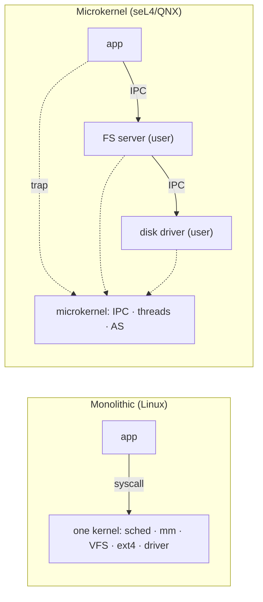

# Note 01 — Kernel types: monolithic, microkernel, hybrid, exokernel

> Module 01 · Architecture · Persian: [`01-kernel-types.fa.md`](01-kernel-types.fa.md) · Index: [`INDEX.en.md`](INDEX.en.md)

## 1. Summary

- A kernel design is a decision about **what runs in ring 0** and **how the other parts talk**: function calls inside one address space, or messages between isolated servers.
- Linux and OpenBSD are **monolithic**: scheduler, memory, file systems, network and drivers share one privileged address space. Linux adds run-time loadable modules and eBPF.
- Microkernels (seL4, QNX, MINIX 3) move drivers and file systems to user space, buying fault isolation at the price of more boundary crossings per operation.

## 2. Explanation

### Intuition

Think of the kernel as the only code allowed to touch the hardware. Every OS needs *some* privileged code: the part that switches page tables, handles interrupts and decides who runs. The design question is how much **else** goes into that privileged code.

- Put everything in: a request like `read()` is one trap plus ordinary C function calls (`vfs_read()` → `ext4_file_read_iter()` → block layer → driver). It's fast and simple to call across subsystems, but a bug anywhere (say, in a Wi-Fi driver) can corrupt the scheduler's memory.
- Put almost nothing in: the kernel offers address spaces, threads and IPC. The file system is a process; the disk driver is another process. A `read()` becomes messages: app → FS server → driver → FS server → app. A crashing driver is restarted like any process.

### The four families

| Family | In ring 0 | Communication | Examples | Strength | Weakness |
|---|---|---|---|---|---|
| **Monolithic** | everything | direct function calls, shared data structures | Linux, OpenBSD, FreeBSD, classic UNIX | speed, simple cross-subsystem calls | no isolation between subsystems; huge trusted code base |
| **Microkernel** | IPC, scheduling, address spaces, (IRQ routing) | message passing (synchronous IPC) | seL4, L4, QNX, MINIX 3 | fault isolation, small TCB (seL4 is formally verified) | more crossings per operation; harder to share state |
| **Hybrid** | microkernel core + most servers in kernel space | mix | XNU (Mach + BSD), Windows NT | engineering compromise | gets the monolithic failure model with some microkernel structure |
| **Exokernel / library OS** | only secure multiplexing of raw resources | applications link their own OS library | MIT Aegis/ExOS (research), unikernels | application-specific policy, few traps | each app carries its own OS; weak sharing |

### Mechanism: what "monolithic" means in Linux

1. **One address space.** All kernel code, including modules, is mapped into the upper half of *every* process's virtual address space (`0xffff8000_00000000` and above on x86-64 with 4-level paging). A user→kernel transition does not change the address space (except for the PTI `CR3` flip, which is a security patch, not a design choice).
2. **Modules are not servers.** `insmod e1000.ko` links the code into that space with relocations against kernel symbols. It runs in ring 0 with full access. "Modular" ≠ "microkernel".
3. **Internal interfaces are C function pointers.** The VFS calls `file->f_op->read_iter()`; the scheduler calls `sched_class->pick_next_task()`. These are the "plug-in points" that in a microkernel would be IPC endpoints.
4. **eBPF** is Linux's answer to "extend the kernel safely": the verifier proves a program terminates and only touches allowed memory, then JITs it into ring 0. It is safety by static checking, not by hardware isolation.
5. **Some services do run in user space**: FUSE file systems, `udev`, user-space drivers through VFIO/UIO, and `sched_ext` schedulers written in BPF. Each is an explicit escape hatch.

### Why did monolithic designs win on servers and desktops?

The 1990s Mach microkernel paid heavily for IPC (message copies, port rights checks, cache pollution). Liedtke's L4 showed IPC can be fast (hundreds of cycles), but by then Linux and the BSDs had the drivers. The dominant cost in a microkernel is not one crossing but the **number** of crossings and the loss of shared caches (page cache, dentry cache) that monolithic kernels get for free. Microkernels win where isolation and certification matter more than throughput: automotive (QNX), aerospace and high-assurance systems (seL4).

### Where OpenBSD differs from Linux

Both are monolithic. OpenBSD's choices are about **reducing what the kernel trusts**, not about moving code out:
- no loadable modules since OpenBSD 5.7 (2015): the kernel you boot is all the kernel there is;
- a big kernel lock (`KERNEL_LOCK()`) still protects syscalls not marked `NOLOCK` in `syscalls.master` (see the walkthrough §8.3);
- kernel relinking at boot (KARL) gives each boot a different kernel layout.

## 3. Diagram



One `read()` on the left: **2 mode switches** (in, out). On the right: at least **4 IPC round trips** through the microkernel, each with its own mode switches and maybe address-space switches.

## 4. Worked example: modules really are inside the kernel

On the course VM (Linux 6.18.63), captured 2026-11-15. ext4 is built into this kernel (`=y`); `isofs` is a loaded module:

```text
$ grep -E "^CONFIG_EXT4_FS=" /boot/config-$(uname -r)
CONFIG_EXT4_FS=y
$ grep -w -e vfs_read -e ext4_file_read_iter /proc/kallsyms
ffffffffadca2b40 T vfs_read
ffffffffaddb4cf0 t ext4_file_read_iter
$ lsmod | wc -l
60
$ grep -w isofs /proc/modules
isofs 61440 0 - Live 0xffffffffc0a8f000
$ grep "\[isofs\]" /proc/kallsyms | grep -w -e isofs_fill_super -e isofs_lookup
ffffffffc0a911c0 t isofs_fill_super	[isofs]
ffffffffc0a8f520 t isofs_lookup	[isofs]
```

- Built-in or module, it is the same kind of code: `ext4_file_read_iter` (built in) and `isofs_lookup` (module) are both just symbols in `/proc/kallsyms`, with no PID and no address space of their own.
- 59 modules are loaded (`lsmod` prints one header line). They sit in the kernel's module area (`0xffffffffc0…`), while core text like `vfs_read` is at `0xffffffffad…`. Both are in the kernel half of every process's address space, run at CPL 0, and are reached by ordinary calls.
- Whether ext4 is `=y` or `=m` is a build choice (`/boot/config-*`). It changes nothing about isolation.

The source makes the same point from the other side. The call from the VFS into a file system is a plain indirect function call:

`linux/fs/read_write.c · vfs_read() · v6.18.63` (L569–574)

```c
	if (file->f_op->read)
		ret = file->f_op->read(file, buf, count, pos);
	else if (file->f_op->read_iter)
		ret = new_sync_read(file, buf, count, pos);
	else
		ret = -EINVAL;
```

In a microkernel this line would be "send a message to the file-system server and wait for the reply".

## 5. Edge cases & pitfalls

- **"Linux is hybrid because it has modules."** No: hybrid refers to a microkernel structure with services moved back into kernel space (XNU, NT). Linux never had the microkernel core.
- **"Windows NT is a microkernel."** Its design started that way; drivers, the window manager (`win32k`) and the file systems run in kernel mode. Most texts call it hybrid.
- **"Microkernel = more secure."** Isolation limits the damage of a bug, but the IPC interface itself must be right. seL4's *formal proof* is what gives it strong guarantees, not only its size.
- **FUSE and user-space drivers** don't make Linux a microkernel; they are opt-in exceptions with a performance cost that proves the point (every FUSE request is a round trip to a daemon).
- **Unikernels** are often listed under "library OS": the application and its OS library are linked into one image that runs directly on a hypervisor, with a single address space and often a single privilege level.
- **The "Tanenbaum–Torvalds debate" (1992)** is history, not a result: both designs are in production today for different requirements.

## 6. Exam-style key points

- The deciding question: *what runs in privileged mode, and how do the parts communicate?*
- Monolithic: one address space, function calls, fast, no internal isolation (Linux, OpenBSD).
- Microkernel: minimal ring-0 core (IPC, scheduling, address spaces), services as user processes, isolation + restartability, more crossings (seL4, QNX, MINIX 3).
- Hybrid: microkernel-style structure, services in kernel space (XNU, NT).
- Exokernel/libOS: kernel only multiplexes hardware securely; policy lives in application libraries.
- Linux modules (`.ko`) run in ring 0 in the kernel address space; modular ≠ microkernel.
- eBPF extends Linux with statically verified code, not hardware isolation.
- OpenBSD: monolithic, no loadable modules, still a big kernel lock for many syscalls.
- Microkernel cost is dominated by the *number* of IPC crossings and lost shared caches.

## 7. Links

- Lesson: [§2.6 Monolithic, microkernel, hybrid](../lesson.en.md#26-monolithic-microkernel-hybrid-where-do-linux-and-openbsd-sit)
- Walkthrough: [§8.3 OpenBSD `KERNEL_LOCK()`](../kernel-walkthrough.en.md#83-the-c-dispatcher)
- Lab: [05 ftrace vfs_read](../labs/05-ftrace-vfs-read/README.md) (watch `vfs_read` call into `ext4` directly)
- Quiz: questions 1, 2, 13 and oral question O1 in [`quiz.en.md`](../quiz.en.md)
