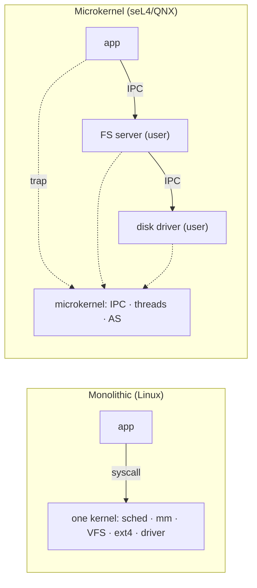

<div dir="rtl">

# یادداشت ۰۱ — انواع کرنل: monolithic، microkernel، hybrid، exokernel

> ماژول ۰۱ · معماری · نسخهٔ انگلیسی: [`01-kernel-types.en.md`](01-kernel-types.en.md) · فهرست: [`INDEX.fa.md`](INDEX.fa.md)

## ۱. خلاصه

- طراحی کرنل یعنی تصمیم دربارهٔ اینکه **چه چیزی در ring 0 اجرا شود** و **بقیهٔ اجزا چطور با هم حرف بزنند**: فراخوانی تابع در یک فضای آدرس، یا پیام بین سرورهای جدا از هم.
- Linux و OpenBSD **monolithic** هستند: زمان‌بند، حافظه، فایل‌سیستم‌ها، شبکه و درایورها یک فضای آدرس ممتاز مشترک دارند. لینوکس ماژول‌های قابل بارگذاری در زمان اجرا و eBPF را هم دارد.
- microkernelها (seL4، QNX، MINIX 3) درایورها و فایل‌سیستم‌ها را به فضای کاربر می‌برند؛ جداسازی خطا به دست می‌آید، به قیمت عبورهای بیشتر از مرز برای هر عملیات.

## ۲. توضیح

### شهود

کرنل را تنها کدی در نظر بگیرید که اجازه دارد به سخت‌افزار دست بزند. هر سیستم‌عاملی به *مقداری* کد ممتاز نیاز دارد: بخشی که جدول صفحه را عوض می‌کند، به interruptها رسیدگی می‌کند و تصمیم می‌گیرد چه کسی اجرا شود. پرسش طراحی این است که **چه چیز دیگری** هم داخل آن کد ممتاز برود.

- همه‌چیز را داخل بگذارید: درخواستی مثل `read()` یعنی یک trap و چند فراخوانی عادی تابع در C (`vfs_read()` ← `ext4_file_read_iter()` ← لایهٔ block ← درایور). سریع است و صدا زدن زیرسیستم‌های دیگر ساده است، ولی باگی در هر جایی (مثلاً یک درایور Wi-Fi) می‌تواند حافظهٔ زمان‌بند را خراب کند.
- تقریباً هیچ چیز را داخل نگذارید: کرنل فقط فضای آدرس، نخ و IPC ارائه می‌دهد. فایل‌سیستم یک پردازه است و درایور دیسک یک پردازهٔ دیگر. یک `read()` تبدیل به پیام می‌شود: برنامه ← سرور FS ← درایور ← سرور FS ← برنامه. درایوری که crash کند مثل هر پردازهٔ دیگری دوباره راه‌اندازی می‌شود.

### چهار خانواده

| خانواده | در ring 0 | ارتباط | نمونه‌ها | نقطهٔ قوت | نقطهٔ ضعف |
|---|---|---|---|---|---|
| **Monolithic** | همه‌چیز | فراخوانی مستقیم تابع، ساختار دادهٔ مشترک | Linux، OpenBSD، FreeBSD، یونیکس کلاسیک | سرعت، فراخوانی سادهٔ زیرسیستم‌ها | جداسازی بین زیرسیستم‌ها نیست؛ پایهٔ کد مورد اعتماد بسیار بزرگ |
| **Microkernel** | IPC، زمان‌بندی، فضای آدرس، (مسیریابی IRQ) | ارسال پیام (IPC همگام) | seL4، L4، QNX، MINIX 3 | جداسازی خطا، TCB کوچک (seL4 به‌طور رسمی اثبات شده) | عبورهای بیشتر برای هر عملیات؛ اشتراک وضعیت سخت‌تر |
| **Hybrid** | هستهٔ microkernel به‌اضافهٔ بیشتر سرورها در فضای کرنل | ترکیبی | XNU (یعنی Mach + BSD)، Windows NT | مصالحهٔ مهندسی | مدل خرابی monolithic را با کمی ساختار microkernel دارد |
| **Exokernel / library OS** | فقط تقسیم امن منابع خام | برنامه‌ها کتابخانهٔ سیستم‌عامل خودشان را لینک می‌کنند | Aegis/ExOS در MIT (پژوهشی)، unikernelها | سیاست مخصوص هر برنامه، trap کم | هر برنامه سیستم‌عامل خودش را حمل می‌کند؛ اشتراک ضعیف |

### سازوکار: «monolithic» در لینوکس یعنی چه

۱. **یک فضای آدرس.** همهٔ کد کرنل، از جمله ماژول‌ها، در نیمهٔ بالایی فضای آدرس مجازی *همهٔ* پردازه‌ها map شده‌اند (در x86-64 با paging چهارسطحی از `0xffff8000_00000000` به بالا). گذر از کاربر به کرنل فضای آدرس را عوض نمی‌کند (جز جابه‌جایی `CR3` در PTI که یک وصلهٔ امنیتی است، نه انتخاب طراحی).
۲. **ماژول‌ها سرور نیستند.** `insmod e1000.ko` کد را با relocation روی نمادهای کرنل به همان فضا لینک می‌کند. در ring 0 و با دسترسی کامل اجرا می‌شود. «ماژولار» ≠ «microkernel».
۳. **رابط‌های داخلی اشاره‌گر تابع در C هستند.** VFS تابع `file->f_op->read_iter()` را صدا می‌زند؛ زمان‌بند `sched_class->pick_next_task()` را. این‌ها «نقطه‌های اتصال»ی هستند که در microkernel نقطهٔ پایانی IPC می‌شدند.
۴. **eBPF** پاسخ لینوکس به «گسترش امن کرنل» است: verifier اثبات می‌کند برنامه تمام می‌شود و فقط به حافظهٔ مجاز دست می‌زند، بعد آن را با JIT به ring 0 می‌برد. امنیت از بررسی ایستا می‌آید، نه از جداسازی سخت‌افزاری.
۵. **بعضی سرویس‌ها واقعاً در فضای کاربر اجرا می‌شوند**: فایل‌سیستم‌های FUSE، `udev`، درایورهای فضای کاربر با VFIO/UIO و زمان‌بندهای `sched_ext` نوشته‌شده با BPF. هر کدام یک راه فرار صریح است.

### چرا طراحی monolithic در سرور و دسکتاپ برنده شد؟

microkernel به نام Mach در دههٔ ۱۹۹۰ هزینهٔ سنگینی برای IPC می‌داد (کپی پیام، بررسی حق port، آلودگی cache). L4 از Liedtke نشان داد IPC می‌تواند سریع باشد (چند صد چرخه)، اما تا آن زمان Linux و BSDها درایورها را داشتند. هزینهٔ اصلی در microkernel یک عبور نیست، بلکه **تعداد** عبورها و از دست رفتن cacheهای مشترک (page cache، dentry cache) است که کرنل monolithic مجانی دارد. microkernelها جایی برنده‌اند که جداسازی و گواهی‌پذیری از توان عملیاتی مهم‌تر است: خودرو (QNX)، هوافضا و سیستم‌های با اطمینان بالا (seL4).

### تفاوت OpenBSD با لینوکس

هر دو monolithic هستند. انتخاب‌های OpenBSD برای **کم کردن چیزهایی است که کرنل به آن‌ها اعتماد می‌کند**، نه بیرون بردن کد:
- از OpenBSD 5.7 (سال ۲۰۱۵) ماژول قابل بارگذاری ندارد: کرنلی که بوت می‌کنید کل کرنل است؛
- یک قفل بزرگ کرنل (`KERNEL_LOCK()`) هنوز از syscallهایی که در `syscalls.master` علامت `NOLOCK` ندارند محافظت می‌کند (walkthrough بخش ۸.۳)؛
- لینک دوبارهٔ کرنل هنگام بوت (KARL) در هر بوت چیدمان متفاوتی به کرنل می‌دهد.

## ۳. نمودار

</div>



<div dir="rtl">

یک `read()` در سمت چپ: **۲ mode switch** (ورود و خروج). در سمت راست: دست‌کم **۴ رفت‌وبرگشت IPC** از طریق microkernel، هر کدام با mode switchهای خودش و شاید تعویض فضای آدرس.

## ۴. مثال عملی: ماژول‌ها واقعاً داخل کرنل‌اند

روی VM درس (Linux 6.18.63)، گرفته‌شده در ۱۴۰۵/۰۸/۲۴. در این کرنل ext4 داخل خود کرنل ساخته شده (`=y`) و `isofs` یک ماژول بارگذاری‌شده است:

</div>

```text
$ grep -E "^CONFIG_EXT4_FS=" /boot/config-$(uname -r)
CONFIG_EXT4_FS=y
$ grep -w -e vfs_read -e ext4_file_read_iter /proc/kallsyms
ffffffffadca2b40 T vfs_read
ffffffffaddb4cf0 t ext4_file_read_iter
$ lsmod | wc -l
60
$ grep -w isofs /proc/modules
isofs 61440 0 - Live 0xffffffffc0a8f000
$ grep "\[isofs\]" /proc/kallsyms | grep -w -e isofs_fill_super -e isofs_lookup
ffffffffc0a911c0 t isofs_fill_super	[isofs]
ffffffffc0a8f520 t isofs_lookup	[isofs]
```

<div dir="rtl">

- داخلی یا ماژول، هر دو یک نوع کدند: `ext4_file_read_iter` (داخلی) و `isofs_lookup` (ماژول) هر دو فقط نمادی در `/proc/kallsyms` هستند، بدون PID و بدون فضای آدرس جداگانه.
- ۵۹ ماژول بارگذاری شده است (`lsmod` یک خط سرستون هم چاپ می‌کند). ماژول‌ها در ناحیهٔ ماژول کرنل (`0xffffffffc0…`) قرار دارند و کد اصلی مثل `vfs_read` در `0xffffffffad…`. هر دو در نیمهٔ کرنلِ فضای آدرس همهٔ پردازه‌ها هستند، در CPL صفر اجرا می‌شوند و با فراخوانی عادی صدا زده می‌شوند.
- اینکه ext4 به‌صورت `=y` یا `=m` ساخته شود یک انتخاب build است (`/boot/config-*`) و چیزی را در جداسازی عوض نمی‌کند.

سورس همین را از طرف دیگر نشان می‌دهد. فراخوانی از VFS به فایل‌سیستم یک فراخوانی غیرمستقیم ساده است:

`linux/fs/read_write.c · vfs_read() · v6.18.63` (L569–574)

</div>

```c
	if (file->f_op->read)
		ret = file->f_op->read(file, buf, count, pos);
	else if (file->f_op->read_iter)
		ret = new_sync_read(file, buf, count, pos);
	else
		ret = -EINVAL;
```

<div dir="rtl">

در یک microkernel این خط می‌شد «یک پیام به سرور فایل‌سیستم بفرست و منتظر پاسخ بمان».

## ۵. حالت‌های خاص و دام‌ها

- **«لینوکس hybrid است چون ماژول دارد.»** نه. hybrid به ساختار microkernel گفته می‌شود که سرویس‌هایش به فضای کرنل برگشته‌اند (XNU، NT). لینوکس هرگز هستهٔ microkernel نداشته است.
- **«Windows NT یک microkernel است.»** طراحی‌اش این‌طور شروع شد؛ ولی درایورها، مدیر پنجره (`win32k`) و فایل‌سیستم‌ها در حالت کرنل اجرا می‌شوند. بیشتر منابع آن را hybrid می‌نامند.
- **«microkernel یعنی امن‌تر.»** جداسازی آسیب یک باگ را محدود می‌کند، ولی خود رابط IPC باید درست باشد. ضمانت قوی seL4 از *اثبات رسمی* آن است، نه فقط از کوچکی‌اش.
- **FUSE و درایورهای فضای کاربر** لینوکس را microkernel نمی‌کنند؛ استثناهای اختیاری‌اند با هزینهٔ کارایی که خودش نکته را ثابت می‌کند (هر درخواست FUSE یک رفت‌وبرگشت به یک daemon است).
- **Unikernelها** معمولاً زیر «library OS» فهرست می‌شوند: برنامه و کتابخانهٔ سیستم‌عاملش در یک image لینک می‌شوند که مستقیم روی hypervisor اجرا می‌شود، با یک فضای آدرس و اغلب یک سطح دسترسی.
- **«بحث Tanenbaum–Torvalds» (۱۹۹۲)** تاریخ است، نه نتیجه: هر دو طراحی امروز برای نیازهای متفاوت در محیط واقعی کار می‌کنند.

## ۶. نکته‌های کلیدی امتحانی

- پرسش تعیین‌کننده: *چه چیزی در حالت ممتاز اجرا می‌شود و اجزا چطور ارتباط دارند؟*
- Monolithic: یک فضای آدرس، فراخوانی تابع، سریع، بدون جداسازی داخلی (Linux، OpenBSD).
- Microkernel: هستهٔ کمینه در ring 0 (IPC، زمان‌بندی، فضای آدرس)، سرویس‌ها به شکل پردازهٔ کاربر، جداسازی و قابلیت راه‌اندازی دوباره، عبورهای بیشتر (seL4، QNX، MINIX 3).
- Hybrid: ساختار شبیه microkernel، سرویس‌ها در فضای کرنل (XNU، NT).
- Exokernel/libOS: کرنل فقط سخت‌افزار را به‌طور امن تقسیم می‌کند؛ سیاست در کتابخانه‌های برنامه است.
- ماژول‌های لینوکس (`.ko`) در ring 0 و در فضای آدرس کرنل اجرا می‌شوند؛ ماژولار ≠ microkernel.
- eBPF لینوکس را با کد تأییدشدهٔ ایستا گسترش می‌دهد، نه با جداسازی سخت‌افزاری.
- OpenBSD: monolithic، بدون ماژول قابل بارگذاری، و هنوز قفل بزرگ کرنل برای بسیاری از syscallها.
- هزینهٔ microkernel را *تعداد* عبورهای IPC و از دست رفتن cacheهای مشترک تعیین می‌کند.

## ۷. پیوندها

- درس: [بخش ۲.۶ Monolithic، microkernel، hybrid](../lesson.fa.md)
- Walkthrough: [بخش ۸.۳ قفل `KERNEL_LOCK()` در OpenBSD](../kernel-walkthrough.fa.md)
- آزمایش: [05 ftrace روی vfs_read](../labs/05-ftrace-vfs-read/README.md) (ببینید `vfs_read` مستقیم `ext4` را صدا می‌زند)
- آزمونک: پرسش‌های ۱، ۲، ۱۳ و پرسش شفاهی O1 در [`quiz.fa.md`](../quiz.fa.md)

</div>
