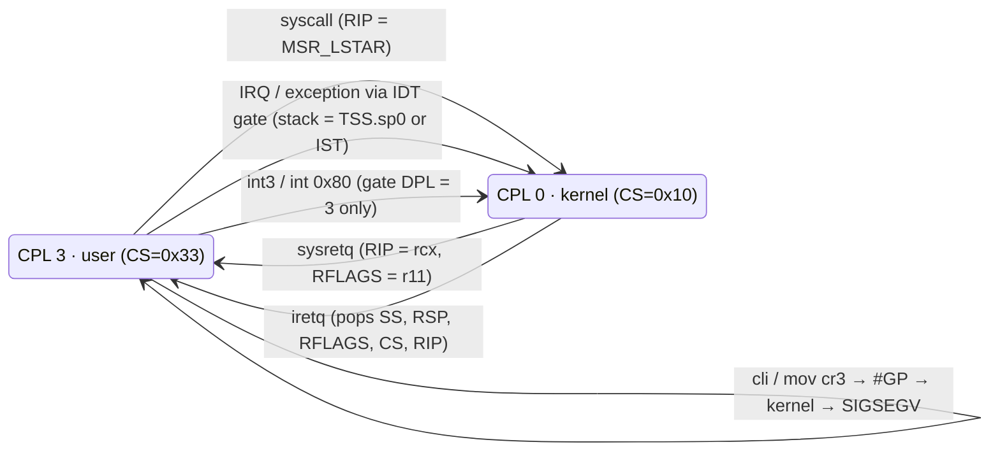

# Note 02 — Privilege rings and `CPL`

> Module 01 · Architecture · Persian: [`02-privilege-rings-cpl.fa.md`](02-privilege-rings-cpl.fa.md) · Index: [`INDEX.en.md`](INDEX.en.md) · **ARCH-SPECIFIC (x86-64)**

## 1. Summary

- The CPU, not the OS, enforces protection: it compares the **Current Privilege Level** (`CPL`, low 2 bits of `CS`) with what each instruction, page and gate requires.
- Linux uses ring 0 (kernel) and ring 3 (user) only. User `CS` is `0x33` (`CPL` 3), kernel `CS` is `0x10` (`CPL` 0).
- The only ways to raise `CPL` are controlled entry points chosen by the kernel: `syscall` (target in `MSR_LSTAR`) and IDT gates (interrupts, exceptions, `int N` if the gate's `DPL` allows it).

## 2. Explanation

### Intuition

A user program and the kernel run on the same CPU, with the same registers, often in the same address space. What separates them is one 2-bit number inside the CPU. When it is 3, a set of instructions and memory pages is off limits; trying to use them causes an exception that hands control to the kernel. When it is 0, everything is allowed. Security comes from one rule: **user code cannot set that number to 0 by itself**. It can only jump to kernel code at addresses the kernel picked in advance.

### Mechanism

**Where `CPL` lives.** In 64-bit mode segmentation is mostly disabled (bases are 0, limits are ignored), but the `CS` selector still matters: its low two bits are the `CPL`. The selector layout is `index(13 bits) | TI(1) | RPL(2)`. Linux defines (`arch/x86/include/asm/segment.h`, 64-bit part):

| Selector | Formula | Value | Meaning |
|---|---|---|---|
| `__KERNEL_CS` | `GDT_ENTRY_KERNEL_CS*8` = 2·8 | `0x10` | ring 0 code |
| `__USER_DS` | `GDT_ENTRY_DEFAULT_USER_DS*8 + 3` = 5·8+3 | `0x2b` | ring 3 data/stack |
| `__USER_CS` | `GDT_ENTRY_DEFAULT_USER_CS*8 + 3` = 6·8+3 | `0x33` | ring 3 64-bit code |

The user DS-before-CS order is not an accident: `sysret` computes both from one field in `MSR_STAR` (`SS = base+8`, `CS = base+16`), so the GDT must have them adjacent in that order.

**What the CPU checks against `CPL`:**

| Resource | Rule | Violation |
|---|---|---|
| Privileged instructions: `cli`/`sti` (without IOPL), `hlt`, `mov` to/from `CR0/CR3/CR4`, `wrmsr`/`rdmsr`, `lgdt`/`lidt`, `invlpg` | only at `CPL` 0 | `#GP(0)` |
| Memory pages | a page with `U/S = 0` (supervisor) can't be touched at `CPL` 3 | `#PF` with the `U` bit set in the error code |
| Supervisor touching user pages | **SMAP**: kernel data access to `U/S=1` pages faults unless `RFLAGS.AC` is set (`stac`/`clac`); **SMEP**: kernel can never *execute* user pages | `#PF` (kernel oops) |
| `int N` | allowed only if gate `DPL` ≥ `CPL` | `#GP` |
| I/O ports | `CPL` ≤ `IOPL`, or the TSS I/O bitmap allows the port | `#GP` |

**How `CPL` goes up (3 → 0).** Only through doors the kernel installed:
- `syscall`: the CPU loads `CS` from `MSR_STAR` (kernel `CS`), `RIP` from `MSR_LSTAR` (`entry_SYSCALL_64`), and masks `RFLAGS` with `MSR_SYSCALL_MASK`. It does **not** switch stacks: the kernel does it in software (walkthrough §2).
- IDT delivery (interrupt, exception, permitted `int N`): the CPU reads the gate, loads kernel `CS:RIP` from it, and because the privilege level changes it loads the kernel stack pointer from `TSS.sp0` (or an IST stack), then pushes `SS, RSP, RFLAGS, CS, RIP` (and an error code for some exceptions).

**How `CPL` goes down (0 → 3).** `sysretq` (restores `RIP` from `rcx`, `RFLAGS` from `r11`, `CS`/`SS` from `MSR_STAR`) or `iretq` (pops the five-word frame). Both are privileged: user code can't use them to go *up*.

**Rings 1 and 2.** They exist, but paging has only "user" (`CPL` 3) vs "supervisor" (`CPL` 0–2) so they offer little. Old paravirtualized Xen ran guest kernels in ring 1 on 32-bit. Modern hardware virtualization adds a different axis instead: **VMX root/non-root** ("ring −1" informally) lets a guest kernel run at `CPL` 0 under a hypervisor (Module 06).

### Mode switch vs context switch

Raising `CPL` does not change the task. On `syscall`, the same `task_struct` keeps running, now in kernel mode, on its own kernel stack. That is a **mode switch**. A **context switch** changes which task runs (note 05). Confusing the two is the most common mistake in this module.

## 3. Diagram



## 4. Worked example

`labs/02-raw-syscall/cpl.c` reads `CS` and `SS` in user mode, then tries two ring-0 instructions, each in a child process. Real output from the VM, 2026-11-15:

```text
$ gcc -Wall -Wextra -O2 -o cpl cpl.c && ./cpl
CS = 0x0033  -> index 6, RPL/CPL = 3
SS = 0x002b  -> index 5, RPL     = 3
cli            -> killed by signal 11 (Segmentation fault)
mov %cr3,reg   -> killed by signal 11 (Segmentation fault)
```

- `CS = 0x33`: index 6, `CPL` 3, exactly `__USER_CS` from `segment.h`.
- `SS = 0x2b`: index 5, `__USER_DS`.
- `cli` and `mov %cr3` both raise `#GP`; the kernel's `exc_general_protection` handler (`arch/x86/kernel/traps.c` L792) turns a user-mode `#GP` into `SIGSEGV` (signal 11).

The kernel side: the 64-bit IDT installs `#GP` as a DPL-0 interrupt gate:

`linux/arch/x86/kernel/idt.c · def_idts · v6.18.63` (L94)

```c
	INTG(X86_TRAP_GP,		asm_exc_general_protection),
```

and `syscall_init()` programs the selectors that `syscall`/`sysret` will load:

`linux/arch/x86/kernel/cpu/common.c · syscall_init() · v6.18.63` (L2268–2271)

```c
void syscall_init(void)
{
	/* The default user and kernel segments */
	wrmsr(MSR_STAR, 0, (__USER32_CS << 16) | __KERNEL_CS);
```

The high half of `MSR_STAR` holds `__USER32_CS << 16 | __KERNEL_CS`. On `syscall` the CPU uses `__KERNEL_CS` (and `+8` for `SS`). On 64-bit `sysret` it uses the `__USER32_CS` field: `SS = __USER32_CS + 8 = __USER_DS`, `CS = __USER32_CS + 16 = __USER_CS`. The GDT order (32-bit user CS 4, user DS 5, user CS 6) exists to make this arithmetic work.

## 5. Edge cases & pitfalls

- **`CPL` is not stored in a "mode register".** It is the `RPL` field of the loaded `CS`. You can read `CS` in user mode (`mov %cs, %ax` is not privileged), which is what `cpl.c` does.
- **`cli` after `iopl(3)` does not disable interrupts.** Linux emulates `iopl(3)` (needs `CAP_SYS_RAWIO`) with the TSS I/O bitmap. A `cli`/`sti` still raises `#GP`, and `fixup_iopl_exception()` (`traps.c` L681) logs "attempts to use CLI/STI, pretending it's a NOP" and skips the instruction. User space can never really turn interrupts off.
- **SMAP/SMEP protect the kernel from itself.** Without SMEP, a kernel bug that jumps to a user address runs attacker code in ring 0. With SMAP, every legitimate user copy is wrapped in `stac`/`clac` inside `copy_from_user()`.
- **The kernel is mapped in every process.** Ring 3 can't read those pages because their `U/S` bit is 0. Meltdown (2018) broke that on Intel CPUs speculatively, which is why PTI unmaps the kernel from the user page tables (note 04).
- **Ring 0 inside a VM** is real `CPL` 0, but in VMX non-root mode: sensitive operations cause a VM exit to the hypervisor.
- **System Management Mode (SMM)** and firmware are above the OS and invisible to it; "ring −2" is an informal name.

## 6. Exam-style key points

- `CPL` = low 2 bits of `CS`; Linux user `CS` = `0x33`, kernel `CS` = `0x10`.
- Linux and OpenBSD use rings 0 and 3 only; paging distinguishes only user/supervisor.
- Privileged instruction at `CPL` 3 → `#GP` → `SIGSEGV`.
- User access to a supervisor page → `#PF`; SMAP/SMEP stop the kernel from touching/executing user pages.
- Up: `syscall` (`MSR_LSTAR`, no stack switch) or IDT gate (stack from `TSS.sp0`/IST). Down: `sysretq` or `iretq`.
- `int N` from user mode needs gate `DPL` = 3 (`int3`, `int 0x80`).
- Mode switch (same task) ≠ context switch (different task).
- `MSR_STAR` + GDT order make `sysret` produce `CS 0x33`, `SS 0x2b`.

## 7. Links

- Lesson: [§2.1 Why two modes](../lesson.en.md#21-why-does-the-cpu-need-two-modes-at-all)
- Walkthrough: [§1 MSR setup](../kernel-walkthrough.en.md#1-boot-telling-the-cpu-where-syscall-lands), [§6 IDT](../kernel-walkthrough.en.md#6-interrupts-and-exceptions-the-idt)
- Lab: [02 raw syscall](../labs/02-raw-syscall/README.md) (`cpl.c`)
- Quiz: questions 3, 4, 10 in [`quiz.en.md`](../quiz.en.md)
