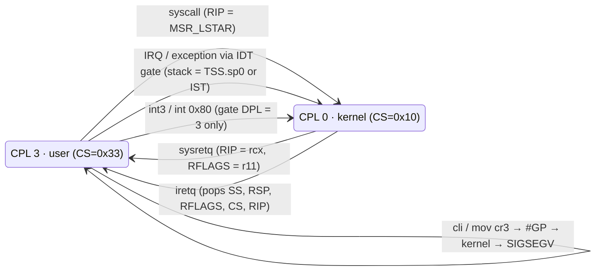

<div dir="rtl">

# یادداشت ۰۲ — ringهای دسترسی و `CPL`

> ماژول ۰۱ · معماری · نسخهٔ انگلیسی: [`02-privilege-rings-cpl.en.md`](02-privilege-rings-cpl.en.md) · فهرست: [`INDEX.fa.md`](INDEX.fa.md) · **ARCH-SPECIFIC (x86-64)**

## ۱. خلاصه

- حفاظت را CPU اعمال می‌کند، نه سیستم‌عامل: **Current Privilege Level** (`CPL`، دو بیت پایین `CS`) را با چیزی که هر دستور، صفحه و گیت لازم دارد مقایسه می‌کند.
- لینوکس فقط ring 0 (کرنل) و ring 3 (کاربر) را استفاده می‌کند. `CS` کاربر برابر `0x33` (یعنی `CPL` برابر ۳) و `CS` کرنل برابر `0x10` (یعنی `CPL` برابر ۰) است.
- تنها راه‌های بالا بردن `CPL` نقطه‌های ورود کنترل‌شده‌ای است که کرنل انتخاب کرده: `syscall` (مقصد در `MSR_LSTAR`) و گیت‌های IDT (interrupt، exception، و `int N` اگر `DPL` گیت اجازه دهد).

## ۲. توضیح

### شهود

برنامهٔ کاربر و کرنل روی یک CPU، با رجیسترهای یکسان و اغلب در یک فضای آدرس اجرا می‌شوند. چیزی که آن‌ها را جدا می‌کند یک عدد دوبیتی داخل CPU است. وقتی ۳ باشد، مجموعه‌ای از دستورها و صفحه‌های حافظه ممنوع‌اند؛ تلاش برای استفاده از آن‌ها یک exception ایجاد می‌کند که کنترل را به کرنل می‌دهد. وقتی ۰ باشد، همه‌چیز مجاز است. امنیت از یک قانون می‌آید: **کد کاربر نمی‌تواند خودش آن عدد را صفر کند.** فقط می‌تواند به آدرس‌هایی از کرنل بپرد که کرنل از قبل انتخاب کرده است.

### سازوکار

**`CPL` کجا نگه داشته می‌شود.** در حالت ۶۴ بیتی segmentation تقریباً خاموش است (پایه‌ها صفرند و حدها نادیده گرفته می‌شوند)، اما selector در `CS` هنوز مهم است: دو بیت پایینش همان `CPL` است. قالب selector این است: `index(13 bits) | TI(1) | RPL(2)`. لینوکس این‌ها را تعریف می‌کند (`arch/x86/include/asm/segment.h`، بخش ۶۴ بیتی):

| Selector | فرمول | مقدار | معنا |
|---|---|---|---|
| `__KERNEL_CS` | `GDT_ENTRY_KERNEL_CS*8` = ۲×۸ | `0x10` | کد ring 0 |
| `__USER_DS` | `GDT_ENTRY_DEFAULT_USER_DS*8 + 3` = ۵×۸+۳ | `0x2b` | داده و پشتهٔ ring 3 |
| `__USER_CS` | `GDT_ENTRY_DEFAULT_USER_CS*8 + 3` = ۶×۸+۳ | `0x33` | کد ۶۴ بیتی ring 3 |

اینکه DS کاربر پیش از CS آمده تصادفی نیست: `sysret` هر دو را از یک فیلد در `MSR_STAR` حساب می‌کند (`SS = base+8` و `CS = base+16`)، پس GDT باید آن‌ها را کنار هم و به همین ترتیب داشته باشد.

**CPU چه چیزهایی را با `CPL` بررسی می‌کند:**

| منبع | قانون | تخلف |
|---|---|---|
| دستورهای ممتاز: `cli`/`sti` (بدون IOPL)، `hlt`، `mov` به/از `CR0/CR3/CR4`، `wrmsr`/`rdmsr`، `lgdt`/`lidt`، `invlpg` | فقط در `CPL` برابر ۰ | `#GP(0)` |
| صفحه‌های حافظه | صفحه‌ای با `U/S = 0` (supervisor) را نمی‌شود در `CPL` ۳ لمس کرد | `#PF` با بیت `U` روشن در کد خطا |
| دسترسی supervisor به صفحه‌های کاربر | **SMAP**: دسترسی دادهٔ کرنل به صفحه‌های `U/S=1` fault می‌دهد مگر `RFLAGS.AC` روشن باشد (`stac`/`clac`)؛ **SMEP**: کرنل هرگز نمی‌تواند صفحهٔ کاربر را *اجرا* کند | `#PF` (oops در کرنل) |
| `int N` | فقط اگر `DPL` گیت ≥ `CPL` | `#GP` |
| پورت‌های I/O | `CPL` ≤ `IOPL`، یا bitmap در TSS پورت را مجاز کند | `#GP` |

**`CPL` چطور بالا می‌رود (۳ ← ۰).** فقط از درهایی که کرنل نصب کرده:
- `syscall`: CPU مقدار `CS` را از `MSR_STAR` (یعنی `CS` کرنل)، `RIP` را از `MSR_LSTAR` (یعنی `entry_SYSCALL_64`) بار می‌کند و `RFLAGS` را با `MSR_SYSCALL_MASK` ماسک می‌کند. پشته را **عوض نمی‌کند**؛ کرنل این کار را در نرم‌افزار انجام می‌دهد (walkthrough بخش ۲).
- تحویل از طریق IDT (interrupt، exception، یا `int N` مجاز): CPU گیت را می‌خواند، `CS:RIP` کرنل را از آن بار می‌کند، و چون سطح دسترسی عوض می‌شود، اشاره‌گر پشتهٔ کرنل را از `TSS.sp0` (یا یک پشتهٔ IST) بار می‌کند و بعد `SS, RSP, RFLAGS, CS, RIP` (و برای بعضی exceptionها یک کد خطا) را push می‌کند.

**`CPL` چطور پایین می‌آید (۰ ← ۳).** با `sysretq` (که `RIP` را از `rcx`، `RFLAGS` را از `r11` و `CS`/`SS` را از `MSR_STAR` برمی‌گرداند) یا `iretq` (که قاب پنج‌کلمه‌ای را pop می‌کند). هر دو ممتازند: کد کاربر نمی‌تواند با آن‌ها *بالا* برود.

**ringهای ۱ و ۲.** وجود دارند، اما paging فقط «user» (`CPL` ۳) و «supervisor» (`CPL` ۰ تا ۲) را می‌شناسد، پس فایدهٔ کمی دارند. Xen قدیمی با paravirtualization در ۳۲ بیتی کرنل مهمان را در ring 1 اجرا می‌کرد. مجازی‌سازی سخت‌افزاری امروزی محور دیگری اضافه می‌کند: **VMX root/non-root** (به‌طور غیررسمی «ring −1») به کرنل مهمان اجازه می‌دهد زیر یک hypervisor در `CPL` ۰ اجرا شود (ماژول ۰۶).

### mode switch در برابر context switch

بالا رفتن `CPL` task را عوض نمی‌کند. هنگام `syscall` همان `task_struct` به اجرا ادامه می‌دهد، حالا در حالت کرنل و روی پشتهٔ کرنل خودش. این یک **mode switch** است. **context switch** عوض می‌کند کدام task اجرا شود (یادداشت ۰۵). قاطی کردن این دو رایج‌ترین اشتباه این ماژول است.

## ۳. نمودار

</div>



<div dir="rtl">

## ۴. مثال عملی

`labs/02-raw-syscall/cpl.c` در حالت کاربر `CS` و `SS` را می‌خواند و بعد دو دستور ring 0 را، هر کدام در یک پردازهٔ فرزند، امتحان می‌کند. خروجی واقعی روی VM، ۱۴۰۵/۰۸/۲۴:

</div>

```text
$ gcc -Wall -Wextra -O2 -o cpl cpl.c && ./cpl
CS = 0x0033  -> index 6, RPL/CPL = 3
SS = 0x002b  -> index 5, RPL     = 3
cli            -> killed by signal 11 (Segmentation fault)
mov %cr3,reg   -> killed by signal 11 (Segmentation fault)
```

<div dir="rtl">

- `CS = 0x33`: اندیس ۶، `CPL` برابر ۳، دقیقاً همان `__USER_CS` در `segment.h`.
- `SS = 0x2b`: اندیس ۵، یعنی `__USER_DS`.
- هر دو دستور `cli` و `mov %cr3` خطای `#GP` می‌دهند؛ handler کرنل یعنی `exc_general_protection` (`arch/x86/kernel/traps.c` خط L792) خطای `#GP` در حالت کاربر را به `SIGSEGV` (signal شمارهٔ ۱۱) تبدیل می‌کند.

سمت کرنل: IDT ۶۴ بیتی `#GP` را به شکل یک interrupt gate با DPL صفر نصب می‌کند:

`linux/arch/x86/kernel/idt.c · def_idts · v6.18.63` (L94)

</div>

```c
	INTG(X86_TRAP_GP,		asm_exc_general_protection),
```

<div dir="rtl">

و `syscall_init()` selectorهایی را که `syscall`/`sysret` بار خواهند کرد برنامه‌ریزی می‌کند:

`linux/arch/x86/kernel/cpu/common.c · syscall_init() · v6.18.63` (L2268–2271)

</div>

```c
void syscall_init(void)
{
	/* The default user and kernel segments */
	wrmsr(MSR_STAR, 0, (__USER32_CS << 16) | __KERNEL_CS);
```

<div dir="rtl">

نیمهٔ بالایی `MSR_STAR` مقدار `__USER32_CS << 16 | __KERNEL_CS` را نگه می‌دارد. هنگام `syscall`، CPU از `__KERNEL_CS` (و `+8` برای `SS`) استفاده می‌کند. هنگام `sysret` در ۶۴ بیتی از فیلد `__USER32_CS` استفاده می‌کند: `SS = __USER32_CS + 8 = __USER_DS` و `CS = __USER32_CS + 16 = __USER_CS`. ترتیب GDT (CS کاربر ۳۲ بیتی ۴، DS کاربر ۵، CS کاربر ۶) برای درست درآمدن همین حساب است.

## ۵. حالت‌های خاص و دام‌ها

- **`CPL` در یک «رجیستر حالت» ذخیره نمی‌شود.** فیلد `RPL` در `CS` بارشده است. می‌توانید `CS` را در حالت کاربر بخوانید (`mov %cs, %ax` ممتاز نیست)؛ کاری که `cpl.c` انجام می‌دهد.
- **`cli` بعد از `iopl(3)` interruptها را خاموش نمی‌کند.** لینوکس `iopl(3)` را (که `CAP_SYS_RAWIO` لازم دارد) با bitmap ورودی/خروجی در TSS شبیه‌سازی می‌کند. `cli`/`sti` همچنان `#GP` می‌دهند و `fixup_iopl_exception()` (`traps.c` خط L681) پیام «attempts to use CLI/STI, pretending it's a NOP» را ثبت می‌کند و از دستور می‌گذرد. فضای کاربر هرگز واقعاً نمی‌تواند interruptها را خاموش کند.
- **SMAP و SMEP کرنل را از خودش محافظت می‌کنند.** بدون SMEP، باگی در کرنل که به آدرس کاربر بپرد، کد مهاجم را در ring 0 اجرا می‌کند. با SMAP، هر کپی مشروع از حافظهٔ کاربر داخل `copy_from_user()` بین `stac`/`clac` قرار می‌گیرد.
- **کرنل در همهٔ پردازه‌ها map شده است.** ring 3 نمی‌تواند آن صفحه‌ها را بخواند چون بیت `U/S` آن‌ها صفر است. Meltdown (۲۰۱۸) این را در CPUهای Intel به‌طور حدسی شکست؛ برای همین PTI کرنل را از جدول صفحهٔ کاربر حذف می‌کند (یادداشت ۰۴).
- **ring 0 داخل VM** واقعاً `CPL` صفر است، ولی در حالت VMX non-root: عملیات حساس باعث VM exit به hypervisor می‌شوند.
- **System Management Mode (SMM)** و firmware بالاتر از سیستم‌عامل و برای آن نامرئی‌اند؛ «ring −2» نام غیررسمی آن است.

## ۶. نکته‌های کلیدی امتحانی

- `CPL` = دو بیت پایین `CS`؛ در لینوکس `CS` کاربر `0x33` و `CS` کرنل `0x10` است.
- Linux و OpenBSD فقط ringهای ۰ و ۳ را استفاده می‌کنند؛ paging فقط user/supervisor را تشخیص می‌دهد.
- دستور ممتاز در `CPL` ۳ ← `#GP` ← `SIGSEGV`.
- دسترسی کاربر به صفحهٔ supervisor ← `#PF`؛ SMAP/SMEP کرنل را از لمس/اجرای صفحه‌های کاربر باز می‌دارند.
- بالا: `syscall` (`MSR_LSTAR`، بدون تعویض پشته) یا گیت IDT (پشته از `TSS.sp0`/IST). پایین: `sysretq` یا `iretq`.
- `int N` در حالت کاربر به `DPL` گیت برابر ۳ نیاز دارد (`int3`، `int 0x80`).
- mode switch (همان task) ≠ context switch (task دیگر).
- `MSR_STAR` به‌همراه ترتیب GDT باعث می‌شود `sysret` مقدار `CS 0x33` و `SS 0x2b` بسازد.

## ۷. پیوندها

- درس: [بخش ۲.۱ چرا دو حالت](../lesson.fa.md)
- Walkthrough: [بخش ۱ تنظیم MSR](../kernel-walkthrough.fa.md)، [بخش ۶ IDT](../kernel-walkthrough.fa.md)
- آزمایش: [02 syscall خام](../labs/02-raw-syscall/README.md) (`cpl.c`)
- آزمونک: پرسش‌های ۳، ۴ و ۱۰ در [`quiz.fa.md`](../quiz.fa.md)

</div>
