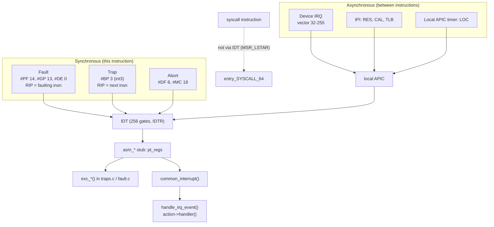

# Note 03 — Interrupts vs exceptions vs traps (the IDT)

> Module 01 · Architecture · Persian: [`03-interrupts-exceptions-traps.fa.md`](03-interrupts-exceptions-traps.fa.md) · Index: [`INDEX.en.md`](INDEX.en.md) · **ARCH-SPECIFIC (x86-64)**

## 1. Summary

- **Exceptions** are synchronous: the current instruction caused them (fault → retried, trap → reported after, abort → no return). **Interrupts** are asynchronous: a device, the timer or another CPU signalled.
- Both enter the kernel through the **IDT**, a 256-entry table of gates. Vectors 0–31 are CPU exceptions; 32–255 are external interrupts and IPIs (`FIRST_EXTERNAL_VECTOR` = `0x20`).
- Linux splits interrupt work into a short **top half** (`action->handler`, interrupts off) and deferred **bottom halves** (softirqs, tasklets, threaded IRQs, workqueues).

## 2. Explanation

### Intuition

The CPU executes one instruction after another. Two kinds of events break that flow:

- **Something about this instruction is wrong or special**: it divides by zero, touches a page that isn't mapped, or is a breakpoint. The CPU can't continue the normal flow, so it calls the kernel *now*, before (fault) or after (trap) the instruction. This is an **exception**. Run the same program with the same input and it happens at the same instruction every time.
- **Something outside the instruction stream happened**: a packet arrived, a disk finished, the scheduler tick timer expired, another CPU wants this one to reschedule. The CPU finishes the current instruction and then calls the kernel. This is an **interrupt**. It can happen between any two instructions.

Older texts use "trap" for *any* entry into the kernel, including system calls. In the Intel manual it has a precise meaning: an exception reported **after** the instruction completes. This note uses the Intel meaning.

### Exception classes (Intel SDM terms)

| Class | Saved RIP points to | Restartable | Examples (vector) |
|---|---|---|---|
| **Fault** | the faulting instruction | yes, after the handler fixes the cause | `#DE` divide error (0), `#UD` invalid opcode (6), `#GP` general protection (13), `#PF` page fault (14) |
| **Trap** | the next instruction | continues | `#BP` breakpoint `int3` (3), `#OF` `into` (4), `#DB` single-step (1, mostly trap) |
| **Abort** | unreliable | no | `#DF` double fault (8), `#MC` machine check (18) |

The page fault is the most important fault in the whole course: demand paging, copy-on-write, swap and `mmap` all depend on "fault, fix the page table, re-run the instruction" (Module 04).

### The IDT

The IDT is an array of 256 16-byte **gate descriptors**; the CPU finds it through the `IDTR` register (`lidt`). Each gate holds: handler address, code segment (`__KERNEL_CS`), type (interrupt gate clears `IF`; trap gate doesn't; Linux uses interrupt gates everywhere), `DPL` (who may use `int N`), and an **IST** index (use a known-good stack). Linux builds it from tables in `arch/x86/kernel/idt.c`:

`linux/arch/x86/kernel/idt.c · def_idts · v6.18.63` (L84–96)

```c
static const __initconst struct idt_data def_idts[] = {
	INTG(X86_TRAP_DE,		asm_exc_divide_error),
	ISTG(X86_TRAP_NMI,		asm_exc_nmi, IST_INDEX_NMI),
	INTG(X86_TRAP_BR,		asm_exc_bounds),
	INTG(X86_TRAP_UD,		asm_exc_invalid_op),
	INTG(X86_TRAP_NM,		asm_exc_device_not_available),
	INTG(X86_TRAP_OLD_MF,		asm_exc_coproc_segment_overrun),
	INTG(X86_TRAP_TS,		asm_exc_invalid_tss),
	INTG(X86_TRAP_NP,		asm_exc_segment_not_present),
	INTG(X86_TRAP_SS,		asm_exc_stack_segment),
	INTG(X86_TRAP_GP,		asm_exc_general_protection),
	INTG(X86_TRAP_SPURIOUS,		asm_exc_spurious_interrupt_bug),
	INTG(X86_TRAP_MF,		asm_exc_coprocessor_error),
```

- `INTG` = interrupt gate, `DPL0`: user code can't `int 0`, but the CPU still delivers `#DE` when user code divides by zero.
- `ISTG(... IST_INDEX_NMI)`: an NMI can arrive while the kernel is in the middle of switching stacks, so it always runs on its own per-CPU IST stack. `#DF`, `#DB` and `#MC` do too (L103–108).
- The `asm_exc_*` symbols are generated by `DECLARE_IDTENTRY*` macros in `arch/x86/include/asm/idtentry.h`; each stub saves `pt_regs` and calls the C handler `exc_*` (e.g. `DEFINE_IDTENTRY(exc_divide_error)`, `traps.c` L287).

### Interrupt delivery on x86-64

1. A device raises an MSI or a line on the I/O APIC; the **local APIC** of the target CPU gets a vector number (≥ 32).
2. At the next instruction boundary, if `RFLAGS.IF = 1`, the CPU reads gate N from the IDT, switches to the kernel stack (from ring 3: `TSS.sp0`), pushes `SS, RSP, RFLAGS, CS, RIP`, clears `IF`, jumps to the stub.
3. Linux's stub calls `common_interrupt(regs, vector)` (`arch/x86/kernel/irq.c` L318). It looks up `vector_irq[vector]` → `struct irq_desc`, runs the flow handler (`handle_edge_irq` / `handle_fasteoi_irq`), which increments the per-CPU count shown in `/proc/interrupts` and calls `handle_irq_event()` → each driver's `action->handler()` (walkthrough §6).
4. The handler acknowledges the device, maybe raises a softirq or wakes an IRQ thread, and returns. The APIC gets an EOI.
5. On the way out (`irqentry_exit`), if the interrupt came from user mode, or from preemptible kernel code, and `need_resched` is set, the kernel schedules. **The timer interrupt is how a CPU-bound task gets preempted.**

### Architecture vectors you'll see in `/proc/interrupts`

| Row | Vector | Source |
|---|---|---|
| `LOC` | `LOCAL_TIMER_VECTOR` (`0xec`) | local APIC timer: scheduler tick, hrtimers |
| `RES` | `RESCHEDULE_VECTOR` (`0xfd`) | IPI: "please call `schedule()`" (wakeup on another CPU) |
| `CAL` | `CALL_FUNCTION_VECTOR` (`0xfc`) | IPI: run a function on this CPU (`smp_call_function`) |
| `TLB` | (CAL subset) | TLB shootdown IPIs (Module 04) |
| `NMI` | 2 | non-maskable interrupt (watchdog, perf) |
| `0`, `1`, … numbered rows | 32–255 via `irq_desc` | devices: timer, i8042, ahci, virtio, e1000 … |

These names are printed by `arch_show_interrupts()` in `arch/x86/kernel/irq.c` (L72–172).

### Top half and bottom halves

The top half runs with interrupts off on this CPU, so it must be short. Deferred work:

| Mechanism | Runs in | Can sleep | Example |
|---|---|---|---|
| softirq | interrupt exit or `ksoftirqd/N` | no | `NET_RX`, `TIMER`, `RCU`, `SCHED` (see `/proc/softirqs`) |
| tasklet | softirq context | no | older drivers |
| threaded IRQ | kernel thread `irq/N-name` | yes | `request_threaded_irq()`, the `IRQ_WAKE_THREAD` return value |
| workqueue | `kworker/*` | yes | most "do this later" work |

## 3. Diagram



## 4. Worked example

On the VM (2026-11-15, shared 8-vCPU guest with other users active), a 5-second sample of `/proc/interrupts` (lab 03's `irq-delta.sh`) and a separate 5-second `perf stat` of the tracepoints:

```text
$ bash irq-delta.sh 5 8
interrupts during 5s on 8 CPUs (sum over CPUs):
   delta  irq    source
   46186  CAL    Function call interrupts
    9223  21     IO-APIC 21-fasteoi ahci[0000:00:0d.0]
    8746  LOC    Local timer interrupts
     193  RES    Rescheduling interrupts
     100  19     IO-APIC 19-fasteoi enp0s3
      38  TLB    TLB shootdowns
      10  IWI    IRQ work interrupts

$ sudo perf stat -a -e 'irq:irq_handler_entry,irq:softirq_entry,irq_vectors:local_timer_entry,irq_vectors:reschedule_entry,exceptions:page_fault_user' sleep 5
              3650      irq:irq_handler_entry
             18126      irq:softirq_entry
             22222      irq_vectors:local_timer_entry
               668      irq_vectors:reschedule_entry
            134260      exceptions:page_fault_user
```

What it shows:
- `LOC`: 8,746 timer interrupts in 5 s on 8 CPUs, about 220/s per CPU, although `CONFIG_HZ=1000`. Idle CPUs stop their tick (`NO_HZ`; this kernel has `CONFIG_NO_HZ_FULL=y`), so the count is far below `HZ`×CPUs×seconds = 40,000.
- `CAL` (46,186) and `RES` (193) are IPIs, CPUs interrupting each other. On this shared VM other users' process churn made function-call IPIs the largest source.
- `irq:irq_handler_entry` (3,650) counts only device handlers (numbered rows such as `21` ahci). The architecture vectors have their own entry points and tracepoints (`irq_vectors:*`).
- 134,260 user page faults in 5 s and not one of them in `/proc/interrupts`: faults are exceptions, not interrupts.

## 5. Edge cases & pitfalls

- **`syscall` is not an interrupt** and doesn't use the IDT on x86-64. `int 0x80` (32-bit legacy) does.
- **Interrupts can arrive in the kernel too.** A timer interrupt during a syscall nests on the kernel stack. Whether the kernel can be *preempted* there depends on the preemption model (`PREEMPT_DYNAMIC`: `none`/`voluntary`/`full`/`lazy`; Module 07).
- **Page faults in the kernel are normal** when touching user memory in `copy_from_user()`. The exception table (`__ex_table`) lets the fault handler turn a bad user pointer into `-EFAULT` instead of an oops.
- **`#DB` is fault or trap** depending on the cause (instruction breakpoint = fault, single step = trap). Don't over-generalize vector → class.
- **NMIs can't be masked by `cli`.** That's why they need an IST stack and very careful entry code (`asm_exc_nmi`).
- **`/proc/interrupts` counts are per CPU since boot.** Always compare two snapshots; a single read tells you little.
- In a **VM** many "devices" are virtual (virtio, VirtualBox's `vboxguest`), and the timer may be a paravirt clock. The rows differ from bare metal.

## 6. Exam-style key points

- Exception = synchronous, caused by the instruction. Interrupt = asynchronous, external.
- Fault: RIP = faulting instruction, retried (page fault). Trap: RIP = next instruction (`int3`). Abort: no return (`#DF`, `#MC`).
- IDT: 256 gates via `IDTR`; vectors 0–31 exceptions, 32–255 external (`FIRST_EXTERNAL_VECTOR` 0x20).
- Gate `DPL` controls `int N` from user mode; `int3` is `SYSG` (DPL 3).
- NMI, `#DF`, `#MC`, `#DB` run on IST stacks.
- Device IRQ path: APIC → IDT → `common_interrupt()` → `irq_desc` flow handler → `handle_irq_event()` → `action->handler()`.
- Top half short with IRQs off; bottom halves: softirq, tasklet, threaded IRQ, workqueue.
- The timer interrupt (`LOC`) + `need_resched` on interrupt exit is how preemption of CPU-bound tasks happens.
- Syscalls on x86-64 do not use the IDT.

## 7. Links

- Lesson: [§2.3 Interrupt, exception, trap, fault](../lesson.en.md#23-interrupt-exception-trap-fault-whats-the-difference)
- Walkthrough: [§6 Interrupts and exceptions](../kernel-walkthrough.en.md#6-interrupts-and-exceptions-the-idt)
- Lab: [03 interrupts](../labs/03-interrupts/README.md)
- Quiz: questions 5, 6, 11 in [`quiz.en.md`](../quiz.en.md)
