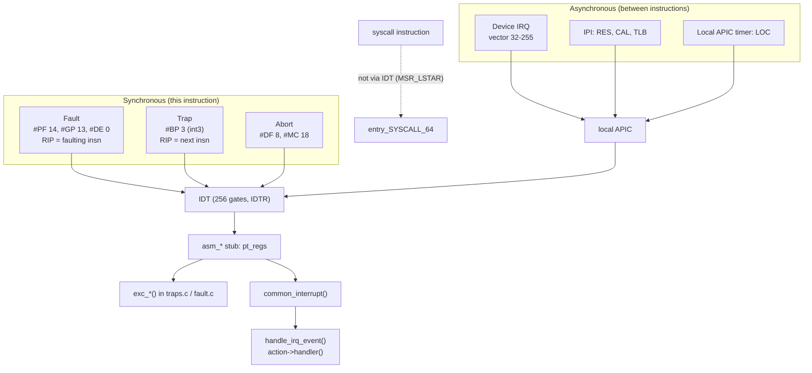

<div dir="rtl">

# یادداشت ۰۳ — interrupt در برابر exception و trap (جدول IDT)

> ماژول ۰۱ · معماری · نسخهٔ انگلیسی: [`03-interrupts-exceptions-traps.en.md`](03-interrupts-exceptions-traps.en.md) · فهرست: [`INDEX.fa.md`](INDEX.fa.md) · **ARCH-SPECIFIC (x86-64)**

## ۱. خلاصه

- **exceptionها** همگام‌اند: دستور فعلی باعثشان شده (fault ← دوباره اجرا، trap ← بعد از دستور گزارش، abort ← بدون برگشت). **interruptها** ناهمگام‌اند: یک دستگاه، تایمر یا CPU دیگر سیگنال داده.
- هر دو از طریق **IDT** وارد کرنل می‌شوند؛ جدولی با ۲۵۶ گیت. بردارهای ۰ تا ۳۱ exceptionهای CPU و ۳۲ تا ۲۵۵ interruptهای خارجی و IPI هستند (`FIRST_EXTERNAL_VECTOR` برابر `0x20`).
- لینوکس کار interrupt را به یک **نیمهٔ بالایی** کوتاه (`action->handler`، با interruptهای خاموش) و **نیمه‌های پایینی** با تأخیر (softirq، tasklet، IRQ نخ‌دار، workqueue) تقسیم می‌کند.

## ۲. توضیح

### شهود

CPU دستورها را یکی پس از دیگری اجرا می‌کند. دو نوع رویداد این جریان را می‌شکنند:

- **این دستور ایرادی یا ویژگی خاصی دارد**: بر صفر تقسیم می‌کند، به صفحه‌ای دست می‌زند که map نشده، یا یک breakpoint است. CPU نمی‌تواند جریان عادی را ادامه دهد، پس *همین حالا* کرنل را صدا می‌زند؛ پیش از دستور (fault) یا بعد از آن (trap). این یک **exception** است. همان برنامه را با همان ورودی اجرا کنید و هر بار روی همان دستور رخ می‌دهد.
- **چیزی بیرون از جریان دستورها رخ داده**: یک بسته رسیده، دیسک کارش تمام شده، تایمر tick زمان‌بند منقضی شده، یا CPU دیگری از این CPU می‌خواهد دوباره زمان‌بندی کند. CPU دستور فعلی را تمام می‌کند و بعد کرنل را صدا می‌زند. این یک **interrupt** است و ممکن است بین هر دو دستوری رخ دهد.

کتاب‌های قدیمی‌تر «trap» را برای *هر* ورودی به کرنل، از جمله system call، به کار می‌برند. در دفترچهٔ Intel معنای دقیقی دارد: exceptionای که **بعد از** تمام شدن دستور گزارش می‌شود. این یادداشت معنای Intel را به کار می‌برد.

### دسته‌های exception (اصطلاحات Intel SDM)

| دسته | RIP ذخیره‌شده به کجا اشاره می‌کند | قابل ادامه | نمونه‌ها (بردار) |
|---|---|---|---|
| **Fault** | دستوری که fault داده | بله، بعد از اینکه handler علت را رفع کند | خطای تقسیم `#DE` (۰)، opcode نامعتبر `#UD` (۶)، حفاظت عمومی `#GP` (۱۳)، page fault یا `#PF` (۱۴) |
| **Trap** | دستور بعدی | ادامه می‌دهد | breakpoint با `int3` یعنی `#BP` (۳)، `into` یعنی `#OF` (۴)، single-step یعنی `#DB` (۱، بیشتر trap) |
| **Abort** | قابل اعتماد نیست | نه | double fault یعنی `#DF` (۸)، machine check یعنی `#MC` (۱۸) |

page fault مهم‌ترین fault در کل این درس است: demand paging، copy-on-write، swap و `mmap` همه به «fault، اصلاح جدول صفحه، اجرای دوبارهٔ دستور» وابسته‌اند (ماژول ۰۴).

### IDT

IDT آرایه‌ای از ۲۵۶ **descriptor گیت** ۱۶ بایتی است؛ CPU آن را از طریق رجیستر `IDTR` پیدا می‌کند (`lidt`). هر گیت این‌ها را نگه می‌دارد: آدرس handler، segment کد (`__KERNEL_CS`)، نوع (interrupt gate بیت `IF` را پاک می‌کند و trap gate نه؛ لینوکس همه‌جا از interrupt gate استفاده می‌کند)، `DPL` (چه کسی می‌تواند `int N` بزند) و یک اندیس **IST** (استفاده از پشته‌ای که مطمئنیم سالم است). لینوکس آن را از جدول‌هایی در `arch/x86/kernel/idt.c` می‌سازد:

`linux/arch/x86/kernel/idt.c · def_idts · v6.18.63` (L84–96)

</div>

```c
static const __initconst struct idt_data def_idts[] = {
	INTG(X86_TRAP_DE,		asm_exc_divide_error),
	ISTG(X86_TRAP_NMI,		asm_exc_nmi, IST_INDEX_NMI),
	INTG(X86_TRAP_BR,		asm_exc_bounds),
	INTG(X86_TRAP_UD,		asm_exc_invalid_op),
	INTG(X86_TRAP_NM,		asm_exc_device_not_available),
	INTG(X86_TRAP_OLD_MF,		asm_exc_coproc_segment_overrun),
	INTG(X86_TRAP_TS,		asm_exc_invalid_tss),
	INTG(X86_TRAP_NP,		asm_exc_segment_not_present),
	INTG(X86_TRAP_SS,		asm_exc_stack_segment),
	INTG(X86_TRAP_GP,		asm_exc_general_protection),
	INTG(X86_TRAP_SPURIOUS,		asm_exc_spurious_interrupt_bug),
	INTG(X86_TRAP_MF,		asm_exc_coprocessor_error),
```

<div dir="rtl">

- `INTG` یعنی interrupt gate با `DPL0`: کد کاربر نمی‌تواند `int 0` بزند، ولی CPU وقتی کد کاربر بر صفر تقسیم کند همچنان `#DE` را تحویل می‌دهد.
- `ISTG(... IST_INDEX_NMI)`: یک NMI ممکن است وقتی برسد که کرنل وسط عوض کردن پشته است، پس همیشه روی پشتهٔ IST مخصوص خودش (برای هر CPU) اجرا می‌شود. `#DF`، `#DB` و `#MC` هم همین‌طورند (L103–108).
- نمادهای `asm_exc_*` را ماکروهای `DECLARE_IDTENTRY*` در `arch/x86/include/asm/idtentry.h` می‌سازند؛ هر stub مقدار `pt_regs` را ذخیره می‌کند و handler نوشته‌شده به C یعنی `exc_*` را صدا می‌زند (مثلاً `DEFINE_IDTENTRY(exc_divide_error)` در `traps.c` خط L287).

### تحویل interrupt در x86-64

۱. یک دستگاه یک MSI یا یک خط روی I/O APIC را فعال می‌کند؛ **local APIC** در CPU مقصد یک شمارهٔ بردار (≥ ۳۲) دریافت می‌کند.
۲. در مرز دستور بعدی، اگر `RFLAGS.IF = 1` باشد، CPU گیت N را از IDT می‌خواند، به پشتهٔ کرنل می‌رود (اگر از ring 3 آمده باشد از `TSS.sp0`)، `SS, RSP, RFLAGS, CS, RIP` را push می‌کند، `IF` را پاک می‌کند و به stub می‌پرد.
۳. stub لینوکس `common_interrupt(regs, vector)` را صدا می‌زند (`arch/x86/kernel/irq.c` خط L318). این تابع `vector_irq[vector]` را جستجو می‌کند تا `struct irq_desc` را پیدا کند و تابع جریان (`handle_edge_irq` / `handle_fasteoi_irq`) را اجرا می‌کند که شمارندهٔ per-CPU نشان داده‌شده در `/proc/interrupts` را افزایش می‌دهد و `handle_irq_event()` ← `action->handler()` هر درایور را صدا می‌زند (walkthrough بخش ۶).
۴. handler دستگاه را تأیید می‌کند، شاید یک softirq فعال کند یا یک نخ IRQ را بیدار کند، و برمی‌گردد. APIC یک EOI دریافت می‌کند.
۵. در مسیر خروج (`irqentry_exit`)، اگر interrupt از حالت کاربر یا از کد کرنل قابل preemption آمده باشد و `need_resched` تنظیم شده باشد، کرنل زمان‌بندی می‌کند. **interrupt تایمر همان راهی است که یک task پرمصرف CPU را preempt می‌کند.**

### بردارهای معماری که در `/proc/interrupts` می‌بینید

| ردیف | بردار | منبع |
|---|---|---|
| `LOC` | `LOCAL_TIMER_VECTOR` (`0xec`) | تایمر local APIC: tick زمان‌بند و hrtimerها |
| `RES` | `RESCHEDULE_VECTOR` (`0xfd`) | IPI: «لطفاً `schedule()` را صدا بزن» (بیدار شدن taskی روی CPU دیگر) |
| `CAL` | `CALL_FUNCTION_VECTOR` (`0xfc`) | IPI: یک تابع را روی این CPU اجرا کن (`smp_call_function`) |
| `TLB` | (زیرمجموعهٔ CAL) | IPIهای TLB shootdown (ماژول ۰۴) |
| `NMI` | ۲ | interrupt غیرقابل ماسک (watchdog، perf) |
| ردیف‌های عددی `0`، `1`، … | ۳۲ تا ۲۵۵ از طریق `irq_desc` | دستگاه‌ها: timer، i8042، ahci، virtio، e1000 … |

این نام‌ها را `arch_show_interrupts()` در `arch/x86/kernel/irq.c` (خط‌های L72–172) چاپ می‌کند.

### نیمهٔ بالایی و نیمه‌های پایینی

نیمهٔ بالایی با interruptهای خاموش روی همین CPU اجرا می‌شود، پس باید کوتاه باشد. کار با تأخیر:

| سازوکار | کجا اجرا می‌شود | می‌تواند بخوابد | نمونه |
|---|---|---|---|
| softirq | هنگام خروج از interrupt یا در `ksoftirqd/N` | نه | `NET_RX`، `TIMER`، `RCU`، `SCHED` (ببینید `/proc/softirqs`) |
| tasklet | زمینهٔ softirq | نه | درایورهای قدیمی‌تر |
| IRQ نخ‌دار | نخ کرنل `irq/N-name` | بله | `request_threaded_irq()`، مقدار برگشتی `IRQ_WAKE_THREAD` |
| workqueue | `kworker/*` | بله | بیشتر کارهای «بعداً انجامش بده» |

## ۳. نمودار

</div>



<div dir="rtl">

## ۴. مثال عملی

روی VM (۱۴۰۵/۰۸/۲۴، مهمان مشترک با ۸ vCPU در حالی که کاربران دیگر فعال بودند)، یک نمونهٔ ۵ ثانیه‌ای از `/proc/interrupts` (اسکریپت `irq-delta.sh` در آزمایش ۰۳) و یک `perf stat` جداگانهٔ ۵ ثانیه‌ای روی tracepointها:

</div>

```text
$ bash irq-delta.sh 5 8
interrupts during 5s on 8 CPUs (sum over CPUs):
   delta  irq    source
   46186  CAL    Function call interrupts
    9223  21     IO-APIC 21-fasteoi ahci[0000:00:0d.0]
    8746  LOC    Local timer interrupts
     193  RES    Rescheduling interrupts
     100  19     IO-APIC 19-fasteoi enp0s3
      38  TLB    TLB shootdowns
      10  IWI    IRQ work interrupts

$ sudo perf stat -a -e 'irq:irq_handler_entry,irq:softirq_entry,irq_vectors:local_timer_entry,irq_vectors:reschedule_entry,exceptions:page_fault_user' sleep 5
              3650      irq:irq_handler_entry
             18126      irq:softirq_entry
             22222      irq_vectors:local_timer_entry
               668      irq_vectors:reschedule_entry
            134260      exceptions:page_fault_user
```

<div dir="rtl">

چه چیزی را نشان می‌دهد:
- `LOC`: در ۵ ثانیه روی ۸ CPU، ۸٬۷۴۶ وقفهٔ تایمر رخ داد، یعنی حدود ۲۲۰ در ثانیه برای هر CPU، با اینکه `CONFIG_HZ=1000` است. CPUهای بیکار tick خود را متوقف می‌کنند (`NO_HZ`؛ این کرنل `CONFIG_NO_HZ_FULL=y` دارد)، پس عدد خیلی کمتر از HZ×CPUها×ثانیه = ۴۰٬۰۰۰ است.
- `CAL` (۴۶٬۱۸۶) و `RES` (۱۹۳) همان IPIها هستند: CPUها یکدیگر را قطع می‌کنند. روی این VM مشترک، ساخته شدن مداوم پردازه‌ها توسط کاربران دیگر، IPIهای function-call را به بزرگ‌ترین منبع تبدیل کرد.
- `irq:irq_handler_entry` (۳٬۶۵۰) فقط handlerهای دستگاه را می‌شمارد (ردیف‌های عددی مثل `21` یعنی ahci). بردارهای معماری نقطهٔ ورود و tracepoint خودشان را دارند (`irq_vectors:*`).
- ۱۳۴٬۲۶۰ page fault کاربر در ۵ ثانیه، و هیچ‌کدام در `/proc/interrupts` نیست: fault یک exception است، نه interrupt.

## ۵. حالت‌های خاص و دام‌ها

- **`syscall` یک interrupt نیست** و در x86-64 از IDT استفاده نمی‌کند. `int 0x80` (مسیر قدیمی ۳۲ بیتی) استفاده می‌کند.
- **interruptها در کرنل هم می‌رسند.** یک interrupt تایمر وسط یک syscall روی پشتهٔ کرنل تودرتو می‌شود. اینکه کرنل آنجا قابل *preempt* شدن باشد به مدل preemption بستگی دارد (`PREEMPT_DYNAMIC`: `none`/`voluntary`/`full`/`lazy`؛ ماژول ۰۷).
- **page fault در کرنل عادی است** وقتی در `copy_from_user()` به حافظهٔ کاربر دست زده می‌شود. جدول exception (`__ex_table`) به handler اجازه می‌دهد یک اشاره‌گر کاربر خراب را به جای oops به `-EFAULT` تبدیل کند.
- **`#DB` بسته به علت fault یا trap است** (breakpoint دستور = fault، single step = trap). از روی شمارهٔ بردار دربارهٔ دسته تعمیم ندهید.
- **NMI با `cli` ماسک نمی‌شود.** برای همین به پشتهٔ IST و کد ورود بسیار دقیقی (`asm_exc_nmi`) نیاز دارد.
- **شمارنده‌های `/proc/interrupts` برای هر CPU از زمان بوت‌اند.** همیشه دو نمونه را مقایسه کنید؛ یک بار خواندن چیز زیادی نمی‌گوید.
- در **VM** بسیاری از «دستگاه‌ها» مجازی‌اند (virtio، `vboxguest` در VirtualBox) و تایمر ممکن است یک ساعت paravirt باشد. ردیف‌ها با سخت‌افزار واقعی فرق دارند.

## ۶. نکته‌های کلیدی امتحانی

- exception = همگام، دستور باعثش شده. interrupt = ناهمگام، بیرونی.
- fault: RIP = دستور خطادار، دوباره اجرا می‌شود (page fault). trap: RIP = دستور بعدی (`int3`). abort: بدون برگشت (`#DF`، `#MC`).
- IDT: ۲۵۶ گیت از طریق `IDTR`؛ بردارهای ۰ تا ۳۱ exception و ۳۲ تا ۲۵۵ خارجی (`FIRST_EXTERNAL_VECTOR` برابر 0x20).
- `DPL` گیت، `int N` در حالت کاربر را کنترل می‌کند؛ `int3` از نوع `SYSG` (با DPL 3) است.
- NMI، `#DF`، `#MC` و `#DB` روی پشته‌های IST اجرا می‌شوند.
- مسیر IRQ دستگاه: APIC ← IDT ← `common_interrupt()` ← تابع جریان `irq_desc` ← `handle_irq_event()` ← `action->handler()`.
- نیمهٔ بالایی کوتاه و با IRQهای خاموش؛ نیمه‌های پایینی: softirq، tasklet، IRQ نخ‌دار، workqueue.
- interrupt تایمر (`LOC`) به‌اضافهٔ `need_resched` هنگام خروج از interrupt، همان سازوکار preempt شدن taskهای پرمصرف CPU است.
- syscallها در x86-64 از IDT استفاده نمی‌کنند.

## ۷. پیوندها

- درس: [بخش ۲.۳ interrupt، exception، trap، fault](../lesson.fa.md)
- Walkthrough: [بخش ۶ interrupt و exception](../kernel-walkthrough.fa.md)
- آزمایش: [03 interruptها](../labs/03-interrupts/README.md)
- آزمونک: پرسش‌های ۵، ۶ و ۱۱ در [`quiz.fa.md`](../quiz.fa.md)

</div>
