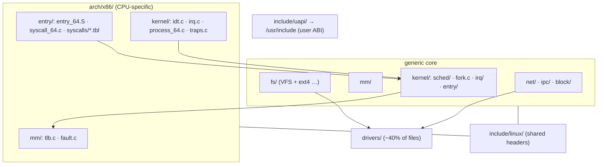

# Note 06 — Linux source tree map

> Module 01 · Architecture · Persian: [`06-linux-source-tree-map.fa.md`](06-linux-source-tree-map.fa.md) · Index: [`INDEX.en.md`](INDEX.en.md) · Pin: **v6.18.63**

## 1. Summary

- The tree is split by **layer**: `arch/` (CPU-specific), `kernel/` + `mm/` + `fs/` + `net/` + `block/` + `ipc/` (generic core), `drivers/` (devices), `include/` (shared headers). Generic code calls arch code through a fixed set of hooks.
- `drivers/` alone is ~40% of the files; the core that this course reads is a small fraction.
- To find anything: `git grep` the definition (for syscalls: `SYSCALL_DEFINEn(name,`), check the file's `MAINTAINERS` entry, then read it on Elixir at the pinned tag.

## 2. Explanation

### Intuition

The tree reflects the monolithic-but-portable design (note 01): one kernel image that runs on 20+ CPU architectures. Everything that depends on the CPU (entry code, page-table format, context-switch assembly, atomic instructions) is under `arch/<cpu>/`; everything else is written once. When you read a call chain you will often cross that line: `kernel/sched/core.c` (generic) calls `switch_to()`, defined in `arch/x86/include/asm/switch_to.h`.

### The top level

| Directory | Contents | Examples you will read in this course |
|---|---|---|
| `arch/x86/` | x86 entry code, IDT, syscalls table, context-switch asm, page-table and TLB code, KVM | `entry/entry_64.S`, `entry/syscall_64.c`, `entry/syscalls/syscall_64.tbl`, `kernel/process_64.c`, `kernel/idt.c`, `mm/tlb.c`, `mm/fault.c`, `kvm/` (M6) |
| `kernel/` | scheduler, fork/exit, signals, generic IRQ, entry work, locking, RCU, tracing, cgroups, namespaces | `sched/core.c`, `sched/fair.c` (M2), `fork.c` (M2), `irq/handle.c`, `entry/common.c`, `locking/` (M3), `rcu/` (M3), `cgroup/` + `nsproxy.c` (M6), `seccomp.c` (M7) |
| `mm/` | memory management | `memory.c`, `mmap.c`, `page_alloc.c`, `slub.c`, `vmscan.c` (M4) |
| `fs/` | VFS + each file system | `read_write.c`, `namei.c`, `dcache.c`, `inode.c`, `ext4/` (M5) |
| `block/`, `io_uring/` | block layer, I/O schedulers, io_uring | M5 |
| `net/` | networking stack | sockets (M2 IPC) |
| `ipc/` | System V IPC, POSIX mqueue | `shm.c`, `msg.c` (M2) |
| `drivers/` | device drivers, by bus/class | `drivers/char/`, `drivers/block/` |
| `include/linux/`, `include/uapi/` | kernel-internal headers; **user ABI** headers (copied to `/usr/include`) | `syscalls.h`, `compiler_types.h`, `sched.h` (`task_struct`) |
| `security/` | LSMs: SELinux, AppArmor, Landlock | `landlock/` (M7) |
| `virt/` | generic KVM | `virt/kvm/` (M6) |
| `init/` | boot: `start_kernel()` | `init/main.c` |
| `lib/` | helpers (strings, rbtree, vDSO generic code) | `lib/vdso/gettimeofday.c` |
| `tools/` | user-space tools that ship with the kernel | `tools/perf/`, `tools/testing/selftests/` |
| `Documentation/` | reStructuredText docs → docs.kernel.org | `Documentation/scheduler/`, `Documentation/arch/x86/` |
| `scripts/` | build helpers, `checkpatch.pl`, `get_maintainer.pl` | — |
| `rust/` | Rust support for drivers | — |

### The `arch/` ↔ generic boundary

Generic code expects each architecture to provide a set of functions/macros with fixed names. Some you meet in this module:

| Generic caller | Arch hook (x86) | Defined in |
|---|---|---|
| `context_switch()` in `kernel/sched/core.c` | `switch_to()`, `switch_mm_irqs_off()` | `arch/x86/include/asm/switch_to.h`, `arch/x86/mm/tlb.c` |
| `do_syscall_64()` → generic entry | `syscall_enter_from_user_mode()` | `include/linux/entry-common.h` (generic) called from arch |
| `handle_irq_event()` in `kernel/irq/` | `common_interrupt()` → `call_irq_handler()` | `arch/x86/kernel/irq.c` |
| `SYSCALL_DEFINEn` in `include/linux/syscalls.h` | `__SYSCALL_DEFINEx` override (pt_regs stubs) | `arch/x86/include/asm/syscall_wrapper.h` |

Direction matters: since ~v5.9 x86 uses the **generic entry** code (`kernel/entry/`), so the order is arch asm → arch C (`do_syscall_64`) → generic helpers → back to arch asm.

### How to find a symbol in 30 seconds

1. **Definition**: `git grep -n "^ssize_t vfs_read"` or `git grep -n "SYSCALL_DEFINE3(read,"`. Kernel style puts the return type at line start, so `^type name` finds definitions, not calls.
2. **Macro-generated names** (`__x64_sys_read`, `asm_exc_page_fault`): search for the macro that builds them (`__SYS_STUBx`, `DECLARE_IDTENTRY`), or look in `/proc/kallsyms` on the running kernel.
3. **Who calls it**: Elixir's "Referenced in" list, or `cscope -d` (set up in Module 00).
4. **Who owns it**: `scripts/get_maintainer.pl -f fs/read_write.c` or search `MAINTAINERS`.
5. **Cite it**: `bash _shared/sources/cite.sh linux fs/read_write.c vfs_read` (path · function · v6.18.63 · line range).

### What runs where in the image

`vmlinux` sections tie back to source annotations you'll see in excerpts:

| Annotation | Section | Meaning |
|---|---|---|
| `__init` | `.init.text` | freed after boot |
| `noinstr` | `.noinstr.text` | no tracing/instrumentation (entry code) |
| `__visible` | — | keep the symbol visible to asm callers even with LTO |
| `__user` | — (sparse only) | pointer into user space; must go through `copy_from_user()` |
| `SYM_CODE_START` | `.text` (asm) | asm symbol that is not a normal C function (no standard frame) |

## 3. Diagram



## 4. Worked example: what's actually in the tree

Run in the course checkout (`_shared/sources/linux`, v6.18.63). `git ls-tree` reads the commit, so it counts the whole tree even though our working copy is sparse:

```text
$ git ls-tree -d --name-only HEAD | tr '\n' ' '
Documentation LICENSES arch block certs crypto drivers fs include init io_uring ipc kernel lib mm net rust samples scripts security sound tools usr virt

$ git ls-tree -r --name-only HEAD | awk -F/ '{print $1}' | sort | uniq -c | sort -rn | head -12
  36552 drivers
  18099 arch
  10820 Documentation
   8613 tools
   6512 include
   2911 sound
   2260 fs
   1983 net
    765 lib
    675 kernel
    573 scripts
    297 security

$ git ls-tree -r --name-only HEAD | wc -l
91256
```

- `drivers/` has 36,552 of 91,256 files (40%); `kernel/` has 675 and `mm/` 197. The scheduler, the syscall path and the memory manager this course reads are in under 1,000 files.
- `arch/` is the second largest because each architecture repeats entry, MM and boot code.

And the sparse set we actually check out (`git sparse-checkout list`) is: `arch/x86/{entry,include,kernel,kvm,mm}`, `block`, `drivers/{block,char,net/wireguard}`, `fs`, `include`, `init`, `io_uring`, `ipc`, `kernel`, `lib`, `mm`, `net`, `security`, `virt` and a few `Documentation/` folders. If a path is missing, add it with `git -C _shared/sources/linux sparse-checkout add <dir>`.

## 5. Edge cases & pitfalls

- **Searching `sys_read(`** finds nothing useful: the function is generated by `SYSCALL_DEFINE3(read, …)` (walkthrough §5).
- **Headers in `arch/x86/include/asm/` override `include/asm-generic/`**: the same `#include <asm/switch_to.h>` resolves differently per architecture.
- **`include/uapi/` is ABI**: anything there is promised to user space forever; `include/linux/` can change any release.
- **Generated files are not in git**: `asm/syscalls_64.h` (from `syscall_64.tbl`), `asm-offsets.h` (`TASK_threadsp` used by `__switch_to_asm`). Elixir can't show them either. Read the generator (`arch/x86/entry/syscalls/Makefile`, `arch/x86/kernel/asm-offsets.c`) or look in a build tree (Module 00 lab 03).
- **Blog posts quote old trees**: e.g. `arch/x86/kernel/entry_64.S` (moved to `arch/x86/entry/` in 2015), `sys_call_table[]` dispatch (gone on x86-64). Always check against the pin.
- **Config changes the code**: `#ifdef CONFIG_X86_X32_ABI`, PTI `ALTERNATIVE`s. Read with the VM's `/boot/config-$(uname -r)` next to you.

## 6. Exam-style key points

- `arch/` = CPU-specific; `kernel/`, `mm/`, `fs/`, `net/`, `block/`, `ipc/` = generic core; `drivers/` = devices (~40% of files).
- Generic code calls fixed arch hooks (`switch_to`, `switch_mm_irqs_off`, entry hooks).
- `include/uapi/` = stable user ABI; `include/linux/` = internal, unstable.
- Find definitions with `git grep "^type name"`; syscalls with `SYSCALL_DEFINEn(name,`.
- Macro-generated symbols (`__x64_sys_*`, `asm_exc_*`) come from `syscall_wrapper.h`, `idtentry.h`.
- Section annotations: `__init`, `noinstr` (`.noinstr.text`), `__user` (sparse).
- Always cite path · function · v6.18.63 · lines; never trust old blog paths.

## 7. Links

- Lesson: [§2.7 Where is everything in the Linux tree?](../lesson.en.md#27-where-is-everything-in-the-linux-tree)
- Walkthrough: [§0 call-chain table](../kernel-walkthrough.en.md#0-the-call-chain)
- Lab: [01 strace map](../labs/01-strace-map/README.md) (uses `syscall_64.tbl`), Module 00 guide §4 (`ctags`, `cscope`, Elixir)
- Quiz: question 15 in [`quiz.en.md`](../quiz.en.md)
