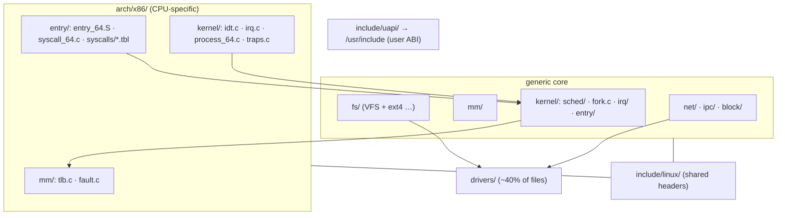

<div dir="rtl">

# یادداشت ۰۶ — نقشهٔ درخت سورس لینوکس

> ماژول ۰۱ · معماری · نسخهٔ انگلیسی: [`06-linux-source-tree-map.en.md`](06-linux-source-tree-map.en.md) · فهرست: [`INDEX.fa.md`](INDEX.fa.md) · نسخهٔ ثابت: **v6.18.63**

## ۱. خلاصه

- درخت بر اساس **لایه** تقسیم شده است: `arch/` (وابسته به CPU)، `kernel/` + `mm/` + `fs/` + `net/` + `block/` + `ipc/` (هستهٔ عمومی)، `drivers/` (دستگاه‌ها)، `include/` (headerهای مشترک). کد عمومی از طریق مجموعهٔ ثابتی از hookها کد معماری را صدا می‌زند.
- `drivers/` به‌تنهایی حدود ۴۰٪ فایل‌هاست؛ هسته‌ای که این درس می‌خواند بخش کوچکی است.
- برای پیدا کردن هر چیزی: تعریف را با `git grep` پیدا کنید (برای syscall: `SYSCALL_DEFINEn(name,`)، ورودی `MAINTAINERS` فایل را ببینید، بعد آن را در Elixir روی tag ثابت بخوانید.

## ۲. توضیح

### شهود

درخت بازتاب طراحی monolithic ولی قابل‌حمل است (یادداشت ۰۱): یک image کرنل که روی بیش از ۲۰ معماری CPU اجرا می‌شود. هر چیزی که به CPU وابسته است (کد ورود، قالب جدول صفحه، اسمبلی context switch، دستورهای atomic) زیر `arch/<cpu>/` است و بقیه یک بار نوشته می‌شود. وقتی یک زنجیرهٔ فراخوانی را می‌خوانید، اغلب از این مرز عبور می‌کنید: `kernel/sched/core.c` (عمومی) تابع `switch_to()` را صدا می‌زند که در `arch/x86/include/asm/switch_to.h` تعریف شده.

### سطح بالا

| پوشه | محتوا | نمونه‌هایی که در این درس می‌خوانید |
|---|---|---|
| `arch/x86/` | کد ورود x86، IDT، جدول syscall، اسمبلی context switch، کد جدول صفحه و TLB، KVM | `entry/entry_64.S`، `entry/syscall_64.c`، `entry/syscalls/syscall_64.tbl`، `kernel/process_64.c`، `kernel/idt.c`، `mm/tlb.c`، `mm/fault.c`، `kvm/` (ماژول ۶) |
| `kernel/` | زمان‌بند، fork/exit، signal، IRQ عمومی، کارهای ورود، قفل‌ها، RCU، ردیابی، cgroup، namespace | `sched/core.c`، `sched/fair.c` (ماژول ۲)، `fork.c` (ماژول ۲)، `irq/handle.c`، `entry/common.c`، `locking/` (ماژول ۳)، `rcu/` (ماژول ۳)، `cgroup/` و `nsproxy.c` (ماژول ۶)، `seccomp.c` (ماژول ۷) |
| `mm/` | مدیریت حافظه | `memory.c`، `mmap.c`، `page_alloc.c`، `slub.c`، `vmscan.c` (ماژول ۴) |
| `fs/` | VFS و هر فایل‌سیستم | `read_write.c`، `namei.c`، `dcache.c`، `inode.c`، `ext4/` (ماژول ۵) |
| `block/`، `io_uring/` | لایهٔ block، زمان‌بندهای I/O، io_uring | ماژول ۵ |
| `net/` | پشتهٔ شبکه | socketها (IPC در ماژول ۲) |
| `ipc/` | System V IPC، صف پیام POSIX | `shm.c`، `msg.c` (ماژول ۲) |
| `drivers/` | درایورهای دستگاه، بر اساس bus/کلاس | `drivers/char/`، `drivers/block/` |
| `include/linux/`، `include/uapi/` | headerهای داخلی کرنل؛ headerهای **ABI کاربر** (که در `/usr/include` کپی می‌شوند) | `syscalls.h`، `compiler_types.h`، `sched.h` (`task_struct`) |
| `security/` | LSMها: SELinux، AppArmor، Landlock | `landlock/` (ماژول ۷) |
| `virt/` | KVM عمومی | `virt/kvm/` (ماژول ۶) |
| `init/` | بوت: `start_kernel()` | `init/main.c` |
| `lib/` | کمکی‌ها (رشته، rbtree، کد عمومی vDSO) | `lib/vdso/gettimeofday.c` |
| `tools/` | ابزارهای فضای کاربر که با کرنل عرضه می‌شوند | `tools/perf/`، `tools/testing/selftests/` |
| `Documentation/` | مستندات reStructuredText ← docs.kernel.org | `Documentation/scheduler/`، `Documentation/arch/x86/` |
| `scripts/` | کمک‌ابزارهای build، `checkpatch.pl`، `get_maintainer.pl` | — |
| `rust/` | پشتیبانی Rust برای درایورها | — |

### مرز `arch/` ↔ عمومی

کد عمومی از هر معماری انتظار دارد مجموعه‌ای از توابع یا ماکروها را با نام‌های ثابت فراهم کند. چند تا که در این ماژول می‌بینید:

| فراخوانی‌کنندهٔ عمومی | hook معماری (x86) | محل تعریف |
|---|---|---|
| `context_switch()` در `kernel/sched/core.c` | `switch_to()`، `switch_mm_irqs_off()` | `arch/x86/include/asm/switch_to.h`، `arch/x86/mm/tlb.c` |
| `do_syscall_64()` ← ورود عمومی | `syscall_enter_from_user_mode()` | `include/linux/entry-common.h` (عمومی) که از معماری صدا زده می‌شود |
| `handle_irq_event()` در `kernel/irq/` | `common_interrupt()` ← `call_irq_handler()` | `arch/x86/kernel/irq.c` |
| `SYSCALL_DEFINEn` در `include/linux/syscalls.h` | بازتعریف `__SYSCALL_DEFINEx` (stubهای pt_regs) | `arch/x86/include/asm/syscall_wrapper.h` |

جهت مهم است: از حدود v5.9، x86 از کد **ورود عمومی** (`kernel/entry/`) استفاده می‌کند، پس ترتیب این است: اسمبلی معماری ← C معماری (`do_syscall_64`) ← کمکی‌های عمومی ← دوباره اسمبلی معماری.

### چطور یک نماد را در ۳۰ ثانیه پیدا کنیم

۱. **تعریف**: `git grep -n "^ssize_t vfs_read"` یا `git grep -n "SYSCALL_DEFINE3(read,"`. سبک کد کرنل نوع برگشتی را در ابتدای خط می‌گذارد، پس `^type name` تعریف‌ها را پیدا می‌کند، نه فراخوانی‌ها را.
۲. **نام‌هایی که ماکرو ساخته** (`__x64_sys_read`، `asm_exc_page_fault`): دنبال ماکروی سازنده بگردید (`__SYS_STUBx`، `DECLARE_IDTENTRY`)، یا روی کرنل در حال اجرا در `/proc/kallsyms` نگاه کنید.
۳. **چه کسی آن را صدا می‌زند**: فهرست «Referenced in» در Elixir، یا `cscope -d` (در ماژول ۰۰ راه‌اندازی شده).
۴. **صاحبش کیست**: `scripts/get_maintainer.pl -f fs/read_write.c` یا جستجو در `MAINTAINERS`.
۵. **ارجاع**: `bash _shared/sources/cite.sh linux fs/read_write.c vfs_read` (مسیر · تابع · v6.18.63 · بازهٔ خط).

### چه چیزی کجای image اجرا می‌شود

بخش‌های `vmlinux` به برچسب‌هایی در سورس برمی‌گردند که در بخش‌های کد می‌بینید:

| برچسب | بخش | معنا |
|---|---|---|
| `__init` | `.init.text` | بعد از بوت آزاد می‌شود |
| `noinstr` | `.noinstr.text` | بدون ردیابی و instrumentation (کد ورود) |
| `__visible` | — | نماد را حتی با LTO برای فراخوانی‌کننده‌های اسمبلی قابل دیدن نگه می‌دارد |
| `__user` | — (فقط sparse) | اشاره‌گر به فضای کاربر؛ باید از `copy_from_user()` بگذرد |
| `SYM_CODE_START` | `.text` (اسمبلی) | نماد اسمبلی که تابع C عادی نیست (قاب استاندارد ندارد) |

## ۳. نمودار

</div>



<div dir="rtl">

## ۴. مثال عملی: واقعاً چه چیزی در درخت هست

در checkout درس (`_shared/sources/linux`، v6.18.63) اجرا کنید. `git ls-tree` خود commit را می‌خواند، پس کل درخت را می‌شمارد، حتی با اینکه نسخهٔ کاری ما sparse است:

</div>

```text
$ git ls-tree -d --name-only HEAD | tr '\n' ' '
Documentation LICENSES arch block certs crypto drivers fs include init io_uring ipc kernel lib mm net rust samples scripts security sound tools usr virt

$ git ls-tree -r --name-only HEAD | awk -F/ '{print $1}' | sort | uniq -c | sort -rn | head -12
  36552 drivers
  18099 arch
  10820 Documentation
   8613 tools
   6512 include
   2911 sound
   2260 fs
   1983 net
    765 lib
    675 kernel
    573 scripts
    297 security

$ git ls-tree -r --name-only HEAD | wc -l
91256
```

<div dir="rtl">

- `drivers/` شامل ۳۶٬۵۵۲ فایل از ۹۱٬۲۵۶ فایل است (۴۰٪)؛ `kernel/` ۶۷۵ و `mm/` ۱۹۷ فایل دارد. زمان‌بند، مسیر syscall و مدیر حافظه‌ای که این درس می‌خواند در کمتر از ۱٬۰۰۰ فایل‌اند.
- `arch/` دومین پوشهٔ بزرگ است، چون هر معماری کد ورود، MM و بوت را تکرار می‌کند.

مجموعهٔ sparse که ما واقعاً checkout می‌کنیم (`git sparse-checkout list`) این است: `arch/x86/{entry,include,kernel,kvm,mm}`، `block`، `drivers/{block,char,net/wireguard}`، `fs`، `include`، `init`، `io_uring`، `ipc`، `kernel`، `lib`، `mm`، `net`، `security`، `virt` و چند پوشهٔ `Documentation/`. اگر مسیری نبود، با `git -C _shared/sources/linux sparse-checkout add <dir>` اضافه‌اش کنید.

## ۵. حالت‌های خاص و دام‌ها

- **جستجوی `sys_read(`** چیز مفیدی پیدا نمی‌کند: این تابع را `SYSCALL_DEFINE3(read, …)` می‌سازد (walkthrough بخش ۵).
- **headerهای `arch/x86/include/asm/` روی `include/asm-generic/` غلبه می‌کنند**: همان `#include <asm/switch_to.h>` در هر معماری به فایل دیگری می‌رسد.
- **`include/uapi/` یعنی ABI**: هر چیزی آنجا برای همیشه به فضای کاربر قول داده شده؛ `include/linux/` در هر نسخه می‌تواند عوض شود.
- **فایل‌های تولیدشده در git نیستند**: `asm/syscalls_64.h` (از `syscall_64.tbl`)، `asm-offsets.h` (مقدار `TASK_threadsp` که `__switch_to_asm` استفاده می‌کند). Elixir هم نشانشان نمی‌دهد. سازنده را بخوانید (`arch/x86/entry/syscalls/Makefile`، `arch/x86/kernel/asm-offsets.c`) یا در یک درخت build نگاه کنید (آزمایش ۰۳ ماژول ۰۰).
- **پست‌های وبلاگ درخت قدیمی را نقل می‌کنند**: مثلاً `arch/x86/kernel/entry_64.S` (در سال ۲۰۱۵ به `arch/x86/entry/` منتقل شد)، یا توزیع با `sys_call_table[]` (در x86-64 دیگر وجود ندارد). همیشه با نسخهٔ ثابت مقایسه کنید.
- **پیکربندی کد را عوض می‌کند**: `#ifdef CONFIG_X86_X32_ABI`، `ALTERNATIVE`های PTI. هنگام خواندن، `/boot/config-$(uname -r)` روی VM را کنارتان داشته باشید.

## ۶. نکته‌های کلیدی امتحانی

- `arch/` = وابسته به CPU؛ `kernel/`، `mm/`، `fs/`، `net/`، `block/`، `ipc/` = هستهٔ عمومی؛ `drivers/` = دستگاه‌ها (حدود ۴۰٪ فایل‌ها).
- کد عمومی hookهای ثابت معماری را صدا می‌زند (`switch_to`، `switch_mm_irqs_off`، hookهای ورود).
- `include/uapi/` = ABI پایدار کاربر؛ `include/linux/` = داخلی و ناپایدار.
- تعریف‌ها را با `git grep "^type name"` و syscallها را با `SYSCALL_DEFINEn(name,` پیدا کنید.
- نمادهای ساخت ماکرو (`__x64_sys_*`، `asm_exc_*`) از `syscall_wrapper.h` و `idtentry.h` می‌آیند.
- برچسب‌های بخش: `__init`، `noinstr` (`.noinstr.text`)، `__user` (sparse).
- همیشه مسیر · تابع · v6.18.63 · خط‌ها را ارجاع دهید؛ به مسیرهای وبلاگ‌های قدیمی اعتماد نکنید.

## ۷. پیوندها

- درس: [بخش ۲.۷ هر چیز کجای درخت لینوکس است؟](../lesson.fa.md)
- Walkthrough: [بخش ۰ جدول زنجیرهٔ فراخوانی](../kernel-walkthrough.fa.md)
- آزمایش: [01 نقشهٔ strace](../labs/01-strace-map/README.md) (از `syscall_64.tbl` استفاده می‌کند)، راهنمای ماژول ۰۰ بخش ۴ (`ctags`، `cscope`، Elixir)
- آزمونک: پرسش ۱۵ در [`quiz.fa.md`](../quiz.fa.md)

</div>
