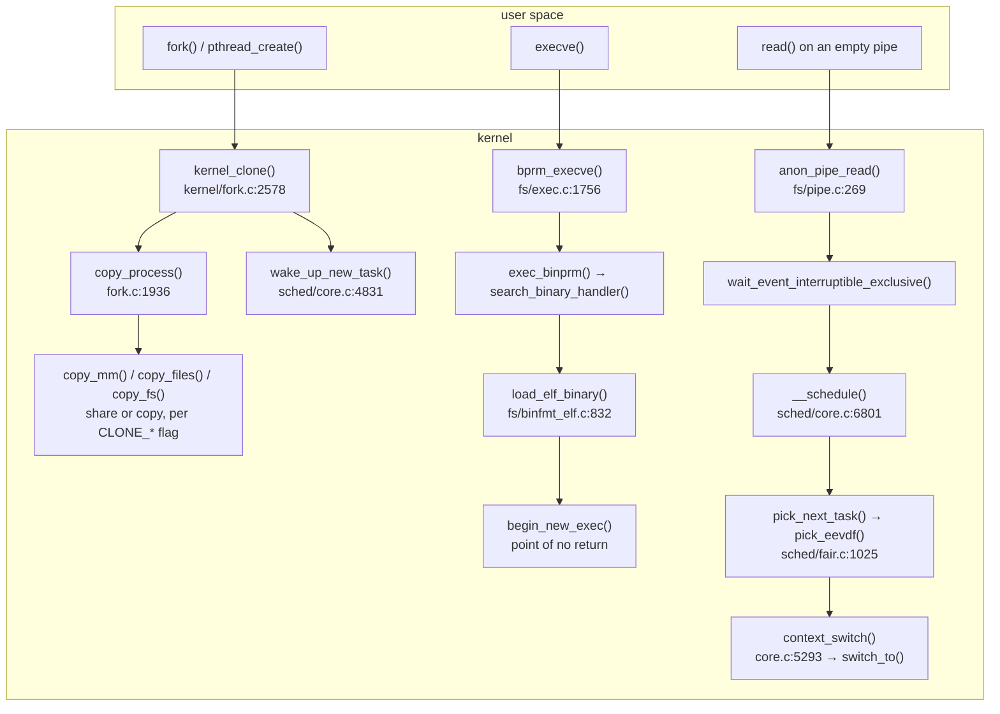

# 02 — Kernel walkthrough: fork, exec, schedule, switch, pipe

> Pins: Linux **v6.18.63** (`_shared/sources/linux/`), OpenBSD **`8cada8c`** (`_shared/sources/openbsd/`) · Arch: **ARCH-SPECIFIC (x86-64)** where noted
> Persian version: [`kernel-walkthrough.fa.md`](kernel-walkthrough.fa.md) · Lesson: [`lesson.en.md`](lesson.en.md)

Every excerpt below was printed with `bash _shared/sources/cite.sh linux <path> <symbol|L<n>> <lines>` from the local checkout. Line numbers are real. Re-print any excerpt yourself to check it.

## 0. Call chains at a glance



| # | File | Function | Why it matters |
|---|---|---|---|
| 1 | `kernel/fork.c` | `kernel_clone()`, `copy_process()`, `copy_mm()` | one entry point for `fork`, `vfork`, `clone`, `clone3`, kernel threads |
| 2 | `fs/exec.c` | `bprm_execve()`, `exec_binprm()`, `search_binary_handler()` | how one task becomes a new program |
| 3 | `kernel/sched/core.c` | `__schedule()` | the single place where a CPU changes task |
| 4 | `kernel/sched/core.c`, `sched.h` | `__pick_next_task()`, `DEFINE_SCHED_CLASS` | the class order stop → dl → rt → fair → ext → idle |
| 5 | `kernel/sched/fair.c` | `pick_eevdf()`, `vruntime_eligible()`, `update_deadline()` | EEVDF: eligible + earliest virtual deadline |
| 6 | `kernel/sched/core.c` | `context_switch()` | address space switch, then registers and stack |
| 7 | `fs/pipe.c` | `anon_pipe_read()` | how a blocking read turns into a sleep and a wakeup |
| 8 | `ipc/shm.c` | `newseg()` | System V shared memory is a shmem file |
| — | `kernel/sched/ext.c` | `DEFINE_SCHED_CLASS(ext)` at L3400 | sched_ext: BPF-defined scheduling class (mention only) |

---

## 1. `kernel_clone()`: every new task starts here

Source: `linux/kernel/fork.c · kernel_clone() · v6.18.63` · [Elixir L2578](https://elixir.bootlin.com/linux/v6.18.63/source/kernel/fork.c#L2578)

```c
pid_t kernel_clone(struct kernel_clone_args *args)
{
	u64 clone_flags = args->flags;
	struct completion vfork;
	struct pid *pid;
	struct task_struct *p;
	int trace = 0;
	pid_t nr;
	/* ... L2587-2617: CLONE_PIDFD check, pick the ptrace event ... */
	p = copy_process(NULL, trace, NUMA_NO_NODE, args);
	add_latent_entropy();

	if (IS_ERR(p))
		return PTR_ERR(p);

	/*
	 * Do this prior waking up the new thread - the thread pointer
	 * might get invalid after that point, if the thread exits quickly.
	 */
	trace_sched_process_fork(current, p);

	pid = get_task_pid(p, PIDTYPE_PID);
	nr = pid_vnr(pid);
```

and, a few lines further (L2637–2650):

```c
	if (clone_flags & CLONE_VFORK) {
		p->vfork_done = &vfork;
		init_completion(&vfork);
		get_task_struct(p);
	}
	/* ... L2643-2648: LRU-gen mm registration ... */
	wake_up_new_task(p);
```

| Line | Meaning |
|---|---|
| `clone_flags = args->flags` | `fork()` passes `0` flags + `exit_signal = SIGCHLD` (`SYSCALL_DEFINE0(fork)`, L2699). `vfork()` passes `CLONE_VFORK \| CLONE_VM` (L2715). `pthread_create()` reaches here through `clone3` (L2900) with a full set of sharing flags. |
| `copy_process(...)` | Does all the real work: allocates the `task_struct`, then copies or shares each resource. Returns an `ERR_PTR` on failure. |
| `trace_sched_process_fork` | The `sched:sched_process_fork` tracepoint. It fires *before* the child can run, so tools never miss a short-lived child. |
| `pid_vnr(pid)` | The PID number as seen from the caller's PID namespace (Module 6). This is the value `fork()` returns in the parent. |
| `CLONE_VFORK` block | The parent will sleep on a `completion` until the child calls `exec` or exits (`wait_for_vfork_done`, L2657). That is why a `vfork` child must not return or touch the parent's stack. |
| `wake_up_new_task(p)` | Puts the child on a run queue for the first time (`sched/core.c` L4831). From here the child can run, even before `fork()` returns in the parent. |

### 1.1 `copy_process()`: the copy-or-share decisions

Source: `linux/kernel/fork.c · copy_process() · v6.18.63` · [Elixir L2177](https://elixir.bootlin.com/linux/v6.18.63/source/kernel/fork.c#L2177)

```c
	retval = copy_files(clone_flags, p, args->no_files);
	if (retval)
		goto bad_fork_cleanup_semundo;
	retval = copy_fs(clone_flags, p);
	if (retval)
		goto bad_fork_cleanup_semundo;
	retval = copy_sighand(clone_flags, p);
	if (retval)
		goto bad_fork_cleanup_fs;
	retval = copy_signal(clone_flags, p);
	if (retval)
		goto bad_fork_cleanup_sighand;
	retval = copy_mm(clone_flags, p);
	if (retval)
		goto bad_fork_cleanup_signal;
	retval = copy_namespaces(clone_flags, p);
	if (retval)
		goto bad_fork_cleanup_mm;
	retval = copy_io(clone_flags, p);
	if (retval)
		goto bad_fork_cleanup_namespaces;
	retval = copy_thread(p, args);
	if (retval)
		goto bad_fork_cleanup_io;
```

- Each `copy_X()` either **shares** the parent's object (bumps a reference count) when the matching `CLONE_X` flag is set, or **duplicates** it. Lab 02.2 tests exactly these lines: `CLONE_FILES` → `copy_files`, `CLONE_FS` → `copy_fs`, `CLONE_VM` → `copy_mm`.
- The error path is a ladder of `goto` labels in reverse order, so each failure undoes only what was already done. This is the standard kernel cleanup idiom.
- `copy_thread()` is **ARCH-SPECIFIC (x86-64)**: `arch/x86/kernel/process.c`. It builds the child's kernel stack so that its first `switch_to()` lands in `ret_from_fork`, and sets the child's return value register (`ax`) to 0. That is why `fork()` returns 0 in the child.
- Earlier in `copy_process()` (L1963–1972) the kernel rejects inconsistent flag sets: `CLONE_THREAD` without `CLONE_SIGHAND`, and `CLONE_SIGHAND` without `CLONE_VM`, both return `-EINVAL`. A thread *must* share signal handlers, and shared handlers *must* share memory.

### 1.2 `copy_mm()`: what `CLONE_VM` really does

Source: `linux/kernel/fork.c · copy_mm() · v6.18.63` · [Elixir L1521](https://elixir.bootlin.com/linux/v6.18.63/source/kernel/fork.c#L1521)

```c
static int copy_mm(u64 clone_flags, struct task_struct *tsk)
{
	struct mm_struct *mm, *oldmm;

	tsk->min_flt = tsk->maj_flt = 0;
	tsk->nvcsw = tsk->nivcsw = 0;
	/* ... L1527-1530: hung-task detector fields ... */
	tsk->mm = NULL;
	tsk->active_mm = NULL;

	/*
	 * Are we cloning a kernel thread?
	 *
	 * We need to steal a active VM for that..
	 */
	oldmm = current->mm;
	if (!oldmm)
		return 0;

	if (clone_flags & CLONE_VM) {
		mmget(oldmm);
		mm = oldmm;
	} else {
		mm = dup_mm(tsk, current->mm);
		if (!mm)
			return -ENOMEM;
	}
```

| Line | Meaning |
|---|---|
| `min_flt`, `nvcsw = 0` | The child starts with zero page faults and zero context switches. These are the counters you read in `/proc/<pid>/status` (`voluntary_ctxt_switches`). |
| `if (!oldmm) return 0` | A kernel thread has no user address space (`mm == NULL`). It borrows whatever was active (`active_mm`), see `context_switch()` below. |
| `CLONE_VM` → `mmget(oldmm)` | **A thread:** the same `mm_struct`, one more reference. No page table copy. |
| else → `dup_mm()` | **A process:** a new `mm_struct`. `dup_mm()` copies the VMAs and marks private pages **copy-on-write** (Module 4); no data pages are copied now. That is why `fork()` of a large process is fast but not free: the page tables still have to be walked. |

---

## 2. `bprm_execve()`: a task becomes a new program

Source: `linux/fs/exec.c · bprm_execve() · v6.18.63` · [Elixir L1756](https://elixir.bootlin.com/linux/v6.18.63/source/fs/exec.c#L1756)

```c
static int bprm_execve(struct linux_binprm *bprm)
{
	int retval;

	retval = prepare_bprm_creds(bprm);
	if (retval)
		return retval;

	/*
	 * Check for unsafe execution states before exec_binprm(), which
	 * will call back into begin_new_exec(), into bprm_creds_from_file(),
	 * where setuid-ness is evaluated.
	 */
	check_unsafe_exec(bprm);
	current->in_execve = 1;
	sched_mm_cid_before_execve(current);

	sched_exec();

	/* Set the unchanging part of bprm->cred */
	retval = security_bprm_creds_for_exec(bprm);
	if (retval || bprm->is_check)
		goto out;

	retval = exec_binprm(bprm);
	if (retval < 0)
		goto out;
```

| Line | Meaning |
|---|---|
| `prepare_bprm_creds` | Builds the *new* credentials. setuid bits are applied later in `begin_new_exec()`. |
| `check_unsafe_exec` | Detects things like a ptraced setuid exec, or shared `fs_struct` with another process, that make setuid unsafe. |
| `sched_exec()` | A good moment to move the task to a less busy CPU: the old memory footprint is about to disappear, so cache affinity is worth nothing. |
| `security_bprm_creds_for_exec` | The LSM hook (SELinux, AppArmor, Landlock; Module 7). |
| `exec_binprm(bprm)` | Finds a binary format handler and loads the program. |
| `goto out` | Below `out:` (L1793): if the failure happens **after** `point_of_no_return`, the kernel kills the task with `SIGSEGV`. The old program is already gone, so there is nothing to return to. |

### 2.1 `search_binary_handler()`: try each format until one accepts

Source: `linux/fs/exec.c · search_binary_handler() · v6.18.63` · [Elixir L1677](https://elixir.bootlin.com/linux/v6.18.63/source/fs/exec.c#L1677)

```c
	read_lock(&binfmt_lock);
	list_for_each_entry(fmt, &formats, lh) {
		if (!try_module_get(fmt->module))
			continue;
		read_unlock(&binfmt_lock);

		retval = fmt->load_binary(bprm);

		read_lock(&binfmt_lock);
		put_binfmt(fmt);
		if (bprm->point_of_no_return || (retval != -ENOEXEC)) {
			read_unlock(&binfmt_lock);
			return retval;
		}
	}
	read_unlock(&binfmt_lock);

	return -ENOEXEC;
```

- `formats` is a list of `struct linux_binfmt`. ELF registers `.load_binary = load_elf_binary` (`fs/binfmt_elf.c` L97); scripts (`#!`) are `binfmt_script`; `binfmt_misc` handles registered magic numbers (e.g. running ARM binaries through QEMU).
- `-ENOEXEC` means "not my format, try the next one". Any other result ends the search.
- For `#!/bin/sh` scripts, `binfmt_script` sets `bprm->interpreter`, and `exec_binprm()` (L1711) loops: "This allows 4 levels of binfmt rewrites before failing hard" (`depth > 5` → `-ELOOP`).
- `load_elf_binary()` calls back into `begin_new_exec()` (L1114). That sets `bprm->point_of_no_return = true`, calls `de_thread()` ("Make this the only thread in the thread group": every other thread of the process is killed), and replaces the `mm`.

---

## 3. `__schedule()`: the only place a CPU changes task

Source: `linux/kernel/sched/core.c · __schedule() · v6.18.63` · [Elixir L6801](https://elixir.bootlin.com/linux/v6.18.63/source/kernel/sched/core.c#L6801)

Excerpt A, deciding whether `prev` leaves the run queue (L6858–6883):

```c
	switch_count = &prev->nivcsw;

	/* Task state changes only considers SM_PREEMPT as preemption */
	preempt = sched_mode == SM_PREEMPT;

	/*
	 * We must load prev->state once (task_struct::state is volatile), such
	 * that we form a control dependency vs deactivate_task() below.
	 */
	prev_state = READ_ONCE(prev->__state);
	if (sched_mode == SM_IDLE) {
		/* SCX must consult the BPF scheduler to tell if rq is empty */
		if (!rq->nr_running && !scx_enabled()) {
			next = prev;
			goto picked;
		}
	} else if (!preempt && prev_state) {
		/*
		 * We pass task_is_blocked() as the should_block arg
		 * in order to keep mutex-blocked tasks on the runqueue
		 * for slection with proxy-exec (without proxy-exec
		 * task_is_blocked() will always be false).
		 */
		try_to_block_task(rq, prev, &prev_state,
				  !task_is_blocked(prev));
		switch_count = &prev->nvcsw;
	}
```

| Line | Meaning |
|---|---|
| `switch_count = &prev->nivcsw` | Default assumption: this switch is **involuntary** (the task was preempted while still runnable). |
| `prev_state = READ_ONCE(prev->__state)` | The caller set `__state` to `TASK_INTERRUPTIBLE` etc. *before* calling `schedule()`. `0` = `TASK_RUNNING`. |
| `!preempt && prev_state` | The task asked to sleep (it is not running, and this is not a preemption): take it **off** the run queue (`try_to_block_task` → `deactivate_task`) ... |
| `switch_count = &prev->nvcsw` | ... and count a **voluntary** switch. These two fields are exactly `voluntary_ctxt_switches` / `nonvoluntary_ctxt_switches` in `/proc/<pid>/status` (`fs/proc/array.c` L399). Lab 02.4's bpftrace script reproduces this split from `prev_state`. |

Excerpt B, pick and switch (L6886–6895 and L6941–6944):

```c
pick_again:
	assert_balance_callbacks_empty(rq);
	next = pick_next_task(rq, &rf);
	rq_set_donor(rq, next);
	if (unlikely(task_is_blocked(next))) {
		next = find_proxy_task(rq, next, &rf);
		if (!next)
			goto pick_again;
		if (next == rq->idle)
			goto keep_resched;
	}
	/* ... L6897-6940: clear need_resched, rq->nr_switches++, rq->curr = next ... */
		trace_sched_switch(preempt, prev, next, prev_state);

		/* Also unlocks the rq: */
		rq = context_switch(rq, prev, next, &rf);
```

- `pick_next_task()` walks the scheduling classes in priority order (section 4).
- `rq_set_donor` / `find_proxy_task`: **proxy execution**. With `CONFIG_SCHED_PROXY_EXEC`, a high-priority task blocked on a mutex can "donate" its slot so the mutex owner runs in its place. Without that option `task_is_blocked()` is always false (the comment above says so). **VERSION-DEPENDENT**: `CONFIG_SCHED_PROXY_EXEC` (`init/Kconfig` L910) is recent; older kernels have none of this code.
- `trace_sched_switch(...)` is the `sched:sched_switch` tracepoint that `perf sched` and bpftrace use. It receives `prev_state`, which is why tools can tell preemption from sleeping.

## 4. Scheduling classes: a linker-ordered array

Source: `linux/kernel/sched/sched.h · DEFINE_SCHED_CLASS · v6.18.63` · [Elixir L2520](https://elixir.bootlin.com/linux/v6.18.63/source/kernel/sched/sched.h#L2520)

```c
/*
 * Helper to define a sched_class instance; each one is placed in a separate
 * section which is ordered by the linker script:
 *
 *   include/asm-generic/vmlinux.lds.h
 *
 * *CAREFUL* they are laid out in *REVERSE* order!!!
 *
 * Also enforce alignment on the instance, not the type, to guarantee layout.
 */
#define DEFINE_SCHED_CLASS(name) \
const struct sched_class name##_sched_class \
	__aligned(__alignof__(struct sched_class)) \
	__section("__" #name "_sched_class")
```

and the order, `linux/include/asm-generic/vmlinux.lds.h · SCHED_DATA · v6.18.63` · [Elixir L136](https://elixir.bootlin.com/linux/v6.18.63/source/include/asm-generic/vmlinux.lds.h#L136):

```c
#define SCHED_DATA				\
	STRUCT_ALIGN();				\
	__sched_class_highest = .;		\
	*(__stop_sched_class)			\
	*(__dl_sched_class)			\
	*(__rt_sched_class)			\
	*(__fair_sched_class)			\
	*(__ext_sched_class)			\
	*(__idle_sched_class)			\
	__sched_class_lowest = .;
```

- Each class is a `const struct sched_class` in its own section. The linker script lays them out in priority order, so "higher priority" is literally "lower address": `#define sched_class_above(_a, _b) ((_a) < (_b))` (`sched.h` L2574).
- `for_each_active_class(class)` is just pointer arithmetic over that array, skipping `ext` when no BPF scheduler is loaded and skipping `fair` when sched_ext has taken over every task.
- Order: **stop** (CPU stopper, migration) → **dl** (`SCHED_DEADLINE`) → **rt** (`SCHED_FIFO`, `SCHED_RR`) → **fair** (`SCHED_OTHER`, `SCHED_BATCH`, `SCHED_IDLE`: EEVDF) → **ext** (`SCHED_EXT`, sched_ext; `kernel/sched/ext.c` L3400) → **idle** (the per-CPU idle task).

The fast path, `linux/kernel/sched/core.c · __pick_next_task() · v6.18.63` · [Elixir L5974](https://elixir.bootlin.com/linux/v6.18.63/source/kernel/sched/core.c#L5974):

```c
	if (likely(!sched_class_above(rq->donor->sched_class, &fair_sched_class) &&
		   rq->nr_running == rq->cfs.h_nr_queued)) {

		p = pick_next_task_fair(rq, rq->donor, rf);
		if (unlikely(p == RETRY_TASK))
			goto restart;

		/* Assume the next prioritized class is idle_sched_class */
		if (!p) {
			p = pick_task_idle(rq);
			put_prev_set_next_task(rq, rq->donor, p);
		}

		return p;
	}

restart:
	prev_balance(rq, rf);

	for_each_active_class(class) {
		if (class->pick_next_task) {
			p = class->pick_next_task(rq, rq->donor);
			if (p)
				return p;
```

- The common case: every runnable task on this CPU is a fair task (`nr_running == cfs.h_nr_queued`). Then the kernel skips the class walk and calls `pick_next_task_fair()` directly.
- Otherwise it walks the classes top-down and takes the first task offered. This is why one runnable `SCHED_FIFO` task always beats every `SCHED_OTHER` task on that CPU, **except** for the fair server: since 6.12, a `SCHED_DEADLINE` "server" (`fair_server`, `/sys/kernel/debug/sched/fair_server/cpuN/{runtime,period}`) reserves CPU time for fair tasks under RT pressure. Lab 02.5 measures it.

## 5. EEVDF: `pick_eevdf()`

Source: `linux/kernel/sched/fair.c · pick_eevdf() · v6.18.63` · [Elixir L1025](https://elixir.bootlin.com/linux/v6.18.63/source/kernel/sched/fair.c#L1025)

The header comment (L1005–1023) is the best one-paragraph definition of EEVDF in the tree:

```c
/*
 * Earliest Eligible Virtual Deadline First
 *
 * In order to provide latency guarantees for different request sizes
 * EEVDF selects the best runnable task from two criteria:
 *
 *  1) the task must be eligible (must be owed service)
 *
 *  2) from those tasks that meet 1), we select the one
 *     with the earliest virtual deadline.
 *
 * We can do this in O(log n) time due to an augmented RB-tree. The
 * tree keeps the entries sorted on deadline, but also functions as a
 * heap based on the vruntime by keeping:
 *
 *  se->min_vruntime = min(se->vruntime, se->{left,right}->min_vruntime)
 *
 * Which allows tree pruning through eligibility.
 */
```

The search loop (L1055–1073):

```c
	/* Pick the leftmost entity if it's eligible */
	if (se && entity_eligible(cfs_rq, se)) {
		best = se;
		goto found;
	}

	/* Heap search for the EEVD entity */
	while (node) {
		struct rb_node *left = node->rb_left;

		/*
		 * Eligible entities in left subtree are always better
		 * choices, since they have earlier deadlines.
		 */
		if (left && vruntime_eligible(cfs_rq,
					__node_2_se(left)->min_vruntime)) {
			node = left;
			continue;
		}

		se = __node_2_se(node);
```

| Line | Meaning |
|---|---|
| leftmost = earliest deadline | The RB-tree is **sorted by virtual deadline**, not by vruntime as in CFS. If the leftmost task is eligible, it is the answer: O(1). |
| `min_vruntime` augmentation | Each node also stores the smallest vruntime in its subtree. If even that minimum is not eligible, the whole subtree can be skipped. |
| go left when possible | An eligible task on the left always has an earlier deadline than anything at or right of the current node. |
| result | O(log n) search for "eligible and earliest deadline". |

Earlier in the function (L1042–1053) two shortcuts run first: the `PICK_BUDDY` "next buddy" (a task the waker hinted should run next), and `protect_slice(curr)`: the running task keeps the CPU until its current slice is used up (`RUN_TO_PARITY`), so EEVDF does not thrash between tasks with nearly equal deadlines.

### 5.1 Eligibility and the virtual deadline

`linux/kernel/sched/fair.c · vruntime_eligible() · v6.18.63` · [Elixir L802](https://elixir.bootlin.com/linux/v6.18.63/source/kernel/sched/fair.c#L802)

```c
static int vruntime_eligible(struct cfs_rq *cfs_rq, u64 vruntime)
{
	struct sched_entity *curr = cfs_rq->curr;
	s64 avg = cfs_rq->sum_w_vruntime;
	long load = cfs_rq->sum_weight;

	if (curr && curr->on_rq) {
		unsigned long weight = scale_load_down(curr->load.weight);

		avg += entity_key(cfs_rq, curr) * weight;
		load += weight;
	}

	return avg >= vruntime_op(vruntime, "-", cfs_rq->zero_vruntime) * load;
}
```

- The comment above it (L786–800) says: "Entity is eligible once it received less service than it ought to have, eg. lag >= 0", with `lag_i = w_i * (V - v_i)` and `V` the **weighted average vruntime** of the queue.
- To avoid a division (and its rounding error) the kernel compares `Σ(v_j − v0)·w_j ≥ (v_i − v0)·Σw_j` instead of `V ≥ v_i`. `v0` is `zero_vruntime`, a reference point that keeps the products small enough for 64 bits.

`linux/kernel/sched/fair.c · update_deadline() · v6.18.63` · [Elixir L1127](https://elixir.bootlin.com/linux/v6.18.63/source/kernel/sched/fair.c#L1127)

```c
static bool update_deadline(struct cfs_rq *cfs_rq, struct sched_entity *se)
{
	if (vruntime_cmp(se->vruntime, "<", se->deadline))
		return false;

	/*
	 * For EEVDF the virtual time slope is determined by w_i (iow.
	 * nice) while the request time r_i is determined by
	 * sysctl_sched_base_slice.
	 */
	if (!se->custom_slice)
		se->slice = sysctl_sched_base_slice;

	/*
	 * EEVDF: vd_i = ve_i + r_i / w_i
	 */
	se->deadline = se->vruntime + calc_delta_fair(se->slice, se);
	avg_vruntime(cfs_rq);

	/*
	 * The task has consumed its request, reschedule.
	 */
	return true;
}
```

- **Two independent knobs.** Weight (`nice`) changes how fast vruntime grows, so it changes the **share** of CPU. The slice `r_i` changes how far away the deadline is, so it changes **latency** (how soon the task is picked), not its long-run share.
- `sysctl_sched_base_slice` is 0.7 ms × (1 + log2(min(ncpus, 8))) by default (L74–79, `get_update_sysctl_factor()` L192): **2.8 ms on the 8-vCPU lab VM**. It is visible as `/sys/kernel/debug/sched/base_slice_ns`.
- `custom_slice` is set by `sched_setattr()` with a non-zero `sched_runtime` on a fair task, clamped to 0.1–100 ms in `__setparam_fair()` (L5299). Lab 02.5 sets it and reads it back.

## 6. `context_switch()`: memory first, then registers

Source: `linux/kernel/sched/core.c · context_switch() · v6.18.63` · [Elixir L5293](https://elixir.bootlin.com/linux/v6.18.63/source/kernel/sched/core.c#L5293)

```c
	if (!next->mm) {                                // to kernel
		enter_lazy_tlb(prev->active_mm, next);

		next->active_mm = prev->active_mm;
		if (prev->mm)                           // from user
			mmgrab_lazy_tlb(prev->active_mm);
		else
			prev->active_mm = NULL;
	} else {                                        // to user
		membarrier_switch_mm(rq, prev->active_mm, next->mm);
		/* ... L5325-5332: membarrier comment ... */
		switch_mm_irqs_off(prev->active_mm, next->mm, next);
		lru_gen_use_mm(next->mm);

		if (!prev->mm) {                        // from kernel
			/* will mmdrop_lazy_tlb() in finish_task_switch(). */
			rq->prev_mm = prev->active_mm;
			prev->active_mm = NULL;
		}
	}

	/* switch_mm_cid() requires the memory barriers above. */
	switch_mm_cid(rq, prev, next);

	prepare_lock_switch(rq, next, rf);

	/* Here we just switch the register state and the stack. */
	switch_to(prev, next, prev);
	barrier();

	return finish_task_switch(prev);
```

| Case | What happens | Cost |
|---|---|---|
| user → kernel thread | **lazy TLB**: keep the old page tables loaded, borrow `active_mm` | cheap, no `CR3` write |
| user → user, different `mm` | `switch_mm_irqs_off()` loads the new page table root (`CR3` on x86-64) | TLB entries of the old process are no longer useful (PCID softens this; Module 4) |
| thread → thread, same `mm` | `switch_mm_irqs_off()` sees `prev == next` mm and skips the reload | the cheapest user → user switch |
| always | `switch_to()` → `__switch_to_asm` → `__switch_to()` (`arch/x86/kernel/process_64.c`, Module 1): stack pointer, callee-saved registers, FS/GS base, FPU state | **ARCH-SPECIFIC (x86-64)** |

`switch_to(prev, next, prev)` returns **in the context of `next`**, possibly much later, when someone switches back to this task. The third argument tells the resumed task which task ran just before it, so `finish_task_switch(prev)` can drop references to it.

## 7. `anon_pipe_read()`: blocking is a loop around a wait queue

Source: `linux/fs/pipe.c · anon_pipe_read() · v6.18.63` · [Elixir L269](https://elixir.bootlin.com/linux/v6.18.63/source/fs/pipe.c#L269) (excerpt L370–393)

```c
		if (!pipe->writers)
			break;
		if (ret)
			break;
		if ((filp->f_flags & O_NONBLOCK) ||
		    (iocb->ki_flags & IOCB_NOWAIT)) {
			ret = -EAGAIN;
			break;
		}
		mutex_unlock(&pipe->mutex);
		/*
		 * We only get here if we didn't actually read anything.
		 *
		 * But because we didn't read anything, at this point we can
		 * just return directly with -ERESTARTSYS if we're interrupted,
		 * since we've done any required wakeups and there's no need
		 * to mark anything accessed. And we've dropped the lock.
		 */
		if (wait_event_interruptible_exclusive(pipe->rd_wait, pipe_readable(pipe)) < 0)
			return -ERESTARTSYS;

		wake_next_reader = true;
		mutex_lock(&pipe->mutex);
	}
```

| Line | Meaning |
|---|---|
| `if (!pipe->writers) break;` | **EOF**: no write end is open anywhere. `read()` returns 0. If *any* process still holds a write fd (often the reader itself, by mistake) this never happens and the reader blocks forever. Lab 02.1 closes `fds[1]` in the parent for this reason. |
| `O_NONBLOCK` → `-EAGAIN` | Non-blocking mode returns immediately instead of sleeping. |
| `wait_event_interruptible_exclusive` | Sets `TASK_INTERRUPTIBLE`, adds the task to `rd_wait`, calls `schedule()`. In `__schedule()` this is the `!preempt && prev_state` branch: a **voluntary** switch. A writer later calls `wake_up_interruptible_sync_poll(&pipe->rd_wait, ...)`. |
| `-ERESTARTSYS` | A signal arrived. The syscall layer restarts the `read()` or returns `EINTR`, depending on `SA_RESTART`. |
| `_sync_` wakeups | The comment at L285–290: wakeups use `WF_SYNC`, a hint that the waker will sleep soon, so the scheduler may run the wakee on the same CPU. This is part of what Lab 02.3 measures. |

## 8. `newseg()`: System V shared memory is a file in shmem

Source: `linux/ipc/shm.c · newseg() · v6.18.63` · [Elixir L766](https://elixir.bootlin.com/linux/v6.18.63/source/ipc/shm.c#L766)

```c
		file = shmem_kernel_file_setup(name, size, acctflag);
```

`shmget()` creates an unlinked file on the internal `shmem` (tmpfs) mount; `shmat()` (`do_shmat`, L1506) is an `mmap()` of that file with `MAP_SHARED`. POSIX `shm_open()` does the same through a visible file in `/dev/shm`. Both end in the same page cache pages mapped into two address spaces: after setup, communication costs **zero syscalls**, but you must bring your own synchronization (Module 3).

---

## 9. OpenBSD comparison

### 9.1 Process creation: two structures instead of one

Linux (above): one `task_struct` per thread; a "process" is a set of tasks with the same `tgid` that share an `mm`, `files`, `signal`... chosen by `CLONE_*` flags in a single `kernel_clone()`.

OpenBSD splits the two concepts: **`struct process`** (address space, files, credentials, the list of threads) and **`struct proc`** (one thread: run queue link, state, priority).

`openbsd/sys/sys/proc.h · struct proc · 8cada8c` · [GitHub L362](https://github.com/openbsd/src/blob/8cada8c/sys/sys/proc.h#L362)

```c
struct proc {
	TAILQ_ENTRY(proc) p_runq;	/* [S] current run/sleep queue */
	LIST_ENTRY(proc) p_list;	/* List of all threads. */

	struct	process *p_p;		/* [I] The process of this thread. */
	TAILQ_ENTRY(proc) p_thr_link;	/* [K|m] Threads in a process linkage. */

	/* substructures: */
	struct	filedesc *p_fd;		/* copy of p_p->ps_fd */
	struct	vmspace *p_vmspace;	/* [I] copy of p_p->ps_vmspace */
```

`openbsd/sys/kern/kern_fork.c · fork1() · 8cada8c` · [GitHub L350](https://github.com/openbsd/src/blob/8cada8c/sys/kern/kern_fork.c#L350) (excerpt L395–412)

```c
	uaddr = uvm_uarea_alloc();
	if (uaddr == 0) {
		(void)chgproccnt(uid, -1);
		nprocesses--;
		atomic_dec_int(&nthreads);
		return (ENOMEM);
	}

	/*
	 * From now on, we're committed to the fork and cannot fail.
	 */
	p = thread_new(curp, uaddr);
	pr = process_new(p, curpr, flags);

	p->p_fd		= pr->ps_fd;
	p->p_vmspace	= pr->ps_vmspace;
	if (pr->ps_flags & PS_SYSTEM)
		atomic_setbits_int(&p->p_flag, P_SYSTEM);
```

- `fork1()` serves `fork`, `vfork` and kernel threads with a small set of `FORK_*` flags (`FORK_FORK`, `FORK_VFORK`, `FORK_SHAREVM`, `FORK_SHAREFILES`, ..., KASSERT at L363). There is no way to ask for "share files but not memory" from user space: that menu exists only in Linux `clone()`.
- Threads come from a **separate** syscall, `__tfork()` → `thread_fork()` (L549): it creates only a `struct proc` (`thread_new`) and links it into the existing process (`p->p_p = pr`, `TAILQ_INSERT_TAIL(&pr->ps_threads, ...)`).
- "From now on, we're committed": OpenBSD reserves everything that can fail (process count, `uvm_uarea_alloc`) first, then builds the objects with no failure path. Linux does the opposite: it builds step by step and unwinds with the `goto bad_fork_*` ladder.

### 9.2 exec: kill the other threads, then replace the address space

`openbsd/sys/kern/kern_exec.c · sys_execve() · 8cada8c` · [GitHub L507](https://github.com/openbsd/src/blob/8cada8c/sys/kern/kern_exec.c#L507) (excerpt L507–520; the function starts at L303)

```c
	/*
	 * we're committed: any further errors will kill the process, so
	 * kill the other threads now.
	 */
	single_thread_set(p, SINGLE_EXIT);

	/* Clear profiling state in new image */
	prof_exec(pr);

	/*
	 * Prepare vmspace for remapping. Note that uvmspace_exec can replace
	 * ps_vmspace!
	 */
	uvmspace_exec(p, VM_MIN_ADDRESS, VM_MAXUSER_ADDRESS);
```

Same idea as Linux `begin_new_exec()`: a point of no return, then all other threads die (`de_thread()` in Linux, `single_thread_set(SINGLE_EXIT)` in OpenBSD), then a new address space. OpenBSD has no pluggable `binfmt_misc`; formats are a static table, `execsw[]` in `sys/kern/exec_conf.c` L39 (scripts, ELF).

### 9.3 Scheduler: 32 priority queues vs EEVDF

`openbsd/sys/kern/kern_sched.c · sched_chooseproc() · 8cada8c` · [GitHub L327](https://github.com/openbsd/src/blob/8cada8c/sys/kern/kern_sched.c#L327) (excerpt L360–376)

```c
	if (spc->spc_whichqs) {
		queue = ffs(spc->spc_whichqs) - 1;
		p = TAILQ_FIRST(&spc->spc_qs[queue]);
		remrunqueue(p);
#ifdef SCHED_COUNTERS
		sched_noidle++;
#endif
		if (p->p_stat != SRUN)
			panic("thread %d not in SRUN: %d", p->p_tid, p->p_stat);
	} else if ((p = sched_steal_proc(curcpu())) == NULL) {
		p = spc->spc_idleproc;
		if (p == NULL)
			panic("no idleproc set on CPU%d",
			    CPU_INFO_UNIT(curcpu()));
		p->p_stat = SRUN;
	} 
```

`openbsd/sys/kern/sched_bsd.c · setpriority() · 8cada8c` · [GitHub L506](https://github.com/openbsd/src/blob/8cada8c/sys/kern/sched_bsd.c#L506)

```c
void
setpriority(struct proc *p, uint32_t newcpu, uint8_t nice)
{
	unsigned int newprio;

	newprio = min((PUSER + newcpu + NICE_WEIGHT * (nice - NZERO)), MAXPRI);

	SCHED_ASSERT_LOCKED();
	p->p_estcpu = newcpu;
	p->p_usrpri = newprio;
}
```

- Each CPU has `SCHED_NQS` = 32 FIFO queues (`sys/sys/sched.h` L102) and a 32-bit mask `spc_whichqs` of non-empty queues. `ffs()` (find first set bit) gives the best queue in O(1). Priority 0–127 maps to a queue by `prio >> 2` (`setrunqueue()`, L277).
- The priority of a user thread comes from the classic 4.4BSD formula: `PUSER (50) + p_estcpu + 2 × nice`. `schedclock()` (L532) increments `p_estcpu` while the thread runs; `schedcpu()` decays it once per second by a load-dependent factor. CPU-heavy threads sink to worse queues; sleepers float up.
- `roundrobin()` (L84) forces a switch among equal-priority threads every `roundrobin_period` = 10 hardclock ticks (`kern_clock.c` L108), i.e. 100 ms at `hz=100`.
- When the local queues are empty, `sched_steal_proc()` takes a thread from another CPU. Linux does periodic and idle **load balancing** over sched domains instead.

### 9.4 Trade-off table

| Design choice | Linux v6.18.63 | OpenBSD 8cada8c | Trade-off |
|---|---|---|---|
| Thread vs process object | one `task_struct`; sharing is per resource via `CLONE_*` | `struct process` + `struct proc` | Linux: maximal flexibility (containers, `vfork`, odd mixes) but every resource needs refcounting and many flag combinations must be rejected. OpenBSD: clear model, fewer invalid states, no "half-thread" |
| Thread creation API | `clone`/`clone3`, same path as `fork` | separate `__tfork()` → `thread_fork()` | one code path to optimize vs. simpler, narrower paths |
| Failure handling in fork | build step by step, unwind with `goto` ladder | reserve resources first, then "cannot fail" | Linux can fail late (e.g. namespace setup); OpenBSD's construct phase stays simple |
| Fair-class algorithm | **EEVDF**: weighted lag, eligibility, virtual deadlines, RB-tree O(log n) | 32 priority FIFOs, decay-usage priority, `ffs()` O(1) | EEVDF gives proportional share by `nice` weight *and* a latency knob (slice). BSD gives a cheap pick and good interactivity heuristics, but share depends on load-average decay and is not exactly proportional |
| Policy classes | stop, dl, rt, fair, ext (BPF), idle | one scheduler; real-time classes are not offered | Linux: real-time and deadline guarantees, pluggable BPF policies; more code and more ways to starve tasks (RT hogs, mitigated by the fair server) |
| Latency control for normal tasks | `nice` (share) + `sched_setattr` slice (latency) | `nice` only | separate share and latency knobs vs. one knob that does both, loosely |
| Multi-CPU | sched domains, periodic + idle load balancing, wake-affine | per-CPU queues + steal when idle | Linux scales to NUMA boxes with hundreds of CPUs; OpenBSD is simpler and favors correctness |

## 10. Check it yourself

```bash
cd _shared/sources/linux
git grep -n "^pid_t kernel_clone" kernel/fork.c               # 2578
git grep -n "__schedule(int sched_mode)" kernel/sched/core.c   # 6801
git grep -n "^static struct sched_entity \*pick_eevdf" kernel/sched/fair.c   # 1025
git grep -n "DEFINE_SCHED_CLASS(" kernel/sched/               # stop dl rt fair ext idle
ls Documentation/scheduler/sched-eevdf.rst                    # the in-tree EEVDF doc
grep -c SCHED_DEBUG init/Kconfig lib/Kconfig.debug            # 0 and 0: the option is gone in 6.18
```

`CONFIG_SCHED_DEBUG` no longer exists in v6.18: `/sys/kernel/debug/sched/` and `/proc/<pid>/sched` are always built in (with `CONFIG_SCHEDSTATS` for the extra counters). Old tutorials that say "enable SCHED_DEBUG first" are outdated. **VERSION-DEPENDENT**.
