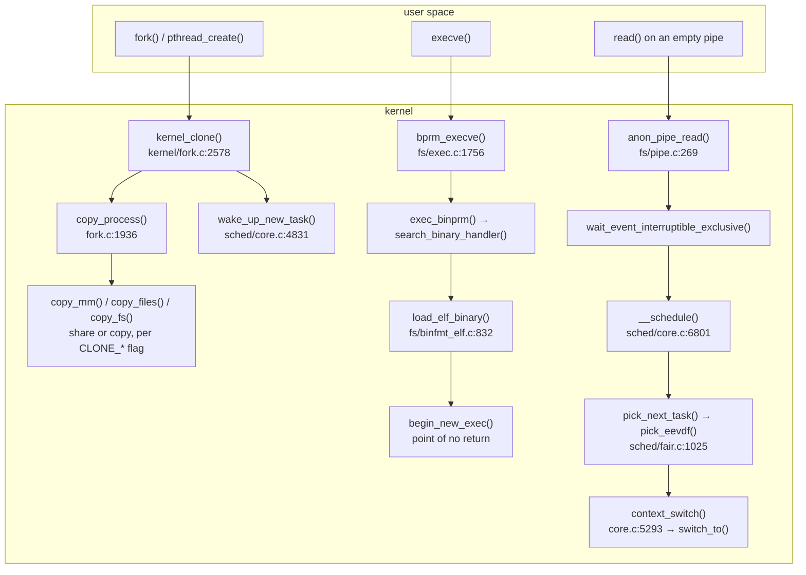

<div dir="rtl">

# ۰۲ — مرور کد کرنل: fork، exec، schedule، switch و pipe

> نسخه‌های ثابت: Linux **v6.18.63** (`_shared/sources/linux/`) و OpenBSD **`8cada8c`** (`_shared/sources/openbsd/`) · معماری: هر جا لازم بوده **ARCH-SPECIFIC (x86-64)** علامت خورده است
> نسخهٔ انگلیسی: [`kernel-walkthrough.en.md`](kernel-walkthrough.en.md) · درس: [`lesson.fa.md`](lesson.fa.md)

همهٔ بخش‌های کد زیر با `bash _shared/sources/cite.sh linux <path> <symbol|L<n>> <lines>` از checkout محلی چاپ شده‌اند و شمارهٔ خط‌ها واقعی است. هر بخش را خودتان دوباره چاپ کنید تا مطمئن شوید.

## ۰. نگاه کلی به زنجیره‌های فراخوانی

</div>



<div dir="rtl">

| # | فایل | تابع | چرا مهم است |
|---|---|---|---|
| ۱ | `kernel/fork.c` | `kernel_clone()`، `copy_process()`، `copy_mm()` | یک نقطهٔ ورود برای `fork`، `vfork`، `clone`، `clone3` و نخ‌های کرنل |
| ۲ | `fs/exec.c` | `bprm_execve()`، `exec_binprm()`، `search_binary_handler()` | یک task چطور برنامهٔ جدیدی می‌شود |
| ۳ | `kernel/sched/core.c` | `__schedule()` | تنها جایی که CPU task را عوض می‌کند |
| ۴ | `kernel/sched/core.c` و `sched.h` | `__pick_next_task()`، `DEFINE_SCHED_CLASS` | ترتیب کلاس‌ها: stop ← dl ← rt ← fair ← ext ← idle |
| ۵ | `kernel/sched/fair.c` | `pick_eevdf()`، `vruntime_eligible()`، `update_deadline()` | EEVDF: eligible بودن به‌اضافهٔ زودترین virtual deadline |
| ۶ | `kernel/sched/core.c` | `context_switch()` | اول عوض‌کردن فضای آدرس، بعد رجیسترها و پشته |
| ۷ | `fs/pipe.c` | `anon_pipe_read()` | read مسدودکننده چطور به خواب و بیدارباش تبدیل می‌شود |
| ۸ | `ipc/shm.c` | `newseg()` | حافظهٔ مشترک System V در واقع یک فایل shmem است |
| — | `kernel/sched/ext.c` | `DEFINE_SCHED_CLASS(ext)` در خط 3400 | sched_ext: کلاس زمان‌بندی تعریف‌شده با BPF (فقط اشاره) |

---

## ۱. `kernel_clone()`: هر task جدیدی از اینجا شروع می‌شود

منبع: `linux/kernel/fork.c · kernel_clone() · v6.18.63` · [Elixir L2578](https://elixir.bootlin.com/linux/v6.18.63/source/kernel/fork.c#L2578)

</div>

```c
pid_t kernel_clone(struct kernel_clone_args *args)
{
	u64 clone_flags = args->flags;
	struct completion vfork;
	struct pid *pid;
	struct task_struct *p;
	int trace = 0;
	pid_t nr;
	/* ... L2587-2617: CLONE_PIDFD check, pick the ptrace event ... */
	p = copy_process(NULL, trace, NUMA_NO_NODE, args);
	add_latent_entropy();

	if (IS_ERR(p))
		return PTR_ERR(p);

	/*
	 * Do this prior waking up the new thread - the thread pointer
	 * might get invalid after that point, if the thread exits quickly.
	 */
	trace_sched_process_fork(current, p);

	pid = get_task_pid(p, PIDTYPE_PID);
	nr = pid_vnr(pid);
```

<div dir="rtl">

و چند خط پایین‌تر (خط‌های 2637 تا 2650):

</div>

```c
	if (clone_flags & CLONE_VFORK) {
		p->vfork_done = &vfork;
		init_completion(&vfork);
		get_task_struct(p);
	}
	/* ... L2643-2648: LRU-gen mm registration ... */
	wake_up_new_task(p);
```

<div dir="rtl">

| خط | توضیح |
|---|---|
| `clone_flags = args->flags` | `fork()` پرچم `0` و `exit_signal = SIGCHLD` می‌فرستد (`SYSCALL_DEFINE0(fork)`، خط 2699). `vfork()` پرچم `CLONE_VFORK \| CLONE_VM` می‌فرستد (خط 2715). `pthread_create()` از طریق `clone3` (خط 2900) با مجموعهٔ کاملی از پرچم‌های اشتراک به اینجا می‌رسد. |
| `copy_process(...)` | همهٔ کار اصلی را انجام می‌دهد: `task_struct` را می‌سازد و بعد هر منبع را کپی یا مشترک می‌کند. در صورت خطا یک `ERR_PTR` برمی‌گرداند. |
| `trace_sched_process_fork` | tracepoint با نام `sched:sched_process_fork`. این tracepoint *قبل از* اینکه فرزند بتواند اجرا شود فراخوانی می‌شود، پس ابزارها هیچ فرزند کوتاه‌عمری را از دست نمی‌دهند. |
| `pid_vnr(pid)` | شمارهٔ PID از دید PID namespace فراخواننده (ماژول ۶). همین مقداری است که `fork()` در والد برمی‌گرداند. |
| بلوک `CLONE_VFORK` | والد روی یک `completion` می‌خوابد تا فرزند `exec` کند یا خارج شود (`wait_for_vfork_done`، خط 2657). به همین دلیل فرزند vfork نباید return کند یا به پشتهٔ والد دست بزند. |
| `wake_up_new_task(p)` | فرزند را برای اولین بار روی یک run queue می‌گذارد (`sched/core.c` خط 4831). از این لحظه فرزند می‌تواند اجرا شود، حتی قبل از اینکه `fork()` در والد برگردد. |

### ۱.۱ `copy_process()`: تصمیم کپی یا اشتراک

منبع: `linux/kernel/fork.c · copy_process() · v6.18.63` · [Elixir L2177](https://elixir.bootlin.com/linux/v6.18.63/source/kernel/fork.c#L2177)

</div>

```c
	retval = copy_files(clone_flags, p, args->no_files);
	if (retval)
		goto bad_fork_cleanup_semundo;
	retval = copy_fs(clone_flags, p);
	if (retval)
		goto bad_fork_cleanup_semundo;
	retval = copy_sighand(clone_flags, p);
	if (retval)
		goto bad_fork_cleanup_fs;
	retval = copy_signal(clone_flags, p);
	if (retval)
		goto bad_fork_cleanup_sighand;
	retval = copy_mm(clone_flags, p);
	if (retval)
		goto bad_fork_cleanup_signal;
	retval = copy_namespaces(clone_flags, p);
	if (retval)
		goto bad_fork_cleanup_mm;
	retval = copy_io(clone_flags, p);
	if (retval)
		goto bad_fork_cleanup_namespaces;
	retval = copy_thread(p, args);
	if (retval)
		goto bad_fork_cleanup_io;
```

<div dir="rtl">

- هر تابع `copy_X()` یا شیء والد را **مشترک می‌کند** (شمارندهٔ ارجاعش را بالا می‌برد)، اگر پرچم `CLONE_X` متناظر گذاشته شده باشد، یا آن را **تکثیر می‌کند**. آزمایش ۰۲.۲ دقیقاً همین خط‌ها را می‌آزماید: `CLONE_FILES` ← `copy_files`، `CLONE_FS` ← `copy_fs`، `CLONE_VM` ← `copy_mm`.
- مسیر خطا نردبانی از برچسب‌های `goto` به ترتیب معکوس است، پس هر شکست فقط کارهایی را که انجام شده‌اند برمی‌گرداند. این الگوی استاندارد پاک‌سازی در کرنل است.
- `copy_thread()` **ARCH-SPECIFIC (x86-64)** است و در `arch/x86/kernel/process.c` قرار دارد. پشتهٔ کرنل فرزند را طوری می‌سازد که اولین `switch_to()` او در `ret_from_fork` فرود بیاید، و رجیستر مقدار بازگشتی فرزند (`ax`) را ۰ می‌کند. به همین دلیل `fork()` در فرزند ۰ برمی‌گرداند.
- کمی بالاتر در `copy_process()` (خط‌های 1963 تا 1972) کرنل ترکیب‌های ناسازگار پرچم‌ها را رد می‌کند: `CLONE_THREAD` بدون `CLONE_SIGHAND`، و `CLONE_SIGHAND` بدون `CLONE_VM`، هر دو `-EINVAL` برمی‌گردانند. نخ *باید* handlerهای سیگنال را مشترک داشته باشد و handlerهای مشترک *باید* حافظهٔ مشترک داشته باشند.

### ۱.۲ `copy_mm()`: `CLONE_VM` واقعاً چه می‌کند

منبع: `linux/kernel/fork.c · copy_mm() · v6.18.63` · [Elixir L1521](https://elixir.bootlin.com/linux/v6.18.63/source/kernel/fork.c#L1521)

</div>

```c
static int copy_mm(u64 clone_flags, struct task_struct *tsk)
{
	struct mm_struct *mm, *oldmm;

	tsk->min_flt = tsk->maj_flt = 0;
	tsk->nvcsw = tsk->nivcsw = 0;
	/* ... L1527-1530: hung-task detector fields ... */
	tsk->mm = NULL;
	tsk->active_mm = NULL;

	/*
	 * Are we cloning a kernel thread?
	 *
	 * We need to steal a active VM for that..
	 */
	oldmm = current->mm;
	if (!oldmm)
		return 0;

	if (clone_flags & CLONE_VM) {
		mmget(oldmm);
		mm = oldmm;
	} else {
		mm = dup_mm(tsk, current->mm);
		if (!mm)
			return -ENOMEM;
	}
```

<div dir="rtl">

| خط | توضیح |
|---|---|
| `min_flt`، `nvcsw = 0` | فرزند با صفر page fault و صفر context switch شروع می‌کند. این‌ها همان شمارنده‌هایی هستند که در `/proc/<pid>/status` می‌خوانید (`voluntary_ctxt_switches`). |
| `if (!oldmm) return 0` | نخ کرنل فضای آدرس کاربر ندارد (`mm == NULL`) و هر فضایی را که فعال باشد قرض می‌گیرد (`active_mm`). پایین‌تر `context_switch()` را ببینید. |
| `CLONE_VM` ← `mmget(oldmm)` | **نخ:** همان `mm_struct` با یک ارجاع بیشتر. هیچ page tableای کپی نمی‌شود. |
| در غیر این صورت ← `dup_mm()` | **پردازه:** یک `mm_struct` جدید. `dup_mm()` VMAها را کپی و صفحه‌های خصوصی را **copy-on-write** علامت می‌زند (ماژول ۴)؛ الان هیچ صفحهٔ داده‌ای کپی نمی‌شود. به همین دلیل `fork()` یک پردازهٔ بزرگ سریع است اما رایگان نیست: page tableها هنوز باید پیمایش شوند. |

---

## ۲. `bprm_execve()`: یک task برنامهٔ جدیدی می‌شود

منبع: `linux/fs/exec.c · bprm_execve() · v6.18.63` · [Elixir L1756](https://elixir.bootlin.com/linux/v6.18.63/source/fs/exec.c#L1756)

</div>

```c
static int bprm_execve(struct linux_binprm *bprm)
{
	int retval;

	retval = prepare_bprm_creds(bprm);
	if (retval)
		return retval;

	/*
	 * Check for unsafe execution states before exec_binprm(), which
	 * will call back into begin_new_exec(), into bprm_creds_from_file(),
	 * where setuid-ness is evaluated.
	 */
	check_unsafe_exec(bprm);
	current->in_execve = 1;
	sched_mm_cid_before_execve(current);

	sched_exec();

	/* Set the unchanging part of bprm->cred */
	retval = security_bprm_creds_for_exec(bprm);
	if (retval || bprm->is_check)
		goto out;

	retval = exec_binprm(bprm);
	if (retval < 0)
		goto out;
```

<div dir="rtl">

| خط | توضیح |
|---|---|
| `prepare_bprm_creds` | اعتبارنامه‌های *جدید* را می‌سازد. بیت‌های setuid بعداً در `begin_new_exec()` اعمال می‌شوند. |
| `check_unsafe_exec` | حالت‌هایی را تشخیص می‌دهد که setuid را ناامن می‌کنند، مثل exec یک فایل setuid در حالی که task تحت ptrace است، یا `fs_struct` مشترک با پردازهٔ دیگر. |
| `sched_exec()` | زمان خوبی برای بردن task به یک CPU خلوت‌تر است: ردپای حافظهٔ قدیمی در حال از بین رفتن است، پس وابستگی به cache ارزشی ندارد. |
| `security_bprm_creds_for_exec` | hook مربوط به LSM (یعنی SELinux، AppArmor و Landlock؛ ماژول ۷). |
| `exec_binprm(bprm)` | یک handler قالب باینری پیدا می‌کند و برنامه را بارگذاری می‌کند. |
| `goto out` | زیر برچسب `out:` (خط 1793): اگر خطا **بعد از** `point_of_no_return` رخ دهد، کرنل task را با `SIGSEGV` می‌کشد. برنامهٔ قدیمی از بین رفته و جایی برای برگشتن نیست. |

### ۲.۱ `search_binary_handler()`: همهٔ قالب‌ها را امتحان کن تا یکی بپذیرد

منبع: `linux/fs/exec.c · search_binary_handler() · v6.18.63` · [Elixir L1677](https://elixir.bootlin.com/linux/v6.18.63/source/fs/exec.c#L1677)

</div>

```c
	read_lock(&binfmt_lock);
	list_for_each_entry(fmt, &formats, lh) {
		if (!try_module_get(fmt->module))
			continue;
		read_unlock(&binfmt_lock);

		retval = fmt->load_binary(bprm);

		read_lock(&binfmt_lock);
		put_binfmt(fmt);
		if (bprm->point_of_no_return || (retval != -ENOEXEC)) {
			read_unlock(&binfmt_lock);
			return retval;
		}
	}
	read_unlock(&binfmt_lock);

	return -ENOEXEC;
```

<div dir="rtl">

- `formats` فهرستی از `struct linux_binfmt` است. ELF مقدار `.load_binary = load_elf_binary` را ثبت می‌کند (`fs/binfmt_elf.c` خط 97)؛ اسکریپت‌ها (`#!`) با `binfmt_script` اجرا می‌شوند؛ و `binfmt_misc` شماره‌های جادویی ثبت‌شده را پوشش می‌دهد (مثلاً اجرای باینری ARM از طریق QEMU).
- `-ENOEXEC` یعنی «قالب من نیست، بعدی را امتحان کن». هر نتیجهٔ دیگری جستجو را تمام می‌کند.
- برای اسکریپت‌های `#!/bin/sh`، `binfmt_script` مقدار `bprm->interpreter` را می‌گذارد و `exec_binprm()` (خط 1711) حلقه می‌زند. توضیح کد می‌گوید چهار سطح بازنویسی binfmt مجاز است و بعد از آن شکست قطعی است (`depth > 5` ← `-ELOOP`).
- `load_elf_binary()` به `begin_new_exec()` (خط 1114) برمی‌گردد. این تابع `bprm->point_of_no_return = true` را می‌گذارد، `de_thread()` را صدا می‌زند (یعنی این نخ تنها نخ گروه می‌شود و همهٔ نخ‌های دیگر پردازه کشته می‌شوند) و `mm` را جایگزین می‌کند.

---

## ۳. `__schedule()`: تنها جایی که CPU task را عوض می‌کند

منبع: `linux/kernel/sched/core.c · __schedule() · v6.18.63` · [Elixir L6801](https://elixir.bootlin.com/linux/v6.18.63/source/kernel/sched/core.c#L6801)

بخش A: تصمیم اینکه آیا `prev` از run queue خارج می‌شود (خط‌های 6858 تا 6883):

</div>

```c
	switch_count = &prev->nivcsw;

	/* Task state changes only considers SM_PREEMPT as preemption */
	preempt = sched_mode == SM_PREEMPT;

	/*
	 * We must load prev->state once (task_struct::state is volatile), such
	 * that we form a control dependency vs deactivate_task() below.
	 */
	prev_state = READ_ONCE(prev->__state);
	if (sched_mode == SM_IDLE) {
		/* SCX must consult the BPF scheduler to tell if rq is empty */
		if (!rq->nr_running && !scx_enabled()) {
			next = prev;
			goto picked;
		}
	} else if (!preempt && prev_state) {
		/*
		 * We pass task_is_blocked() as the should_block arg
		 * in order to keep mutex-blocked tasks on the runqueue
		 * for slection with proxy-exec (without proxy-exec
		 * task_is_blocked() will always be false).
		 */
		try_to_block_task(rq, prev, &prev_state,
				  !task_is_blocked(prev));
		switch_count = &prev->nvcsw;
	}
```

<div dir="rtl">

| خط | توضیح |
|---|---|
| `switch_count = &prev->nivcsw` | فرض پیش‌فرض: این switch **غیرداوطلبانه** است (task در حالی که هنوز قابل اجرا بوده preempt شده). |
| `prev_state = READ_ONCE(prev->__state)` | فراخواننده *قبل از* صدا زدن `schedule()` مقدار `__state` را روی `TASK_INTERRUPTIBLE` یا مشابه آن گذاشته است. `0` یعنی `TASK_RUNNING`. |
| `!preempt && prev_state` | task خودش خواسته بخوابد (در حال اجرا نیست و این یک preemption نیست): آن را از run queue **خارج کن** (`try_to_block_task` ← `deactivate_task`) ... |
| `switch_count = &prev->nvcsw` | ... و یک switch **داوطلبانه** بشمار. این دو فیلد دقیقاً همان `voluntary_ctxt_switches` و `nonvoluntary_ctxt_switches` در `/proc/<pid>/status` هستند (`fs/proc/array.c` خط 399). اسکریپت bpftrace آزمایش ۰۲.۴ همین تقسیم را از روی `prev_state` بازسازی می‌کند. |

بخش B: انتخاب و switch (خط‌های 6886 تا 6895 و 6941 تا 6944):

</div>

```c
pick_again:
	assert_balance_callbacks_empty(rq);
	next = pick_next_task(rq, &rf);
	rq_set_donor(rq, next);
	if (unlikely(task_is_blocked(next))) {
		next = find_proxy_task(rq, next, &rf);
		if (!next)
			goto pick_again;
		if (next == rq->idle)
			goto keep_resched;
	}
	/* ... L6897-6940: clear need_resched, rq->nr_switches++, rq->curr = next ... */
		trace_sched_switch(preempt, prev, next, prev_state);

		/* Also unlocks the rq: */
		rq = context_switch(rq, prev, next, &rf);
```

<div dir="rtl">

- `pick_next_task()` کلاس‌های زمان‌بندی را به ترتیب اولویت پیمایش می‌کند (بخش ۴).
- `rq_set_donor` و `find_proxy_task`: **proxy execution**. با `CONFIG_SCHED_PROXY_EXEC` یک task پراولویت که پشت یک mutex مسدود شده می‌تواند جایگاهش را «اهدا» کند تا صاحب mutex به جای او اجرا شود. بدون این گزینه `task_is_blocked()` همیشه false است (توضیح بالای کد هم همین را می‌گوید). **VERSION-DEPENDENT**: گزینهٔ `CONFIG_SCHED_PROXY_EXEC` (`init/Kconfig` خط 910) جدید است و کرنل‌های قدیمی‌تر هیچ‌کدام از این کدها را ندارند.
- `trace_sched_switch(...)` همان tracepoint با نام `sched:sched_switch` است که `perf sched` و bpftrace از آن استفاده می‌کنند. این tracepoint مقدار `prev_state` را می‌گیرد و به همین دلیل ابزارها می‌توانند preemption را از خوابیدن تشخیص دهند.

## ۴. کلاس‌های زمان‌بندی: آرایه‌ای که linker مرتب می‌کند

منبع: `linux/kernel/sched/sched.h · DEFINE_SCHED_CLASS · v6.18.63` · [Elixir L2520](https://elixir.bootlin.com/linux/v6.18.63/source/kernel/sched/sched.h#L2520)

</div>

```c
/*
 * Helper to define a sched_class instance; each one is placed in a separate
 * section which is ordered by the linker script:
 *
 *   include/asm-generic/vmlinux.lds.h
 *
 * *CAREFUL* they are laid out in *REVERSE* order!!!
 *
 * Also enforce alignment on the instance, not the type, to guarantee layout.
 */
#define DEFINE_SCHED_CLASS(name) \
const struct sched_class name##_sched_class \
	__aligned(__alignof__(struct sched_class)) \
	__section("__" #name "_sched_class")
```

<div dir="rtl">

و ترتیب آن‌ها در `linux/include/asm-generic/vmlinux.lds.h · SCHED_DATA · v6.18.63` · [Elixir L136](https://elixir.bootlin.com/linux/v6.18.63/source/include/asm-generic/vmlinux.lds.h#L136):

</div>

```c
#define SCHED_DATA				\
	STRUCT_ALIGN();				\
	__sched_class_highest = .;		\
	*(__stop_sched_class)			\
	*(__dl_sched_class)			\
	*(__rt_sched_class)			\
	*(__fair_sched_class)			\
	*(__ext_sched_class)			\
	*(__idle_sched_class)			\
	__sched_class_lowest = .;
```

<div dir="rtl">

- هر کلاس یک `const struct sched_class` در section جداگانهٔ خودش است. اسکریپت linker آن‌ها را به ترتیب اولویت می‌چیند، پس «اولویت بالاتر» به معنای واقعی «آدرس پایین‌تر» است: `#define sched_class_above(_a, _b) ((_a) < (_b))` (`sched.h` خط 2574).
- `for_each_active_class(class)` فقط حساب اشاره‌گر روی همین آرایه است: وقتی هیچ زمان‌بند BPF بارگذاری نشده `ext` را رد می‌کند، و وقتی sched_ext همهٔ taskها را گرفته `fair` را.
- ترتیب: **stop** (CPU stopper و migration) ← **dl** (`SCHED_DEADLINE`) ← **rt** (`SCHED_FIFO` و `SCHED_RR`) ← **fair** (`SCHED_OTHER`، `SCHED_BATCH`، `SCHED_IDLE`، یعنی EEVDF) ← **ext** (`SCHED_EXT`، sched_ext؛ `kernel/sched/ext.c` خط 3400) ← **idle** (task بیکار هر CPU).

مسیر سریع، `linux/kernel/sched/core.c · __pick_next_task() · v6.18.63` · [Elixir L5974](https://elixir.bootlin.com/linux/v6.18.63/source/kernel/sched/core.c#L5974):

</div>

```c
	if (likely(!sched_class_above(rq->donor->sched_class, &fair_sched_class) &&
		   rq->nr_running == rq->cfs.h_nr_queued)) {

		p = pick_next_task_fair(rq, rq->donor, rf);
		if (unlikely(p == RETRY_TASK))
			goto restart;

		/* Assume the next prioritized class is idle_sched_class */
		if (!p) {
			p = pick_task_idle(rq);
			put_prev_set_next_task(rq, rq->donor, p);
		}

		return p;
	}

restart:
	prev_balance(rq, rf);

	for_each_active_class(class) {
		if (class->pick_next_task) {
			p = class->pick_next_task(rq, rq->donor);
			if (p)
				return p;
```

<div dir="rtl">

- حالت معمول: همهٔ taskهای قابل اجرای این CPU از کلاس fair هستند (`nr_running == cfs.h_nr_queued`). در این حالت کرنل پیمایش کلاس‌ها را کنار می‌گذارد و مستقیم `pick_next_task_fair()` را صدا می‌زند.
- در غیر این صورت کلاس‌ها را از بالا به پایین می‌پیماید و اولین task پیشنهادی را برمی‌دارد. به همین دلیل یک task قابل اجرای `SCHED_FIFO` همیشه از همهٔ taskهای `SCHED_OTHER` روی آن CPU جلو می‌زند، **مگر** در مورد fair server: از 6.12 یک «server» از نوع `SCHED_DEADLINE` (`fair_server`، در `/sys/kernel/debug/sched/fair_server/cpuN/{runtime,period}`) زیر فشار RT برای taskهای fair زمان CPU رزرو می‌کند. آزمایش ۰۲.۵ آن را اندازه می‌گیرد.

## ۵. EEVDF: تابع `pick_eevdf()`

منبع: `linux/kernel/sched/fair.c · pick_eevdf() · v6.18.63` · [Elixir L1025](https://elixir.bootlin.com/linux/v6.18.63/source/kernel/sched/fair.c#L1025)

توضیح سرآغاز تابع (خط‌های 1005 تا 1023) بهترین تعریف یک‌پاراگرافی EEVDF در کل درخت سورس است:

</div>

```c
/*
 * Earliest Eligible Virtual Deadline First
 *
 * In order to provide latency guarantees for different request sizes
 * EEVDF selects the best runnable task from two criteria:
 *
 *  1) the task must be eligible (must be owed service)
 *
 *  2) from those tasks that meet 1), we select the one
 *     with the earliest virtual deadline.
 *
 * We can do this in O(log n) time due to an augmented RB-tree. The
 * tree keeps the entries sorted on deadline, but also functions as a
 * heap based on the vruntime by keeping:
 *
 *  se->min_vruntime = min(se->vruntime, se->{left,right}->min_vruntime)
 *
 * Which allows tree pruning through eligibility.
 */
```

<div dir="rtl">

حلقهٔ جستجو (خط‌های 1055 تا 1073):

</div>

```c
	/* Pick the leftmost entity if it's eligible */
	if (se && entity_eligible(cfs_rq, se)) {
		best = se;
		goto found;
	}

	/* Heap search for the EEVD entity */
	while (node) {
		struct rb_node *left = node->rb_left;

		/*
		 * Eligible entities in left subtree are always better
		 * choices, since they have earlier deadlines.
		 */
		if (left && vruntime_eligible(cfs_rq,
					__node_2_se(left)->min_vruntime)) {
			node = left;
			continue;
		}

		se = __node_2_se(node);
```

<div dir="rtl">

| خط | توضیح |
|---|---|
| چپ‌ترین = زودترین deadline | RB-tree **بر اساس virtual deadline مرتب است**، نه مثل CFS بر اساس vruntime. اگر چپ‌ترین task eligible باشد، جواب همان است: O(1). |
| تقویت با `min_vruntime` | هر گره کوچک‌ترین vruntime زیردرختش را هم نگه می‌دارد. اگر حتی همان کمینه هم eligible نباشد، کل زیردرخت را می‌شود کنار گذاشت. |
| هر وقت ممکن است به چپ برو | یک task eligible در سمت چپ همیشه deadline زودتری از هر چیزی در گرهٔ فعلی یا سمت راست آن دارد. |
| نتیجه | جستجوی O(log n) برای «eligible و زودترین deadline». |

کمی بالاتر در همین تابع (خط‌های 1042 تا 1053) دو میان‌بر اول اجرا می‌شوند: «next buddy» با `PICK_BUDDY` (taskای که بیدارکننده اشاره کرده بعدی اجرا شود) و `protect_slice(curr)`: task در حال اجرا تا وقتی slice فعلی‌اش تمام نشده CPU را نگه می‌دارد (`RUN_TO_PARITY`)، تا EEVDF بین taskهایی با deadline تقریباً برابر مدام عوض نشود.

### ۵.۱ eligible بودن و virtual deadline

`linux/kernel/sched/fair.c · vruntime_eligible() · v6.18.63` · [Elixir L802](https://elixir.bootlin.com/linux/v6.18.63/source/kernel/sched/fair.c#L802)

</div>

```c
static int vruntime_eligible(struct cfs_rq *cfs_rq, u64 vruntime)
{
	struct sched_entity *curr = cfs_rq->curr;
	s64 avg = cfs_rq->sum_w_vruntime;
	long load = cfs_rq->sum_weight;

	if (curr && curr->on_rq) {
		unsigned long weight = scale_load_down(curr->load.weight);

		avg += entity_key(cfs_rq, curr) * weight;
		load += weight;
	}

	return avg >= vruntime_op(vruntime, "-", cfs_rq->zero_vruntime) * load;
}
```

<div dir="rtl">

- توضیح بالای آن (خط‌های 786 تا 800) می‌گوید یک entity وقتی eligible است که کمتر از سهمی که باید می‌گرفته سرویس گرفته باشد، یعنی lag >= 0؛ با `lag_i = w_i * (V - v_i)` که `V` **میانگین وزنی vruntime** صف است.
- کرنل برای پرهیز از تقسیم (و خطای گرد کردنش) به جای `V ≥ v_i` نامساوی `Σ(v_j − v0)·w_j ≥ (v_i − v0)·Σw_j` را مقایسه می‌کند. `v0` همان `zero_vruntime` است، نقطهٔ مرجعی که حاصل‌ضرب‌ها را آن‌قدر کوچک نگه می‌دارد که در ۶۴ بیت جا شوند.

`linux/kernel/sched/fair.c · update_deadline() · v6.18.63` · [Elixir L1127](https://elixir.bootlin.com/linux/v6.18.63/source/kernel/sched/fair.c#L1127)

</div>

```c
static bool update_deadline(struct cfs_rq *cfs_rq, struct sched_entity *se)
{
	if (vruntime_cmp(se->vruntime, "<", se->deadline))
		return false;

	/*
	 * For EEVDF the virtual time slope is determined by w_i (iow.
	 * nice) while the request time r_i is determined by
	 * sysctl_sched_base_slice.
	 */
	if (!se->custom_slice)
		se->slice = sysctl_sched_base_slice;

	/*
	 * EEVDF: vd_i = ve_i + r_i / w_i
	 */
	se->deadline = se->vruntime + calc_delta_fair(se->slice, se);
	avg_vruntime(cfs_rq);

	/*
	 * The task has consumed its request, reschedule.
	 */
	return true;
}
```

<div dir="rtl">

- **دو پیچ تنظیم مستقل.** وزن (`nice`) سرعت رشد vruntime را تغییر می‌دهد، پس **سهم** CPU را تغییر می‌دهد. slice یعنی `r_i` فاصلهٔ deadline را تغییر می‌دهد، پس **تأخیر** را تغییر می‌دهد (اینکه task چقدر زود انتخاب شود)، نه سهم بلندمدتش را.
- مقدار پیش‌فرض `sysctl_sched_base_slice` برابر 0.7 میلی‌ثانیه × (1 + log2(min(ncpus, 8))) است (خط‌های 74 تا 79، `get_update_sysctl_factor()` خط 192): **روی VM هشت‌هسته‌ای آزمایشگاه ۲.۸ میلی‌ثانیه**. این مقدار در `/sys/kernel/debug/sched/base_slice_ns` دیده می‌شود.
- `custom_slice` را `sched_setattr()` با `sched_runtime` غیرصفر روی یک task از کلاس fair تنظیم می‌کند و `__setparam_fair()` (خط 5299) آن را به بازهٔ 0.1 تا 100 میلی‌ثانیه محدود می‌کند. آزمایش ۰۲.۵ آن را تنظیم می‌کند و دوباره می‌خواند.

## ۶. `context_switch()`: اول حافظه، بعد رجیسترها

منبع: `linux/kernel/sched/core.c · context_switch() · v6.18.63` · [Elixir L5293](https://elixir.bootlin.com/linux/v6.18.63/source/kernel/sched/core.c#L5293)

</div>

```c
	if (!next->mm) {                                // to kernel
		enter_lazy_tlb(prev->active_mm, next);

		next->active_mm = prev->active_mm;
		if (prev->mm)                           // from user
			mmgrab_lazy_tlb(prev->active_mm);
		else
			prev->active_mm = NULL;
	} else {                                        // to user
		membarrier_switch_mm(rq, prev->active_mm, next->mm);
		/* ... L5325-5332: membarrier comment ... */
		switch_mm_irqs_off(prev->active_mm, next->mm, next);
		lru_gen_use_mm(next->mm);

		if (!prev->mm) {                        // from kernel
			/* will mmdrop_lazy_tlb() in finish_task_switch(). */
			rq->prev_mm = prev->active_mm;
			prev->active_mm = NULL;
		}
	}

	/* switch_mm_cid() requires the memory barriers above. */
	switch_mm_cid(rq, prev, next);

	prepare_lock_switch(rq, next, rf);

	/* Here we just switch the register state and the stack. */
	switch_to(prev, next, prev);
	barrier();

	return finish_task_switch(prev);
```

<div dir="rtl">

| حالت | چه اتفاقی می‌افتد | هزینه |
|---|---|---|
| کاربر ← نخ کرنل | **lazy TLB**: page tableهای قبلی بارگذاری‌شده می‌مانند و `active_mm` قرض گرفته می‌شود | ارزان، بدون نوشتن در `CR3` |
| کاربر ← کاربر، `mm` متفاوت | `switch_mm_irqs_off()` ریشهٔ page table جدید را بارگذاری می‌کند (در x86-64 یعنی `CR3`) | ورودی‌های TLB پردازهٔ قبلی دیگر به درد نمی‌خورند (PCID این را نرم‌تر می‌کند؛ ماژول ۴) |
| نخ ← نخ، `mm` یکسان | `switch_mm_irqs_off()` می‌بیند `mm` قبلی و بعدی یکی‌اند و بارگذاری را رد می‌کند | ارزان‌ترین switch کاربر ← کاربر |
| همیشه | `switch_to()` ← `__switch_to_asm` ← `__switch_to()` (`arch/x86/kernel/process_64.c`، ماژول ۱): اشاره‌گر پشته، رجیسترهای callee-saved، پایهٔ FS/GS، وضعیت FPU | **ARCH-SPECIFIC (x86-64)** |

`switch_to(prev, next, prev)` **در زمینهٔ `next`** برمی‌گردد، شاید خیلی بعد، وقتی کسی دوباره به این task برگردد. آرگومان سوم به task از سر گرفته‌شده می‌گوید درست قبل از او کدام task اجرا شده، تا `finish_task_switch(prev)` بتواند ارجاع‌ها به آن را رها کند.

## ۷. `anon_pipe_read()`: مسدود شدن، حلقه‌ای دور یک wait queue است

منبع: `linux/fs/pipe.c · anon_pipe_read() · v6.18.63` · [Elixir L269](https://elixir.bootlin.com/linux/v6.18.63/source/fs/pipe.c#L269) (خط‌های 370 تا 393)

</div>

```c
		if (!pipe->writers)
			break;
		if (ret)
			break;
		if ((filp->f_flags & O_NONBLOCK) ||
		    (iocb->ki_flags & IOCB_NOWAIT)) {
			ret = -EAGAIN;
			break;
		}
		mutex_unlock(&pipe->mutex);
		/*
		 * We only get here if we didn't actually read anything.
		 *
		 * But because we didn't read anything, at this point we can
		 * just return directly with -ERESTARTSYS if we're interrupted,
		 * since we've done any required wakeups and there's no need
		 * to mark anything accessed. And we've dropped the lock.
		 */
		if (wait_event_interruptible_exclusive(pipe->rd_wait, pipe_readable(pipe)) < 0)
			return -ERESTARTSYS;

		wake_next_reader = true;
		mutex_lock(&pipe->mutex);
	}
```

<div dir="rtl">

| خط | توضیح |
|---|---|
| `if (!pipe->writers) break;` | **EOF**: هیچ سر نوشتنی هیچ‌جا باز نیست و `read()` مقدار ۰ برمی‌گرداند. اگر *هر* پردازه‌ای هنوز یک fd نوشتن داشته باشد (اغلب به اشتباه خود خواننده)، این اتفاق هرگز نمی‌افتد و خواننده برای همیشه مسدود می‌ماند. آزمایش ۰۲.۱ به همین دلیل `fds[1]` را در والد می‌بندد. |
| `O_NONBLOCK` ← `-EAGAIN` | حالت non-blocking به جای خوابیدن فوراً برمی‌گردد. |
| `wait_event_interruptible_exclusive` | `TASK_INTERRUPTIBLE` را می‌گذارد، task را به `rd_wait` اضافه می‌کند و `schedule()` را صدا می‌زند. در `__schedule()` این همان شاخهٔ `!preempt && prev_state` است: یک switch **داوطلبانه**. بعداً نویسنده `wake_up_interruptible_sync_poll(&pipe->rd_wait, ...)` را صدا می‌زند. |
| `-ERESTARTSYS` | سیگنالی رسیده است. لایهٔ syscall بسته به `SA_RESTART`، `read()` را دوباره شروع می‌کند یا `EINTR` برمی‌گرداند. |
| بیدارباش‌های `_sync_` | توضیح خط‌های 285 تا 290: بیدارباش‌ها از `WF_SYNC` استفاده می‌کنند، یعنی اشاره‌ای به اینکه بیدارکننده به‌زودی می‌خوابد، پس زمان‌بند ممکن است task بیدارشده را روی همان CPU اجرا کند. این بخشی از چیزی است که آزمایش ۰۲.۳ اندازه می‌گیرد. |

## ۸. `newseg()`: حافظهٔ مشترک System V یک فایل در shmem است

منبع: `linux/ipc/shm.c · newseg() · v6.18.63` · [Elixir L766](https://elixir.bootlin.com/linux/v6.18.63/source/ipc/shm.c#L766)

</div>

```c
		file = shmem_kernel_file_setup(name, size, acctflag);
```

<div dir="rtl">

`shmget()` یک فایل بی‌نام روی mount داخلی `shmem` (همان tmpfs) می‌سازد و `shmat()` (`do_shmat`، خط 1506) یک `mmap()` با `MAP_SHARED` از همان فایل است. `shm_open()` در POSIX همین کار را با یک فایل قابل‌مشاهده در `/dev/shm` انجام می‌دهد. هر دو به همان صفحه‌های page cache می‌رسند که در دو فضای آدرس نگاشت شده‌اند: بعد از راه‌اندازی، ارتباط **هیچ syscallی** هزینه ندارد، اما همگام‌سازی را باید خودتان بیاورید (ماژول ۳).

---

## ۹. مقایسه با OpenBSD

### ۹.۱ ساخت پردازه: دو ساختار به جای یکی

لینوکس (بالا): برای هر نخ یک `task_struct`؛ «پردازه» مجموعه‌ای از taskها با `tgid` یکسان است که `mm`، `files`، `signal` و ... را مشترک دارند، و این اشتراک با پرچم‌های `CLONE_*` در یک `kernel_clone()` انتخاب می‌شود.

OpenBSD این دو مفهوم را جدا می‌کند: **`struct process`** (فضای آدرس، فایل‌ها، اعتبارنامه‌ها، فهرست نخ‌ها) و **`struct proc`** (یک نخ: پیوند run queue، وضعیت، اولویت).

`openbsd/sys/sys/proc.h · struct proc · 8cada8c` · [GitHub L362](https://github.com/openbsd/src/blob/8cada8c/sys/sys/proc.h#L362)

</div>

```c
struct proc {
	TAILQ_ENTRY(proc) p_runq;	/* [S] current run/sleep queue */
	LIST_ENTRY(proc) p_list;	/* List of all threads. */

	struct	process *p_p;		/* [I] The process of this thread. */
	TAILQ_ENTRY(proc) p_thr_link;	/* [K|m] Threads in a process linkage. */

	/* substructures: */
	struct	filedesc *p_fd;		/* copy of p_p->ps_fd */
	struct	vmspace *p_vmspace;	/* [I] copy of p_p->ps_vmspace */
```

<div dir="rtl">

`openbsd/sys/kern/kern_fork.c · fork1() · 8cada8c` · [GitHub L350](https://github.com/openbsd/src/blob/8cada8c/sys/kern/kern_fork.c#L350) (خط‌های 395 تا 412)

</div>

```c
	uaddr = uvm_uarea_alloc();
	if (uaddr == 0) {
		(void)chgproccnt(uid, -1);
		nprocesses--;
		atomic_dec_int(&nthreads);
		return (ENOMEM);
	}

	/*
	 * From now on, we're committed to the fork and cannot fail.
	 */
	p = thread_new(curp, uaddr);
	pr = process_new(p, curpr, flags);

	p->p_fd		= pr->ps_fd;
	p->p_vmspace	= pr->ps_vmspace;
	if (pr->ps_flags & PS_SYSTEM)
		atomic_setbits_int(&p->p_flag, P_SYSTEM);
```

<div dir="rtl">

- `fork1()` با مجموعهٔ کوچکی از پرچم‌های `FORK_*` (`FORK_FORK`، `FORK_VFORK`، `FORK_SHAREVM`، `FORK_SHAREFILES` و ...؛ KASSERT خط 363) به `fork`، `vfork` و نخ‌های کرنل خدمت می‌کند. از فضای کاربر راهی برای درخواست «فایل‌ها مشترک ولی حافظه نه» وجود ندارد؛ این منو فقط در `clone()` لینوکس هست.
- نخ‌ها از syscall **جداگانه‌ای** می‌آیند: `__tfork()` ← `thread_fork()` (خط 549). این تابع فقط یک `struct proc` می‌سازد (`thread_new`) و آن را به پردازهٔ موجود وصل می‌کند (`p->p_p = pr`، `TAILQ_INSERT_TAIL(&pr->ps_threads, ...)`).
- توضیح کد می‌گوید از اینجا به بعد fork قطعی است و نمی‌تواند شکست بخورد: OpenBSD اول هر چیزی را که ممکن است شکست بخورد رزرو می‌کند (شمار پردازه‌ها، `uvm_uarea_alloc`) و بعد شیءها را بدون مسیر شکست می‌سازد. لینوکس برعکس عمل می‌کند: قدم به قدم می‌سازد و با نردبان `goto bad_fork_*` برمی‌گردد.

### ۹.۲ exec: نخ‌های دیگر را بکش، بعد فضای آدرس را عوض کن

`openbsd/sys/kern/kern_exec.c · sys_execve() · 8cada8c` · [GitHub L507](https://github.com/openbsd/src/blob/8cada8c/sys/kern/kern_exec.c#L507) (خط‌های 507 تا 520؛ تابع از خط 303 شروع می‌شود)

</div>

```c
	/*
	 * we're committed: any further errors will kill the process, so
	 * kill the other threads now.
	 */
	single_thread_set(p, SINGLE_EXIT);

	/* Clear profiling state in new image */
	prof_exec(pr);

	/*
	 * Prepare vmspace for remapping. Note that uvmspace_exec can replace
	 * ps_vmspace!
	 */
	uvmspace_exec(p, VM_MIN_ADDRESS, VM_MAXUSER_ADDRESS);
```

<div dir="rtl">

همان ایدهٔ `begin_new_exec()` در لینوکس: یک نقطهٔ بی‌بازگشت، بعد مرگ همهٔ نخ‌های دیگر (`de_thread()` در لینوکس و `single_thread_set(SINGLE_EXIT)` در OpenBSD) و بعد یک فضای آدرس جدید. OpenBSD چیزی مثل `binfmt_misc` قابل‌افزودن ندارد؛ قالب‌ها جدولی ثابت هستند: `execsw[]` در `sys/kern/exec_conf.c` خط 39 (اسکریپت‌ها و ELF).

### ۹.۳ زمان‌بند: ۳۲ صف اولویت در برابر EEVDF

`openbsd/sys/kern/kern_sched.c · sched_chooseproc() · 8cada8c` · [GitHub L327](https://github.com/openbsd/src/blob/8cada8c/sys/kern/kern_sched.c#L327) (خط‌های 360 تا 376)

</div>

```c
	if (spc->spc_whichqs) {
		queue = ffs(spc->spc_whichqs) - 1;
		p = TAILQ_FIRST(&spc->spc_qs[queue]);
		remrunqueue(p);
#ifdef SCHED_COUNTERS
		sched_noidle++;
#endif
		if (p->p_stat != SRUN)
			panic("thread %d not in SRUN: %d", p->p_tid, p->p_stat);
	} else if ((p = sched_steal_proc(curcpu())) == NULL) {
		p = spc->spc_idleproc;
		if (p == NULL)
			panic("no idleproc set on CPU%d",
			    CPU_INFO_UNIT(curcpu()));
		p->p_stat = SRUN;
	} 
```

<div dir="rtl">

`openbsd/sys/kern/sched_bsd.c · setpriority() · 8cada8c` · [GitHub L506](https://github.com/openbsd/src/blob/8cada8c/sys/kern/sched_bsd.c#L506)

</div>

```c
void
setpriority(struct proc *p, uint32_t newcpu, uint8_t nice)
{
	unsigned int newprio;

	newprio = min((PUSER + newcpu + NICE_WEIGHT * (nice - NZERO)), MAXPRI);

	SCHED_ASSERT_LOCKED();
	p->p_estcpu = newcpu;
	p->p_usrpri = newprio;
}
```

<div dir="rtl">

- هر CPU تعداد `SCHED_NQS` = ۳۲ صف FIFO دارد (`sys/sys/sched.h` خط 102) و یک ماسک ۳۲بیتی `spc_whichqs` از صف‌های غیرخالی. `ffs()` (پیدا کردن اولین بیت روشن) بهترین صف را در O(1) می‌دهد. اولویت ۰ تا ۱۲۷ با `prio >> 2` به یک صف نگاشت می‌شود (`setrunqueue()`، خط 277).
- اولویت نخ کاربر از فرمول کلاسیک 4.4BSD می‌آید: `PUSER (50) + p_estcpu + 2 × nice`. `schedclock()` (خط 532) تا وقتی نخ اجرا می‌شود `p_estcpu` را زیاد می‌کند و `schedcpu()` هر ثانیه آن را با ضریبی وابسته به بار کاهش می‌دهد. نخ‌های پرمصرف به صف‌های بدتر می‌روند و نخ‌هایی که می‌خوابند بالا می‌آیند.
- `roundrobin()` (خط 84) هر `roundrobin_period` یعنی ۱۰ تیک hardclock (`kern_clock.c` خط 108)، معادل ۱۰۰ میلی‌ثانیه با `hz=100`، بین نخ‌های هم‌اولویت switch اجباری می‌کند.
- وقتی صف‌های محلی خالی‌اند، `sched_steal_proc()` یک نخ از CPU دیگر برمی‌دارد. لینوکس به جای آن **load balancing** دوره‌ای و هنگام بیکاری روی sched domainها انجام می‌دهد.

### ۹.۴ جدول مصالحه‌ها

| انتخاب طراحی | Linux v6.18.63 | OpenBSD 8cada8c | مصالحه |
|---|---|---|---|
| شیء نخ در برابر پردازه | یک `task_struct`؛ اشتراک برای هر منبع جداگانه با `CLONE_*` | `struct process` + `struct proc` | لینوکس: بیشترین انعطاف (container، `vfork`، ترکیب‌های عجیب) اما هر منبع شمارش ارجاع لازم دارد و ترکیب‌های زیادی از پرچم‌ها باید رد شوند. OpenBSD: مدل روشن، حالت‌های نامعتبر کمتر، بدون «نیمه‌نخ» |
| API ساخت نخ | `clone`/`clone3`، همان مسیر `fork` | syscall جداگانهٔ `__tfork()` ← `thread_fork()` | یک مسیر کد برای بهینه‌سازی در برابر مسیرهای ساده‌تر و باریک‌تر |
| مدیریت شکست در fork | قدم به قدم ساختن و برگشت با نردبان `goto` | اول رزرو منابع، بعد بخش «نمی‌تواند شکست بخورد» | لینوکس می‌تواند دیر شکست بخورد (مثلاً در ساخت namespace)؛ مرحلهٔ ساخت در OpenBSD ساده می‌ماند |
| الگوریتم کلاس fair | **EEVDF**: lag وزنی، eligible بودن، virtual deadline، RB-tree با O(log n) | ۳۲ صف FIFO اولویت، اولویت decay-usage، `ffs()` با O(1) | EEVDF هم سهم متناسب با وزن `nice` می‌دهد *و هم* پیچ تأخیر (slice). BSD انتخاب ارزان و روش‌های ابتکاری خوب برای تعامل می‌دهد، اما سهم به کاهش load average وابسته است و دقیقاً متناسب نیست |
| کلاس‌های سیاست | stop، dl، rt، fair، ext (BPF)، idle | یک زمان‌بند؛ کلاس real-time ارائه نمی‌شود | لینوکس: تضمین real-time و deadline، سیاست‌های BPF قابل‌افزودن؛ کد بیشتر و راه‌های بیشتر برای گرسنه‌ماندن taskها (RT پرمصرف، که fair server کاهشش می‌دهد) |
| کنترل تأخیر برای taskهای معمولی | `nice` (سهم) + slice با `sched_setattr` (تأخیر) | فقط `nice` | پیچ‌های جدا برای سهم و تأخیر در برابر یک پیچ که هر دو را به‌طور تقریبی انجام می‌دهد |
| چند CPU | sched domainها، load balancing دوره‌ای و هنگام بیکاری، wake-affine | صف‌های جدا برای هر CPU + دزدیدن هنگام بیکاری | لینوکس تا ماشین‌های NUMA با صدها CPU مقیاس می‌گیرد؛ OpenBSD ساده‌تر است و درستی را ترجیح می‌دهد |

## ۱۰. خودتان بررسی کنید

</div>

```bash
cd _shared/sources/linux
git grep -n "^pid_t kernel_clone" kernel/fork.c               # 2578
git grep -n "__schedule(int sched_mode)" kernel/sched/core.c   # 6801
git grep -n "^static struct sched_entity \*pick_eevdf" kernel/sched/fair.c   # 1025
git grep -n "DEFINE_SCHED_CLASS(" kernel/sched/               # stop dl rt fair ext idle
ls Documentation/scheduler/sched-eevdf.rst                    # the in-tree EEVDF doc
grep -c SCHED_DEBUG init/Kconfig lib/Kconfig.debug            # 0 and 0: the option is gone in 6.18
```

<div dir="rtl">

گزینهٔ `CONFIG_SCHED_DEBUG` در v6.18 دیگر وجود ندارد: `/sys/kernel/debug/sched/` و `/proc/<pid>/sched` همیشه ساخته می‌شوند (و `CONFIG_SCHEDSTATS` شمارنده‌های اضافه را می‌دهد). آموزش‌های قدیمی که می‌گویند «اول SCHED_DEBUG را روشن کنید» منسوخ‌اند. **VERSION-DEPENDENT**.

</div>
