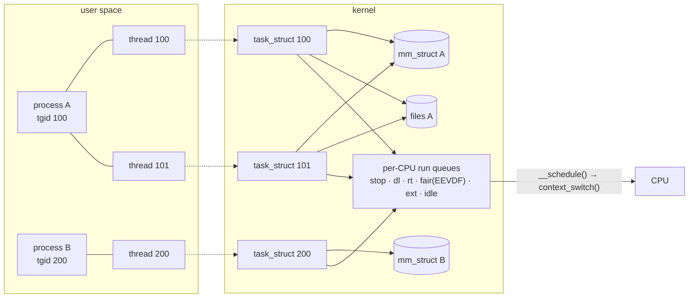
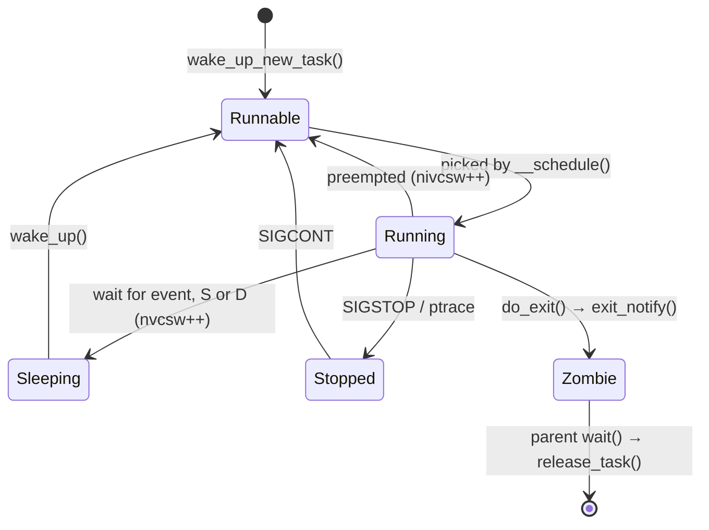

# 02 — Processes & Threads

> Course: Advanced Operating Systems · Term 1 · Pins: Linux **v6.18.63**, OpenBSD **`8cada8c`** · Arch: **x86-64**
> Time: ~16 h · Persian version: [`lesson.fa.md`](lesson.fa.md) · Code: [`kernel-walkthrough.en.md`](kernel-walkthrough.en.md) · Notes: [`notes/INDEX.en.md`](notes/INDEX.en.md) · Decks: [`slides/`](slides/)
>
> **Depends on:** Module 00 (the VM and tools, `cite.sh`) and Module 01 (user/kernel mode, the `syscall` path, what a context switch saves: registers, kernel stack, `CR3`). **Used by:** Module 03 (threads are what races), Module 04 (`fork` copy-on-write, `mm_struct`), Module 06 (`clone` namespace flags, cgroups), Module 07 (`SCHED_FIFO`, `SCHED_DEADLINE`).

## Learning goals

- Explain what a process and a thread are **to the Linux kernel** (`task_struct`, `mm_struct`, `tgid`), and why the difference is only "which resources are shared".
- Trace `fork()`, `clone()`, `execve()`, `exit()` and `wait()` through the kernel and predict what is shared, copied or replaced.
- Read `/proc/<pid>/{status,maps,fd,sched}` and `perf sched` output to tell a sleeping, runnable, preempted or zombie task apart.
- Describe how Linux picks the next task: the class order (stop → dl → rt → fair → ext → idle) and **EEVDF** in the fair class (lag, eligibility, virtual deadline, slice).
- Measure a context switch and IPC round trip on a real machine and explain the numbers.
- Compare the Linux design with OpenBSD (`struct process` + `struct proc`, 32 priority queues).

## Glossary

| Term | Meaning |
|---|---|
| **Process** | A running program: one address space plus resources (files, signal handlers, credentials) and one or more threads |
| **Thread** | One flow of execution with its own registers, stack and kernel state, inside a process |
| **`task_struct`** | The kernel's object for **one thread** (`include/linux/sched.h` L815). Linux has no separate "process" struct |
| **PID / TID / TGID** | In the kernel, `pid` is per task (the TID user space sees) and `tgid` is the thread-group id (what `getpid()` returns) |
| **`mm_struct`** | One address space: VMAs and page tables. Threads share one; processes have their own |
| **`fork()`** | Make a child process: a copy of the caller, with copy-on-write memory |
| **`vfork()`** | `fork` variant where the child borrows the parent's memory and the parent sleeps until the child `exec`s or exits |
| **`clone()` / `clone3()`** | The general syscall: flags choose what the child shares (`CLONE_VM`, `CLONE_FILES`, `CLONE_THREAD`, ...) |
| **`execve()`** | Replace the program running in this task: new address space, same PID, same (non-`CLOEXEC`) fds |
| **ELF** | Executable and Linkable Format: the binary format Linux loads with `load_elf_binary()` |
| **Copy-on-write (COW)** | Parent and child share pages read-only; the first write to a page makes a private copy (Module 4) |
| **Zombie** | A task that exited but whose parent has not called `wait()` yet: state `Z`, only the exit status remains |
| **Orphan** | A child whose parent exited; it is re-parented to a subreaper or to PID 1 |
| **Run queue (`rq`)** | Per-CPU structure holding the runnable tasks of that CPU, one sub-queue per scheduling class |
| **Scheduling class** | A pluggable policy module (`struct sched_class`): stop, dl, rt, fair, ext, idle, in that priority order |
| **Policy** | What user space asks for: `SCHED_OTHER`/`BATCH`/`IDLE` (fair), `SCHED_FIFO`/`RR` (rt), `SCHED_DEADLINE` (dl), `SCHED_EXT` |
| **CFS** | Completely Fair Scheduler, the fair-class algorithm from 2.6.23 until it was replaced by EEVDF (6.6) |
| **EEVDF** | Earliest Eligible Virtual Deadline First: pick, among tasks that are owed CPU time, the one with the earliest virtual deadline |
| **vruntime** | A task's CPU time scaled by its weight: grows slower for high-weight (low nice) tasks |
| **Lag** | How much CPU time a task is owed compared with an ideal fair share; `lag ≥ 0` means **eligible** |
| **Slice** | The amount of CPU time a task asks for per turn (EEVDF request size `r_i`); default `base_slice_ns` |
| **Weight / nice** | `nice` −20..19 maps to a weight (`nice 0 = 1024`); each nice step is about 10% CPU |
| **Context switch** | Saving one task's CPU state and loading another's (`context_switch()` → `switch_to()`) |
| **Voluntary / involuntary switch** | Task blocked by itself (sleep, I/O) vs was preempted while still runnable (`nvcsw` / `nivcsw`) |
| **Preemption** | Taking the CPU away from a running task, e.g. when a task with an earlier deadline wakes up |
| **IPC** | Inter-process communication: pipes, shared memory, UNIX sockets, message queues, signals |
| **Pipe** | A kernel buffer (16 pages by default) with a read end and a write end; EOF when no writer is left |
| **Goroutine** | A Go runtime task, multiplexed onto a few OS threads (M:N). The kernel does not see goroutines |

## 1. Big picture

The kernel schedules **tasks** (threads). A "process" is just the set of tasks that point at the same `mm_struct`, file table and signal state and share a `tgid`.

## 2. Concepts

### 2.1 What *is* a process to the kernel?

One `struct task_struct` per thread (`include/linux/sched.h` L815). It holds the scheduling state (`__state`, `se`, `rt`, `dl`, `sched_class`, `policy`, `prio`), the identity (`pid`, `tgid`, `real_parent`), and **pointers** to shared resources: `mm` (memory), `files` (fd table), `fs` (cwd, root), `signal`/`sighand`, `nsproxy` (namespaces). The last field, `thread`, holds the arch-specific CPU state saved at a context switch (Module 1).

| You ask | Kernel field | Where to see it |
|---|---|---|
| "my PID" (`getpid()`) | `tgid` | `/proc/<pid>/status` `Tgid:` |
| "my thread id" (`gettid()`) | `pid` | `/proc/<pid>/task/<tid>/` |
| state R/S/D/Z | `__state`, `exit_state` | `State:` line, `ps -o stat` |
| how often it slept / was preempted | `nvcsw`, `nivcsw` | `voluntary_ctxt_switches` |
| memory | `mm` | `/proc/<pid>/maps` |

Note: [01 task_struct anatomy](notes/01-task-struct-anatomy.en.md).

### 2.2 What happens when you call `fork()`?

`fork()` → `SYSCALL_DEFINE0(fork)` → `kernel_clone()` → `copy_process()`, which allocates a new `task_struct` and then, for each resource, **shares or copies** it according to the `CLONE_*` flags. Plain `fork()` passes no sharing flags, so everything is copied; memory is copied lazily by copy-on-write. Finally `wake_up_new_task()` makes the child runnable. The child returns 0 from `fork()` because `copy_thread()` sets its saved `ax` register to 0.

| Call | Flags passed to `kernel_clone()` | Result |
|---|---|---|
| `fork()` | `exit_signal = SIGCHLD` | new process, COW memory |
| `vfork()` | `CLONE_VFORK \| CLONE_VM` | child borrows memory, parent sleeps until exec/exit |
| `pthread_create()` | `CLONE_VM \| CLONE_FS \| CLONE_FILES \| CLONE_SIGHAND \| CLONE_THREAD \| CLONE_SYSVSEM \| CLONE_SETTLS \| CLONE_PARENT_SETTID \| CLONE_CHILD_CLEARTID` | new thread in the same process |
| `unshare` / container runtime | `CLONE_NEWPID`, `CLONE_NEWNS`, ... | new namespaces (Module 6) |

Notes: [02 fork/vfork/clone](notes/02-fork-vfork-clone-flags.en.md), lab [02.2 clone flags](labs/02-clone-flags/README.md).

### 2.3 What does `execve()` replace, and what does it keep?

`execve()` → `do_execveat_common()` → `bprm_execve()` → `exec_binprm()` → `search_binary_handler()` → `load_elf_binary()` → `begin_new_exec()`. After the **point of no return** the old program is gone: a new `mm`, all other threads killed (`de_thread()`), signal handlers reset to default, `O_CLOEXEC` fds closed.

| Kept | Replaced / reset |
|---|---|
| PID, TGID, parent, children | address space (code, heap, stack, mmaps) |
| open fds without `FD_CLOEXEC` | caught signal handlers → `SIG_DFL` |
| cwd, root, umask, rlimits | other threads of the process (killed) |
| nice, policy, CPU affinity, cgroup | `comm` (name), credentials if setuid |

This is why the shell pattern **fork → (in child) set up fds with `dup2` → exec** works: the fd table survives exec. Note: [03 execve and ELF](notes/03-execve-and-elf-loading.en.md), lab [02.1](labs/01-fork-exec-pipe/README.md).

### 2.4 What happens after `exit()`?

`do_exit()` frees almost everything (memory, files), then `exit_notify()` sets `exit_state = EXIT_ZOMBIE` and signals the parent (`SIGCHLD`). The `task_struct` stays until the parent calls `wait*()` and collects the status. If the parent ignores `SIGCHLD` explicitly (`SIG_IGN`) or sets `SA_NOCLDWAIT`, the kernel reaps the child automatically. Note: [04 states and wait](notes/04-process-states-and-wait.en.md).

### 2.5 Is a thread just a process that shares memory?

In Linux, almost literally. A thread is a task created with `CLONE_VM | CLONE_THREAD | ...`: same `mm`, same `files`, same `signal`, same `tgid`, its own `pid` (TID), registers, kernel stack and scheduling entity. Each thread is scheduled independently, so a process with 8 busy threads can use 8 CPUs. Language runtimes (Go, Java virtual threads, Tokio) add their own **user-level** tasks on top: goroutines are multiplexed onto a few OS threads (`GOMAXPROCS`), and the kernel sees only those threads. Note: [05 threads share an mm](notes/05-threads-share-an-mm.en.md), lab [02.6](labs/06-goroutines-vs-threads/README.md).

### 2.6 Who decides which task runs next?

Each CPU has a run queue with one sub-queue per scheduling class. `__schedule()` asks the classes **in fixed order** and takes the first task offered:

| Class | Policies | Pick rule | Typical users |
|---|---|---|---|
| stop | — (kernel only) | always first | CPU stopper, migration |
| dl | `SCHED_DEADLINE` | earliest absolute deadline, with admission control | periodic real-time; also the **fair server** |
| rt | `SCHED_FIFO`, `SCHED_RR` | highest static priority 1–99; RR rotates every 100 ms | audio, control loops |
| fair | `SCHED_OTHER`, `SCHED_BATCH`, `SCHED_IDLE` | **EEVDF** | almost everything |
| ext | `SCHED_EXT` | whatever the loaded BPF program decides (sched_ext) | custom schedulers |
| idle | — | when nothing else is runnable | the idle task (`swapper/N`) |

A runnable `SCHED_FIFO` task beats every fair task on its CPU. Since 6.12 the **fair server** (a `SCHED_DEADLINE` reservation, 50 ms per 1 s per CPU by default) keeps a little CPU for fair tasks, so an RT spinner no longer starves them completely. **VERSION-DEPENDENT**. Note: [06 scheduling classes](notes/06-scheduling-classes.en.md), lab [02.5](labs/05-sched-policies/README.md).

### 2.7 How does EEVDF pick among normal tasks?

1. Each task's `vruntime` grows by `real runtime × 1024 / weight`. A `nice 0` task has weight 1024; `nice 5` has 335, so its vruntime grows ~3× faster.
2. The queue's weighted average vruntime `V` is the "ideal" virtual time. **Lag** = `weight × (V − vruntime)`. A task with lag ≥ 0 has received less than its share: it is **eligible**.
3. Each task has a **virtual deadline** = `vruntime + slice × 1024 / weight`.
4. Pick the **eligible task with the earliest virtual deadline** (`pick_eevdf()`, O(log n) in an augmented RB-tree).

Consequence: `nice` controls **how much** CPU you get, and the slice (default 2.8 ms on the 8-vCPU VM, settable per task with `sched_setattr()`) controls **how soon** you get it. CFS mixed both into one heuristic. Note: [07 EEVDF](notes/07-eevdf.en.md).

### 2.8 What does a context switch cost?

`context_switch()` switches the address space (`switch_mm_irqs_off()`: a `CR3` write if the `mm` changes, nothing if both tasks are threads of one process), then `switch_to()` swaps stack pointer and registers. The direct cost is about a microsecond; the indirect cost (cold caches and TLB) is often larger. Lab [02.3](labs/03-ctxsw-pingpong/README.md) measures a pipe round trip with both tasks on one CPU vs on two CPUs. Lab [02.4](labs/04-perf-sched-bpftrace/README.md) watches switches with `perf sched` and bpftrace.

### 2.9 How do processes talk to each other?

| Mechanism | Kernel object | Data copies | Sync built in | Typical use |
|---|---|---|---|---|
| pipe / FIFO | `pipe_inode_info`, 16 × 4 KiB ring by default | 2 (write → kernel → read) | yes, blocking read/write | shell pipelines |
| UNIX domain socket | `struct sock` pair, `AF_UNIX` | 2 | yes; can pass fds (`SCM_RIGHTS`) | databases, systemd, Docker API |
| shared memory (`shm_open`+`mmap`, `shmget`) | shmem file mapped twice | 0 after setup | **no**: add a futex/semaphore | high-volume data |
| POSIX message queue | `mqueue` fs | 2 | yes, priorities | small messages |
| signals | `sigpending` | — | async | notifications |

Note: [08 IPC](notes/08-ipc-pipes-shm-sockets.en.md).

## 3. Where this lives in Linux

| Topic | File · function | Walkthrough |
|---|---|---|
| process creation | `kernel/fork.c` · `kernel_clone()` L2578, `copy_process()` L1936, `copy_mm()` L1521 | [§1](kernel-walkthrough.en.md#1-kernel_clone-every-new-task-starts-here) |
| exec | `fs/exec.c` · `bprm_execve()` L1756, `search_binary_handler()` L1677 | [§2](kernel-walkthrough.en.md#2-bprm_execve-a-task-becomes-a-new-program) |
| schedule | `kernel/sched/core.c` · `__schedule()` L6801 | [§3](kernel-walkthrough.en.md#3-__schedule-the-only-place-a-cpu-changes-task) |
| class order | `kernel/sched/sched.h` · `DEFINE_SCHED_CLASS` L2531; `__pick_next_task()` L5974 | [§4](kernel-walkthrough.en.md#4-scheduling-classes-a-linker-ordered-array) |
| EEVDF | `kernel/sched/fair.c` · `pick_eevdf()` L1025, `update_deadline()` L1127 | [§5](kernel-walkthrough.en.md#5-eevdf-pick_eevdf) |
| context switch | `kernel/sched/core.c` · `context_switch()` L5293 | [§6](kernel-walkthrough.en.md#6-context_switch-memory-first-then-registers) |
| pipes, shm | `fs/pipe.c` · `anon_pipe_read()` L269; `ipc/shm.c` · `newseg()` L704 | [§7–8](kernel-walkthrough.en.md#7-anon_pipe_read-blocking-is-a-loop-around-a-wait-queue) |
| sched_ext | `kernel/sched/ext.c` · `DEFINE_SCHED_CLASS(ext)` L3400 | mention only |
| OpenBSD | `sys/kern/kern_fork.c` `fork1()`, `kern_sched.c`, `sched_bsd.c` | [§9](kernel-walkthrough.en.md#9-openbsd-comparison) |

## 4. Labs

| Lab | Goal | Time |
|---|---|---|
| [02.1 fork-exec-pipe](labs/01-fork-exec-pipe/README.md) | fork, `dup2`, exec, pipe; see the fd table and a zombie in `/proc` | 45 min |
| [02.2 clone-flags](labs/02-clone-flags/README.md) | which `CLONE_*` flag shares memory, fds, cwd; what makes a thread | 60 min |
| [02.3 ctxsw-pingpong](labs/03-ctxsw-pingpong/README.md) | cost of a blocking round trip, same CPU vs two CPUs | 60 min |
| [02.4 perf-sched-bpftrace](labs/04-perf-sched-bpftrace/README.md) | scheduler latency with `perf sched`; voluntary vs involuntary with bpftrace | 60 min |
| [02.5 sched-policies](labs/05-sched-policies/README.md) | nice weights, `SCHED_FIFO` vs fair server, EEVDF custom slice | 75 min |
| [02.6 goroutines-vs-threads](labs/06-goroutines-vs-threads/README.md) | goroutines vs OS threads in `/proc/<pid>/task` | 45 min |

[`labs/capture-all.sh`](labs/capture-all.sh) builds every lab and re-runs labs 02.3–02.6 in one go (about 5 minutes; transcripts go to `labs/out/`). The expected outputs of those READMEs came from it; labs 02.1–02.2 were captured by hand with the README commands.

## 5. Common misconceptions

| Misconception | Reality |
|---|---|
| "Linux has processes and threads as different kernel objects." | One `task_struct` per thread. "Process" = tasks sharing a `tgid` and an `mm`. |
| "`fork()` copies the whole memory." | It copies page tables and marks pages COW. Data pages are copied only when written. |
| "`getpid()` returns the thread's id." | It returns `tgid`. Use `gettid()` for the task's own id. |
| "A goroutine is an OS thread." | Thousands of goroutines run on `GOMAXPROCS` threads; extra threads appear only for blocking syscalls and cgo. |
| "Linux uses CFS." | Since 6.6 the fair class is EEVDF. `sched-design-CFS.rst` still exists, but describes history. |
| "`nice` sets the time slice." | `nice` sets the weight (share). The slice is a separate request (`base_slice_ns`, `sched_setattr`). |
| "A `SCHED_FIFO` busy loop freezes the machine." | Other CPUs still run, and the fair server reserves ~5% per CPU for fair tasks (6.12+). It is still a bad idea. |
| "A zombie uses memory." | Only the `task_struct` and exit status remain. Many zombies exhaust PIDs, not RAM. |
| "`kill -9` removes a zombie." | A zombie is already dead. Only its parent's `wait()`, or the parent's death, removes it. |
| "Shared memory is IPC with synchronization." | It is only shared pages. You need a futex, semaphore or atomic protocol (Module 3). |

## 6. Self-check questions

1. Which fields of `task_struct` are pointers that two threads of one process have in common? Which are private?
2. Why does `fork()` return twice, and why is it 0 in the child? Name the function that sets this.
3. After `execve()`, which of these survive: PID, fd 3 opened with `O_CLOEXEC`, `SIGINT` handler, nice value, other threads?
4. A server has 3,000 processes in state `Z`. What is wrong, and how do you fix it without restarting the server?
5. Two `nice 0` and one `nice 5` busy tasks share one CPU. What share does each get? (Use 1024 and 335.)
6. Under EEVDF, what is the difference between giving a task `nice -5` and giving it a 0.5 ms slice?
7. Why is a ping-pong between two threads on the same CPU cheaper than between two processes on the same CPU, even though both are context switches?
8. Your Go service shows 2,000 OS threads in `/proc/<pid>/status`. Give two possible causes.
9. Why does a pipe reader block forever if the parent forgets to `close()` the write end?
10. OpenBSD has `struct process` and `struct proc`. What does Linux use for each?

Answers: the quiz [`quiz.en.md`](quiz.en.md) covers each of these; the notes give the details.
