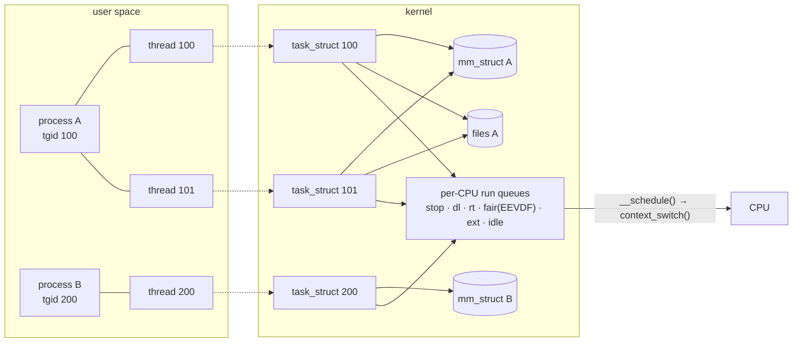
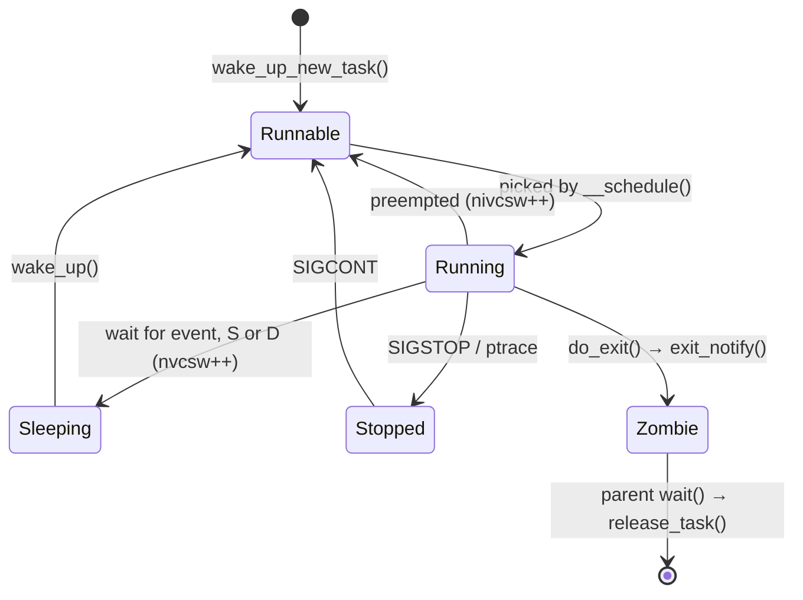

# ۰۲ — پردازه‌ها و نخ‌ها (Processes & Threads)

> درس: سیستم‌عامل پیشرفته · ترم ۱ · نسخه‌های ثابت: Linux **v6.18.63** و OpenBSD **`8cada8c`** · معماری: **x86-64**
> زمان: حدود ۱۶ ساعت · نسخهٔ انگلیسی: [`lesson.en.md`](lesson.en.md) · کد: [`kernel-walkthrough.fa.md`](kernel-walkthrough.fa.md) · یادداشت‌ها: [`notes/INDEX.fa.md`](notes/INDEX.fa.md) · اسلایدها: [`slides/`](slides/)
>
> **پیش‌نیاز:** ماژول ۰۰ (VM، ابزارها و `cite.sh`) و ماژول ۰۱ (حالت کاربر و کرنل، مسیر `syscall`، و اینکه context switch چه چیزهایی را ذخیره می‌کند: رجیسترها، پشتهٔ کرنل و `CR3`). **مورد استفاده در:** ماژول ۰۳ (race بین نخ‌ها رخ می‌دهد)، ماژول ۰۴ (copy-on-write در `fork` و `mm_struct`)، ماژول ۰۶ (پرچم‌های namespace در `clone` و cgroupها) و ماژول ۰۷ (`SCHED_FIFO` و `SCHED_DEADLINE`).

## هدف‌های یادگیری

- توضیح دهید پردازه و نخ **از دید کرنل لینوکس** چه هستند (`task_struct`، `mm_struct`، `tgid`) و چرا تفاوتشان فقط این است که «کدام منابع مشترک‌اند».
- مسیر `fork()`، `clone()`، `execve()`، `exit()` و `wait()` را داخل کرنل دنبال کنید و پیش‌بینی کنید چه چیزی مشترک می‌شود، کپی می‌شود یا جایگزین می‌شود.
- با خواندن `/proc/<pid>/{status,maps,fd,sched}` و خروجی `perf sched` تشخیص دهید یک task در خواب است، قابل اجراست، preempt شده یا zombie است.
- شرح دهید لینوکس task بعدی را چطور انتخاب می‌کند: ترتیب کلاس‌ها (stop ← dl ← rt ← fair ← ext ← idle) و **EEVDF** در کلاس fair (lag، eligibility، virtual deadline و slice).
- هزینهٔ context switch و رفت‌وبرگشت IPC را روی ماشین واقعی اندازه بگیرید و عددها را توضیح دهید.
- طراحی لینوکس را با OpenBSD مقایسه کنید (`struct process` و `struct proc`، و ۳۲ صف اولویت).

## واژه‌نامه

| اصطلاح | تعریف |
|---|---|
| **Process (پردازه)** | برنامه‌ای در حال اجرا: یک فضای آدرس، منابع (فایل‌ها، handlerهای سیگنال، اعتبارنامه‌ها) و یک یا چند نخ. |
| **Thread (نخ)** | یک جریان اجرا با رجیسترها، پشته و وضعیت کرنلی خودش، داخل یک پردازه. |
| **`task_struct`** | شیء کرنل برای **یک نخ** (`include/linux/sched.h` خط 815). لینوکس ساختار جداگانه‌ای به نام «پردازه» ندارد. |
| **PID / TID / TGID** | در کرنل، `pid` مال هر task است (همان TID که برنامه می‌بیند) و `tgid` شناسهٔ گروه نخ است (چیزی که `getpid()` برمی‌گرداند). |
| **`mm_struct`** | یک فضای آدرس: VMAها و page tableها. نخ‌ها یکی را مشترک دارند و هر پردازه مال خودش را. |
| **`fork()`** | ساخت پردازهٔ فرزند به‌صورت کپی فراخواننده، با حافظهٔ copy-on-write. |
| **`vfork()`** | گونه‌ای از `fork` که فرزند حافظهٔ والد را قرض می‌گیرد و والد تا `exec` یا خروج فرزند می‌خوابد. |
| **`clone()` / `clone3()`** | syscall عمومی؛ با پرچم‌ها تعیین می‌کنید فرزند چه چیزهایی را مشترک داشته باشد (`CLONE_VM`، `CLONE_FILES`، `CLONE_THREAD` و ...). |
| **`execve()`** | برنامهٔ در حال اجرا در این task را عوض می‌کند: فضای آدرس نو، همان PID، همان fdهایی که `CLOEXEC` ندارند. |
| **ELF** | قالب فایل اجرایی که لینوکس با `load_elf_binary()` بارگذاری می‌کند. |
| **Copy-on-write (COW)** | والد و فرزند صفحه‌ها را فقط‌خواندنی مشترک دارند؛ اولین نوشتن روی یک صفحه، کپی خصوصی آن را می‌سازد (ماژول ۴). |
| **Zombie** | taskای که خارج شده اما والدش هنوز `wait()` نکرده؛ وضعیت `Z` و فقط وضعیت خروج باقی مانده است. |
| **Orphan (یتیم)** | فرزندی که والدش خارج شده؛ به یک subreaper یا PID 1 سپرده می‌شود. |
| **Run queue (`rq`)** | ساختار هر CPU که taskهای قابل اجرای آن CPU را نگه می‌دارد، با یک زیرصف برای هر کلاس زمان‌بندی. |
| **Scheduling class** | ماژول سیاست قابل‌تعویض (`struct sched_class`): stop، dl، rt، fair، ext، idle به همین ترتیب اولویت. |
| **Policy** | چیزی که برنامه درخواست می‌کند: `SCHED_OTHER`/`BATCH`/`IDLE` (fair)، `SCHED_FIFO`/`RR` (rt)، `SCHED_DEADLINE` (dl)، `SCHED_EXT`. |
| **CFS** | Completely Fair Scheduler؛ الگوریتم کلاس fair از نسخهٔ 2.6.23 تا وقتی EEVDF جایش را گرفت (6.6). |
| **EEVDF** | Earliest Eligible Virtual Deadline First: از میان taskهایی که طلب CPU دارند، آن را که زودترین virtual deadline دارد انتخاب کن. |
| **vruntime** | زمان CPU مصرف‌شدهٔ task تقسیم بر وزنش؛ برای taskهای پروزن (nice کم) کندتر رشد می‌کند. |
| **Lag** | اینکه task در مقایسه با سهم منصفانهٔ ایده‌آل چقدر طلب دارد؛ `lag ≥ 0` یعنی **eligible**. |
| **Slice** | مقدار زمان CPU که task در هر نوبت درخواست می‌کند (اندازهٔ درخواست `r_i` در EEVDF)؛ پیش‌فرض `base_slice_ns`. |
| **Weight / nice** | مقدار `nice` از ۲۰- تا ۱۹ به یک وزن تبدیل می‌شود (`nice 0 = 1024`)؛ هر پلهٔ nice حدود ۱۰٪ CPU است. |
| **Context switch** | ذخیرهٔ وضعیت CPU یک task و بارگذاری وضعیت task دیگر (`context_switch()` ← `switch_to()`). |
| **Voluntary / involuntary switch** | task خودش مسدود شده (خواب، I/O) در برابر اینکه در حالی که هنوز قابل اجرا بوده preempt شده است (`nvcsw` / `nivcsw`). |
| **Preemption** | گرفتن CPU از task در حال اجرا، مثلاً وقتی taskای با deadline زودتر بیدار می‌شود. |
| **IPC** | ارتباط بین پردازه‌ها: pipe، حافظهٔ مشترک، سوکت UNIX، صف پیام و سیگنال. |
| **Pipe** | بافر کرنلی (به‌طور پیش‌فرض ۱۶ صفحه) با یک سر خواندن و یک سر نوشتن؛ وقتی هیچ نویسنده‌ای نماند EOF می‌شود. |
| **Goroutine** | یک task در runtime زبان Go که روی چند نخ سیستم‌عامل سوار می‌شود (M:N). کرنل goroutine را نمی‌بیند. |

## ۱. تصویر کلی

کرنل **task** (یعنی نخ) زمان‌بندی می‌کند. «پردازه» فقط مجموعهٔ taskهایی است که به یک `mm_struct`، یک جدول فایل و یک وضعیت سیگنال اشاره می‌کنند و `tgid` یکسانی دارند.

## ۲. مفاهیم

### ۲.۱ پردازه از دید کرنل دقیقاً چیست؟

برای هر نخ یک `struct task_struct` وجود دارد (`include/linux/sched.h` خط 815). این ساختار وضعیت زمان‌بندی (`__state`، `se`، `rt`، `dl`، `sched_class`، `policy`، `prio`)، هویت (`pid`، `tgid`، `real_parent`) و **اشاره‌گر** به منابع مشترک را نگه می‌دارد: `mm` (حافظه)، `files` (جدول fd)، `fs` (cwd و root)، `signal` و `sighand`، و `nsproxy` (namespaceها). آخرین فیلد، `thread`، وضعیت وابسته به معماری CPU است که در context switch ذخیره می‌شود (ماژول ۱).

| آنچه می‌پرسید | فیلد کرنل | کجا ببینید |
|---|---|---|
| «PID من» (`getpid()`) | `tgid` | خط `Tgid:` در `/proc/<pid>/status` |
| «شناسهٔ نخ من» (`gettid()`) | `pid` | `/proc/<pid>/task/<tid>/` |
| وضعیت R/S/D/Z | `__state` و `exit_state` | خط `State:` و `ps -o stat` |
| چند بار خوابیده / preempt شده | `nvcsw` و `nivcsw` | `voluntary_ctxt_switches` |
| حافظه | `mm` | `/proc/<pid>/maps` |

یادداشت: [۰۱ ساختار task_struct](notes/01-task-struct-anatomy.fa.md).

### ۲.۲ وقتی `fork()` را صدا می‌زنید چه اتفاقی می‌افتد؟

مسیر این است: `fork()` ← `SYSCALL_DEFINE0(fork)` ← `kernel_clone()` ← `copy_process()`. این تابع یک `task_struct` تازه می‌سازد و بعد برای هر منبع، بر اساس پرچم‌های `CLONE_*`، آن را **مشترک می‌کند یا کپی می‌کند**. `fork()` معمولی هیچ پرچم اشتراکی نمی‌فرستد، پس همه‌چیز کپی می‌شود؛ حافظه هم به‌صورت تنبل و با copy-on-write کپی می‌شود. در پایان `wake_up_new_task()` فرزند را قابل اجرا می‌کند. فرزند از `fork()` مقدار ۰ می‌گیرد، چون `copy_thread()` رجیستر `ax` ذخیره‌شدهٔ او را صفر می‌کند.

| فراخوانی | پرچم‌های ارسالی به `kernel_clone()` | نتیجه |
|---|---|---|
| `fork()` | `exit_signal = SIGCHLD` | پردازهٔ جدید با حافظهٔ COW |
| `vfork()` | `CLONE_VFORK \| CLONE_VM` | فرزند حافظه را قرض می‌گیرد و والد تا exec یا exit می‌خوابد |
| `pthread_create()` | `CLONE_VM \| CLONE_FS \| CLONE_FILES \| CLONE_SIGHAND \| CLONE_THREAD \| CLONE_SYSVSEM \| CLONE_SETTLS \| CLONE_PARENT_SETTID \| CLONE_CHILD_CLEARTID` | نخ جدید در همان پردازه |
| `unshare` و runtimeهای container | `CLONE_NEWPID`، `CLONE_NEWNS` و ... | namespace جدید (ماژول ۶) |

یادداشت: [۰۲ fork، vfork و clone](notes/02-fork-vfork-clone-flags.fa.md)، آزمایش [۰۲.۲ پرچم‌های clone](labs/02-clone-flags/README.md).

### ۲.۳ `execve()` چه چیزی را عوض می‌کند و چه چیزی را نگه می‌دارد؟

مسیر: `execve()` ← `do_execveat_common()` ← `bprm_execve()` ← `exec_binprm()` ← `search_binary_handler()` ← `load_elf_binary()` ← `begin_new_exec()`. بعد از **نقطهٔ بی‌بازگشت** برنامهٔ قدیمی دیگر وجود ندارد: `mm` نو، همهٔ نخ‌های دیگر کشته می‌شوند (`de_thread()`)، handlerهای سیگنال به حالت پیش‌فرض برمی‌گردند و fdهای `O_CLOEXEC` بسته می‌شوند.

| نگه داشته می‌شود | جایگزین یا بازنشانی می‌شود |
|---|---|
| PID، TGID، والد، فرزندان | فضای آدرس (کد، heap، پشته، mmapها) |
| fdهای باز بدون `FD_CLOEXEC` | handlerهای سیگنالی که نصب شده‌اند ← `SIG_DFL` |
| cwd، root، umask، rlimitها | نخ‌های دیگر پردازه (کشته می‌شوند) |
| nice، policy، CPU affinity، cgroup | `comm` (نام)، و اعتبارنامه اگر فایل setuid باشد |

الگوی shell، یعنی **fork ← (در فرزند) تنظیم fdها با `dup2` ← exec**، به همین دلیل کار می‌کند: جدول fd از exec عبور می‌کند. یادداشت: [۰۳ execve و ELF](notes/03-execve-and-elf-loading.fa.md)، آزمایش [۰۲.۱](labs/01-fork-exec-pipe/README.md).

### ۲.۴ بعد از `exit()` چه می‌شود؟

`do_exit()` تقریباً همه‌چیز (حافظه، فایل‌ها) را آزاد می‌کند و بعد `exit_notify()` مقدار `exit_state = EXIT_ZOMBIE` را می‌گذارد و به والد سیگنال `SIGCHLD` می‌فرستد. `task_struct` تا وقتی والد `wait*()` را صدا بزند و وضعیت را بردارد باقی می‌ماند. اگر والد صراحتاً `SIGCHLD` را نادیده بگیرد (`SIG_IGN`) یا `SA_NOCLDWAIT` را بگذارد، کرنل فرزند را خودکار جمع می‌کند. یادداشت: [۰۴ وضعیت‌ها و wait](notes/04-process-states-and-wait.fa.md).

### ۲.۵ آیا نخ همان پردازه‌ای است که حافظه‌اش مشترک است؟

در لینوکس تقریباً به معنای واقعی کلمه، بله. نخ taskای است که با `CLONE_VM | CLONE_THREAD | ...` ساخته شده: همان `mm`، همان `files`، همان `signal`، همان `tgid`، اما `pid` (TID)، رجیسترها، پشتهٔ کرنل و موجودیت زمان‌بندی مخصوص خودش. هر نخ مستقل زمان‌بندی می‌شود، پس پردازه‌ای با ۸ نخ پرکار می‌تواند از ۸ CPU استفاده کند. runtimeهای زبان‌ها (Go، virtual threadهای Java، Tokio) taskهای **سطح کاربر** خودشان را روی این‌ها سوار می‌کنند: goroutineها روی چند نخ سیستم‌عامل (`GOMAXPROCS`) چندبخشی می‌شوند و کرنل فقط همان نخ‌ها را می‌بیند. یادداشت: [۰۵ نخ‌ها یک mm مشترک دارند](notes/05-threads-share-an-mm.fa.md)، آزمایش [۰۲.۶](labs/06-goroutines-vs-threads/README.md).

### ۲.۶ چه کسی تعیین می‌کند task بعدی کدام باشد؟

هر CPU یک run queue دارد که برای هر کلاس زمان‌بندی یک زیرصف دارد. `__schedule()` کلاس‌ها را **به ترتیب ثابت** می‌پرسد و اولین taskای را که پیشنهاد شود برمی‌دارد:

| کلاس | policyها | قاعدهٔ انتخاب | کاربرد معمول |
|---|---|---|---|
| stop | — (فقط کرنل) | همیشه اول | CPU stopper، migration |
| dl | `SCHED_DEADLINE` | زودترین deadline مطلق، با admission control | real-time دوره‌ای؛ و همچنین **fair server** |
| rt | `SCHED_FIFO`، `SCHED_RR` | بالاترین اولویت ایستا از ۱ تا ۹۹؛ در RR هر ۱۰۰ میلی‌ثانیه چرخش | صوت، حلقه‌های کنترلی |
| fair | `SCHED_OTHER`، `SCHED_BATCH`، `SCHED_IDLE` | **EEVDF** | تقریباً همه‌چیز |
| ext | `SCHED_EXT` | هرچه برنامهٔ BPF بارگذاری‌شده تصمیم بگیرد (sched_ext) | زمان‌بندهای سفارشی |
| idle | — | وقتی هیچ چیز دیگری قابل اجرا نیست | task بیکار (`swapper/N`) |

یک task قابل اجرای `SCHED_FIFO` روی CPU خودش از همهٔ taskهای fair جلو می‌زند. از نسخهٔ 6.12 به بعد **fair server** (رزرو `SCHED_DEADLINE`، به‌طور پیش‌فرض ۵۰ میلی‌ثانیه در هر ۱ ثانیه برای هر CPU) کمی CPU برای taskهای fair نگه می‌دارد، پس یک RT پرمصرف دیگر آن‌ها را کاملاً گرسنه نمی‌گذارد. **VERSION-DEPENDENT**. یادداشت: [۰۶ کلاس‌های زمان‌بندی](notes/06-scheduling-classes.fa.md)، آزمایش [۰۲.۵](labs/05-sched-policies/README.md).

### ۲.۷ EEVDF بین taskهای معمولی چطور انتخاب می‌کند؟

۱. `vruntime` هر task به اندازهٔ `زمان اجرای واقعی × 1024 / weight` رشد می‌کند. task با `nice 0` وزن 1024 دارد و `nice 5` وزن 335، پس vruntime دومی حدود ۳ برابر سریع‌تر بالا می‌رود.
۲. میانگین وزنی vruntime صف، یعنی `V`، زمان مجازی «ایده‌آل» است. **Lag** برابر `weight × (V − vruntime)` است. taskای که lag ≥ 0 دارد کمتر از سهمش گرفته و **eligible** است.
۳. هر task یک **virtual deadline** دارد: `vruntime + slice × 1024 / weight`.
۴. **taskای که eligible است و زودترین virtual deadline را دارد** انتخاب می‌شود (`pick_eevdf()`، با هزینهٔ O(log n) در یک RB-tree تقویت‌شده).

نتیجه: `nice` تعیین می‌کند **چقدر** CPU بگیرید و slice (پیش‌فرض ۲.۸ میلی‌ثانیه روی VM هشت‌هسته‌ای، و قابل تنظیم برای هر task با `sched_setattr()`) تعیین می‌کند **چقدر زود** آن را بگیرید. CFS هر دو را در یک روش ابتکاری قاطی می‌کرد. یادداشت: [۰۷ EEVDF](notes/07-eevdf.fa.md).

### ۲.۸ هزینهٔ یک context switch چقدر است؟

`context_switch()` اول فضای آدرس را عوض می‌کند (`switch_mm_irqs_off()`: اگر `mm` تغییر کند یک نوشتن در `CR3`، و اگر هر دو task نخ‌های یک پردازه باشند هیچ کاری) و بعد `switch_to()` اشاره‌گر پشته و رجیسترها را جابه‌جا می‌کند. هزینهٔ مستقیم در حد یک میکروثانیه است؛ هزینهٔ غیرمستقیم (cache و TLB سرد) اغلب بیشتر است. آزمایش [۰۲.۳](labs/03-ctxsw-pingpong/README.md) رفت‌وبرگشت از طریق pipe را وقتی هر دو task روی یک CPU هستند و وقتی روی دو CPU هستند اندازه می‌گیرد. آزمایش [۰۲.۴](labs/04-perf-sched-bpftrace/README.md) switchها را با `perf sched` و bpftrace تماشا می‌کند.

### ۲.۹ پردازه‌ها چطور با هم حرف می‌زنند؟

| سازوکار | شیء کرنل | تعداد کپی داده | همگام‌سازی داخلی | کاربرد معمول |
|---|---|---|---|---|
| pipe / FIFO | `pipe_inode_info`، حلقهٔ پیش‌فرض ۱۶ × ۴ کیلوبایت | ۲ (نوشتن ← کرنل ← خواندن) | دارد؛ read/write مسدودکننده | pipelineهای shell |
| سوکت UNIX domain | جفت `struct sock` با `AF_UNIX` | ۲ | دارد؛ امکان ارسال fd (`SCM_RIGHTS`) | پایگاه‌داده‌ها، systemd، API داکر |
| حافظهٔ مشترک (`shm_open` + `mmap`، `shmget`) | فایل shmem که دو بار نگاشت شده | بعد از راه‌اندازی صفر | **ندارد**؛ futex یا semaphore اضافه کنید | دادهٔ حجیم |
| صف پیام POSIX | فایل‌سیستم `mqueue` | ۲ | دارد، با اولویت | پیام‌های کوچک |
| سیگنال | `sigpending` | — | ناهمگام | اعلان |

یادداشت: [۰۸ IPC](notes/08-ipc-pipes-shm-sockets.fa.md).

## ۳. این مفاهیم در کجای لینوکس هستند

| موضوع | فایل و تابع | بخش walkthrough |
|---|---|---|
| ساخت پردازه | `kernel/fork.c` · `kernel_clone()` خط 2578، `copy_process()` خط 1936، `copy_mm()` خط 1521 | [§۱](kernel-walkthrough.fa.md) |
| exec | `fs/exec.c` · `bprm_execve()` خط 1756، `search_binary_handler()` خط 1677 | [§۲](kernel-walkthrough.fa.md) |
| زمان‌بندی | `kernel/sched/core.c` · `__schedule()` خط 6801 | [§۳](kernel-walkthrough.fa.md) |
| ترتیب کلاس‌ها | `kernel/sched/sched.h` · `DEFINE_SCHED_CLASS` خط 2531؛ `__pick_next_task()` خط 5974 | [§۴](kernel-walkthrough.fa.md) |
| EEVDF | `kernel/sched/fair.c` · `pick_eevdf()` خط 1025، `update_deadline()` خط 1127 | [§۵](kernel-walkthrough.fa.md) |
| context switch | `kernel/sched/core.c` · `context_switch()` خط 5293 | [§۶](kernel-walkthrough.fa.md) |
| pipe و shm | `fs/pipe.c` · `anon_pipe_read()` خط 269؛ `ipc/shm.c` · `newseg()` خط 704 | [§۷ و §۸](kernel-walkthrough.fa.md) |
| sched_ext | `kernel/sched/ext.c` · `DEFINE_SCHED_CLASS(ext)` خط 3400 | فقط اشاره |
| OpenBSD | `sys/kern/kern_fork.c` تابع `fork1()`، `kern_sched.c`، `sched_bsd.c` | [§۹](kernel-walkthrough.fa.md) |

## ۴. آزمایش‌ها

| آزمایش | هدف | زمان |
|---|---|---|
| [۰۲.۱ fork-exec-pipe](labs/01-fork-exec-pipe/README.md) | fork، `dup2`، exec و pipe؛ دیدن جدول fd و یک zombie در `/proc` | ۴۵ دقیقه |
| [۰۲.۲ clone-flags](labs/02-clone-flags/README.md) | کدام پرچم `CLONE_*` حافظه، fd و cwd را مشترک می‌کند و چه چیزی task را نخ می‌کند | ۶۰ دقیقه |
| [۰۲.۳ ctxsw-pingpong](labs/03-ctxsw-pingpong/README.md) | هزینهٔ رفت‌وبرگشت مسدودکننده روی یک CPU در برابر دو CPU | ۶۰ دقیقه |
| [۰۲.۴ perf-sched-bpftrace](labs/04-perf-sched-bpftrace/README.md) | تأخیر زمان‌بندی با `perf sched`؛ داوطلبانه در برابر غیرداوطلبانه با bpftrace | ۶۰ دقیقه |
| [۰۲.۵ sched-policies](labs/05-sched-policies/README.md) | وزن‌های nice، `SCHED_FIFO` در برابر fair server، slice سفارشی EEVDF | ۷۵ دقیقه |
| [۰۲.۶ goroutines-vs-threads](labs/06-goroutines-vs-threads/README.md) | goroutine در برابر نخ سیستم‌عامل در `/proc/<pid>/task` | ۴۵ دقیقه |

اسکریپت [`labs/capture-all.sh`](labs/capture-all.sh) همهٔ آزمایش‌ها را build می‌کند و آزمایش‌های ۰۲.۳ تا ۰۲.۶ را یک‌جا دوباره اجرا می‌کند (حدود ۵ دقیقه؛ خروجی‌ها در `labs/out/`). خروجی‌های مورد انتظار این READMEها از همین اسکریپت آمده‌اند؛ آزمایش‌های ۰۲.۱ و ۰۲.۲ با دستورهای README به‌صورت دستی گرفته شده‌اند.

## ۵. برداشت‌های نادرست رایج

| برداشت نادرست | واقعیت |
|---|---|
| «لینوکس پردازه و نخ را دو شیء متفاوت کرنلی می‌داند.» | برای هر نخ یک `task_struct` هست. «پردازه» یعنی taskهایی با `tgid` و `mm` مشترک. |
| «`fork()` کل حافظه را کپی می‌کند.» | page tableها را کپی و صفحه‌ها را COW علامت می‌زند. صفحهٔ داده فقط وقتی نوشته شود کپی می‌شود. |
| «`getpid()` شناسهٔ نخ را برمی‌گرداند.» | `tgid` را برمی‌گرداند. برای شناسهٔ خود task از `gettid()` استفاده کنید. |
| «goroutine همان نخ سیستم‌عامل است.» | هزاران goroutine روی `GOMAXPROCS` نخ اجرا می‌شوند؛ نخ اضافه فقط برای syscallهای مسدودکننده و cgo ساخته می‌شود. |
| «لینوکس از CFS استفاده می‌کند.» | از 6.6 کلاس fair همان EEVDF است. `sched-design-CFS.rst` هنوز هست، اما تاریخچه را توضیح می‌دهد. |
| «`nice` طول time slice را تعیین می‌کند.» | `nice` وزن (سهم) را تعیین می‌کند. slice درخواست جداگانه‌ای است (`base_slice_ns`، `sched_setattr`). |
| «حلقهٔ بی‌پایان `SCHED_FIFO` کل ماشین را قفل می‌کند.» | CPUهای دیگر کار می‌کنند و fair server حدود ۵٪ هر CPU را برای taskهای fair نگه می‌دارد (6.12 به بعد). باز هم کار بدی است. |
| «zombie حافظه مصرف می‌کند.» | فقط `task_struct` و وضعیت خروج می‌ماند. zombieهای زیاد PIDها را تمام می‌کنند، نه RAM را. |
| «`kill -9` zombie را پاک می‌کند.» | zombie از قبل مرده است. فقط `wait()` والد یا مرگ والد آن را پاک می‌کند. |
| «حافظهٔ مشترک IPC همراه با همگام‌سازی است.» | فقط صفحه‌های مشترک است. futex، semaphore یا پروتکل atomic لازم دارید (ماژول ۳). |

## ۶. پرسش‌های خودسنجی

۱. کدام فیلدهای `task_struct` اشاره‌گرهایی هستند که دو نخ یک پردازه مشترک دارند؟ کدام‌ها خصوصی‌اند؟
۲. چرا `fork()` دو بار برمی‌گردد و چرا در فرزند ۰ است؟ تابعی را که این را تنظیم می‌کند نام ببرید.
۳. بعد از `execve()` کدام‌ها باقی می‌مانند: PID، fd شمارهٔ ۳ که با `O_CLOEXEC` باز شده، handler سیگنال `SIGINT`، مقدار nice، نخ‌های دیگر؟
۴. یک سرور ۳۰۰۰ پردازه در وضعیت `Z` دارد. مشکل چیست و بدون راه‌اندازی دوبارهٔ سرور چطور درستش می‌کنید؟
۵. دو task پرمصرف با `nice 0` و یکی با `nice 5` یک CPU را شریک‌اند. سهم هر کدام چقدر است؟ (از 1024 و 335 استفاده کنید.)
۶. در EEVDF دادن `nice -5` به یک task چه فرقی با دادن slice نیم‌میلی‌ثانیه‌ای به آن دارد؟
۷. چرا ping-pong بین دو نخ روی یک CPU از ping-pong بین دو پردازه روی یک CPU ارزان‌تر است، با اینکه هر دو context switch هستند؟
۸. سرویس Go شما در `/proc/<pid>/status` دو هزار نخ سیستم‌عامل نشان می‌دهد. دو علت ممکن بگویید.
۹. چرا اگر والد `close()` سر نوشتن را فراموش کند، خوانندهٔ pipe برای همیشه مسدود می‌ماند؟
۱۰. OpenBSD دو ساختار `struct process` و `struct proc` دارد. لینوکس برای هر کدام از چه چیزی استفاده می‌کند؟

پاسخ‌ها: آزمون [`quiz.fa.md`](quiz.fa.md) همهٔ این‌ها را پوشش می‌دهد و یادداشت‌ها جزئیات را دارند.

