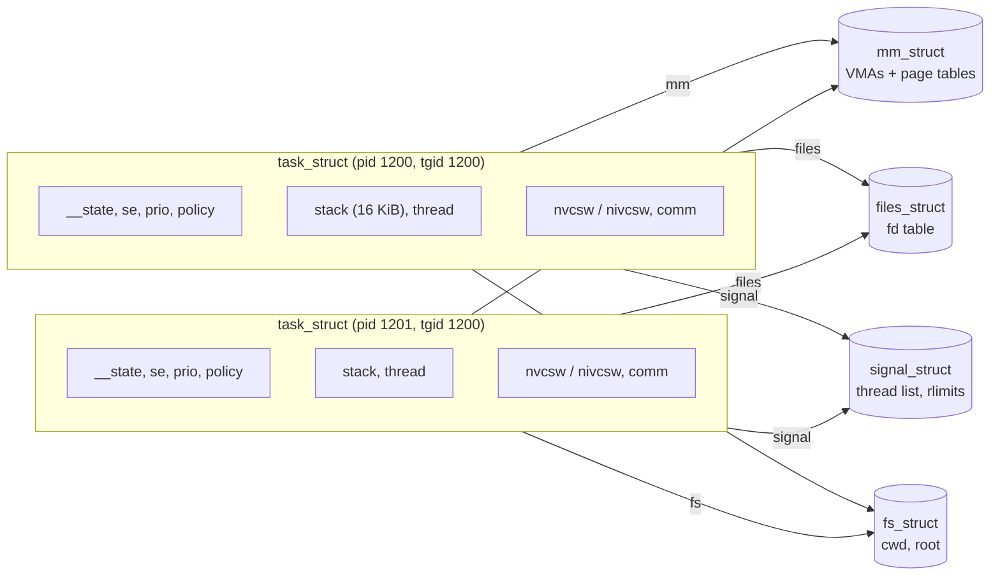

# Note 01 — `task_struct` anatomy

> Module 02 · Persian: [`01-task-struct-anatomy.fa.md`](01-task-struct-anatomy.fa.md) · Index: [`INDEX.en.md`](INDEX.en.md)

## 1. Summary

- Linux has exactly one kernel object per thread: `struct task_struct` (`include/linux/sched.h` L815). There is no separate "process" structure.
- A task is a bundle of *private* state (scheduling, registers, kernel stack, ids) plus *pointers* to resources that may be shared (`mm`, `files`, `fs`, `signal`, `sighand`, `nsproxy`).
- `/proc/<pid>/` and `/proc/<pid>/task/<tid>/` are views onto these fields; learning the field names lets you read any `/proc` file.

## 2. Detailed explanation

### Intuition

Think of a task as an employee badge. The badge itself is personal: name (TID), current activity (state), how many times the person was interrupted (switch counters). But the badge also points to shared things: which office (address space), which filing cabinet (open files), which company rules (signal handlers). Two employees can share an office or not. "Thread" vs "process" is just a question of which pointers are the same.

### The fields that matter in this module

Printed from `include/linux/sched.h` (v6.18.63), line numbers in brackets:

| Group | Field (line) | What it is |
|---|---|---|
| state | `unsigned int __state` (L823) | `TASK_RUNNING` 0, `TASK_INTERRUPTIBLE` 1, `TASK_UNINTERRUPTIBLE` 2, `__TASK_STOPPED` 4, `__TASK_TRACED` 8 (L105–109) |
| state | `int exit_state` (L961) | `EXIT_ZOMBIE` 0x20 or `EXIT_DEAD` 0x10 after `do_exit()` |
| stack | `void *stack` (L834) | the task's **kernel** stack (16 KiB on x86-64). Every task has one; it is used while the task is in a syscall or interrupted |
| priority | `prio`, `static_prio`, `normal_prio` (L861–863) | `static_prio` = 120 + nice for fair tasks; `prio` is the effective one (can be boosted by priority inheritance) |
| scheduling | `struct sched_entity se` (L866) | the fair-class (EEVDF) entity: `vruntime`, `deadline`, `slice`, `vlag`, `load.weight` |
| scheduling | `sched_rt_entity rt`, `sched_dl_entity dl` (L867–868) | entities for the RT and deadline classes |
| scheduling | `const struct sched_class *sched_class` (L873) | which class owns this task now (`fair_sched_class`, `rt_sched_class`, ...) |
| scheduling | `unsigned int policy` (L915), `cpus_ptr` (L918) | `SCHED_OTHER`/`FIFO`/...; allowed CPUs (`taskset`) |
| memory | `struct mm_struct *mm`, `*active_mm` (L957–958) | the user address space. `mm == NULL` for kernel threads, which borrow `active_mm` |
| identity | `pid_t pid`, `pid_t tgid` (L1059–1060) | `pid` = thread id; `tgid` = process id (what `getpid()` returns) |
| family | `struct task_struct __rcu *real_parent` (L1073) | who forked us (changes on re-parenting) |
| family | `struct list_head thread_node` (L1097) | links all threads of one process (in `signal->thread_head`) |
| accounting | `unsigned long nvcsw, nivcsw` (L1126–1127) | voluntary / involuntary context switches |
| name | `char comm[TASK_COMM_LEN]` (L1172) | 16-byte name shown by `ps`, `top`; set at exec or by `prctl(PR_SET_NAME)` |
| resources | `fs` (L1185), `files` (L1188), `nsproxy` (L1195), `signal` (L1198) | shared or private depending on `CLONE_*` flags |
| CPU state | `struct thread_struct thread` (L1672) | **ARCH-SPECIFIC (x86-64)**: saved `sp`, FS/GS base, debug regs; FPU state follows the struct |

Two details worth knowing:

1. **Randomized layout.** The struct is wrapped in `randomized_struct_fields_start/end` (end at L1678). With `CONFIG_RANDSTRUCT` the field order is shuffled at build time to make exploits harder. Never assume offsets; use BTF (`bpftrace` does).
2. **It is big.** On a typical distro build it is several KiB. Read the exact size with `sudo bpftrace -e 'BEGIN { printf("%d\n", sizeof(struct task_struct)); exit(); }'` or `pahole -C task_struct` on a kernel with BTF.

### From task to "process"

The kernel builds the user's notion of a process out of shared pointers:

- all tasks of a process have the same `tgid` and the same `signal` (`struct signal_struct`: shared pending signals, rlimits, the thread list);
- they normally share `mm`, `files`, `fs`, `sighand`;
- the **thread group leader** is the task whose `pid == tgid`.

`/proc/<pid>` shows the leader; `/proc/<pid>/task/` lists every task in the group.

### `current`

Inside the kernel, `current` is the `task_struct *` of the task running on this CPU. On x86-64 it is the per-CPU variable `current_task` (`arch/x86/include/asm/current.h` L15, **ARCH-SPECIFIC**), updated in `__switch_to()`. Every syscall implicitly works on `current`: `getpid()` is just `return task_tgid_vnr(current);` (`kernel/sys.c` L999).

## 3. Diagram



## 4. Worked example

The `/proc/<pid>/status` file is printed by `fs/proc/array.c`. The state letter comes from a table indexed by the state bits:

`linux/fs/proc/array.c · task_state_array · v6.18.63` (L126–140)

```c
static const char * const task_state_array[] = {

	/* states in TASK_REPORT: */
	"R (running)",		/* 0x00 */
	"S (sleeping)",		/* 0x01 */
	"D (disk sleep)",	/* 0x02 */
	"T (stopped)",		/* 0x04 */
	"t (tracing stop)",	/* 0x08 */
	"X (dead)",		/* 0x10 */
	"Z (zombie)",		/* 0x20 */
	"P (parked)",		/* 0x40 */

	/* states beyond TASK_REPORT: */
	"I (idle)",		/* 0x80 */
};
```

and the switch counters come straight from the two fields (L399–400):

```c
	seq_put_decimal_ull(m, "voluntary_ctxt_switches:\t", p->nvcsw);
	seq_put_decimal_ull(m, "\nnonvoluntary_ctxt_switches:\t", p->nivcsw);
```

Real output on the lab VM (aos-lab, Linux 6.18.63), for a shell's `sleep`:

```text
$ sleep 300 & P=$!
$ grep -E '^(Name|State|Tgid|Pid|PPid|Threads|voluntary|nonvoluntary)' /proc/$P/status
Name:	sleep
State:	S (sleeping)
Tgid:	4300
Pid:	4300
PPid:	4261
Threads:	1
voluntary_ctxt_switches:	3
nonvoluntary_ctxt_switches:	0
```

`Tgid` and `Pid` are equal (single-threaded leader). `State: S` is `TASK_INTERRUPTIBLE`: `sleep` is in `hrtimer_nanosleep()`. Every switch was voluntary, since `sleep` never runs long enough to be preempted.

## 5. Edge cases & pitfalls

- **`I (idle)` is not idle CPU.** It is `TASK_IDLE` = `TASK_UNINTERRUPTIBLE | TASK_NOLOAD`: kernel threads waiting for work. They do not count in the load average, unlike real `D` tasks.
- **`D` state and load average.** A task in `TASK_UNINTERRUPTIBLE` (`D`) counts toward the load average even though it uses no CPU. A load of 40 on an idle box usually means 40 tasks stuck in I/O or a lock.
- **`ps` shows the leader.** `ps aux` prints one line per process (per `tgid`). Use `ps -eLf` or `top -H` to see every task.
- **Kernel threads have `mm == NULL`.** Their `/proc/<pid>/maps` is empty and `VmRSS` is missing from `status`. Names appear in brackets in `ps` (`[kworker/0:1]`).
- **`comm` is 15 characters + NUL.** Long program names are cut. Use `/proc/<pid>/cmdline` for the full command.
- **Offsets are not stable.** Struct layout changes between versions and with `RANDSTRUCT`. Old blog posts with hard-coded offsets are wrong for 6.18.

## 6. Exam-style key points

- One `task_struct` per **thread**; a process = tasks with the same `tgid` sharing `mm`/`files`/`signal`.
- `getpid()` → `tgid`; `gettid()` → `pid`.
- `__state`: 0 R, 1 S, 2 D, 4 T, 8 t; `exit_state`: 0x20 Z, 0x10 X.
- `se` is the EEVDF entity; `sched_class` points to the owning class.
- `mm == NULL` ⇔ kernel thread; it runs on a borrowed `active_mm`.
- `nvcsw` / `nivcsw` = voluntary / involuntary context switches, shown in `/proc/<pid>/status`.
- Every task has its own kernel stack (16 KiB on x86-64) and saved CPU state (`thread`).

## 7. Links

- Lesson: [§2.1 What is a process to the kernel?](../lesson.en.md#21-what-is-a-process-to-the-kernel)
- Walkthrough: [§1.2 `copy_mm()`](../kernel-walkthrough.en.md#12-copy_mm-what-clone_vm-really-does) (where `nvcsw`, `mm` are initialized)
- Labs: [02.1 fork-exec-pipe](../labs/01-fork-exec-pipe/README.md), [02.6 goroutines vs threads](../labs/06-goroutines-vs-threads/README.md)
- Quiz: Q1, Q7
