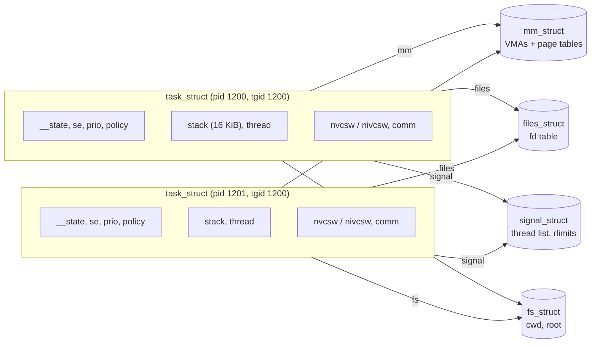

<div dir="rtl">

# یادداشت ۰۱ — ساختار `task_struct`

> ماژول ۰۲ · نسخهٔ انگلیسی: [`01-task-struct-anatomy.en.md`](01-task-struct-anatomy.en.md) · فهرست: [`INDEX.fa.md`](INDEX.fa.md)

## ۱. خلاصه

- لینوکس برای هر نخ دقیقاً یک شیء کرنلی دارد: `struct task_struct` (`include/linux/sched.h` خط 815). ساختار جداگانه‌ای به نام «پردازه» وجود ندارد.
- هر task مجموعه‌ای از وضعیت *خصوصی* (زمان‌بندی، رجیسترها، پشتهٔ کرنل، شناسه‌ها) به‌اضافهٔ *اشاره‌گرهایی* به منابعی است که ممکن است مشترک باشند (`mm`، `files`، `fs`، `signal`، `sighand`، `nsproxy`).
- `/proc/<pid>/` و `/proc/<pid>/task/<tid>/` نمایی از همین فیلدها هستند؛ اگر نام فیلدها را بدانید، هر فایل `/proc` را می‌توانید بخوانید.

## ۲. توضیح مفصل

### شهود

task را مثل کارت شناسایی یک کارمند در نظر بگیرید. خود کارت شخصی است: نام (TID)، کار فعلی (وضعیت) و اینکه چند بار کارش قطع شده (شمارنده‌های switch). اما کارت به چیزهای مشترک هم اشاره می‌کند: کدام اتاق (فضای آدرس)، کدام کمد پرونده (فایل‌های باز) و کدام قوانین شرکت (handlerهای سیگنال). دو کارمند می‌توانند اتاق مشترک داشته باشند یا نداشته باشند. فرق «نخ» و «پردازه» فقط این است که کدام اشاره‌گرها یکی‌اند.

### فیلدهایی که در این ماژول مهم‌اند

از `include/linux/sched.h` نسخهٔ v6.18.63 چاپ شده‌اند و شمارهٔ خط داخل پرانتز است:

| گروه | فیلد (خط) | چیست |
|---|---|---|
| وضعیت | `unsigned int __state` (خط 823) | `TASK_RUNNING` 0، `TASK_INTERRUPTIBLE` 1، `TASK_UNINTERRUPTIBLE` 2، `__TASK_STOPPED` 4، `__TASK_TRACED` 8 (خط‌های 105 تا 109) |
| وضعیت | `int exit_state` (خط 961) | بعد از `do_exit()` مقدار `EXIT_ZOMBIE` 0x20 یا `EXIT_DEAD` 0x10 |
| پشته | `void *stack` (خط 834) | پشتهٔ **کرنل** task (در x86-64 شانزده کیلوبایت). هر task یکی دارد و وقتی task داخل syscall است یا وقفه خورده از آن استفاده می‌شود |
| اولویت | `prio`، `static_prio`، `normal_prio` (خط‌های 861 تا 863) | برای taskهای fair مقدار `static_prio` برابر 120 + nice است؛ `prio` اولویت مؤثر است (با priority inheritance می‌تواند بالا برود) |
| زمان‌بندی | `struct sched_entity se` (خط 866) | موجودیت کلاس fair (EEVDF): `vruntime`، `deadline`، `slice`، `vlag`، `load.weight` |
| زمان‌بندی | `sched_rt_entity rt`، `sched_dl_entity dl` (خط‌های 867 و 868) | موجودیت‌های کلاس‌های RT و deadline |
| زمان‌بندی | `const struct sched_class *sched_class` (خط 873) | کلاسی که الان صاحب این task است (`fair_sched_class`، `rt_sched_class` و ...) |
| زمان‌بندی | `unsigned int policy` (خط 915)، `cpus_ptr` (خط 918) | `SCHED_OTHER`/`FIFO`/...؛ CPUهای مجاز (`taskset`) |
| حافظه | `struct mm_struct *mm` و `*active_mm` (خط‌های 957 و 958) | فضای آدرس کاربر. در نخ‌های کرنل `mm == NULL` است و `active_mm` قرض گرفته می‌شود |
| هویت | `pid_t pid` و `pid_t tgid` (خط‌های 1059 و 1060) | `pid` شناسهٔ نخ است و `tgid` شناسهٔ پردازه (همان که `getpid()` برمی‌گرداند) |
| خانواده | `struct task_struct __rcu *real_parent` (خط 1073) | کسی که ما را fork کرده (با re-parent عوض می‌شود) |
| خانواده | `struct list_head thread_node` (خط 1097) | همهٔ نخ‌های یک پردازه را به هم وصل می‌کند (در `signal->thread_head`) |
| حساب‌داری | `unsigned long nvcsw, nivcsw` (خط‌های 1126 و 1127) | context switchهای داوطلبانه و غیرداوطلبانه |
| نام | `char comm[TASK_COMM_LEN]` (خط 1172) | نام ۱۶ بایتی که `ps` و `top` نشان می‌دهند؛ در exec یا با `prctl(PR_SET_NAME)` تنظیم می‌شود |
| منابع | `fs` (خط 1185)، `files` (خط 1188)، `nsproxy` (خط 1195)، `signal` (خط 1198) | بسته به پرچم‌های `CLONE_*` مشترک یا خصوصی |
| وضعیت CPU | `struct thread_struct thread` (خط 1672) | **ARCH-SPECIFIC (x86-64)**: مقدار ذخیره‌شدهٔ `sp`، پایهٔ FS/GS و رجیسترهای debug؛ وضعیت FPU بعد از این ساختار می‌آید |

دو نکته که خوب است بدانید:

۱. **چیدمان تصادفی.** این ساختار بین `randomized_struct_fields_start` و `randomized_struct_fields_end` قرار دارد (انتها در خط 1678). با `CONFIG_RANDSTRUCT` ترتیب فیلدها هنگام build به‌هم ریخته می‌شود تا exploit سخت‌تر شود. هرگز به offset تکیه نکنید؛ از BTF استفاده کنید (bpftrace همین کار را می‌کند).
۲. **بزرگ است.** در یک build معمول توزیع‌ها چند کیلوبایت است. اندازهٔ دقیقش را با `sudo bpftrace -e 'BEGIN { printf("%d\n", sizeof(struct task_struct)); exit(); }'` یا `pahole -C task_struct` روی کرنلی با BTF ببینید.

### از task تا «پردازه»

کرنل مفهوم پردازهٔ کاربر را از اشاره‌گرهای مشترک می‌سازد:

- همهٔ taskهای یک پردازه `tgid` یکسان و `signal` یکسان دارند (`struct signal_struct`: سیگنال‌های معلق مشترک، rlimitها و فهرست نخ‌ها)؛
- معمولاً `mm`، `files`، `fs` و `sighand` را هم مشترک دارند؛
- **رهبر گروه نخ** taskای است که `pid == tgid` دارد.

`/proc/<pid>` رهبر را نشان می‌دهد و `/proc/<pid>/task/` همهٔ taskهای گروه را فهرست می‌کند.

### `current`

داخل کرنل، `current` همان `task_struct *` مربوط به taskای است که روی این CPU اجرا می‌شود. در x86-64 این همان متغیر per-CPU به نام `current_task` است (`arch/x86/include/asm/current.h` خط 15، **ARCH-SPECIFIC**) که در `__switch_to()` به‌روز می‌شود. هر syscall به‌طور ضمنی روی `current` کار می‌کند: `getpid()` فقط `return task_tgid_vnr(current);` است (`kernel/sys.c` خط 999).

## ۳. نمودار

</div>



<div dir="rtl">

## ۴. مثال عملی

فایل `/proc/<pid>/status` را `fs/proc/array.c` چاپ می‌کند. حرف وضعیت از جدولی می‌آید که با بیت‌های وضعیت شاخص‌گذاری می‌شود:

`linux/fs/proc/array.c · task_state_array · v6.18.63` (خط‌های 126 تا 140)

</div>

```c
static const char * const task_state_array[] = {

	/* states in TASK_REPORT: */
	"R (running)",		/* 0x00 */
	"S (sleeping)",		/* 0x01 */
	"D (disk sleep)",	/* 0x02 */
	"T (stopped)",		/* 0x04 */
	"t (tracing stop)",	/* 0x08 */
	"X (dead)",		/* 0x10 */
	"Z (zombie)",		/* 0x20 */
	"P (parked)",		/* 0x40 */

	/* states beyond TASK_REPORT: */
	"I (idle)",		/* 0x80 */
};
```

<div dir="rtl">

و شمارنده‌های switch مستقیم از همان دو فیلد می‌آیند (خط‌های 399 و 400):

</div>

```c
	seq_put_decimal_ull(m, "voluntary_ctxt_switches:\t", p->nvcsw);
	seq_put_decimal_ull(m, "\nnonvoluntary_ctxt_switches:\t", p->nivcsw);
```

<div dir="rtl">

خروجی واقعی روی VM آزمایشگاه (aos-lab، Linux 6.18.63) برای یک `sleep` که از shell اجرا شده:

</div>

```text
$ sleep 300 & P=$!
$ grep -E '^(Name|State|Tgid|Pid|PPid|Threads|voluntary|nonvoluntary)' /proc/$P/status
Name:	sleep
State:	S (sleeping)
Tgid:	4300
Pid:	4300
PPid:	4261
Threads:	1
voluntary_ctxt_switches:	3
nonvoluntary_ctxt_switches:	0
```

<div dir="rtl">

`Tgid` و `Pid` برابرند (رهبر تک‌نخی). `State: S` یعنی `TASK_INTERRUPTIBLE`: `sleep` داخل `hrtimer_nanosleep()` است. همهٔ switchها داوطلبانه بوده‌اند، چون `sleep` هیچ‌وقت آن‌قدر اجرا نمی‌شود که preempt شود.

## ۵. حالت‌های خاص و دام‌ها

- **`I (idle)` به معنای CPU بیکار نیست.** این `TASK_IDLE` یعنی `TASK_UNINTERRUPTIBLE | TASK_NOLOAD` است: نخ‌های کرنل که منتظر کارند. برخلاف taskهای واقعی `D`، در load average شمرده نمی‌شوند.
- **وضعیت `D` و load average.** taskای که در `TASK_UNINTERRUPTIBLE` (`D`) است در load average شمرده می‌شود، حتی اگر هیچ CPUای مصرف نکند. load برابر ۴۰ روی ماشینی بیکار معمولاً یعنی ۴۰ task در I/O یا پشت یک قفل گیر کرده‌اند.
- **`ps` رهبر را نشان می‌دهد.** `ps aux` برای هر پردازه (هر `tgid`) یک خط چاپ می‌کند. برای دیدن همهٔ taskها از `ps -eLf` یا `top -H` استفاده کنید.
- **نخ‌های کرنل `mm == NULL` دارند.** `/proc/<pid>/maps` آن‌ها خالی است و `VmRSS` در `status` نیست. نامشان در `ps` داخل کروشه می‌آید (`[kworker/0:1]`).
- **`comm` پانزده نویسه به‌اضافهٔ NUL است.** نام‌های بلند بریده می‌شوند. برای فرمان کامل `/proc/<pid>/cmdline` را بخوانید.
- **offsetها پایدار نیستند.** چیدمان ساختار بین نسخه‌ها و با `RANDSTRUCT` عوض می‌شود. پست‌های قدیمی وبلاگ‌ها با offset ثابت برای 6.18 غلط‌اند.

## ۶. نکته‌های کلیدی امتحانی

- برای هر **نخ** یک `task_struct`؛ پردازه یعنی taskهایی با `tgid` یکسان که `mm`، `files` و `signal` را مشترک دارند.
- `getpid()` ← `tgid`؛ `gettid()` ← `pid`.
- `__state`: ۰ یعنی R، ۱ یعنی S، ۲ یعنی D، ۴ یعنی T، ۸ یعنی t؛ `exit_state`: 0x20 یعنی Z و 0x10 یعنی X.
- `se` موجودیت EEVDF است؛ `sched_class` به کلاس صاحب task اشاره می‌کند.
- `mm == NULL` یعنی نخ کرنل؛ روی `active_mm` قرضی اجرا می‌شود.
- `nvcsw` و `nivcsw` همان context switchهای داوطلبانه و غیرداوطلبانه‌اند که در `/proc/<pid>/status` دیده می‌شوند.
- هر task پشتهٔ کرنل خودش (در x86-64 شانزده کیلوبایت) و وضعیت CPU ذخیره‌شدهٔ خودش (`thread`) را دارد.

## ۷. پیوندها

- درس: [§۲.۱ پردازه از دید کرنل دقیقاً چیست؟](../lesson.fa.md)
- مرور کد: [§۱.۲ `copy_mm()`](../kernel-walkthrough.fa.md) (جایی که `nvcsw` و `mm` مقداردهی می‌شوند)
- آزمایش‌ها: [۰۲.۱ fork-exec-pipe](../labs/01-fork-exec-pipe/README.md)، [۰۲.۶ goroutine در برابر نخ](../labs/06-goroutines-vs-threads/README.md)
- آزمون: Q1 و Q7

</div>
