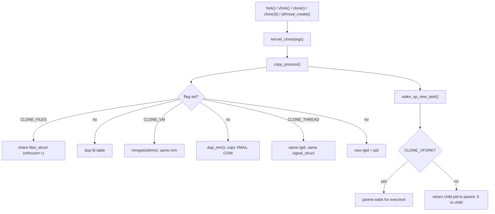

# Note 02 — `fork`, `vfork`, `clone` and the `CLONE_*` flags

> Module 02 · Persian: [`02-fork-vfork-clone-flags.fa.md`](02-fork-vfork-clone-flags.fa.md) · Index: [`INDEX.en.md`](INDEX.en.md)

## 1. Summary

- `fork()`, `vfork()`, `clone()`, `clone3()` and `pthread_create()` all end in **one** kernel function, `kernel_clone()` (`kernel/fork.c` L2578). They differ only in the flags they pass.
- `copy_process()` goes through the resources one by one; for each one a `CLONE_*` flag decides **share** (take a reference) or **copy**.
- `fork()` is cheap because memory is shared copy-on-write. `vfork()` is cheaper still because it shares memory outright and suspends the parent.

## 2. Detailed explanation

### Intuition

Creating a task is like forking a git branch: the new branch starts with the same content, and only differences cost space. `clone()` goes further and lets you choose, per resource, whether the child gets its **own branch** or works on **the same branch** as the parent.

### The entry points

| User call | Syscall | Flags in `struct kernel_clone_args` |
|---|---|---|
| `fork()` | `SYSCALL_DEFINE0(fork)` (L2699) | `.exit_signal = SIGCHLD`, no sharing |
| `vfork()` | `SYSCALL_DEFINE0(vfork)` (L2715) | `.flags = CLONE_VFORK \| CLONE_VM`, `.exit_signal = SIGCHLD` |
| glibc `fork()` | actually `clone(SIGCHLD, ...)` or `clone3` | same effect as `fork` |
| `clone(fn, stack, flags, ...)` | `SYSCALL_DEFINE5(clone, ...)` (L2728–2744, arch-dependent argument order) | whatever you pass |
| `clone3(&args, size)` | `SYSCALL_DEFINE2(clone3, ...)` (L2900) | extensible struct: pidfd, cgroup, `set_tid` |
| `pthread_create()` | `clone3` in current glibc | `CLONE_VM \| CLONE_FS \| CLONE_FILES \| CLONE_SIGHAND \| CLONE_THREAD \| CLONE_SYSVSEM \| CLONE_SETTLS \| CLONE_PARENT_SETTID \| CLONE_CHILD_CLEARTID` |
| kernel thread | `kernel_thread()` (L2668) | `CLONE_VM \| CLONE_UNTRACED`, `.kthread = 1` |

### What `copy_process()` does, in order

1. **Sanity checks** on the flag combination (L1953–1972). Examples: `CLONE_THREAD` requires `CLONE_SIGHAND`; `CLONE_SIGHAND` requires `CLONE_VM`; `CLONE_NEWNS | CLONE_FS` together is invalid.
2. `dup_task_struct()` (L868): allocate the new `task_struct` and kernel stack, copy the parent's struct as a starting point.
3. Limits: `RLIMIT_NPROC`, `max_threads`.
4. `sched_fork()` (L2159 → `sched/core.c` L4695): state `TASK_NEW`, inherit policy and nice, assign a CPU, initialise `se`.
5. The copy-or-share ladder (L2177–2198), each guarded by its flag:

| Function | Flag | Shared object | Copy means |
|---|---|---|---|
| `copy_files()` | `CLONE_FILES` | `files_struct` (fd table) | new fd table with the same open files (each `struct file` refcount +1) |
| `copy_fs()` | `CLONE_FS` | `fs_struct` (cwd, root, umask) | private cwd |
| `copy_sighand()` | `CLONE_SIGHAND` | handler table | private handlers (same values) |
| `copy_signal()` | `CLONE_THREAD` | `signal_struct` (thread group) | new thread group |
| `copy_mm()` | `CLONE_VM` | `mm_struct` | `dup_mm()`: copy VMAs, mark private pages COW |
| `copy_namespaces()` | `CLONE_NEW*` (inverse!) | `nsproxy` | **new** namespaces when the flag is set |
| `copy_io()` | `CLONE_IO` | I/O context | — |
| `copy_thread()` | `CLONE_SETTLS` | — | builds the child's kernel stack and registers (**ARCH-SPECIFIC**) |

6. Allocate the PID (`alloc_pid`), link the task into the parent's lists, set `tgid` (= parent's `tgid` with `CLONE_THREAD`, else = own pid).
7. Back in `kernel_clone()`: `trace_sched_process_fork`, `wake_up_new_task()`, and for `vfork` wait for the child.

### Copy-on-write in one paragraph

`dup_mm()` copies the parent's VMA tree and page tables, but **not** the data pages. For private writable mappings it write-protects the PTEs in **both** parent and child. The first write by either side raises a page fault; the fault handler sees a COW page, allocates a new page, copies 4 KiB, and maps it writable for the writer only. Module 4 walks this in `mm/memory.c` (`do_wp_page()`). Cost of `fork()` is therefore roughly proportional to the **size of the page tables**, not the RSS.

### `vfork()`

`CLONE_VM` means the child runs on the parent's memory, including its stack. To make this safe, `CLONE_VFORK` makes the parent sleep on a `completion` (`kernel_clone()` L2637–2641, `wait_for_vfork_done()` L2657) until the child calls `execve()` or `_exit()`. The child may do nothing else: returning from the function that called `vfork()`, or calling `exit()` (which runs atexit handlers and flushes stdio of the *parent's* buffers), corrupts the parent. `posix_spawn()` in glibc uses `CLONE_VM | CLONE_VFORK` internally, with a separate stack, which is why it is faster than `fork()` + `exec()` for large processes.

## 3. Diagram



## 4. Worked example

The decision for memory, `linux/kernel/fork.c · copy_mm() · v6.18.63` (L1544–1551):

```c
	if (clone_flags & CLONE_VM) {
		mmget(oldmm);
		mm = oldmm;
	} else {
		mm = dup_mm(tsk, current->mm);
		if (!mm)
			return -ENOMEM;
	}
```

Lab 02.2 creates one child per flag set and checks what the parent can see afterwards. Real output on the lab VM:

```text
$ ./cloneflags
0 (like fork)                      mem=no  fds=no  cwd=no    parent_tgid=5091 child_tgid=n/a tid=5092
CLONE_VM                           mem=yes fds=no  cwd=no    parent_tgid=5091 child_tgid=other tid=5093
CLONE_FILES                        mem=no  fds=yes cwd=no    parent_tgid=5091 child_tgid=n/a tid=5094
CLONE_FS                           mem=no  fds=no  cwd=yes   parent_tgid=5091 child_tgid=n/a tid=5095
CLONE_VM|CLONE_FILES|CLONE_FS      mem=yes fds=yes cwd=yes   parent_tgid=5091 child_tgid=other tid=5096
pthread set (+SIGHAND|THREAD|...)  mem=yes fds=yes cwd=yes   parent_tgid=5091 child_tgid=same tid=5097
```

Read row by row: each flag shares exactly one resource; only the last row (the flag set glibc uses for `pthread_create()`) produces a child with the **same TGID**, i.e. a thread.

And `strace -f` shows the real flags glibc passes for a thread:

```text
$ strace -f -e trace=clone,clone3 ./t
clone3({flags=CLONE_VM|CLONE_FS|CLONE_FILES|CLONE_SIGHAND|CLONE_THREAD|CLONE_SYSVSEM|CLONE_SETTLS|CLONE_PARENT_SETTID|CLONE_CHILD_CLEARTID, child_tid=0x785b8f9ff990, parent_tid=0x785b8f9ff990, exit_signal=0, stack=0x785b8f1ff000, stack_size=0x7fff80, tls=0x785b8f9ff6c0} => {parent_tid=[5107]}, 88) = 5107
[pid  5107] +++ exited with 0 +++
+++ exited with 0 +++
```

## 5. Edge cases & pitfalls

- **Fork in a multithreaded program** copies only the calling thread. Locks held by other threads (e.g. inside `malloc`) stay locked forever in the child. After `fork()` in a threaded program, call only async-signal-safe functions until `exec`.
- **`CLONE_NEW*` flags are inverted**: setting them creates new namespaces instead of sharing.
- **`CLONE_THREAD` children cannot be `waitpid()`ed.** The parent learns about their exit through `CLONE_CHILD_CLEARTID` (the kernel writes 0 to a user address and does a futex wake). That is how `pthread_join()` works.
- **`vfork()` child calling `exit()`** instead of `_exit()` runs the parent's atexit handlers and can flush the parent's stdio buffers twice.
- **Huge RSS + `fork()`** (Redis `BGSAVE`, Python multiprocessing) is fast at first, but then every write by either side triggers a COW fault and a page copy: memory use can almost double.
- **`RLIMIT_NPROC` counts threads**, not processes: a thread-heavy program can hit `EAGAIN` from `fork()`.

## 6. Exam-style key points

- One path: every create call → `kernel_clone()` → `copy_process()`.
- For each resource: flag set → **share** (refcount), flag clear → **copy**.
- `CLONE_VM` → same `mm_struct`; otherwise `dup_mm()` + copy-on-write.
- Thread = `CLONE_VM | CLONE_FS | CLONE_FILES | CLONE_SIGHAND | CLONE_THREAD | ...`: same `tgid`.
- `CLONE_THREAD` ⇒ needs `CLONE_SIGHAND` ⇒ needs `CLONE_VM` (else `-EINVAL`).
- `vfork()` = `CLONE_VM | CLONE_VFORK`: parent blocked until child execs or exits.
- Child gets 0 because `copy_thread()` sets `childregs->ax = 0` (`arch/x86/kernel/process.c` L244, **ARCH-SPECIFIC**).

## 7. Links

- Lesson: [§2.2 What happens when you call `fork()`?](../lesson.en.md#22-what-happens-when-you-call-fork)
- Walkthrough: [§1 `kernel_clone()`](../kernel-walkthrough.en.md#1-kernel_clone-every-new-task-starts-here), [§9.1 OpenBSD `fork1()`](../kernel-walkthrough.en.md#91-process-creation-two-structures-instead-of-one)
- Labs: [02.1 fork-exec-pipe](../labs/01-fork-exec-pipe/README.md), [02.2 clone-flags](../labs/02-clone-flags/README.md)
- Quiz: Q2, Q8
