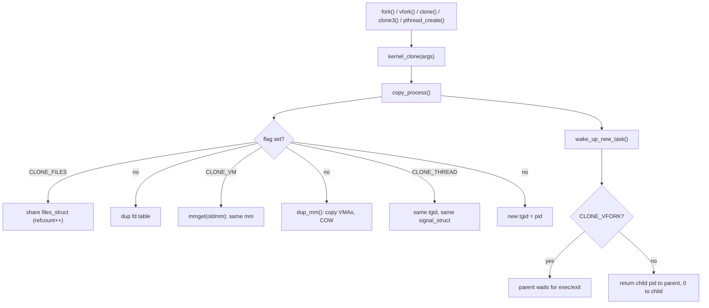

<div dir="rtl">

# یادداشت ۰۲ — `fork`، `vfork`، `clone` و پرچم‌های `CLONE_*`

> ماژول ۰۲ · نسخهٔ انگلیسی: [`02-fork-vfork-clone-flags.en.md`](02-fork-vfork-clone-flags.en.md) · فهرست: [`INDEX.fa.md`](INDEX.fa.md)

## ۱. خلاصه

- `fork()`، `vfork()`، `clone()`، `clone3()` و `pthread_create()` همه به **یک** تابع کرنل می‌رسند: `kernel_clone()` (`kernel/fork.c` خط 2578). فرقشان فقط پرچم‌هایی است که می‌فرستند.
- `copy_process()` منابع را یکی‌یکی مرور می‌کند و برای هر کدام یک پرچم `CLONE_*` تعیین می‌کند که **مشترک** شود (یک ارجاع گرفته شود) یا **کپی**.
- `fork()` ارزان است چون حافظه copy-on-write مشترک می‌شود. `vfork()` از آن هم ارزان‌تر است، چون حافظه را مستقیم مشترک می‌کند و والد را معلق نگه می‌دارد.

## ۲. توضیح مفصل

### شهود

ساختن task مثل ساختن یک شاخه در git است: شاخهٔ جدید با همان محتوا شروع می‌شود و فقط تفاوت‌ها جا می‌گیرند. `clone()` یک قدم جلوتر می‌رود و اجازه می‌دهد برای هر منبع جداگانه انتخاب کنید که فرزند **شاخهٔ خودش** را بگیرد یا روی **همان شاخهٔ** والد کار کند.

### نقطه‌های ورود

| فراخوانی کاربر | syscall | پرچم‌ها در `struct kernel_clone_args` |
|---|---|---|
| `fork()` | `SYSCALL_DEFINE0(fork)` (خط 2699) | `.exit_signal = SIGCHLD`، بدون اشتراک |
| `vfork()` | `SYSCALL_DEFINE0(vfork)` (خط 2715) | `.flags = CLONE_VFORK \| CLONE_VM` و `.exit_signal = SIGCHLD` |
| `fork()` در glibc | در واقع `clone(SIGCHLD, ...)` یا `clone3` | همان اثر `fork` |
| `clone(fn, stack, flags, ...)` | `SYSCALL_DEFINE5(clone, ...)` (خط‌های 2728 تا 2744، ترتیب آرگومان‌ها وابسته به معماری) | هرچه بفرستید |
| `clone3(&args, size)` | `SYSCALL_DEFINE2(clone3, ...)` (خط 2900) | ساختار قابل‌گسترش: pidfd، cgroup، `set_tid` |
| `pthread_create()` | در glibc امروزی `clone3` | `CLONE_VM \| CLONE_FS \| CLONE_FILES \| CLONE_SIGHAND \| CLONE_THREAD \| CLONE_SYSVSEM \| CLONE_SETTLS \| CLONE_PARENT_SETTID \| CLONE_CHILD_CLEARTID` |
| نخ کرنل | `kernel_thread()` (خط 2668) | `CLONE_VM \| CLONE_UNTRACED` و `.kthread = 1` |

### کارهای `copy_process()` به ترتیب

۱. **بررسی درستی** ترکیب پرچم‌ها (خط‌های 1953 تا 1972). مثلاً `CLONE_THREAD` به `CLONE_SIGHAND` نیاز دارد، `CLONE_SIGHAND` به `CLONE_VM` نیاز دارد و ترکیب `CLONE_NEWNS | CLONE_FS` نامعتبر است.
۲. `dup_task_struct()` (خط 868): `task_struct` جدید و پشتهٔ کرنل را می‌سازد و ساختار والد را به‌عنوان نقطهٔ شروع کپی می‌کند.
۳. محدودیت‌ها: `RLIMIT_NPROC` و `max_threads`.
۴. `sched_fork()` (خط 2159 ← `sched/core.c` خط 4695): وضعیت `TASK_NEW`، به ارث بردن policy و nice، انتخاب CPU و مقداردهی `se`.
۵. نردبان کپی یا اشتراک (خط‌های 2177 تا 2198) که هر پله با پرچم خودش کنترل می‌شود:

| تابع | پرچم | شیء مشترک | کپی یعنی |
|---|---|---|---|
| `copy_files()` | `CLONE_FILES` | `files_struct` (جدول fd) | جدول fd جدید با همان فایل‌های باز (شمارندهٔ هر `struct file` یکی زیاد می‌شود) |
| `copy_fs()` | `CLONE_FS` | `fs_struct` (cwd، root، umask) | cwd خصوصی |
| `copy_sighand()` | `CLONE_SIGHAND` | جدول handlerها | handlerهای خصوصی (با همان مقدارها) |
| `copy_signal()` | `CLONE_THREAD` | `signal_struct` (گروه نخ) | گروه نخ جدید |
| `copy_mm()` | `CLONE_VM` | `mm_struct` | `dup_mm()`: کپی VMAها و علامت‌زدن صفحه‌های خصوصی با COW |
| `copy_namespaces()` | `CLONE_NEW*` (برعکس!) | `nsproxy` | وقتی پرچم گذاشته شود namespace **جدید** ساخته می‌شود |
| `copy_io()` | `CLONE_IO` | زمینهٔ I/O | — |
| `copy_thread()` | `CLONE_SETTLS` | — | پشتهٔ کرنل و رجیسترهای فرزند را می‌سازد (**ARCH-SPECIFIC**) |

۶. گرفتن PID (`alloc_pid`)، وصل‌کردن task به فهرست‌های والد و تنظیم `tgid` (با `CLONE_THREAD` برابر `tgid` والد، وگرنه برابر pid خودش).
۷. برگشت به `kernel_clone()`: `trace_sched_process_fork`، `wake_up_new_task()` و در مورد `vfork` منتظر ماندن برای فرزند.

### copy-on-write در یک پاراگراف

`dup_mm()` درخت VMAها و page tableهای والد را کپی می‌کند، اما صفحه‌های داده را **نه**. برای نگاشت‌های خصوصی قابل‌نوشتن، PTEها را هم در والد و هم در فرزند فقط‌خواندنی می‌کند. اولین نوشتن هر کدام یک page fault ایجاد می‌کند؛ fault handler می‌بیند صفحه COW است، صفحهٔ جدیدی می‌گیرد، ۴ کیلوبایت را کپی می‌کند و فقط برای نویسنده قابل‌نوشتن نگاشت می‌کند. ماژول ۴ این را در `mm/memory.c` (`do_wp_page()`) دنبال می‌کند. بنابراین هزینهٔ `fork()` تقریباً متناسب با **اندازهٔ page tableها** است، نه RSS.

### `vfork()`

`CLONE_VM` یعنی فرزند روی حافظهٔ والد اجرا می‌شود، از جمله پشتهٔ او. برای امن کردن این کار، `CLONE_VFORK` والد را روی یک `completion` می‌خواباند (`kernel_clone()` خط‌های 2637 تا 2641 و `wait_for_vfork_done()` خط 2657) تا فرزند `execve()` یا `_exit()` را صدا بزند. فرزند هیچ کار دیگری نباید بکند: return کردن از تابعی که `vfork()` را صدا زده، یا صدا زدن `exit()` (که handlerهای atexit را اجرا و بافرهای stdio *والد* را flush می‌کند)، والد را خراب می‌کند. `posix_spawn()` در glibc در درون از `CLONE_VM | CLONE_VFORK` با پشتهٔ جداگانه استفاده می‌کند و به همین دلیل برای پردازه‌های بزرگ از `fork()` + `exec()` سریع‌تر است.

## ۳. نمودار

</div>



<div dir="rtl">

## ۴. مثال عملی

تصمیم مربوط به حافظه، `linux/kernel/fork.c · copy_mm() · v6.18.63` (خط‌های 1544 تا 1551):

</div>

```c
	if (clone_flags & CLONE_VM) {
		mmget(oldmm);
		mm = oldmm;
	} else {
		mm = dup_mm(tsk, current->mm);
		if (!mm)
			return -ENOMEM;
	}
```

<div dir="rtl">

آزمایش ۰۲.۲ برای هر مجموعه‌پرچم یک فرزند می‌سازد و بعد بررسی می‌کند والد چه چیزی را می‌بیند. خروجی واقعی روی VM آزمایشگاه:

</div>

```text
$ ./cloneflags
0 (like fork)                      mem=no  fds=no  cwd=no    parent_tgid=5091 child_tgid=n/a tid=5092
CLONE_VM                           mem=yes fds=no  cwd=no    parent_tgid=5091 child_tgid=other tid=5093
CLONE_FILES                        mem=no  fds=yes cwd=no    parent_tgid=5091 child_tgid=n/a tid=5094
CLONE_FS                           mem=no  fds=no  cwd=yes   parent_tgid=5091 child_tgid=n/a tid=5095
CLONE_VM|CLONE_FILES|CLONE_FS      mem=yes fds=yes cwd=yes   parent_tgid=5091 child_tgid=other tid=5096
pthread set (+SIGHAND|THREAD|...)  mem=yes fds=yes cwd=yes   parent_tgid=5091 child_tgid=same tid=5097
```

<div dir="rtl">

سطر به سطر بخوانید: هر پرچم دقیقاً یک منبع را مشترک می‌کند؛ فقط سطر آخر (مجموعه‌پرچمی که glibc برای `pthread_create()` به کار می‌برد) فرزندی با **TGID یکسان** می‌سازد، یعنی یک نخ.

و `strace -f` پرچم‌های واقعی را که glibc برای یک نخ می‌فرستد نشان می‌دهد:

</div>

```text
$ strace -f -e trace=clone,clone3 ./t
clone3({flags=CLONE_VM|CLONE_FS|CLONE_FILES|CLONE_SIGHAND|CLONE_THREAD|CLONE_SYSVSEM|CLONE_SETTLS|CLONE_PARENT_SETTID|CLONE_CHILD_CLEARTID, child_tid=0x785b8f9ff990, parent_tid=0x785b8f9ff990, exit_signal=0, stack=0x785b8f1ff000, stack_size=0x7fff80, tls=0x785b8f9ff6c0} => {parent_tid=[5107]}, 88) = 5107
[pid  5107] +++ exited with 0 +++
+++ exited with 0 +++
```

<div dir="rtl">

## ۵. حالت‌های خاص و دام‌ها

- **fork در برنامهٔ چندنخی** فقط نخ فراخواننده را کپی می‌کند. قفل‌هایی که نخ‌های دیگر نگه داشته‌اند (مثلاً داخل `malloc`) در فرزند برای همیشه قفل می‌مانند. بعد از `fork()` در برنامهٔ چندنخی تا `exec` فقط توابع async-signal-safe را صدا بزنید.
- **پرچم‌های `CLONE_NEW*` برعکس‌اند**: گذاشتنشان namespace جدید می‌سازد، نه اشتراک.
- **فرزندان `CLONE_THREAD` را نمی‌شود `waitpid()` کرد.** والد از خروجشان با `CLONE_CHILD_CLEARTID` باخبر می‌شود (کرنل در یک آدرس کاربر صفر می‌نویسد و futex wake انجام می‌دهد). `pthread_join()` همین‌طور کار می‌کند.
- **فرزند `vfork()` که `exit()` صدا بزند** به جای `_exit()`، handlerهای atexit والد را اجرا می‌کند و ممکن است بافرهای stdio والد را دو بار flush کند.
- **RSS بزرگ + `fork()`** (`BGSAVE` در Redis، multiprocessing در Python) اول سریع است، اما بعد هر نوشتن هر طرف یک COW fault و کپی صفحه ایجاد می‌کند: مصرف حافظه می‌تواند تقریباً دو برابر شود.
- **`RLIMIT_NPROC` نخ‌ها را می‌شمارد**، نه پردازه‌ها را: برنامه‌ای با نخ‌های زیاد می‌تواند از `fork()` خطای `EAGAIN` بگیرد.

## ۶. نکته‌های کلیدی امتحانی

- یک مسیر: هر فراخوانی ساخت ← `kernel_clone()` ← `copy_process()`.
- برای هر منبع: پرچم گذاشته شده ← **اشتراک** (شمارندهٔ ارجاع)، پرچم نیست ← **کپی**.
- `CLONE_VM` ← همان `mm_struct`؛ وگرنه `dup_mm()` + copy-on-write.
- نخ = `CLONE_VM | CLONE_FS | CLONE_FILES | CLONE_SIGHAND | CLONE_THREAD | ...`: همان `tgid`.
- `CLONE_THREAD` ⇐ به `CLONE_SIGHAND` نیاز دارد ⇐ به `CLONE_VM` نیاز دارد (وگرنه `-EINVAL`).
- `vfork()` = `CLONE_VM | CLONE_VFORK`: والد تا exec یا exit فرزند مسدود است.
- فرزند ۰ می‌گیرد چون `copy_thread()` مقدار `childregs->ax = 0` را می‌گذارد (`arch/x86/kernel/process.c` خط 244، **ARCH-SPECIFIC**).

## ۷. پیوندها

- درس: [§۲.۲ وقتی `fork()` را صدا می‌زنید چه اتفاقی می‌افتد؟](../lesson.fa.md)
- مرور کد: [§۱ `kernel_clone()`](../kernel-walkthrough.fa.md)، [§۹.۱ تابع `fork1()` در OpenBSD](../kernel-walkthrough.fa.md)
- آزمایش‌ها: [۰۲.۱ fork-exec-pipe](../labs/01-fork-exec-pipe/README.md)، [۰۲.۲ clone-flags](../labs/02-clone-flags/README.md)
- آزمون: Q2 و Q8

</div>
