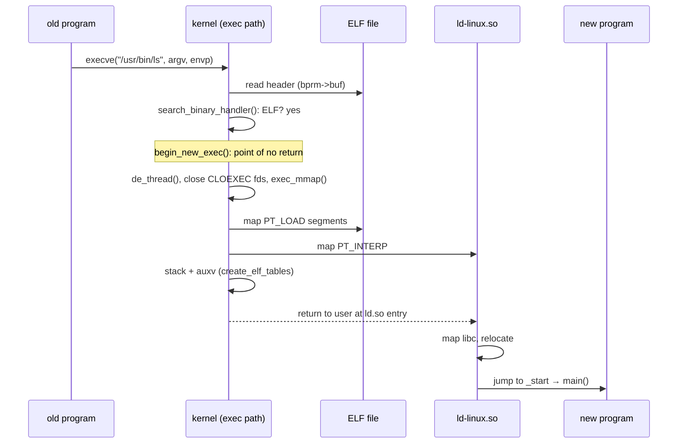

# Note 03 — `execve()` and ELF loading

> Module 02 · Persian: [`03-execve-and-elf-loading.fa.md`](03-execve-and-elf-loading.fa.md) · Index: [`INDEX.en.md`](INDEX.en.md)

## 1. Summary

- `execve()` keeps the **task** (PID, parent, most fds, nice, cgroup) and replaces the **program**: a fresh `mm_struct` built from the ELF file, other threads killed, handlers reset.
- The kernel tries each registered binary format (`search_binary_handler()`); ELF is `load_elf_binary()` in `fs/binfmt_elf.c`, scripts are `binfmt_script`.
- `begin_new_exec()` is the **point of no return**: before it, errors return to the old program; after it, errors kill the task with `SIGSEGV`.

## 2. Detailed explanation

### Intuition

`fork()` clones the actor; `execve()` hands the same actor a new script. The actor keeps their name, their family and the props they are holding (open fds), but forgets everything else they knew.

### The path

```
execve(path, argv, envp)
  SYSCALL_DEFINE3(execve)            fs/exec.c L2031
  do_execveat_common()               L1810   alloc linux_binprm, copy argv/envp to the new stack
  bprm_execve()                      L1756   creds, LSM, sched_exec()
  exec_binprm()                      L1711   loop for #! interpreters (max depth)
  search_binary_handler()            L1677   try each fmt->load_binary()
  load_elf_binary()                  fs/binfmt_elf.c L832
    begin_new_exec()                 fs/exec.c L1114   POINT OF NO RETURN
      de_thread()                    L912    kill other threads, take over the leader's PID
      unshare_files(); do_close_on_exec()    close FD_CLOEXEC fds
      exec_mmap()                    L846    install the new mm, drop the old one
      __set_task_comm(); flush_signal_handlers()
    setup_new_exec()                 L1350
    map PT_LOAD segments, load PT_INTERP (ld-linux.so)
    create_elf_tables()              auxv: AT_ENTRY, AT_PHDR, AT_RANDOM, AT_SYSINFO_EHDR (vDSO) ...
    START_THREAD(regs, elf_entry, sp)        binfmt_elf.c L1379: return to user at the entry point
```

### What `load_elf_binary()` does

1. Read the ELF header (already in `bprm->buf`, the first 256 bytes) and check the magic, class and machine.
2. Read the program headers. Find `PT_INTERP` (L882): the path of the dynamic loader, usually `/lib64/ld-linux-x86-64.so.2`. Find `PT_GNU_STACK` (L941) to decide whether the stack is executable.
3. Call `begin_new_exec()` (L1010). From now on there is no old program.
4. `setup_new_exec()` (L1024) and `setup_arg_pages()` (L1028): place the stack at a randomized top (ASLR) with argv, envp and auxv already copied.
5. Map every `PT_LOAD` segment with `elf_map()` (a `vm_mmap()` of the file). For a PIE (`ET_DYN`) the load bias is randomized; `ELF_ET_DYN_BASE` is the base for interpreters and static PIE (L1131–1140).
6. If there is an interpreter, `load_elf_interp()` (L1254) maps it, and the entry point becomes the **interpreter's** entry. `ld.so` then maps `libc.so.6` etc. from user space.
7. `create_elf_tables()` (L1296) writes the auxiliary vector. `AT_SYSINFO_EHDR` is the address of the vDSO (Module 1: `clock_gettime` without a syscall).
8. `START_THREAD()` sets the user `ip` and `sp` in the saved registers (`pt_regs`). The syscall return path then "returns" into the new program.

### Kept vs replaced

From `begin_new_exec()` (excerpt below), `setup_new_exec()` and the POSIX rules:

| Kept | Reset or replaced | Code |
|---|---|---|
| PID, TGID (the exec'ing thread takes over the leader's PID), PPID, children | the address space | `exec_mmap()` |
| fds without `FD_CLOEXEC` | fds with `FD_CLOEXEC` | `do_close_on_exec()` |
| cwd, root, umask | other threads | `de_thread()` |
| nice, policy, affinity, cgroup, rlimits | caught handlers → `SIG_DFL` (ignored stay ignored), alternate signal stack | `flush_signal_handlers()` |
| pending signals, signal mask | `comm` → basename of the file | `__set_task_comm()` |
| real UID/GID | effective UID/GID if the file is setuid/setgid | `bprm_creds_from_file()` |

## 3. Diagram



## 4. Worked example

The commit point, `linux/fs/exec.c · begin_new_exec() · v6.18.63` (L1124–1147):

```c
	/*
	 * This tracepoint marks the point before flushing the old exec where
	 * the current task is still unchanged, but errors are fatal (point of
	 * no return). The later "sched_process_exec" tracepoint is called after
	 * the current task has successfully switched to the new exec.
	 */
	trace_sched_prepare_exec(current, bprm);

	/*
	 * Ensure all future errors are fatal.
	 */
	bprm->point_of_no_return = true;

	/*
	 * Cancel any io_uring activity across execve. This runs task work
	 * that may still create an io-wq worker, so do it while de_thread()
	 * can still zap it.
	 */
	io_uring_task_cancel();

	/* Make this the only thread in the thread group */
	retval = de_thread(me);
	if (retval)
		goto out;
```

Lab 02.1 runs `ls -l /proc/self/fd` **after** exec in a child whose stdout is a pipe. Real output on the VM:

```text
--- child's fd table after exec (read through the pipe) ---
total 0
lr-x------ 1 fred fred 64 Nov 15 16:15 0 -> pipe:[15744]
l-wx------ 1 fred fred 64 Nov 15 16:15 1 -> pipe:[13197]
l-wx------ 1 fred fred 64 Nov 15 16:15 2 -> pipe:[15746]
lr-x------ 1 fred fred 64 Nov 15 16:15 3 -> /proc/4267/fd
```

fd 1 is the pipe (installed by `dup2()` before exec, which clears `FD_CLOEXEC` on the new descriptor). The original pipe fds 3 and 4 were opened with `O_CLOEXEC` and are gone: `do_close_on_exec()` closed them. The `3 -> /proc/<pid>/fd` entry is the directory `ls` itself opened to list it.

The memory map is brand new. Right after exec, `cat` reading its own `/proc/self/maps` shows only its own ELF segments, a fresh heap, the locale archive and libc (mapped by `ld.so`); nothing of the shell that forked it remains:

```text
$ cat /proc/self/maps | head -8
59ae6cebf000-59ae6cec1000 r--p 00000000 08:01 1712                       /usr/bin/cat
59ae6cec1000-59ae6cec6000 r-xp 00002000 08:01 1712                       /usr/bin/cat
59ae6cec6000-59ae6cec8000 r--p 00007000 08:01 1712                       /usr/bin/cat
59ae6cec8000-59ae6cec9000 r--p 00008000 08:01 1712                       /usr/bin/cat
59ae6cec9000-59ae6ceca000 rw-p 00009000 08:01 1712                       /usr/bin/cat
59aea80ae000-59aea80cf000 rw-p 00000000 00:00 0                          [heap]
72d3c9a00000-72d3c9ceb000 r--p 00000000 08:01 26434                      /usr/lib/locale/locale-archive
72d3c9e00000-72d3c9e28000 r--p 00000000 08:01 3067                       /usr/lib/x86_64-linux-gnu/libc.so.6
```

## 5. Edge cases & pitfalls

- **`ENOEXEC` vs shell fallback.** If no handler accepts the file (no ELF magic, no `#!`), `execve()` fails with `ENOEXEC`. `execvp()` in glibc then retries with `/bin/sh file`; the raw syscall does not.
- **Failure after the point of no return** (e.g. out of memory while mapping) cannot be reported: the task gets `SIGSEGV`. `strace` shows `execve(...) = ?` and then `+++ killed by SIGSEGV +++`.
- **Multithreaded exec.** If a non-leader thread calls `execve()`, `de_thread()` kills all others and the caller **takes over the leader's PID**. Its TID changes.
- **fd leaks into children.** Any fd opened without `O_CLOEXEC` is inherited by every program you exec. Always use `O_CLOEXEC` / `SOCK_CLOEXEC` / `pipe2(..., O_CLOEXEC)` in libraries.
- **`#!` chains** are limited: `exec_binprm()` allows a few levels (`depth > 5` → `-ELOOP`).
- **setuid + ptrace**: `check_unsafe_exec()` refuses to grant setuid privileges while the task is ptraced (unless the tracer is privileged).
- **`/proc/<pid>/exe`** points to the new file immediately after `set_mm_exe_file()`, even while the loader is still running.

## 6. Exam-style key points

- Path: `execve` → `bprm_execve()` → `exec_binprm()` → `search_binary_handler()` → `load_elf_binary()` → `begin_new_exec()`.
- `begin_new_exec()`: point of no return, `de_thread()`, close-on-exec, `exec_mmap()`.
- Kept: PID, parent, non-CLOEXEC fds, cwd, nice/policy/affinity, cgroup, signal mask. Replaced: memory, threads, handlers, `comm`.
- Dynamic programs start in the **interpreter** (`PT_INTERP`), not in `main`.
- auxv passes `AT_ENTRY`, `AT_PHDR`, `AT_RANDOM`, `AT_SYSINFO_EHDR` (vDSO) to the loader.
- Late failure → `SIGSEGV`, since there is no old image to return to.

## 7. Links

- Lesson: [§2.3 What does `execve()` replace?](../lesson.en.md#23-what-does-execve-replace-and-what-does-it-keep)
- Walkthrough: [§2 `bprm_execve()`](../kernel-walkthrough.en.md#2-bprm_execve-a-task-becomes-a-new-program), [§9.2 OpenBSD exec](../kernel-walkthrough.en.md#92-exec-kill-the-other-threads-then-replace-the-address-space)
- Lab: [02.1 fork-exec-pipe](../labs/01-fork-exec-pipe/README.md)
- Quiz: Q3, Q9
