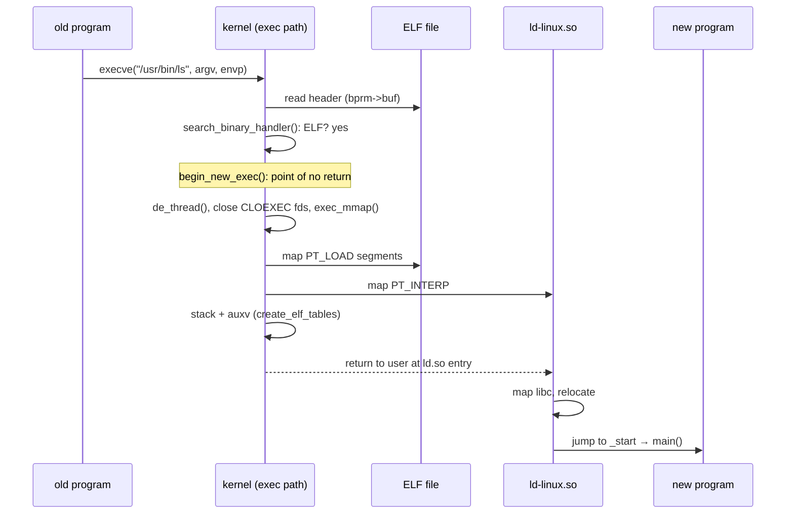

<div dir="rtl">

# یادداشت ۰۳ — `execve()` و بارگذاری ELF

> ماژول ۰۲ · نسخهٔ انگلیسی: [`03-execve-and-elf-loading.en.md`](03-execve-and-elf-loading.en.md) · فهرست: [`INDEX.fa.md`](INDEX.fa.md)

## ۱. خلاصه

- `execve()` خود **task** را نگه می‌دارد (PID، والد، بیشتر fdها، nice، cgroup) و **برنامه** را عوض می‌کند: یک `mm_struct` تازه که از فایل ELF ساخته می‌شود، نخ‌های دیگر کشته می‌شوند و handlerها بازنشانی می‌شوند.
- کرنل همهٔ قالب‌های باینری ثبت‌شده را امتحان می‌کند (`search_binary_handler()`)؛ ELF همان `load_elf_binary()` در `fs/binfmt_elf.c` است و اسکریپت‌ها `binfmt_script`.
- `begin_new_exec()` **نقطهٔ بی‌بازگشت** است: قبل از آن خطاها به برنامهٔ قدیمی برمی‌گردند و بعد از آن task را با `SIGSEGV` می‌کشند.

## ۲. توضیح مفصل

### شهود

`fork()` بازیگر را همانندسازی می‌کند و `execve()` به همان بازیگر یک فیلم‌نامهٔ جدید می‌دهد. بازیگر نام، خانواده و وسایلی را که در دست دارد (fdهای باز) نگه می‌دارد، اما هرچه قبلاً می‌دانسته را فراموش می‌کند.

### مسیر

</div>

```
execve(path, argv, envp)
  SYSCALL_DEFINE3(execve)            fs/exec.c L2031
  do_execveat_common()               L1810   alloc linux_binprm, copy argv/envp to the new stack
  bprm_execve()                      L1756   creds, LSM, sched_exec()
  exec_binprm()                      L1711   loop for #! interpreters (max depth)
  search_binary_handler()            L1677   try each fmt->load_binary()
  load_elf_binary()                  fs/binfmt_elf.c L832
    begin_new_exec()                 fs/exec.c L1114   POINT OF NO RETURN
      de_thread()                    L912    kill other threads, take over the leader's PID
      unshare_files(); do_close_on_exec()    close FD_CLOEXEC fds
      exec_mmap()                    L846    install the new mm, drop the old one
      __set_task_comm(); flush_signal_handlers()
    setup_new_exec()                 L1350
    map PT_LOAD segments, load PT_INTERP (ld-linux.so)
    create_elf_tables()              auxv: AT_ENTRY, AT_PHDR, AT_RANDOM, AT_SYSINFO_EHDR (vDSO) ...
    START_THREAD(regs, elf_entry, sp)        binfmt_elf.c L1379: return to user at the entry point
```

<div dir="rtl">

### کار `load_elf_binary()`

۱. سرآیند ELF را می‌خواند (که از قبل در `bprm->buf`، یعنی ۲۵۶ بایت اول، هست) و magic، کلاس و نوع ماشین را بررسی می‌کند.
۲. program headerها را می‌خواند. `PT_INTERP` (خط 882) را پیدا می‌کند، یعنی مسیر loader پویا که معمولاً `/lib64/ld-linux-x86-64.so.2` است. `PT_GNU_STACK` (خط 941) را هم پیدا می‌کند تا تصمیم بگیرد پشته قابل اجرا باشد یا نه.
۳. `begin_new_exec()` را صدا می‌زند (خط 1010). از اینجا به بعد برنامهٔ قدیمی وجود ندارد.
۴. `setup_new_exec()` (خط 1024) و `setup_arg_pages()` (خط 1028): پشته را با سقفی تصادفی (ASLR) قرار می‌دهد، در حالی که argv، envp و auxv از قبل در آن کپی شده‌اند.
۵. هر بخش `PT_LOAD` را با `elf_map()` نگاشت می‌کند (یک `vm_mmap()` از فایل). برای PIE (`ET_DYN`) مقدار load bias تصادفی است؛ `ELF_ET_DYN_BASE` پایه برای interpreterها و static PIE است (خط‌های 1131 تا 1140).
۶. اگر interpreter وجود داشته باشد، `load_elf_interp()` (خط 1254) آن را نگاشت می‌کند و نقطهٔ شروع، نقطهٔ شروع **interpreter** می‌شود. سپس `ld.so` از فضای کاربر `libc.so.6` و بقیه را نگاشت می‌کند.
۷. `create_elf_tables()` (خط 1296) بردار کمکی (auxv) را می‌نویسد. `AT_SYSINFO_EHDR` آدرس vDSO است (ماژول ۱: `clock_gettime` بدون syscall).
۸. `START_THREAD()` مقدار `ip` و `sp` کاربر را در رجیسترهای ذخیره‌شده (`pt_regs`) می‌گذارد. مسیر برگشت syscall سپس به برنامهٔ جدید «برمی‌گردد».

### چه چیزی می‌ماند و چه چیزی عوض می‌شود

بر اساس `begin_new_exec()` (بخش زیر)، `setup_new_exec()` و قواعد POSIX:

| می‌ماند | بازنشانی یا جایگزین می‌شود | کد |
|---|---|---|
| PID، TGID (نخی که exec می‌کند PID رهبر را می‌گیرد)، PPID، فرزندان | فضای آدرس | `exec_mmap()` |
| fdهای بدون `FD_CLOEXEC` | fdهای دارای `FD_CLOEXEC` | `do_close_on_exec()` |
| cwd، root، umask | نخ‌های دیگر | `de_thread()` |
| nice، policy، affinity، cgroup، rlimitها | handlerهای نصب‌شده ← `SIG_DFL` (نادیده‌گرفته‌ها نادیده می‌مانند)، پشتهٔ جایگزین سیگنال | `flush_signal_handlers()` |
| سیگنال‌های معلق، ماسک سیگنال | `comm` ← نام پایهٔ فایل | `__set_task_comm()` |
| UID و GID واقعی | UID و GID مؤثر اگر فایل setuid یا setgid باشد | `bprm_creds_from_file()` |

## ۳. نمودار

</div>



<div dir="rtl">

## ۴. مثال عملی

نقطهٔ تعهد، `linux/fs/exec.c · begin_new_exec() · v6.18.63` (خط‌های 1124 تا 1147):

</div>

```c
	/*
	 * This tracepoint marks the point before flushing the old exec where
	 * the current task is still unchanged, but errors are fatal (point of
	 * no return). The later "sched_process_exec" tracepoint is called after
	 * the current task has successfully switched to the new exec.
	 */
	trace_sched_prepare_exec(current, bprm);

	/*
	 * Ensure all future errors are fatal.
	 */
	bprm->point_of_no_return = true;

	/*
	 * Cancel any io_uring activity across execve. This runs task work
	 * that may still create an io-wq worker, so do it while de_thread()
	 * can still zap it.
	 */
	io_uring_task_cancel();

	/* Make this the only thread in the thread group */
	retval = de_thread(me);
	if (retval)
		goto out;
```

<div dir="rtl">

آزمایش ۰۲.۱ دستور `ls -l /proc/self/fd` را **بعد از** exec در فرزندی اجرا می‌کند که stdoutش یک pipe است. خروجی واقعی روی VM:

</div>

```text
--- child's fd table after exec (read through the pipe) ---
total 0
lr-x------ 1 fred fred 64 Nov 15 16:15 0 -> pipe:[15744]
l-wx------ 1 fred fred 64 Nov 15 16:15 1 -> pipe:[13197]
l-wx------ 1 fred fred 64 Nov 15 16:15 2 -> pipe:[15746]
lr-x------ 1 fred fred 64 Nov 15 16:15 3 -> /proc/4267/fd
```

<div dir="rtl">

fd شمارهٔ ۱ همان pipe است (که `dup2()` قبل از exec نصب کرده و `FD_CLOEXEC` را روی توصیف‌گر جدید پاک می‌کند). fdهای ۳ و ۴ اصلی pipe با `O_CLOEXEC` باز شده بودند و دیگر نیستند: `do_close_on_exec()` آن‌ها را بسته است. ورودی `3 -> /proc/<pid>/fd` دایرکتوری‌ای است که خود `ls` برای فهرست‌کردن باز کرده.

نقشهٔ حافظه کاملاً نو است. درست بعد از exec، دستور `cat` که `/proc/self/maps` خودش را می‌خواند فقط بخش‌های ELF خودش، یک heap تازه، آرشیو locale و libc (که `ld.so` نگاشت کرده) را نشان می‌دهد؛ هیچ چیزی از shellی که آن را fork کرده باقی نمانده است:

</div>

```text
$ cat /proc/self/maps | head -8
59ae6cebf000-59ae6cec1000 r--p 00000000 08:01 1712                       /usr/bin/cat
59ae6cec1000-59ae6cec6000 r-xp 00002000 08:01 1712                       /usr/bin/cat
59ae6cec6000-59ae6cec8000 r--p 00007000 08:01 1712                       /usr/bin/cat
59ae6cec8000-59ae6cec9000 r--p 00008000 08:01 1712                       /usr/bin/cat
59ae6cec9000-59ae6ceca000 rw-p 00009000 08:01 1712                       /usr/bin/cat
59aea80ae000-59aea80cf000 rw-p 00000000 00:00 0                          [heap]
72d3c9a00000-72d3c9ceb000 r--p 00000000 08:01 26434                      /usr/lib/locale/locale-archive
72d3c9e00000-72d3c9e28000 r--p 00000000 08:01 3067                       /usr/lib/x86_64-linux-gnu/libc.so.6
```

<div dir="rtl">

## ۵. حالت‌های خاص و دام‌ها

- **`ENOEXEC` و پشتیبان shell.** اگر هیچ handlerی فایل را نپذیرد (نه magic ELF و نه `#!`)، `execve()` با `ENOEXEC` شکست می‌خورد. در این حالت `execvp()` در glibc دوباره با `/bin/sh file` امتحان می‌کند؛ اما خود syscall این کار را نمی‌کند.
- **شکست بعد از نقطهٔ بی‌بازگشت** (مثلاً کمبود حافظه هنگام نگاشت) قابل گزارش نیست و task سیگنال `SIGSEGV` می‌گیرد. `strace` اول `execve(...) = ?` و بعد `+++ killed by SIGSEGV +++` را نشان می‌دهد.
- **exec در برنامهٔ چندنخی.** اگر نخی غیر از رهبر `execve()` را صدا بزند، `de_thread()` همهٔ نخ‌های دیگر را می‌کشد و فراخواننده **PID رهبر را می‌گیرد**؛ TID او عوض می‌شود.
- **نشت fd به فرزندان.** هر fdای که بدون `O_CLOEXEC` باز شود به هر برنامه‌ای که exec می‌کنید ارث می‌رسد. در کتابخانه‌ها همیشه از `O_CLOEXEC`، `SOCK_CLOEXEC` و `pipe2(..., O_CLOEXEC)` استفاده کنید.
- **زنجیره‌های `#!`** محدودند: `exec_binprm()` فقط چند سطح را مجاز می‌داند (`depth > 5` ← `-ELOOP`).
- **setuid + ptrace**: `check_unsafe_exec()` در حالی که task تحت ptrace است امتیاز setuid نمی‌دهد (مگر ردیاب خودش امتیاز داشته باشد).
- **`/proc/<pid>/exe`** بلافاصله بعد از `set_mm_exe_file()` به فایل جدید اشاره می‌کند، حتی وقتی loader هنوز در حال اجراست.

## ۶. نکته‌های کلیدی امتحانی

- مسیر: `execve` ← `bprm_execve()` ← `exec_binprm()` ← `search_binary_handler()` ← `load_elf_binary()` ← `begin_new_exec()`.
- `begin_new_exec()`: نقطهٔ بی‌بازگشت، `de_thread()`، بستن fdهای close-on-exec و `exec_mmap()`.
- می‌ماند: PID، والد، fdهای بدون CLOEXEC، cwd، nice/policy/affinity، cgroup و ماسک سیگنال. عوض می‌شود: حافظه، نخ‌ها، handlerها و `comm`.
- برنامه‌های پویا در **interpreter** (`PT_INTERP`) شروع می‌شوند، نه در `main`.
- auxv مقدارهای `AT_ENTRY`، `AT_PHDR`، `AT_RANDOM` و `AT_SYSINFO_EHDR` (vDSO) را به loader می‌دهد.
- شکست دیرهنگام ← `SIGSEGV`، چون تصویر قدیمی‌ای برای برگشت وجود ندارد.

## ۷. پیوندها

- درس: [§۲.۳ `execve()` چه چیزی را عوض می‌کند؟](../lesson.fa.md)
- مرور کد: [§۲ `bprm_execve()`](../kernel-walkthrough.fa.md)، [§۹.۲ exec در OpenBSD](../kernel-walkthrough.fa.md)
- آزمایش: [۰۲.۱ fork-exec-pipe](../labs/01-fork-exec-pipe/README.md)
- آزمون: Q3 و Q9

</div>
