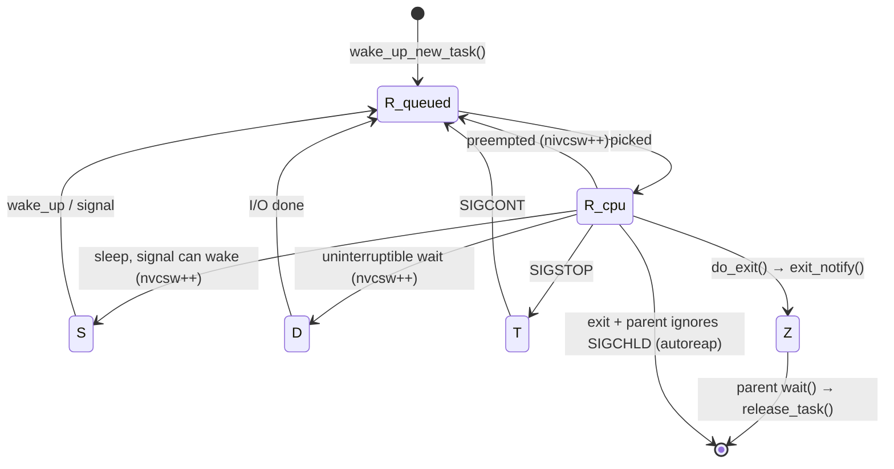

# Note 04 — Process states, `exit()` and `wait()`

> Module 02 · Persian: [`04-process-states-and-wait.fa.md`](04-process-states-and-wait.fa.md) · Index: [`INDEX.en.md`](INDEX.en.md)

## 1. Summary

- A task's state lives in `__state` (R, S, D, T, t) and, after exit, in `exit_state` (Z, X). `ps` and `/proc/<pid>/status` print these as letters.
- `exit()` frees almost everything at once, but the `task_struct` and the exit status stay as a **zombie** until the parent calls `wait*()`, unless the parent declared it does not care (`SIGCHLD` = `SIG_IGN` or `SA_NOCLDWAIT`).
- When a parent dies first, its children are **re-parented** to the nearest *child subreaper* or to PID 1, which reaps them.

## 2. Detailed explanation

### Intuition

Exiting is like checking out of a hotel: you leave the room (memory, files) immediately, but the front desk keeps your bill (exit status) until the person who booked the room (the parent) picks it up. A zombie is an uncollected bill.

### The states

| Letter | Kernel value | Meaning | Typical cause |
|---|---|---|---|
| R | `TASK_RUNNING` 0 | running **or** runnable (on a run queue) | CPU work |
| S | `TASK_INTERRUPTIBLE` 1 | sleeping; a signal wakes it | `read()` on a pipe, `nanosleep`, `epoll_wait` |
| D | `TASK_UNINTERRUPTIBLE` 2 | sleeping; signals do **not** wake it | disk I/O, some locks, NFS |
| T | `__TASK_STOPPED` 4 | stopped by `SIGSTOP`/`SIGTSTP` | Ctrl-Z |
| t | `__TASK_TRACED` 8 | stopped by a tracer | gdb breakpoint, strace |
| Z | `EXIT_ZOMBIE` 0x20 | exited, not yet reaped | parent did not `wait()` |
| X | `EXIT_DEAD` 0x10 | being freed (rarely seen) | — |
| I | `TASK_IDLE` (`D` + `NOLOAD`) | idle kernel thread | `kworker` waiting |

`TASK_KILLABLE` (`TASK_WAKEKILL | TASK_UNINTERRUPTIBLE`) is a `D` sleep that fatal signals *can* interrupt. Newer code prefers it so that `kill -9` works on stuck tasks.

Note that **R does not mean "on a CPU"**. `ps` cannot tell running from waiting in the run queue. `perf sched` and `/proc/<pid>/schedstat` (time waiting on the run queue) can.

### How a task goes to sleep and wakes up

```c
set_current_state(TASK_INTERRUPTIBLE);   /* 1. announce the sleep           */
if (!condition)                          /* 2. re-check the condition       */
        schedule();                      /* 3. __schedule(): dequeue, nvcsw++ */
__set_current_state(TASK_RUNNING);
```

The waker sets the condition and calls `wake_up()`, which runs `try_to_wake_up()` and puts the task back on a run queue. The order (state first, then check, then sleep) prevents the "lost wakeup" race; `wait_event_*()` macros wrap it. `__schedule()` uses exactly this `prev_state` to decide whether to dequeue the task (walkthrough §3).

### Exit and reap

1. `exit_group()` → `do_group_exit()` kills the other threads; each runs `do_exit()` (`kernel/exit.c` L907).
2. `do_exit()` drops the `mm` (`exit_mm`), files, fs, namespaces, and calls `exit_notify()`.
3. `exit_notify()` (L747) re-parents our children (`forget_original_parent()` → `find_new_reaper()` L646), sets `exit_state = EXIT_ZOMBIE`, and sends `SIGCHLD` with `do_notify_parent()`.
4. `do_notify_parent()` (`kernel/signal.c` L2254) checks whether the parent ignores `SIGCHLD` or set `SA_NOCLDWAIT`. If so, it returns "autoreap" and the task goes straight to `EXIT_DEAD`.
5. Otherwise the parent's `wait4()`/`waitid()` → `do_wait()` → `wait_task_zombie()` (L1181) copies status and rusage, and `release_task()` (L249) frees the PID and finally the `task_struct`.

### Orphans and subreapers

If the parent exits first, `find_new_reaper()` chooses:

1. another live thread of the same process, else
2. the closest ancestor that set `prctl(PR_SET_CHILD_SUBREAPER, 1)` (systemd user managers, `tini`, Docker's `--init`), else
3. the init process of the PID namespace.

This is why a container needs a real init: PID 1 in the container must reap orphans or zombies pile up.

## 3. Diagram



## 4. Worked example

`linux/kernel/exit.c · exit_notify() · v6.18.63` (L747–779)

```c
static void exit_notify(struct task_struct *tsk, int group_dead)
{
	bool autoreap;
	struct task_struct *p, *n;
	LIST_HEAD(dead);

	write_lock_irq(&tasklist_lock);
	forget_original_parent(tsk, &dead);

	if (group_dead)
		kill_orphaned_pgrp(tsk->group_leader, NULL);

	tsk->exit_state = EXIT_ZOMBIE;

	if (unlikely(tsk->ptrace)) {
		/* ... L762-766: traced task, notify the tracer ... */
	} else if (thread_group_leader(tsk)) {
		autoreap = thread_group_empty(tsk) &&
			do_notify_parent(tsk, tsk->exit_signal);
	} else {
		autoreap = true;
		/* untraced sub-thread */
		do_notify_pidfd(tsk);
	}

	if (autoreap) {
		tsk->exit_state = EXIT_DEAD;
		list_add(&tsk->ptrace_entry, &dead);
	}
```

- Every task first becomes `EXIT_ZOMBIE`.
- A non-leader **thread** is always autoreaped (nobody can `wait()` for a thread).
- The **leader** is autoreaped only if it is the last thread and the parent does not want the status.

Lab 02.1 reads the child's `/proc/<pid>/status` after the child has exited but before `waitpid()`, then again after. Real output on the VM:

```text
--- EOF after 237 bytes: every write end is closed ---
before waitpid, /proc/4267/status:
  Name:	ls
  State:	Z (zombie)
  Pid:	4267
  PPid:	4266
  Threads:	1
waitpid: child 4267 exited with status 0
after waitpid, /proc/4267/status:
  /proc/4267/status: No such file or directory
```

The zombie keeps its PID, its parent link and its name (`ls`), and has no memory lines any more. After `waitpid()` the `/proc` entry is gone.

## 5. Edge cases & pitfalls

- **You cannot kill a zombie.** It is already dead. Kill or fix the **parent**; once the parent dies, init adopts and reaps the zombie.
- **Zombies cost PIDs, not RAM.** `/proc/sys/kernel/pid_max` (kernel default 32768 on small machines; systemd raises it to 4194304) and the cgroup `pids.max` are the limits that run out.
- **`SIGCHLD` handler pattern.** Signals do not queue per child: three children can exit with one `SIGCHLD`. Loop: `while (waitpid(-1, &st, WNOHANG) > 0) ;`.
- **`D` state and `kill -9`.** Plain `TASK_UNINTERRUPTIBLE` ignores even `SIGKILL` until the wait ends. Look at `/proc/<pid>/stack` (root) or `cat /proc/<pid>/wchan` to see where it sleeps.
- **`waitpid()` on a thread** fails with `ECHILD`. Use `pthread_join()` (futex on the `CLONE_CHILD_CLEARTID` word).
- **pidfd.** `pidfd_open()` + `poll()` / `waitid(P_PIDFD, ...)` avoids PID-reuse races when waiting for a non-child or in event loops.

## 6. Exam-style key points

- States: R (running or runnable), S (interruptible), D (uninterruptible), T/t (stopped/traced), Z (zombie), I (idle kthread).
- Sleep = set state, re-check, `schedule()`; wake = `try_to_wake_up()`.
- `exit_notify()`: re-parent children, `EXIT_ZOMBIE`, `SIGCHLD` to parent.
- Autoreap if parent's `SIGCHLD` is `SIG_IGN` or `SA_NOCLDWAIT`; threads always autoreap.
- Reaping: `wait4` → `wait_task_zombie()` → `release_task()`.
- Orphans → same-process thread, else subreaper, else namespace init.

## 7. Links

- Lesson: [§2.4 What happens after `exit()`?](../lesson.en.md#24-what-happens-after-exit)
- Walkthrough: [§3 `__schedule()`](../kernel-walkthrough.en.md#3-__schedule-the-only-place-a-cpu-changes-task) (the `prev_state` test)
- Lab: [02.1 fork-exec-pipe](../labs/01-fork-exec-pipe/README.md)
- Quiz: Q4, Q14
