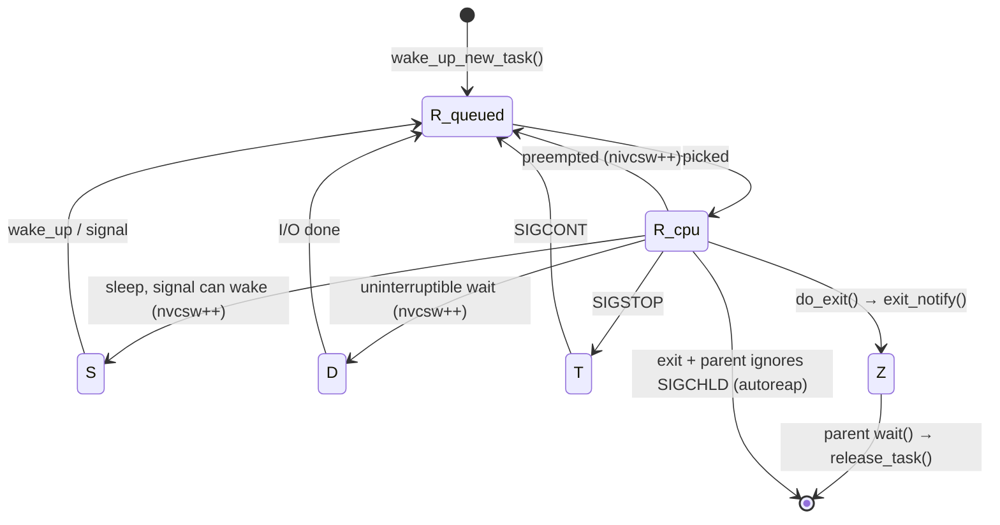

<div dir="rtl">

# یادداشت ۰۴ — وضعیت‌های پردازه، `exit()` و `wait()`

> ماژول ۰۲ · نسخهٔ انگلیسی: [`04-process-states-and-wait.en.md`](04-process-states-and-wait.en.md) · فهرست: [`INDEX.fa.md`](INDEX.fa.md)

## ۱. خلاصه

- وضعیت task در `__state` (یعنی R، S، D، T، t) و بعد از خروج در `exit_state` (یعنی Z و X) نگه داشته می‌شود. `ps` و `/proc/<pid>/status` این‌ها را به‌صورت حرف چاپ می‌کنند.
- `exit()` تقریباً همه‌چیز را یک‌جا آزاد می‌کند، اما `task_struct` و وضعیت خروج به‌صورت **zombie** می‌مانند تا والد `wait*()` را صدا بزند، مگر اینکه والد اعلام کرده باشد اهمیتی نمی‌دهد (`SIGCHLD` برابر `SIG_IGN` یا `SA_NOCLDWAIT`).
- وقتی والد زودتر بمیرد، فرزندانش به نزدیک‌ترین *child subreaper* یا به PID 1 سپرده می‌شوند (**re-parent**) که آن‌ها را جمع می‌کند.

## ۲. توضیح مفصل

### شهود

خروج مثل تسویه‌حساب از هتل است: اتاق (حافظه و فایل‌ها) را فوراً تحویل می‌دهید، اما پذیرش صورت‌حساب شما (وضعیت خروج) را نگه می‌دارد تا کسی که اتاق را رزرو کرده (والد) بیاید و آن را بگیرد. zombie یعنی صورت‌حسابی که کسی نیامده بگیرد.

### وضعیت‌ها

| حرف | مقدار کرنل | معنا | علت معمول |
|---|---|---|---|
| R | `TASK_RUNNING` 0 | در حال اجرا **یا** قابل اجرا (روی run queue) | کار CPU |
| S | `TASK_INTERRUPTIBLE` 1 | در خواب؛ سیگنال بیدارش می‌کند | `read()` روی pipe، `nanosleep`، `epoll_wait` |
| D | `TASK_UNINTERRUPTIBLE` 2 | در خواب؛ سیگنال بیدارش **نمی‌کند** | I/O دیسک، بعضی قفل‌ها، NFS |
| T | `__TASK_STOPPED` 4 | با `SIGSTOP`/`SIGTSTP` متوقف شده | Ctrl-Z |
| t | `__TASK_TRACED` 8 | ردیاب متوقفش کرده | breakpoint در gdb، strace |
| Z | `EXIT_ZOMBIE` 0x20 | خارج شده ولی هنوز جمع نشده | والد `wait()` نکرده |
| X | `EXIT_DEAD` 0x10 | در حال آزاد شدن (به‌ندرت دیده می‌شود) | — |
| I | `TASK_IDLE` (`D` + `NOLOAD`) | نخ کرنل بیکار | `kworker` منتظر کار |

`TASK_KILLABLE` (یعنی `TASK_WAKEKILL | TASK_UNINTERRUPTIBLE`) خوابی از نوع `D` است که سیگنال‌های مرگبار *می‌توانند* قطعش کنند. کدهای جدیدتر آن را ترجیح می‌دهند تا `kill -9` روی taskهای گیرکرده کار کند.

دقت کنید که **R به معنای «روی CPU» نیست**. `ps` نمی‌تواند در حال اجرا را از منتظر در run queue جدا کند. `perf sched` و `/proc/<pid>/schedstat` (زمان انتظار روی run queue) می‌توانند.

### task چطور می‌خوابد و بیدار می‌شود

</div>

```c
set_current_state(TASK_INTERRUPTIBLE);   /* 1. announce the sleep           */
if (!condition)                          /* 2. re-check the condition       */
        schedule();                      /* 3. __schedule(): dequeue, nvcsw++ */
__set_current_state(TASK_RUNNING);
```

<div dir="rtl">

بیدارکننده شرط را برقرار می‌کند و `wake_up()` را صدا می‌زند که `try_to_wake_up()` را اجرا می‌کند و task را دوباره روی یک run queue می‌گذارد. این ترتیب (اول وضعیت، بعد بررسی شرط، بعد خواب) از race «بیدارباش گم‌شده» جلوگیری می‌کند؛ ماکروهای `wait_event_*()` همین را بسته‌بندی کرده‌اند. `__schedule()` دقیقاً از همین `prev_state` برای تصمیم به خارج کردن task از صف استفاده می‌کند (بخش ۳ مرور کد).

### خروج و جمع‌آوری

۱. `exit_group()` ← `do_group_exit()` نخ‌های دیگر را می‌کشد؛ هر کدام `do_exit()` را اجرا می‌کند (`kernel/exit.c` خط 907).
۲. `do_exit()`، `mm` (با `exit_mm`)، فایل‌ها، fs و namespaceها را رها می‌کند و `exit_notify()` را صدا می‌زند.
۳. `exit_notify()` (خط 747) فرزندان ما را re-parent می‌کند (`forget_original_parent()` ← `find_new_reaper()` خط 646)، `exit_state = EXIT_ZOMBIE` را می‌گذارد و با `do_notify_parent()` سیگنال `SIGCHLD` می‌فرستد.
۴. `do_notify_parent()` (`kernel/signal.c` خط 2254) بررسی می‌کند آیا والد `SIGCHLD` را نادیده می‌گیرد یا `SA_NOCLDWAIT` گذاشته است. اگر چنین باشد «autoreap» برمی‌گرداند و task مستقیم به `EXIT_DEAD` می‌رود.
۵. در غیر این صورت `wait4()` یا `waitid()` والد ← `do_wait()` ← `wait_task_zombie()` (خط 1181) وضعیت و rusage را کپی می‌کند و `release_task()` (خط 249) PID و در آخر `task_struct` را آزاد می‌کند.

### یتیم‌ها و subreaperها

اگر والد زودتر خارج شود، `find_new_reaper()` به این ترتیب انتخاب می‌کند:

۱. نخ زندهٔ دیگری از همان پردازه، وگرنه
۲. نزدیک‌ترین نیایی که `prctl(PR_SET_CHILD_SUBREAPER, 1)` را گذاشته (مدیرهای کاربر systemd، `tini`، و `--init` در داکر)، وگرنه
۳. پردازهٔ init در همان PID namespace.

به همین دلیل container به یک init واقعی نیاز دارد: PID 1 داخل container باید یتیم‌ها را جمع کند، وگرنه zombieها انباشته می‌شوند.

## ۳. نمودار

</div>



<div dir="rtl">

## ۴. مثال عملی

`linux/kernel/exit.c · exit_notify() · v6.18.63` (خط‌های 747 تا 779)

</div>

```c
static void exit_notify(struct task_struct *tsk, int group_dead)
{
	bool autoreap;
	struct task_struct *p, *n;
	LIST_HEAD(dead);

	write_lock_irq(&tasklist_lock);
	forget_original_parent(tsk, &dead);

	if (group_dead)
		kill_orphaned_pgrp(tsk->group_leader, NULL);

	tsk->exit_state = EXIT_ZOMBIE;

	if (unlikely(tsk->ptrace)) {
		/* ... L762-766: traced task, notify the tracer ... */
	} else if (thread_group_leader(tsk)) {
		autoreap = thread_group_empty(tsk) &&
			do_notify_parent(tsk, tsk->exit_signal);
	} else {
		autoreap = true;
		/* untraced sub-thread */
		do_notify_pidfd(tsk);
	}

	if (autoreap) {
		tsk->exit_state = EXIT_DEAD;
		list_add(&tsk->ptrace_entry, &dead);
	}
```

<div dir="rtl">

- هر task اول `EXIT_ZOMBIE` می‌شود.
- **نخی** که رهبر نیست همیشه autoreap می‌شود (هیچ‌کس نمی‌تواند برای یک نخ `wait()` کند).
- **رهبر** فقط وقتی autoreap می‌شود که آخرین نخ باشد و والد وضعیت را نخواهد.

آزمایش ۰۲.۱ فایل `/proc/<pid>/status` فرزند را بعد از خروج فرزند اما قبل از `waitpid()` می‌خواند و بعد دوباره. خروجی واقعی روی VM:

</div>

```text
--- EOF after 237 bytes: every write end is closed ---
before waitpid, /proc/4267/status:
  Name:	ls
  State:	Z (zombie)
  Pid:	4267
  PPid:	4266
  Threads:	1
waitpid: child 4267 exited with status 0
after waitpid, /proc/4267/status:
  /proc/4267/status: No such file or directory
```

<div dir="rtl">

zombie هنوز PID، پیوند والد و نامش (`ls`) را دارد و دیگر هیچ خطی دربارهٔ حافظه ندارد. بعد از `waitpid()` ورودی `/proc` هم از بین رفته است.

## ۵. حالت‌های خاص و دام‌ها

- **zombie را نمی‌شود کشت.** از قبل مرده است. **والد** را بکشید یا درست کنید؛ وقتی والد بمیرد، init zombie را می‌پذیرد و جمعش می‌کند.
- **هزینهٔ zombie، PID است نه RAM.** `/proc/sys/kernel/pid_max` (پیش‌فرض کرنل روی ماشین‌های کوچک ۳۲۷۶۸؛ systemd آن را تا ۴۱۹۴۳۰۴ بالا می‌برد) و `pids.max` در cgroup محدودیت‌هایی هستند که تمام می‌شوند.
- **الگوی handler برای `SIGCHLD`.** سیگنال‌ها برای هر فرزند صف نمی‌شوند: سه فرزند می‌توانند با یک `SIGCHLD` خارج شوند. حلقه بزنید: `while (waitpid(-1, &st, WNOHANG) > 0) ;`.
- **وضعیت `D` و `kill -9`.** خواب سادهٔ `TASK_UNINTERRUPTIBLE` حتی `SIGKILL` را تا پایان انتظار نادیده می‌گیرد. با `/proc/<pid>/stack` (به‌عنوان root) یا `cat /proc/<pid>/wchan` ببینید کجا خوابیده است.
- **`waitpid()` روی یک نخ** با `ECHILD` شکست می‌خورد. از `pthread_join()` استفاده کنید (futex روی کلمهٔ `CLONE_CHILD_CLEARTID`).
- **pidfd.** `pidfd_open()` به‌اضافهٔ `poll()` یا `waitid(P_PIDFD, ...)` جلوی race استفادهٔ دوباره از PID را هنگام انتظار برای غیرفرزند یا در event loop می‌گیرد.

## ۶. نکته‌های کلیدی امتحانی

- وضعیت‌ها: R (در حال اجرا یا قابل اجرا)، S (قابل وقفه)، D (غیرقابل وقفه)، T/t (متوقف/ردیابی)، Z (zombie)، I (نخ کرنل بیکار).
- خواب = تنظیم وضعیت، بررسی دوبارهٔ شرط، `schedule()`؛ بیدار شدن = `try_to_wake_up()`.
- `exit_notify()`: re-parent فرزندان، `EXIT_ZOMBIE` و `SIGCHLD` به والد.
- اگر `SIGCHLD` والد `SIG_IGN` یا `SA_NOCLDWAIT` باشد autoreap؛ نخ‌ها همیشه autoreap می‌شوند.
- جمع‌آوری: `wait4` ← `wait_task_zombie()` ← `release_task()`.
- یتیم‌ها ← نخ همان پردازه، وگرنه subreaper، وگرنه init همان namespace.

## ۷. پیوندها

- درس: [§۲.۴ بعد از `exit()` چه می‌شود؟](../lesson.fa.md)
- مرور کد: [§۳ `__schedule()`](../kernel-walkthrough.fa.md) (آزمون `prev_state`)
- آزمایش: [۰۲.۱ fork-exec-pipe](../labs/01-fork-exec-pipe/README.md)
- آزمون: Q4 و Q14

</div>
