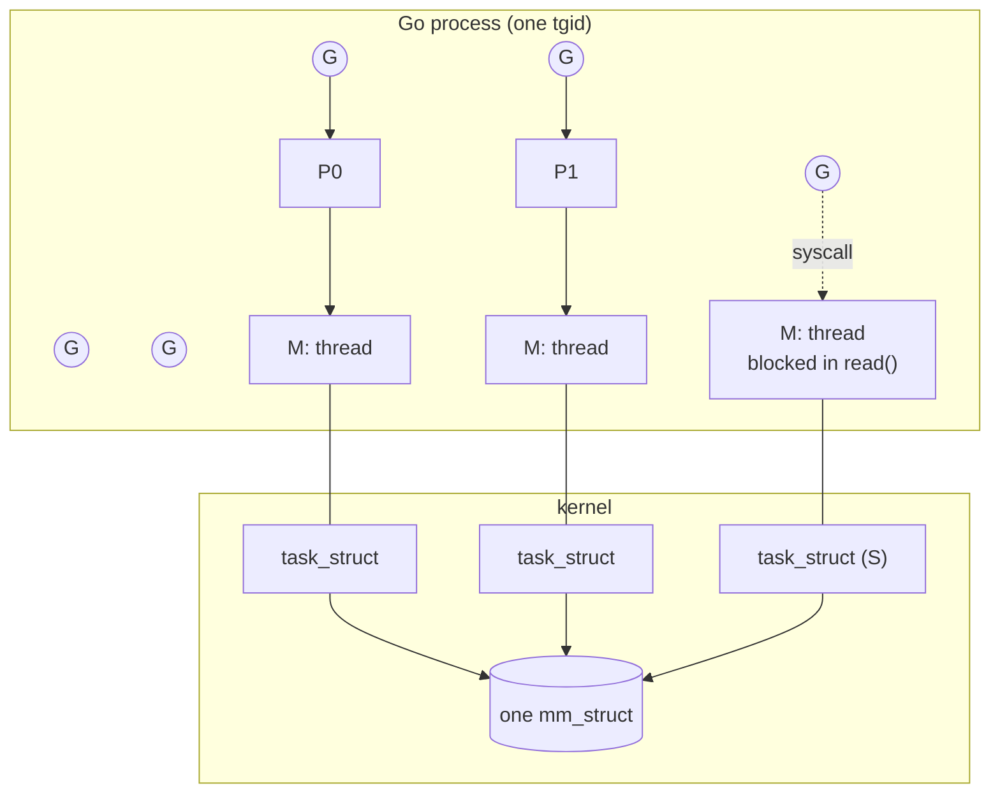

# Note 05 — Threads are tasks that share an `mm`

> Module 02 · Persian: [`05-threads-share-an-mm.fa.md`](05-threads-share-an-mm.fa.md) · Index: [`INDEX.en.md`](INDEX.en.md)

## 1. Summary

- A Linux thread is a task created with `CLONE_THREAD` and friends: it shares the `mm`, fd table, cwd and signal state, and gets the parent's `tgid`, but has its own `pid` (TID), registers, stacks and scheduling entity.
- The scheduler never sees "processes": it schedules every thread independently. That is the **1:1** model; NPTL (glibc's pthreads) maps one pthread to one kernel task.
- Runtimes like Go put **M:N** scheduling on top: many goroutines (G) on a few OS threads (M), limited by `GOMAXPROCS` (P). The kernel only ever sees the Ms.

## 2. Detailed explanation

### Intuition

Two cooks in one kitchen (threads) share the fridge, the knives and the recipe book, but each has their own hands and their own place in the recipe. Two kitchens (processes) share nothing unless someone builds a hatch between them (IPC).

### What `CLONE_THREAD` changes in `copy_process()`

| Code (`kernel/fork.c`) | With `CLONE_THREAD` | Without |
|---|---|---|
| L2261–2267 `tgid`, `group_leader` | `tgid = current->tgid`, leader = our leader | `tgid = own pid`, we are the leader |
| L2336–2341 `real_parent`, `exit_signal` | parent = **our parent's** parent; `exit_signal = -1` (no `SIGCHLD`) | parent = `current`; `SIGCHLD` |
| `copy_signal()` L1660 | share `signal_struct` (thread list, rlimits, shared pending signals) | new one |
| validity L1963 | requires `CLONE_SIGHAND`, which requires `CLONE_VM` | — |

So all threads are *siblings* in the process tree: they all have the same `real_parent`, and only the process as a whole sends `SIGCHLD` when it ends.

### Private vs shared

| Per thread (private) | Per process (shared through pointers) |
|---|---|
| `pid` (TID), `__state`, `se`/`rt`/`dl`, `prio`, `policy`, `cpus_ptr` | `tgid`, `mm` (VMAs, page tables, heap) |
| registers (`thread`), kernel stack, user stack (a separate mapping) | `files` (fd table), `fs` (cwd, root) |
| TLS (FS base on x86-64, set by `CLONE_SETTLS`) | `sighand` (handlers), `signal` (shared pending, rlimits) |
| signal **mask**, per-thread pending signals | credentials (by convention; NPTL keeps them in sync with a signal broadcast) |
| `nvcsw`, `nivcsw`, CPU time | PID namespace, cgroup (threads can be moved separately in cgroup v2 "threaded" mode) |

### Costs

- **Create**: a thread skips `dup_mm()`, so creation is cheaper than `fork()` of a large process. It still needs a kernel stack, a `task_struct`, a user stack `mmap` and a TLS setup. On the shared lab VM, 10,000 `pthread_create()` calls took 3.2 s, ~320 µs each (worked example below); on an idle bare-metal machine expect a few tens of µs.
- **Switch**: between two threads of one process, `context_switch()` keeps the same `mm`, so `switch_mm_irqs_off()` does not reload `CR3` and TLB entries stay valid (walkthrough §6).
- **Memory**: the default pthread stack is 8 MiB of *virtual* memory (RLIMIT_STACK), but only touched pages cost RSS.

### The M:N alternative (Go)

The Go runtime has three objects: G (goroutine, ~2 KiB initial stack, grows on demand), M (an OS thread, i.e. a kernel task), P (a processor token; `GOMAXPROCS` of them). An M must hold a P to run Go code. Consequences:

- 10,000 sleeping goroutines need **no** extra threads: they are parked Gs in the runtime, not tasks in the kernel.
- CPU-bound goroutines: at most `GOMAXPROCS` run at the same time.
- A goroutine blocked in a **syscall** (not network I/O, which uses the netpoller/epoll) keeps its M blocked in the kernel; the runtime hands the P to another M, creating new threads if needed. 200 goroutines blocked in `read()` on a pipe ⇒ ~200 OS threads.
- Since Go 1.14 goroutines are **asynchronously preempted** with a signal (`SIGURG`), so a tight loop no longer blocks the scheduler.

## 3. Diagram



## 4. Worked example

The `tgid` assignment, `linux/kernel/fork.c · copy_process() · v6.18.63` (L2260–2267):

```c
	p->pid = pid_nr(pid);
	if (clone_flags & CLONE_THREAD) {
		p->group_leader = current->group_leader;
		p->tgid = current->tgid;
	} else {
		p->group_leader = p;
		p->tgid = p->pid;
	}
```

Lab 02.6 counts goroutines and OS threads (`/proc/self/task`) in the same Go program. Real output on the VM (8 vCPU, Go from Ubuntu 24.04):

```text
$ ./gvt sleep 10000
pid=3158 GOMAXPROCS=8 NumCPU=8
start:   goroutines=1      os_threads=5    VmRSS=2068 kB
spawned 10000 goroutines in 241.032481ms (24.10 us each)
after 1s: goroutines=10001  os_threads=10   VmRSS=28760 kB
$ ./gvt syscall 200
pid=3157 GOMAXPROCS=8 NumCPU=8
start:   goroutines=1      os_threads=5    VmRSS=2040 kB
spawned 200 goroutines in 544.936µs (2.72 us each)
after 1s: goroutines=201    os_threads=204  VmRSS=5776 kB
```

And the C version, where every pthread is a kernel task:

```text
$ ./threads 10000
start:   os_threads=1      VmRSS=1480 kB
created: os_threads=10001  VmRSS=84680 kB  in 3188.5 ms (318.9 us/thread)
```

## 5. Edge cases & pitfalls

- **`top` shows threads as one process.** Press `H` in `top`, or use `ps -eLf`, `ps -T -p <pid>`, `ls /proc/<pid>/task`.
- **Signals to a process** (`kill(pid, ...)`) are delivered to *any* thread that does not block them. Use `pthread_sigmask` + a dedicated `sigwait` thread for predictable handling.
- **`setuid()` in one thread** changes only that task's credentials in the kernel. glibc broadcasts the change to all threads with an internal signal (`SIGSETXID`) to keep POSIX semantics.
- **`fork()` in a threaded process** copies one thread only (note 02).
- **CPU accounting**: `/proc/<pid>/stat` sums all threads; per-thread time is in `/proc/<pid>/task/<tid>/stat`.
- **Go and `LockOSThread`**: cgo calls and `runtime.LockOSThread()` pin a G to an M, and the thread count can grow without bound. `GOMAXPROCS` does **not** limit threads, only parallel Go execution; the hard limit is `debug.SetMaxThreads` (default 10000).

## 6. Exam-style key points

- Thread = task with `CLONE_VM | CLONE_FILES | CLONE_FS | CLONE_SIGHAND | CLONE_THREAD`.
- Same `tgid`, own `pid`; all threads share one `real_parent`; `exit_signal = -1`.
- Linux is 1:1 (NPTL). Go is M:N (G, M, P).
- Thread switch in the same `mm`: no `CR3` reload, TLB stays warm.
- Blocking syscalls in Go cost OS threads; sleeping goroutines do not.
- `GOMAXPROCS` limits running Go code, not the number of threads.

## 7. Links

- Lesson: [§2.5 Is a thread just a process that shares memory?](../lesson.en.md#25-is-a-thread-just-a-process-that-shares-memory)
- Walkthrough: [§1.1 `copy_process()`](../kernel-walkthrough.en.md#11-copy_process-the-copy-or-share-decisions), [§6 `context_switch()`](../kernel-walkthrough.en.md#6-context_switch-memory-first-then-registers)
- Labs: [02.2 clone-flags](../labs/02-clone-flags/README.md), [02.6 goroutines vs threads](../labs/06-goroutines-vs-threads/README.md)
- Quiz: Q1, Q12
