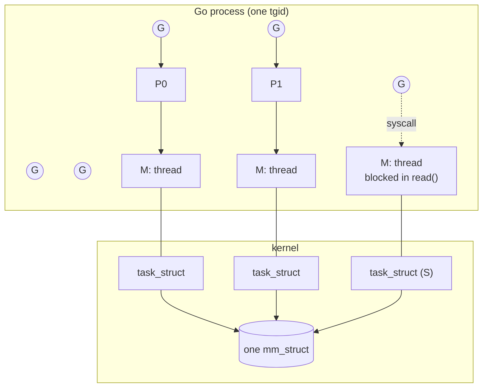

<div dir="rtl">

# یادداشت ۰۵ — نخ‌ها taskهایی هستند که یک `mm` مشترک دارند

> ماژول ۰۲ · نسخهٔ انگلیسی: [`05-threads-share-an-mm.en.md`](05-threads-share-an-mm.en.md) · فهرست: [`INDEX.fa.md`](INDEX.fa.md)

## ۱. خلاصه

- نخ در لینوکس taskای است که با `CLONE_THREAD` و پرچم‌های همراهش ساخته شده: `mm`، جدول fd، cwd و وضعیت سیگنال را مشترک دارد و `tgid` والد را می‌گیرد، اما `pid` (TID)، رجیسترها، پشته‌ها و موجودیت زمان‌بندی خودش را دارد.
- زمان‌بند هیچ‌وقت «پردازه» نمی‌بیند و هر نخ را مستقل زمان‌بندی می‌کند. این مدل **1:1** است؛ NPTL (پیاده‌سازی pthreads در glibc) هر pthread را به یک task کرنل نگاشت می‌کند.
- runtimeهایی مثل Go زمان‌بندی **M:N** را روی این مدل سوار می‌کنند: goroutineهای زیاد (G) روی چند نخ سیستم‌عامل (M)، که با `GOMAXPROCS` (P) محدود می‌شوند. کرنل فقط Mها را می‌بیند.

## ۲. توضیح مفصل

### شهود

دو آشپز در یک آشپزخانه (نخ‌ها) یخچال، چاقوها و کتاب دستور غذا را مشترک دارند، اما هر کدام دست‌های خودش و جای خودش در دستور غذا را دارد. دو آشپزخانه (پردازه‌ها) هیچ چیز مشترکی ندارند، مگر کسی دریچه‌ای بینشان بسازد (IPC).

### `CLONE_THREAD` در `copy_process()` چه چیزی را عوض می‌کند

| کد (`kernel/fork.c`) | با `CLONE_THREAD` | بدون آن |
|---|---|---|
| خط‌های 2261 تا 2267، `tgid` و `group_leader` | `tgid = current->tgid` و رهبر همان رهبر ماست | `tgid` برابر pid خودش و خودش رهبر است |
| خط‌های 2336 تا 2341، `real_parent` و `exit_signal` | والد = **والدِ والد ما**؛ `exit_signal = -1` (بدون `SIGCHLD`) | والد = `current`؛ `SIGCHLD` |
| `copy_signal()` خط 1660 | `signal_struct` مشترک (فهرست نخ‌ها، rlimitها، سیگنال‌های معلق مشترک) | یک ساختار جدید |
| بررسی درستی، خط 1963 | به `CLONE_SIGHAND` نیاز دارد که خودش به `CLONE_VM` نیاز دارد | — |

پس همهٔ نخ‌ها در درخت پردازه‌ها *هم‌سطح* هستند: همه `real_parent` یکسان دارند و فقط پردازه به‌عنوان یک کل، هنگام پایان، `SIGCHLD` می‌فرستد.

### خصوصی در برابر مشترک

| مخصوص هر نخ (خصوصی) | مخصوص پردازه (مشترک از طریق اشاره‌گر) |
|---|---|
| `pid` (TID)، `__state`، `se`/`rt`/`dl`، `prio`، `policy`، `cpus_ptr` | `tgid`، `mm` (VMAها، page tableها، heap) |
| رجیسترها (`thread`)، پشتهٔ کرنل، پشتهٔ کاربر (یک نگاشت جداگانه) | `files` (جدول fd)، `fs` (cwd، root) |
| TLS (پایهٔ FS در x86-64 که `CLONE_SETTLS` تنظیمش می‌کند) | `sighand` (handlerها)، `signal` (سیگنال‌های معلق مشترک، rlimitها) |
| **ماسک** سیگنال، سیگنال‌های معلق مخصوص نخ | اعتبارنامه‌ها (طبق قرارداد؛ NPTL با یک سیگنال همگانی آن‌ها را هماهنگ نگه می‌دارد) |
| `nvcsw`، `nivcsw`، زمان CPU | PID namespace، cgroup (در حالت «threaded» cgroup v2 می‌شود نخ‌ها را جدا جابه‌جا کرد) |

### هزینه‌ها

- **ساخت**: نخ از `dup_mm()` عبور نمی‌کند، پس ساختش از `fork()` یک پردازهٔ بزرگ ارزان‌تر است. ولی هنوز یک پشتهٔ کرنل، یک `task_struct`، یک `mmap` برای پشتهٔ کاربر و تنظیم TLS لازم دارد. روی VM مشترک آزمایشگاه، ۱۰٬۰۰۰ فراخوانی `pthread_create()` حدود ۳٫۲ ثانیه طول کشید، یعنی هر کدام حدود ۳۲۰ میکروثانیه (مثال عملی پایین)؛ روی یک ماشین واقعی بیکار انتظار چند ده میکروثانیه را داشته باشید.
- **switch**: بین دو نخ یک پردازه، `context_switch()` همان `mm` را نگه می‌دارد، پس `switch_mm_irqs_off()` مقدار `CR3` را دوباره بارگذاری نمی‌کند و ورودی‌های TLB معتبر می‌مانند (بخش ۶ مرور کد).
- **حافظه**: پشتهٔ پیش‌فرض pthread هشت مگابایت حافظهٔ *مجازی* است (RLIMIT_STACK)، اما فقط صفحه‌هایی که لمس شوند RSS مصرف می‌کنند.

### جایگزین M:N (زبان Go)

runtime زبان Go سه شیء دارد: G (goroutine، با پشتهٔ اولیهٔ حدود ۲ کیلوبایت که در صورت نیاز بزرگ می‌شود)، M (یک نخ سیستم‌عامل، یعنی یک task کرنل) و P (یک ژتون پردازنده؛ به تعداد `GOMAXPROCS`). یک M برای اجرای کد Go باید یک P در دست داشته باشد. نتیجه‌ها:

- ۱۰٬۰۰۰ goroutine در خواب به نخ اضافه **نیاز ندارند**: آن‌ها Gهای پارک‌شده در runtime هستند، نه taskهایی در کرنل.
- goroutineهای پرمصرف CPU: حداکثر `GOMAXPROCS` تا همزمان اجرا می‌شوند.
- goroutineای که در یک **syscall** مسدود شده (نه I/O شبکه، که از netpoller و epoll استفاده می‌کند) M خودش را داخل کرنل مسدود نگه می‌دارد؛ runtime آن P را به M دیگری می‌دهد و در صورت نیاز نخ جدید می‌سازد. ۲۰۰ goroutine مسدود در `read()` روی یک pipe ⇐ حدود ۲۰۰ نخ سیستم‌عامل.
- از Go 1.14 goroutineها به‌صورت **ناهمگام preempt** می‌شوند (با سیگنال `SIGURG`)، پس یک حلقهٔ تنگ دیگر زمان‌بند را قفل نمی‌کند.

## ۳. نمودار

</div>



<div dir="rtl">

## ۴. مثال عملی

تعیین `tgid`، `linux/kernel/fork.c · copy_process() · v6.18.63` (خط‌های 2260 تا 2267):

</div>

```c
	p->pid = pid_nr(pid);
	if (clone_flags & CLONE_THREAD) {
		p->group_leader = current->group_leader;
		p->tgid = current->tgid;
	} else {
		p->group_leader = p;
		p->tgid = p->pid;
	}
```

<div dir="rtl">

آزمایش ۰۲.۶ در یک برنامهٔ Go هم goroutineها را می‌شمارد و هم نخ‌های سیستم‌عامل (`/proc/self/task`). خروجی واقعی روی VM (۸ vCPU، Go نسخهٔ Ubuntu 24.04):

</div>

```text
$ ./gvt sleep 10000
pid=3158 GOMAXPROCS=8 NumCPU=8
start:   goroutines=1      os_threads=5    VmRSS=2068 kB
spawned 10000 goroutines in 241.032481ms (24.10 us each)
after 1s: goroutines=10001  os_threads=10   VmRSS=28760 kB
$ ./gvt syscall 200
pid=3157 GOMAXPROCS=8 NumCPU=8
start:   goroutines=1      os_threads=5    VmRSS=2040 kB
spawned 200 goroutines in 544.936µs (2.72 us each)
after 1s: goroutines=201    os_threads=204  VmRSS=5776 kB
```

<div dir="rtl">

و نسخهٔ C، که در آن هر pthread یک task کرنل است:

</div>

```text
$ ./threads 10000
start:   os_threads=1      VmRSS=1480 kB
created: os_threads=10001  VmRSS=84680 kB  in 3188.5 ms (318.9 us/thread)
```

<div dir="rtl">

## ۵. حالت‌های خاص و دام‌ها

- **`top` نخ‌ها را یک پردازه نشان می‌دهد.** در `top` کلید `H` را بزنید، یا از `ps -eLf`، `ps -T -p <pid>` و `ls /proc/<pid>/task` استفاده کنید.
- **سیگنال به پردازه** (`kill(pid, ...)`) به *هر* نخی که آن را مسدود نکرده تحویل می‌شود. برای رفتار قابل پیش‌بینی از `pthread_sigmask` و یک نخ اختصاصی `sigwait` استفاده کنید.
- **`setuid()` در یک نخ** در کرنل فقط اعتبارنامهٔ همان task را عوض می‌کند. glibc برای حفظ معنای POSIX، تغییر را با یک سیگنال داخلی (`SIGSETXID`) به همهٔ نخ‌ها پخش می‌کند.
- **`fork()` در پردازهٔ چندنخی** فقط یک نخ را کپی می‌کند (یادداشت ۰۲).
- **حساب‌داری CPU**: `/proc/<pid>/stat` مجموع همهٔ نخ‌هاست؛ زمان هر نخ در `/proc/<pid>/task/<tid>/stat` است.
- **Go و `LockOSThread`**: فراخوانی‌های cgo و `runtime.LockOSThread()` یک G را به یک M سنجاق می‌کنند و تعداد نخ‌ها می‌تواند بی‌حد رشد کند. `GOMAXPROCS` تعداد نخ‌ها را **محدود نمی‌کند**، فقط اجرای موازی کد Go را؛ سقف واقعی `debug.SetMaxThreads` است (پیش‌فرض ۱۰٬۰۰۰).

## ۶. نکته‌های کلیدی امتحانی

- نخ = taskای با `CLONE_VM | CLONE_FILES | CLONE_FS | CLONE_SIGHAND | CLONE_THREAD`.
- `tgid` یکسان و `pid` مخصوص خودش؛ همهٔ نخ‌ها یک `real_parent` دارند؛ `exit_signal = -1`.
- لینوکس 1:1 است (NPTL). Go مدل M:N دارد (G، M، P).
- switch بین نخ‌های یک `mm`: بدون بارگذاری دوبارهٔ `CR3`، و TLB گرم می‌ماند.
- syscallهای مسدودکننده در Go نخ سیستم‌عامل مصرف می‌کنند؛ goroutineهای در خواب نه.
- `GOMAXPROCS` اجرای کد Go را محدود می‌کند، نه تعداد نخ‌ها را.

## ۷. پیوندها

- درس: [§۲.۵ آیا نخ همان پردازه‌ای است که حافظه‌اش مشترک است؟](../lesson.fa.md)
- مرور کد: [§۱.۱ `copy_process()`](../kernel-walkthrough.fa.md)، [§۶ `context_switch()`](../kernel-walkthrough.fa.md)
- آزمایش‌ها: [۰۲.۲ clone-flags](../labs/02-clone-flags/README.md)، [۰۲.۶ goroutine در برابر نخ](../labs/06-goroutines-vs-threads/README.md)
- آزمون: Q1 و Q12

</div>
