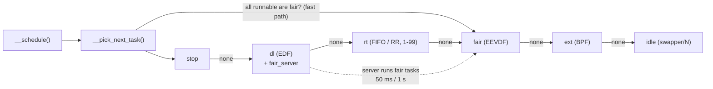

# Note 06 — Scheduling classes: stop, dl, rt, fair, ext, idle

> Module 02 · Persian: [`06-scheduling-classes.fa.md`](06-scheduling-classes.fa.md) · Index: [`INDEX.en.md`](INDEX.en.md)

## 1. Summary

- The Linux scheduler is a fixed **priority list of classes**. Each class is a `struct sched_class` of function pointers (`enqueue_task`, `pick_task`, `task_tick`, ...); the core asks them in order and runs the first task offered.
- Order (highest first): **stop → dl → rt → fair → ext → idle**. User space selects a class through the policy: `SCHED_DEADLINE`, `SCHED_FIFO`/`RR`, `SCHED_OTHER`/`BATCH`/`IDLE`, `SCHED_EXT`.
- A higher class always wins on its CPU. The **fair server** (6.12+) is a deadline reservation that guarantees fair tasks 50 ms per second per CPU even under RT load.

## 2. Detailed explanation

### Intuition

An airport security line with lanes: crew (stop), diplomats with a fixed appointment (dl), first class by rank (rt), everyone else sharing fairly (fair), a lane run by a custom program (ext), and a cleaner who walks through when nobody is waiting (idle). The guard always checks lanes in that order.

### The interface

Each class implements (subset, from `kernel/sched/sched.h`):

| Hook | Called when |
|---|---|
| `enqueue_task` / `dequeue_task` | a task becomes runnable / stops being runnable |
| `wakeup_preempt` | a woken task might deserve the CPU now |
| `pick_task` / `pick_next_task` | `__schedule()` needs the next task |
| `put_prev_task` / `set_next_task` | switching away from / to a task of this class |
| `task_tick` | every scheduler tick for the running task |
| `select_task_rq` | choose a CPU at wakeup or fork |
| `balance` | pull work from other CPUs before picking |

The classes are **ordered by address**: `DEFINE_SCHED_CLASS(name)` puts each instance in its own linker section, and `include/asm-generic/vmlinux.lds.h` (`SCHED_DATA`, L136) lists them stop, dl, rt, fair, ext, idle. "Higher priority" is "lower address": `sched_class_above(a, b)` is `a < b` (`sched.h` L2574).

### The classes

| Class | Policy (value) | Priority range | Pick rule | Preemption |
|---|---|---|---|---|
| stop | — | — | the per-CPU stopper task | preempts everything; used for migration, `stop_machine` |
| dl | `SCHED_DEADLINE` (6) | — | earliest absolute deadline (EDF) + constant bandwidth server | admission control: `Σ runtime/period ≤` allowed bandwidth |
| rt | `SCHED_FIFO` (1), `SCHED_RR` (2) | 1–99 (higher wins) | highest priority; FIFO within a level; RR rotates every 100 ms (`RR_TIMESLICE`) | a higher-priority RT wakeup preempts at once |
| fair | `SCHED_OTHER` (0), `SCHED_BATCH` (3), `SCHED_IDLE` (5) | nice −20..19 → weight 88761..15 | EEVDF (note 07) | earlier virtual deadline of an eligible task |
| ext | `SCHED_EXT` (7) | — | a BPF program (sched_ext, `kernel/sched/ext.c`) | as the BPF scheduler decides; falls back to fair on error |
| idle | — | — | the idle task `swapper/N` | anything else |

`prio` in the kernel unifies these: 0–99 for RT (inverted: `prio = 99 − rt_priority`), 100–139 for fair (`120 + nice`). `ps -o pri` and `top` show transformed versions of the same number, which is why the columns look inconsistent between tools.

### RT throttling and the fair server

A busy `SCHED_FIFO` task never yields to fair tasks on its CPU. Two safety nets exist:

1. `sysctl_sched_rt_runtime = 950000` µs per `sysctl_sched_rt_period = 1000000` µs (`kernel/sched/rt.c` L18–24): RT tasks may use at most 95% of each second.
2. Since 6.12, the **fair server** (`fair_server_init()`, `kernel/sched/fair.c` L9244) is a `SCHED_DEADLINE` entity per CPU with runtime 50 ms and period 1000 ms (`kernel/sched/deadline.c` L1825–1826). When fair tasks are starved, the deadline class (which outranks rt) runs the server, and the server runs fair tasks. Tunable at `/sys/kernel/debug/sched/fair_server/cpuN/{runtime,period}`.

Lab 02.5 shows the result: a fair task sharing a CPU with a `SCHED_FIFO` spinner gets about 5% of the CPU, not 0%.

### Choosing a policy from user space

| Tool / call | Effect |
|---|---|
| `nice -n 10 cmd`, `renice`, `setpriority()` | weight in the fair class |
| `chrt -f 50 cmd`, `sched_setscheduler(SCHED_FIFO)` | move to rt (needs `CAP_SYS_NICE` or `RLIMIT_RTPRIO`) |
| `chrt -b 0 cmd` | `SCHED_BATCH`: fair, but never preempts on wakeup |
| `chrt -i 0 cmd` | `SCHED_IDLE`: fair with the minimum weight (3) |
| `chrt -d --sched-runtime ... cmd`, `sched_setattr()` | `SCHED_DEADLINE` |
| `sched_setattr(sched_runtime)` on `SCHED_OTHER` | custom EEVDF slice (note 07) |
| `SCHED_RESET_ON_FORK` flag | children start back at `SCHED_OTHER`, nice 0 |

## 3. Diagram



## 4. Worked example

`linux/kernel/sched/sched.h · for_each_active_class · v6.18.63` (L2550–2572):

```c
static inline const struct sched_class *next_active_class(const struct sched_class *class)
{
	class++;
#ifdef CONFIG_SCHED_CLASS_EXT
	if (scx_switched_all() && class == &fair_sched_class)
		class++;
	if (!scx_enabled() && class == &ext_sched_class)
		class++;
#endif
	return class;
}

#define for_class_range(class, _from, _to) \
	for (class = (_from); class < (_to); class++)

#define for_each_class(class) \
	for_class_range(class, __sched_class_highest, __sched_class_lowest)

#define for_active_class_range(class, _from, _to)				\
	for (class = (_from); class != (_to); class = next_active_class(class))

#define for_each_active_class(class)						\
	for_active_class_range(class, __sched_class_highest, __sched_class_lowest)
```

`class++` moves to the next class **in memory**, which is the next lower priority. Real output on the VM: the policy and priority of a few tasks, and the fair server settings:

```text
$ ps -eo pid,cls,rtprio,ni,pri,comm | awk 'NR==1 || $2!="TS"' | head -8
    PID CLS RTPRIO  NI PRI COMMAND
     18  FF     99   - 139 migration/0
     19  FF     50   -  90 idle_inject/0
     22  FF     50   -  90 idle_inject/1
     23  FF     99   - 139 migration/1
     28  FF     50   -  90 idle_inject/2
     29  FF     99   - 139 migration/2
     34  FF     50   -  90 idle_inject/3
$ chrt -p 1
pid 1's current scheduling policy: SCHED_OTHER
pid 1's current scheduling priority: 0
$ sudo grep -E "^(policy|prio|se.slice)" /proc/1/sched
policy                                       :                    0
prio                                         :                  120
se.slice                                     :              2800000
$ sudo cat /sys/kernel/debug/sched/fair_server/cpu3/runtime /sys/kernel/debug/sched/fair_server/cpu3/period
50000000
1000000000
$ cat /sys/kernel/sched_ext/state
disabled
```

## 5. Edge cases & pitfalls

- **RT without limits is dangerous.** A buggy `SCHED_FIFO` loop on every CPU can still make a machine unresponsive (kernel threads like `ksoftirqd` are fair tasks). Test RT code pinned to one CPU, as lab 02.5 does.
- **`SCHED_RR` slice is 100 ms**, not the EEVDF slice. Check `/proc/sys/kernel/sched_rr_timeslice_ms`.
- **Priority inversion**: a high-priority RT task waiting on a lock held by a low-priority task. `rt_mutex` / PI futexes boost the owner (Module 7).
- **cgroups change the picture**: with CPU cgroups the fair class schedules *groups* first (each cgroup has its own `cfs_rq`), then tasks inside. `cpu.weight` is the group's nice.
- **sched_ext is opt-in**: `ext` is skipped entirely until a BPF scheduler is loaded (`/sys/kernel/sched_ext/state`). If the BPF program misbehaves, the kernel ejects it and tasks return to fair.
- **`ps` priority columns differ**: `ps -o pri` is not `prio`. Use `/proc/<pid>/sched` (`prio`, `policy`) for the kernel's view.

## 6. Exam-style key points

- Classes in order: stop > dl > rt > fair > ext > idle; the first class with a runnable task wins.
- The order is a linker-section array; `class++` = next lower class.
- Fast path: if all runnable tasks are fair, call `pick_next_task_fair()` directly.
- RT priority 1–99, FIFO/RR; RR quantum 100 ms.
- RT throttling 950 ms/1 s and the fair server 50 ms/1 s protect fair tasks (6.12+).
- `SCHED_DEADLINE` has admission control; RT does not.
- sched_ext: BPF-defined class between fair and idle; off until loaded.

## 7. Links

- Lesson: [§2.6 Who decides which task runs next?](../lesson.en.md#26-who-decides-which-task-runs-next)
- Walkthrough: [§4 Scheduling classes](../kernel-walkthrough.en.md#4-scheduling-classes-a-linker-ordered-array)
- Lab: [02.5 sched-policies](../labs/05-sched-policies/README.md)
- Quiz: Q5, Q13
