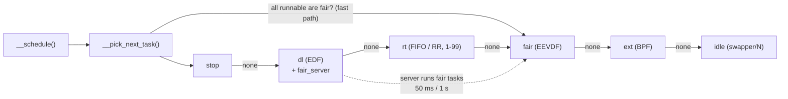

<div dir="rtl">

# یادداشت ۰۶ — کلاس‌های زمان‌بندی: stop، dl، rt، fair، ext، idle

> ماژول ۰۲ · نسخهٔ انگلیسی: [`06-scheduling-classes.en.md`](06-scheduling-classes.en.md) · فهرست: [`INDEX.fa.md`](INDEX.fa.md)

## ۱. خلاصه

- زمان‌بند لینوکس یک **فهرست اولویت ثابت از کلاس‌ها** است. هر کلاس یک `struct sched_class` از اشاره‌گرهای تابع است (`enqueue_task`، `pick_task`، `task_tick` و ...). هسته به ترتیب از آن‌ها می‌پرسد و اولین taskای را که پیشنهاد شود اجرا می‌کند.
- ترتیب (از بالاترین): **stop ← dl ← rt ← fair ← ext ← idle**. برنامهٔ کاربر کلاس را از طریق policy انتخاب می‌کند: `SCHED_DEADLINE`، `SCHED_FIFO`/`RR`، `SCHED_OTHER`/`BATCH`/`IDLE`، `SCHED_EXT`.
- کلاس بالاتر روی CPU خودش همیشه می‌برد. **fair server** (از 6.12) یک رزرو deadline است که حتی زیر بار RT برای taskهای fair در هر ثانیه روی هر CPU پنجاه میلی‌ثانیه تضمین می‌کند.

## ۲. توضیح مفصل

### شهود

صف بازرسی فرودگاه با چند خط را در نظر بگیرید: خدمهٔ پرواز (stop)، دیپلمات‌هایی با وقت ملاقات مشخص (dl)، مسافران درجه‌یک به ترتیب رتبه (rt)، بقیهٔ مردم که منصفانه تقسیم می‌شوند (fair)، خطی که یک برنامهٔ سفارشی اداره‌اش می‌کند (ext) و نظافتچی‌ای که وقتی کسی منتظر نیست رد می‌شود (idle). مأمور همیشه خط‌ها را به همین ترتیب بررسی می‌کند.

### رابط

هر کلاس این‌ها را پیاده‌سازی می‌کند (بخشی از فهرست، از `kernel/sched/sched.h`):

| hook | چه زمانی صدا زده می‌شود |
|---|---|
| `enqueue_task` / `dequeue_task` | task قابل اجرا می‌شود / دیگر قابل اجرا نیست |
| `wakeup_preempt` | taskای که بیدار شده شاید الان CPU را لازم داشته باشد |
| `pick_task` / `pick_next_task` | `__schedule()` به task بعدی نیاز دارد |
| `put_prev_task` / `set_next_task` | switch از / به taskای از این کلاس |
| `task_tick` | در هر tick زمان‌بند برای task در حال اجرا |
| `select_task_rq` | انتخاب CPU هنگام بیدار شدن یا fork |
| `balance` | قبل از انتخاب، کار را از CPUهای دیگر بکش |

کلاس‌ها **بر اساس آدرس مرتب‌اند**: `DEFINE_SCHED_CLASS(name)` هر نمونه را در section مخصوص خودش می‌گذارد و `include/asm-generic/vmlinux.lds.h` (یعنی `SCHED_DATA` در خط 136) آن‌ها را به ترتیب stop، dl، rt، fair، ext، idle فهرست می‌کند. «اولویت بالاتر» یعنی «آدرس پایین‌تر»: `sched_class_above(a, b)` همان `a < b` است (`sched.h` خط 2574).

### کلاس‌ها

| کلاس | policy (مقدار) | بازهٔ اولویت | قاعدهٔ انتخاب | preemption |
|---|---|---|---|---|
| stop | — | — | task stopper هر CPU | همه را preempt می‌کند؛ برای migration و `stop_machine` |
| dl | `SCHED_DEADLINE` (6) | — | زودترین deadline مطلق (EDF) + constant bandwidth server | admission control: مجموع `runtime/period` باید از پهنای باند مجاز کمتر باشد |
| rt | `SCHED_FIFO` (1)، `SCHED_RR` (2) | ۱ تا ۹۹ (بالاتر می‌برد) | بالاترین اولویت؛ در هر سطح FIFO؛ RR هر ۱۰۰ میلی‌ثانیه می‌چرخد (`RR_TIMESLICE`) | بیدار شدن RT با اولویت بالاتر فوراً preempt می‌کند |
| fair | `SCHED_OTHER` (0)، `SCHED_BATCH` (3)، `SCHED_IDLE` (5) | nice از ۲۰- تا ۱۹ ← وزن ۸۸۷۶۱ تا ۱۵ | EEVDF (یادداشت ۰۷) | virtual deadline زودتر یک task واجد شرایط |
| ext | `SCHED_EXT` (7) | — | یک برنامهٔ BPF (sched_ext، `kernel/sched/ext.c`) | هرچه زمان‌بند BPF تصمیم بگیرد؛ در صورت خطا به fair برمی‌گردد |
| idle | — | — | task بیکار `swapper/N` | هر چیز دیگری |

مقدار `prio` در کرنل همهٔ این‌ها را یکپارچه می‌کند: ۰ تا ۹۹ برای RT (معکوس: `prio = 99 − rt_priority`) و ۱۰۰ تا ۱۳۹ برای fair (`120 + nice`). `ps -o pri` و `top` نسخه‌های تبدیل‌شدهٔ همین عدد را نشان می‌دهند و به همین دلیل ستون‌ها بین ابزارها ناسازگار به نظر می‌رسند.

### محدودسازی RT و fair server

یک task پرکار `SCHED_FIFO` روی CPU خودش هیچ‌وقت به taskهای fair نوبت نمی‌دهد. دو تور ایمنی وجود دارد:

۱. `sysctl_sched_rt_runtime = 950000` میکروثانیه در هر `sysctl_sched_rt_period = 1000000` میکروثانیه (`kernel/sched/rt.c` خط‌های 18 تا 24): taskهای RT حداکثر ۹۵٪ هر ثانیه را مصرف می‌کنند.
۲. از 6.12 **fair server** (`fair_server_init()`، `kernel/sched/fair.c` خط 9244) برای هر CPU یک موجودیت `SCHED_DEADLINE` با runtime پنجاه میلی‌ثانیه و period هزار میلی‌ثانیه است (`kernel/sched/deadline.c` خط‌های 1825 و 1826). وقتی taskهای fair گرسنه بمانند، کلاس deadline (که از rt بالاتر است) server را اجرا می‌کند و server taskهای fair را اجرا می‌کند. قابل تنظیم در `/sys/kernel/debug/sched/fair_server/cpuN/{runtime,period}`.

آزمایش ۰۲.۵ نتیجه را نشان می‌دهد: task fairای که یک CPU را با یک `SCHED_FIFO` پرکار شریک است حدود ۵٪ CPU می‌گیرد، نه ۰٪.

### انتخاب policy از فضای کاربر

| ابزار / فراخوانی | اثر |
|---|---|
| `nice -n 10 cmd`، `renice`، `setpriority()` | وزن در کلاس fair |
| `chrt -f 50 cmd`، `sched_setscheduler(SCHED_FIFO)` | انتقال به rt (به `CAP_SYS_NICE` یا `RLIMIT_RTPRIO` نیاز دارد) |
| `chrt -b 0 cmd` | `SCHED_BATCH`: fair، اما هنگام بیدار شدن هرگز preempt نمی‌کند |
| `chrt -i 0 cmd` | `SCHED_IDLE`: fair با کمترین وزن (۳) |
| `chrt -d --sched-runtime ... cmd`، `sched_setattr()` | `SCHED_DEADLINE` |
| `sched_setattr(sched_runtime)` روی `SCHED_OTHER` | slice سفارشی EEVDF (یادداشت ۰۷) |
| پرچم `SCHED_RESET_ON_FORK` | فرزندان با `SCHED_OTHER` و nice صفر شروع می‌کنند |

## ۳. نمودار

</div>



<div dir="rtl">

## ۴. مثال عملی

`linux/kernel/sched/sched.h · for_each_active_class · v6.18.63` (خط‌های 2550 تا 2572):

</div>

```c
static inline const struct sched_class *next_active_class(const struct sched_class *class)
{
	class++;
#ifdef CONFIG_SCHED_CLASS_EXT
	if (scx_switched_all() && class == &fair_sched_class)
		class++;
	if (!scx_enabled() && class == &ext_sched_class)
		class++;
#endif
	return class;
}

#define for_class_range(class, _from, _to) \
	for (class = (_from); class < (_to); class++)

#define for_each_class(class) \
	for_class_range(class, __sched_class_highest, __sched_class_lowest)

#define for_active_class_range(class, _from, _to)				\
	for (class = (_from); class != (_to); class = next_active_class(class))

#define for_each_active_class(class)						\
	for_active_class_range(class, __sched_class_highest, __sched_class_lowest)
```

<div dir="rtl">

`class++` به کلاس بعدی **در حافظه** می‌رود که همان کلاس با اولویت پایین‌تر است. خروجی واقعی روی VM: policy و اولویت چند task و تنظیمات fair server:

</div>

```text
$ ps -eo pid,cls,rtprio,ni,pri,comm | awk 'NR==1 || $2!="TS"' | head -8
    PID CLS RTPRIO  NI PRI COMMAND
     18  FF     99   - 139 migration/0
     19  FF     50   -  90 idle_inject/0
     22  FF     50   -  90 idle_inject/1
     23  FF     99   - 139 migration/1
     28  FF     50   -  90 idle_inject/2
     29  FF     99   - 139 migration/2
     34  FF     50   -  90 idle_inject/3
$ chrt -p 1
pid 1's current scheduling policy: SCHED_OTHER
pid 1's current scheduling priority: 0
$ sudo grep -E "^(policy|prio|se.slice)" /proc/1/sched
policy                                       :                    0
prio                                         :                  120
se.slice                                     :              2800000
$ sudo cat /sys/kernel/debug/sched/fair_server/cpu3/runtime /sys/kernel/debug/sched/fair_server/cpu3/period
50000000
1000000000
$ cat /sys/kernel/sched_ext/state
disabled
```

<div dir="rtl">

## ۵. حالت‌های خاص و دام‌ها

- **RT بدون محدودیت خطرناک است.** یک حلقهٔ اشتباه `SCHED_FIFO` روی همهٔ CPUها هنوز می‌تواند ماشین را از پاسخ بیندازد (نخ‌های کرنل مثل `ksoftirqd` از کلاس fair هستند). کد RT را سنجاق‌شده به یک CPU آزمایش کنید، همان‌طور که آزمایش ۰۲.۵ می‌کند.
- **slice در `SCHED_RR` صد میلی‌ثانیه است**، نه slice مربوط به EEVDF. `/proc/sys/kernel/sched_rr_timeslice_ms` را ببینید.
- **وارونگی اولویت**: یک task RT پراولویت منتظر قفلی است که یک task کم‌اولویت نگه داشته. `rt_mutex` و futexهای PI اولویت صاحب قفل را بالا می‌برند (ماژول ۷).
- **cgroupها تصویر را عوض می‌کنند**: با cgroupهای CPU، کلاس fair اول *گروه‌ها* را زمان‌بندی می‌کند (هر cgroup یک `cfs_rq` مخصوص خودش دارد) و بعد taskهای داخل آن را. `cpu.weight` همان nice گروه است.
- **sched_ext اختیاری است**: تا وقتی یک زمان‌بند BPF بارگذاری نشده، کلاس `ext` کلاً رد می‌شود (`/sys/kernel/sched_ext/state`). اگر برنامهٔ BPF بد رفتار کند، کرنل آن را بیرون می‌اندازد و taskها به fair برمی‌گردند.
- **ستون‌های اولویت در `ps` فرق دارند**: `ps -o pri` همان `prio` نیست. برای دید کرنل از `/proc/<pid>/sched` (فیلدهای `prio` و `policy`) استفاده کنید.

## ۶. نکته‌های کلیدی امتحانی

- ترتیب کلاس‌ها: stop > dl > rt > fair > ext > idle؛ اولین کلاسی که task قابل اجرا دارد می‌برد.
- این ترتیب آرایه‌ای از sectionهای linker است؛ `class++` یعنی کلاس پایین‌تر بعدی.
- مسیر سریع: اگر همهٔ taskهای قابل اجرا fair باشند، `pick_next_task_fair()` مستقیم صدا زده می‌شود.
- اولویت RT از ۱ تا ۹۹، با FIFO یا RR؛ کوانتوم RR صد میلی‌ثانیه.
- محدودسازی RT (۹۵۰ میلی‌ثانیه در ۱ ثانیه) و fair server (۵۰ میلی‌ثانیه در ۱ ثانیه) از taskهای fair محافظت می‌کنند (6.12 به بعد).
- `SCHED_DEADLINE` کنترل پذیرش دارد؛ RT ندارد.
- sched_ext: کلاسی تعریف‌شده با BPF بین fair و idle؛ تا بارگذاری نشده خاموش است.

## ۷. پیوندها

- درس: [§۲.۶ چه کسی تعیین می‌کند task بعدی کدام باشد؟](../lesson.fa.md)
- مرور کد: [§۴ کلاس‌های زمان‌بندی](../kernel-walkthrough.fa.md)
- آزمایش: [۰۲.۵ sched-policies](../labs/05-sched-policies/README.md)
- آزمون: Q5 و Q13

</div>
