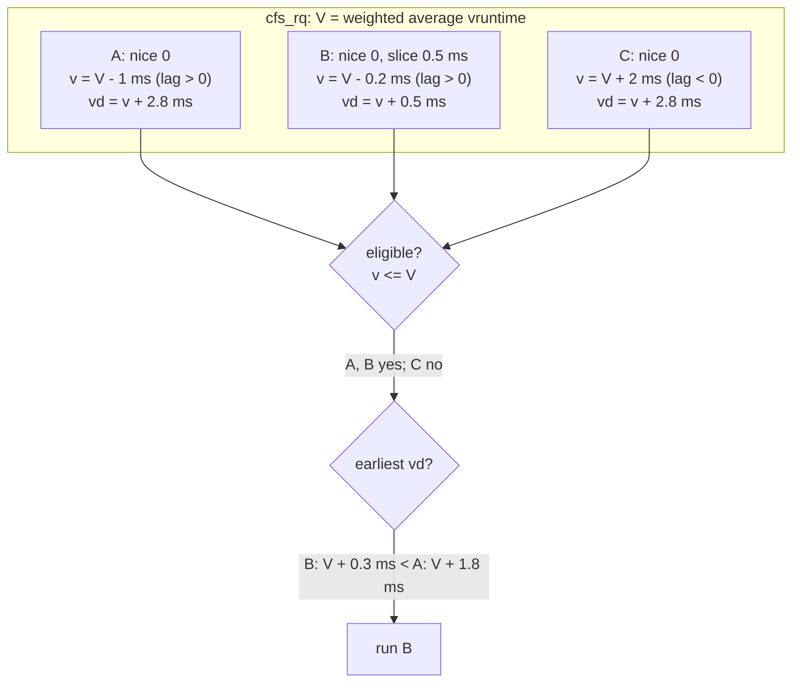

# Note 07 — EEVDF: lag, eligibility, virtual deadline

> Module 02 · Persian: [`07-eevdf.fa.md`](07-eevdf.fa.md) · Index: [`INDEX.en.md`](INDEX.en.md)

## 1. Summary

- Since Linux 6.6 the fair class uses **EEVDF** (Earliest Eligible Virtual Deadline First, Stoica & Abdel-Wahab 1995), replacing CFS. The in-tree doc is `Documentation/scheduler/sched-eevdf.rst`; the code is `kernel/sched/fair.c`.
- A task is **eligible** if its lag ≥ 0 (it has received no more than its fair share). Among eligible tasks, EEVDF runs the one with the **earliest virtual deadline** `vd = vruntime + slice / weight`.
- `nice` (weight) decides the long-run **share**; the slice (`base_slice_ns`, or per task via `sched_setattr()`) decides **latency**. CFS had only one knob plus heuristics.

## 2. Detailed explanation

### Intuition

Imagine a shared pizza cut by weight. Everyone's "virtual time" is how many slices they ate divided by how hungry they are allowed to be (their weight). **Eligible** = you are at or behind the average. Each eligible person also says how big a bite they want: a small bite gives an early deadline, so you are served sooner but more often; a big bite gives a late deadline. The server always serves the eligible person whose deadline comes first.

### The quantities

All from `kernel/sched/fair.c` comments and code:

| Symbol | Kernel field | Definition |
|---|---|---|
| `w_i` | `se->load.weight` | from `sched_prio_to_weight[]`: nice 0 → 1024, each nice step ≈ ×1.25 |
| `v_i` | `se->vruntime` | virtual runtime: real runtime × 1024 / `w_i` (`calc_delta_fair()`, L290) |
| `V` | `avg_vruntime(cfs_rq)` (L715) | weighted average `Σ v_i·w_i / Σ w_i` over the queue, including the running task |
| `lag_i` | `se->vlag` (saved on dequeue) | `w_i · (V − v_i)`: service owed (positive) or overdrawn (negative) |
| `r_i` | `se->slice` | request size; default `sysctl_sched_base_slice` |
| `vd_i` | `se->deadline` | `v_i + r_i · 1024 / w_i` (`update_deadline()`, L1127) |

### The pick

`pick_eevdf()` (L1025):

1. If only one task is queued, return it.
2. If the "next buddy" (a task the waker asked to run next) is eligible, return it.
3. If the current task is still eligible and `protect_slice()` says its slice is not used up (`RUN_TO_PARITY`), keep running it.
4. If the leftmost node of the RB-tree (tree is sorted by **deadline**) is eligible, return it.
5. Otherwise search: go left whenever the left subtree contains an eligible task (checked via the cached `min_vruntime` of the subtree), else test the node, else go right. O(log n).

### When does preemption happen?

- **At the tick**: `update_curr()` advances the running task's `vruntime`. When `vruntime ≥ deadline`, `update_deadline()` sets a new deadline one slice further and returns true → `resched_curr_lazy()` (`update_curr()` L1294–1340).
- **At wakeup**: `check_preempt_wakeup_fair()` (L8981) runs `pick_eevdf()` on the queue including the woken task; if the winner is not the current task, the current task is preempted. A short-slice task has an early deadline, so it tends to preempt.

### Placing a waking task: lag is preserved

When a task sleeps, `update_entity_lag()` (L778) saves `vlag`, clamped to about one slice plus a tick (`entity_lag()`). When it wakes, `place_entity()` sets `vruntime = V − lag` (scaled to keep the average consistent). Effects:

- a task that slept while **owed** time comes back eligible, but not with an unlimited credit (no CFS-style "sleeper bonus" abuse);
- a task that was **overdrawn** cannot reset its debt by sleeping briefly. The sched-eevdf doc says sleeping tasks stay on the queue marked for "deferred dequeue" (`DELAY_DEQUEUE`), so their negative lag decays while they sleep.

### The default slice on the lab VM

`sysctl_sched_base_slice = 700000` ns (L79), multiplied at boot by `1 + ilog2(min(ncpus, 8))` (`get_update_sysctl_factor()`, L192, `SCHED_TUNABLESCALING_LOG`). With 8 vCPUs: 0.7 ms × 4 = **2.8 ms**, visible in `/sys/kernel/debug/sched/base_slice_ns`.

### CFS vs EEVDF

| | CFS (2.6.23 – 6.5) | EEVDF (6.6+) |
|---|---|---|
| tree key | `vruntime` | virtual deadline (with `min_vruntime` augmentation) |
| pick | leftmost = smallest vruntime | eligible with earliest deadline |
| latency control | `sched_latency_ns`, `min_granularity_ns`, wakeup granularity heuristics | per-task slice (`sched_setattr` `sched_runtime`) |
| sleeper handling | sleeper credit (`GENTLE_FAIR_SLEEPERS`) | preserved, clamped lag; delayed dequeue |
| tunables in debugfs | `latency_ns`, `min_granularity_ns`, `wakeup_granularity_ns` | `base_slice_ns` (the old ones are gone) |

## 3. Diagram



## 4. Worked example

`linux/kernel/sched/core.c · sched_prio_to_weight · v6.18.63` (L10331–10340):

```c
const int sched_prio_to_weight[40] = {
 /* -20 */     88761,     71755,     56483,     46273,     36291,
 /* -15 */     29154,     23254,     18705,     14949,     11916,
 /* -10 */      9548,      7620,      6100,      4904,      3906,
 /*  -5 */      3121,      2501,      1991,      1586,      1277,
 /*   0 */      1024,       820,       655,       526,       423,
 /*   5 */       335,       272,       215,       172,       137,
 /*  10 */       110,        87,        70,        56,        45,
 /*  15 */        36,        29,        23,        18,        15,
};
```

Predicted share of nice 0 vs nice 5 on one CPU: 1024 / (1024 + 335) = **75.4%** vs 24.6%. Lab 02.5 measures it, then sets a custom slice. Real output on the VM:

```text
$ ./share 0 5
CPU 3, 3.0 s wall, 2 busy tasks
task   policy      cpu_s    share  fair_pred
0      nice:0      2.258    75.2%      75.3%
1      nice:5      0.743    24.8%      24.7%
```

```text
$ ./slice 50000 3000000 0
default                policy=0 nice=0 sched_runtime=2800000 ns  /proc se.slice=2800000 ns
request 50000 ns       policy=0 nice=0 sched_runtime=100000 ns  /proc se.slice=100000 ns
request 3000000 ns     policy=0 nice=0 sched_runtime=3000000 ns  /proc se.slice=3000000 ns
request 0 ns           policy=0 nice=0 sched_runtime=2800000 ns  /proc se.slice=2800000 ns
```

The 50 µs request comes back as 100 µs: `__setparam_fair()` clamps `sched_runtime` to `[NSEC_PER_MSEC/10, NSEC_PER_MSEC*100]` (L5299–5312). `0` returns to the default 2.8 ms.

## 5. Edge cases & pitfalls

- **Old tunables are gone.** `/proc/sys/kernel/sched_latency_ns` and `sched_min_granularity_ns` do not exist on 6.6+; guides that tune them are for CFS. **VERSION-DEPENDENT**.
- **Slice ≠ share.** A 0.1 ms slice does not give more CPU in the long run; it gives earlier, shorter turns (more context switches).
- **Group scheduling.** With CPU cgroups, EEVDF runs per `cfs_rq` at each level: first among groups (by `cpu.weight`), then among tasks inside the chosen group.
- **Eligibility uses the average, not the minimum.** A newly woken task with lag 0 is eligible exactly at `V`; a task that has run ahead must wait until others catch up, even if it has the earliest deadline.
- **`RUN_TO_PARITY` and `PICK_BUDDY`** are scheduler features (`/sys/kernel/debug/sched/features`). Changing them on a shared VM affects everyone; read, do not write.
- **Numbers on a VM** include steal time and host scheduling; shares are still close to the weight ratio when the CPU is pinned and otherwise quiet.

## 6. Exam-style key points

- EEVDF = pick the **eligible** (lag ≥ 0) entity with the **earliest virtual deadline**.
- `lag_i = w_i (V − v_i)`, `V` = weighted average vruntime; eligible ⇔ `v_i ≤ V`.
- `vd_i = v_i + r_i / w_i`; weight sets share, slice sets latency.
- RB-tree sorted by deadline, augmented with subtree `min_vruntime` → O(log n) pick.
- Default slice 0.7 ms × (1 + log2 ncpus, max 8) = 2.8 ms on 8 CPUs.
- `sched_setattr(SCHED_OTHER, sched_runtime)` sets a custom slice, clamped 0.1–100 ms.
- Lag is kept across sleep (clamped) and decays during delayed dequeue.

## 7. Links

- Lesson: [§2.7 How does EEVDF pick among normal tasks?](../lesson.en.md#27-how-does-eevdf-pick-among-normal-tasks)
- Walkthrough: [§5 EEVDF](../kernel-walkthrough.en.md#5-eevdf-pick_eevdf)
- Lab: [02.5 sched-policies](../labs/05-sched-policies/README.md)
- Docs: `Documentation/scheduler/sched-eevdf.rst`; LWN "An EEVDF CPU scheduler for Linux" (lwn.net/Articles/925371), "Completing the EEVDF scheduler" (lwn.net/Articles/969062), both cited by that doc
- Quiz: Q6, Q13
