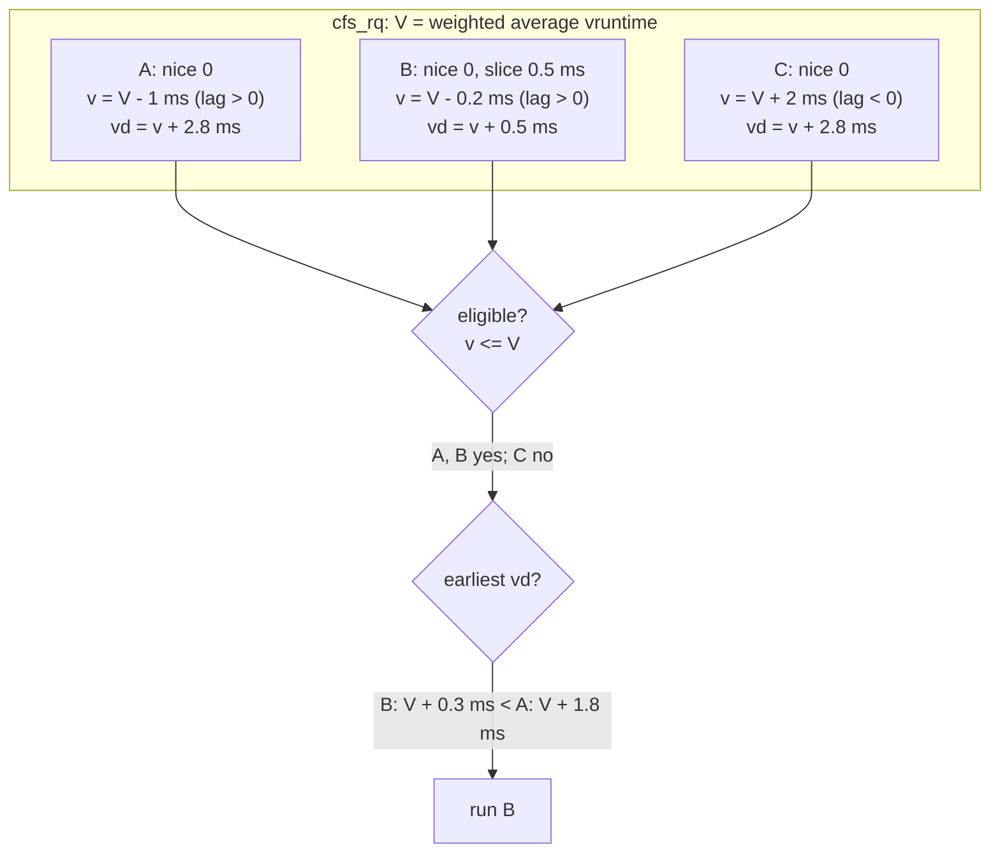

<div dir="rtl">

# یادداشت ۰۷ — EEVDF: lag، eligibility و virtual deadline

> ماژول ۰۲ · نسخهٔ انگلیسی: [`07-eevdf.en.md`](07-eevdf.en.md) · فهرست: [`INDEX.fa.md`](INDEX.fa.md)

## ۱. خلاصه

- از Linux 6.6 کلاس fair به جای CFS از **EEVDF** استفاده می‌کند (Earliest Eligible Virtual Deadline First، از مقالهٔ Stoica و Abdel-Wahab در ۱۹۹۵). مستند داخل درخت سورس `Documentation/scheduler/sched-eevdf.rst` و کد آن `kernel/sched/fair.c` است.
- یک task وقتی **eligible** است که lag آن ≥ ۰ باشد (یعنی بیش از سهم منصفانه‌اش نگرفته باشد). از میان taskهای eligible، EEVDF آن را اجرا می‌کند که **زودترین virtual deadline** را دارد: `vd = vruntime + slice / weight`.
- `nice` (وزن) **سهم** بلندمدت را تعیین می‌کند و slice (`base_slice_ns`، یا برای هر task با `sched_setattr()`) **تأخیر** را. CFS فقط یک پیچ تنظیم داشت به‌اضافهٔ روش‌های ابتکاری.

## ۲. توضیح مفصل

### شهود

پیتزایی مشترک را تصور کنید که بر اساس وزن تقسیم می‌شود. «زمان مجازی» هر نفر یعنی تعداد برش‌هایی که خورده، تقسیم بر میزان گرسنگی مجازش (وزنش). **eligible** یعنی شما هم‌سطح میانگین یا عقب‌تر از آن هستید. هر نفر eligible همچنین می‌گوید چه لقمه‌ای می‌خواهد: لقمهٔ کوچک deadline زودتری می‌دهد، پس زودتر و دفعات بیشتری سرو می‌شوید؛ لقمهٔ بزرگ deadline دیرتری دارد. پیشخدمت همیشه به آدم eligibleای سرو می‌کند که deadlineش زودتر از همه است.

### کمیت‌ها

همه از توضیحات و کد `kernel/sched/fair.c`:

| نماد | فیلد کرنل | تعریف |
|---|---|---|
| `w_i` | `se->load.weight` | از `sched_prio_to_weight[]`: nice صفر ← ۱۰۲۴، و هر پلهٔ nice حدود ×۱٫۲۵ |
| `v_i` | `se->vruntime` | زمان اجرای مجازی: زمان اجرای واقعی × ۱۰۲۴ / `w_i` (`calc_delta_fair()`، خط 290) |
| `V` | `avg_vruntime(cfs_rq)` (خط 715) | میانگین وزنی `Σ v_i·w_i / Σ w_i` روی صف، شامل task در حال اجرا |
| `lag_i` | `se->vlag` (هنگام خروج از صف ذخیره می‌شود) | `w_i · (V − v_i)`: سرویس طلب‌دار (مثبت) یا اضافه‌برداشت (منفی) |
| `r_i` | `se->slice` | اندازهٔ درخواست؛ پیش‌فرض `sysctl_sched_base_slice` |
| `vd_i` | `se->deadline` | `v_i + r_i · 1024 / w_i` (`update_deadline()`، خط 1127) |

### انتخاب

`pick_eevdf()` (خط 1025):

۱. اگر فقط یک task در صف است، همان را برگردان.
۲. اگر «next buddy» (taskای که بیدارکننده خواسته بعدی اجرا شود) eligible است، آن را برگردان.
۳. اگر task فعلی هنوز eligible است و `protect_slice()` می‌گوید slice آن تمام نشده (`RUN_TO_PARITY`)، اجرای آن را ادامه بده.
۴. اگر چپ‌ترین گرهٔ RB-tree (درخت بر اساس **deadline** مرتب است) eligible است، آن را برگردان.
۵. در غیر این صورت جستجو کن: هر وقت زیردرخت چپ task eligible دارد (با `min_vruntime` ذخیره‌شدهٔ آن زیردرخت بررسی می‌شود) به چپ برو، وگرنه گره را بیازما، وگرنه به راست برو. O(log n).

### preemption کِی رخ می‌دهد؟

- **در tick**: `update_curr()` مقدار `vruntime` task در حال اجرا را جلو می‌برد. وقتی `vruntime ≥ deadline` شود، `update_deadline()` یک deadline جدید یک slice جلوتر می‌گذارد و true برمی‌گرداند ← `resched_curr_lazy()` (`update_curr()` خط‌های 1294 تا 1340).
- **هنگام بیدار شدن**: `check_preempt_wakeup_fair()` (خط 8981) تابع `pick_eevdf()` را روی صف به‌اضافهٔ task بیدارشده اجرا می‌کند؛ اگر برنده task فعلی نباشد، task فعلی preempt می‌شود. task با slice کوتاه deadline زودی دارد، پس معمولاً preempt می‌کند.

### جای‌گذاری task بیدارشده: lag حفظ می‌شود

وقتی task می‌خوابد، `update_entity_lag()` (خط 778) مقدار `vlag` را ذخیره می‌کند که به حدود یک slice به‌اضافهٔ یک tick محدود شده (`entity_lag()`). وقتی بیدار می‌شود، `place_entity()` مقدار `vruntime = V − lag` را می‌گذارد (با مقیاس‌دهی تا میانگین سازگار بماند). اثرها:

- taskای که در حالی خوابیده که **طلب‌کار** بوده، eligible برمی‌گردد، اما نه با اعتبار نامحدود (سوءاستفادهٔ «پاداش خواب» به سبک CFS وجود ندارد)؛
- taskای که **اضافه‌برداشت** داشته نمی‌تواند با یک خواب کوتاه بدهی‌اش را پاک کند. مستند sched-eevdf می‌گوید taskهای در خواب با علامت «خروج تأخیری» (`DELAY_DEQUEUE`) در صف می‌مانند تا lag منفی‌شان در طول خواب مستهلک شود.

### slice پیش‌فرض روی VM آزمایشگاه

`sysctl_sched_base_slice = 700000` نانوثانیه (خط 79) که هنگام بوت در `1 + ilog2(min(ncpus, 8))` ضرب می‌شود (`get_update_sysctl_factor()`، خط 192، با `SCHED_TUNABLESCALING_LOG`). با ۸ vCPU: ۰٫۷ میلی‌ثانیه × ۴ = **۲٫۸ میلی‌ثانیه**، که در `/sys/kernel/debug/sched/base_slice_ns` دیده می‌شود.

### CFS در برابر EEVDF

| | CFS (2.6.23 تا 6.5) | EEVDF (6.6 به بعد) |
|---|---|---|
| کلید درخت | `vruntime` | virtual deadline (با تقویت `min_vruntime`) |
| انتخاب | چپ‌ترین = کمترین vruntime | eligible با زودترین deadline |
| کنترل تأخیر | `sched_latency_ns`، `min_granularity_ns` و روش‌های ابتکاری wakeup granularity | slice مخصوص هر task (`sched_runtime` در `sched_setattr`) |
| رفتار با taskهای در خواب | اعتبار خواب (`GENTLE_FAIR_SLEEPERS`) | lag حفظ‌شده و محدود؛ خروج تأخیری |
| تنظیمات debugfs | `latency_ns`، `min_granularity_ns`، `wakeup_granularity_ns` | `base_slice_ns` (قدیمی‌ها حذف شده‌اند) |

## ۳. نمودار

</div>



<div dir="rtl">

## ۴. مثال عملی

`linux/kernel/sched/core.c · sched_prio_to_weight · v6.18.63` (خط‌های 10331 تا 10340):

</div>

```c
const int sched_prio_to_weight[40] = {
 /* -20 */     88761,     71755,     56483,     46273,     36291,
 /* -15 */     29154,     23254,     18705,     14949,     11916,
 /* -10 */      9548,      7620,      6100,      4904,      3906,
 /*  -5 */      3121,      2501,      1991,      1586,      1277,
 /*   0 */      1024,       820,       655,       526,       423,
 /*   5 */       335,       272,       215,       172,       137,
 /*  10 */       110,        87,        70,        56,        45,
 /*  15 */        36,        29,        23,        18,        15,
};
```

<div dir="rtl">

سهم پیش‌بینی‌شدهٔ nice صفر در برابر nice پنج روی یک CPU: ۱۰۲۴ / (۱۰۲۴ + ۳۳۵) = **۷۵٫۴٪** در برابر ۲۴٫۶٪. آزمایش ۰۲.۵ این را اندازه می‌گیرد و بعد یک slice سفارشی تنظیم می‌کند. خروجی واقعی روی VM:

</div>

```text
$ ./share 0 5
CPU 3, 3.0 s wall, 2 busy tasks
task   policy      cpu_s    share  fair_pred
0      nice:0      2.258    75.2%      75.3%
1      nice:5      0.743    24.8%      24.7%
```

```text
$ ./slice 50000 3000000 0
default                policy=0 nice=0 sched_runtime=2800000 ns  /proc se.slice=2800000 ns
request 50000 ns       policy=0 nice=0 sched_runtime=100000 ns  /proc se.slice=100000 ns
request 3000000 ns     policy=0 nice=0 sched_runtime=3000000 ns  /proc se.slice=3000000 ns
request 0 ns           policy=0 nice=0 sched_runtime=2800000 ns  /proc se.slice=2800000 ns
```

<div dir="rtl">

درخواست ۵۰ میکروثانیه به‌صورت ۱۰۰ میکروثانیه برمی‌گردد: `__setparam_fair()` مقدار `sched_runtime` را به `[NSEC_PER_MSEC/10, NSEC_PER_MSEC*100]` محدود می‌کند (خط‌های 5299 تا 5312). مقدار `0` به پیش‌فرض ۲٫۸ میلی‌ثانیه برمی‌گردد.

## ۵. حالت‌های خاص و دام‌ها

- **تنظیمات قدیمی حذف شده‌اند.** `/proc/sys/kernel/sched_latency_ns` و `sched_min_granularity_ns` در 6.6 به بعد وجود ندارند؛ راهنماهایی که آن‌ها را تنظیم می‌کنند مربوط به CFS هستند. **VERSION-DEPENDENT**.
- **slice ≠ سهم.** slice صدمیکروثانیه‌ای در بلندمدت CPU بیشتری نمی‌دهد؛ نوبت‌های زودتر و کوتاه‌تر می‌دهد (context switch بیشتر).
- **زمان‌بندی گروهی.** با cgroupهای CPU، EEVDF در هر سطح جداگانه برای هر `cfs_rq` اجرا می‌شود: اول بین گروه‌ها (با `cpu.weight`) و بعد بین taskهای داخل گروه انتخاب‌شده.
- **eligibility از میانگین استفاده می‌کند، نه کمینه.** task تازه بیدارشده با lag صفر دقیقاً در `V` eligible است؛ taskای که جلو افتاده باید منتظر بماند تا بقیه برسند، حتی اگر زودترین deadline را داشته باشد.
- **`RUN_TO_PARITY` و `PICK_BUDDY`** ویژگی‌های زمان‌بند هستند (`/sys/kernel/debug/sched/features`). تغییرشان روی VM مشترک روی همه اثر می‌گذارد؛ بخوانید، ننویسید.
- **عددها روی VM** شامل steal time و زمان‌بندی میزبان‌اند؛ وقتی CPU سنجاق‌شده و بقیه‌اش آرام باشد، سهم‌ها هنوز نزدیک نسبت وزن‌ها هستند.

## ۶. نکته‌های کلیدی امتحانی

- EEVDF = انتخاب entityای که **eligible** است (lag ≥ 0) و **زودترین virtual deadline** را دارد.
- `lag_i = w_i (V − v_i)` و `V` میانگین وزنی vruntime است؛ eligible ⇔ `v_i ≤ V`.
- `vd_i = v_i + r_i / w_i`؛ وزن سهم را تعیین می‌کند و slice تأخیر را.
- RB-tree مرتب بر اساس deadline، تقویت‌شده با `min_vruntime` زیردرخت ← انتخاب با O(log n).
- slice پیش‌فرض ۰٫۷ میلی‌ثانیه × (۱ + log2 تعداد CPU، حداکثر ۸) = ۲٫۸ میلی‌ثانیه روی ۸ CPU.
- `sched_setattr(SCHED_OTHER, sched_runtime)` یک slice سفارشی می‌گذارد که به ۰٫۱ تا ۱۰۰ میلی‌ثانیه محدود می‌شود.
- lag در طول خواب حفظ می‌شود (محدودشده) و در طول خروج تأخیری مستهلک می‌شود.

## ۷. پیوندها

- درس: [§۲.۷ EEVDF بین taskهای معمولی چطور انتخاب می‌کند؟](../lesson.fa.md)
- مرور کد: [§۵ EEVDF](../kernel-walkthrough.fa.md)
- آزمایش: [۰۲.۵ sched-policies](../labs/05-sched-policies/README.md)
- مستندات: `Documentation/scheduler/sched-eevdf.rst`؛ مقاله‌های LWN «An EEVDF CPU scheduler for Linux» (lwn.net/Articles/925371) و «Completing the EEVDF scheduler» (lwn.net/Articles/969062) که هر دو در همان مستند ارجاع شده‌اند
- آزمون: Q6 و Q13

</div>
