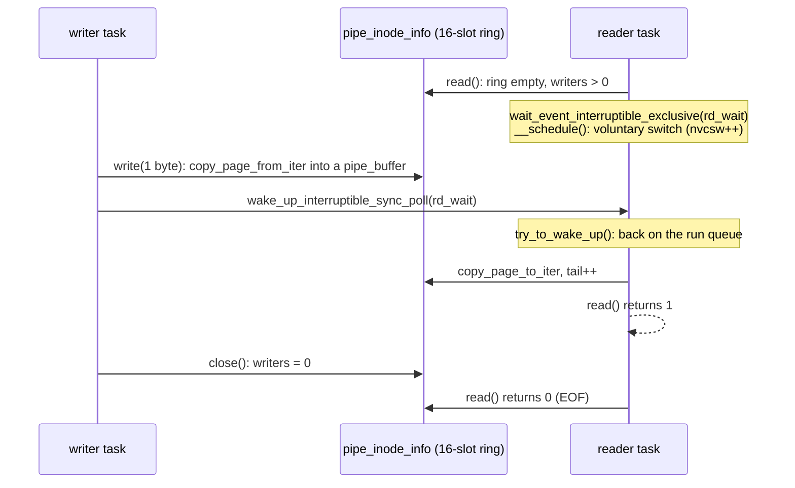

# Note 08 — IPC: pipes, shared memory, UNIX sockets, message queues

> Module 02 · Persian: [`08-ipc-pipes-shm-sockets.fa.md`](08-ipc-pipes-shm-sockets.fa.md) · Index: [`INDEX.en.md`](INDEX.en.md)

## 1. Summary

- Processes have separate address spaces, so every IPC mechanism is a **kernel object both sides can reach**: a pipe buffer, a socket pair, a shared file mapping, a message queue.
- Copying mechanisms (pipe, socket, mqueue) do two copies per message and synchronize for you (a read blocks until data arrives). Shared memory does zero copies but gives you **no synchronization**: you add a futex, semaphore or atomic protocol yourself.
- The blocking behaviour is the scheduler's sleep/wakeup path from note 04: an empty pipe read is `wait_event_interruptible_exclusive()` → `schedule()`, a write is `wake_up_interruptible_sync_poll()`.

## 2. Detailed explanation

### Intuition

Pipes and sockets are a mail slot: you push a letter in, the kernel holds it, the other side pulls it out. Shared memory is a whiteboard in a shared room: instant, but two people writing at once make a mess unless they agree who holds the marker.

### Pipes

- `pipe2(fds, flags)` → `SYSCALL_DEFINE2(pipe2)` (`fs/pipe.c` L1056) creates a `pipe_inode_info` on the internal `pipefs` mount and two `struct file`s: `fds[0]` read end, `fds[1]` write end.
- The buffer is a **ring of `pipe_buffer`s**, each pointing at a page. Default `PIPE_DEF_BUFFERS` = 16 (`include/linux/pipe_fs_i.h` L5) → 64 KiB. `fcntl(F_SETPIPE_SZ)` changes it up to `/proc/sys/fs/pipe-max-size` (1 MiB default).
- `write()` of ≤ `PIPE_BUF` (4096) bytes is **atomic**: it is never interleaved with another writer's data.
- Read on an empty pipe: return 0 (EOF) if `pipe->writers == 0`; else `-EAGAIN` if non-blocking; else sleep on `rd_wait`.
- Write on a full pipe sleeps on `wr_wait`; write with no reader left raises **`SIGPIPE`** (and `EPIPE`).
- `splice()`/`vmsplice()`/`tee()` move pages into or out of a pipe without copying (the basis of zero-copy proxies).
- A **FIFO** (`mkfifo`) is the same object with a name in the file system, so unrelated processes can open it.

### UNIX domain sockets

`socketpair(AF_UNIX, SOCK_STREAM, 0, sv)` or `socket` + `bind("/run/x.sock")`. Data is still copied twice (into an `sk_buff` and out), but:

- `SOCK_STREAM`, `SOCK_DGRAM` (message boundaries) and `SOCK_SEQPACKET`;
- **fd passing** with `SCM_RIGHTS` (systemd socket activation, privilege separation) and **credentials** with `SO_PEERCRED`;
- file-system permissions on the socket path for access control.

### Shared memory

| API | Kernel object | Name space |
|---|---|---|
| `mmap(MAP_SHARED \| MAP_ANONYMOUS)` before `fork()` | shmem object, inherited | related processes only |
| POSIX `shm_open("/x")` + `ftruncate` + `mmap` | a file in tmpfs at `/dev/shm/x` | file names |
| System V `shmget(key)` + `shmat` | `newseg()` → `shmem_kernel_file_setup()` (`ipc/shm.c` L766) | integer keys, `ipcs -m` |
| `memfd_create()` | anonymous shmem file, passable over a UNIX socket | fds |

All of them end up as the **same physical pages mapped into two `mm_struct`s** (Module 4: shared mappings, page cache). After setup, reads and writes are plain loads and stores: no syscall, no copy, no kernel. To wait for the other side without spinning, use a **futex** in the shared page (Module 3): `FUTEX_WAIT` sleeps only if the word still has the expected value, `FUTEX_WAKE` wakes waiters.

### Message queues and signals

- POSIX `mq_open()` (`ipc/mqueue.c`, mounted at `/dev/mqueue`): message boundaries, priorities, `mq_notify`. Limits in `/proc/sys/fs/mqueue/`.
- System V `msgget()`/`msgsnd()`: older, key-based.
- Signals carry almost no data (`sigqueue` adds one integer); they are notifications, not a data channel.

### Choosing

| Need | Use |
|---|---|
| stream between parent and child, shell style | pipe |
| request/response between unrelated local services, pass fds | UNIX socket |
| large data, low latency, you control both sides | shared memory + futex (or a lock-free ring) |
| small prioritized messages | POSIX mqueue |
| "something happened" | eventfd, signalfd, or a signal |

## 3. Diagram



## 4. Worked example

The EOF and sleep logic, `linux/fs/pipe.c · anon_pipe_read() · v6.18.63` (L370–389):

```c
		if (!pipe->writers)
			break;
		if (ret)
			break;
		if ((filp->f_flags & O_NONBLOCK) ||
		    (iocb->ki_flags & IOCB_NOWAIT)) {
			ret = -EAGAIN;
			break;
		}
		mutex_unlock(&pipe->mutex);
		/*
		 * We only get here if we didn't actually read anything.
		 *
		 * But because we didn't read anything, at this point we can
		 * just return directly with -ERESTARTSYS if we're interrupted,
		 * since we've done any required wakeups and there's no need
		 * to mark anything accessed. And we've dropped the lock.
		 */
		if (wait_event_interruptible_exclusive(pipe->rd_wait, pipe_readable(pipe)) < 0)
			return -ERESTARTSYS;
```

Round-trip cost of three mechanisms (lab 02.3 extension, `solution/ipc_rtt.c`), both tasks pinned to CPU 0 (`same`) or on CPUs 0 and 1 (`split`). Real output on the VM, median of 5 runs each:

```text
$ for m in pipe unix shm; do ... ./solution/ipc_rtt $m $n $s ... done    (5 runs each; medians below)
mechanism  same (CPU 0, 200 000 rt)   split (CPU 0+1, 20 000 rt)
pipe        4 864 ns                   230 183 ns
unix        6 254 ns                   331 726 ns
shm+futex   3 323 ns                   251 987 ns
raw runs, pipe same:  7393 4864 4521 5301 3618
raw runs, shm split:  187160 232091 251987 266557 324172
```

On one CPU every mechanism costs two context switches per round trip, and the differences are the syscall and copy overhead: shm + futex is the cheapest because no data is copied. Across two CPUs, the cost is dominated by waking an idle (or busy) vCPU, not by the IPC mechanism.

## 5. Edge cases & pitfalls

- **Forgotten write end.** A reader never sees EOF while *any* process (often the reader itself, or a sibling that inherited the fd) holds a write end. Close unused ends right after `fork()`; use `O_CLOEXEC`.
- **`SIGPIPE` kills servers.** Writing to a pipe or socket whose reader is gone sends `SIGPIPE` (default action: terminate). Servers set `SIGPIPE` to `SIG_IGN` or use `MSG_NOSIGNAL` and handle `EPIPE`.
- **Writes larger than `PIPE_BUF` interleave** when several writers share a pipe.
- **Pipe full = deadlock**: parent writes a lot to the child's stdin while the child writes a lot to its stdout that the parent is not yet reading. Both block. Use `poll()` or threads.
- **System V objects outlive processes.** `shmget` segments stay until `IPC_RMID` or reboot (`ipcs -m`, `ipcrm`). POSIX shm stays in `/dev/shm` until `shm_unlink`.
- **Shared memory with pointers**: the region can be mapped at different addresses in each process. Store offsets, not pointers.
- **Containers**: System V IPC and POSIX mqueues are per IPC namespace (`CLONE_NEWIPC`, Module 6).

## 6. Exam-style key points

- Pipe = `pipe_inode_info` ring of 16 pages (64 KiB) by default; `PIPE_BUF` 4096-byte writes are atomic.
- EOF only when `pipe->writers == 0`; write without readers → `SIGPIPE`/`EPIPE`.
- Blocking read = `wait_event_interruptible_exclusive()` → voluntary switch; write wakes with `_sync_` hint.
- UNIX sockets: two copies, fd passing (`SCM_RIGHTS`), peer credentials.
- Shared memory: shmem pages mapped twice, zero copies, no built-in synchronization (use futex).
- SysV `shmget` → `newseg()` → `shmem_kernel_file_setup()`.

## 7. Links

- Lesson: [§2.9 How do processes talk to each other?](../lesson.en.md#29-how-do-processes-talk-to-each-other)
- Walkthrough: [§7 `anon_pipe_read()`](../kernel-walkthrough.en.md#7-anon_pipe_read-blocking-is-a-loop-around-a-wait-queue), [§8 `newseg()`](../kernel-walkthrough.en.md#8-newseg-system-v-shared-memory-is-a-file-in-shmem)
- Labs: [02.1 fork-exec-pipe](../labs/01-fork-exec-pipe/README.md), [02.3 ctxsw-pingpong](../labs/03-ctxsw-pingpong/README.md)
- Quiz: Q10, Q11
