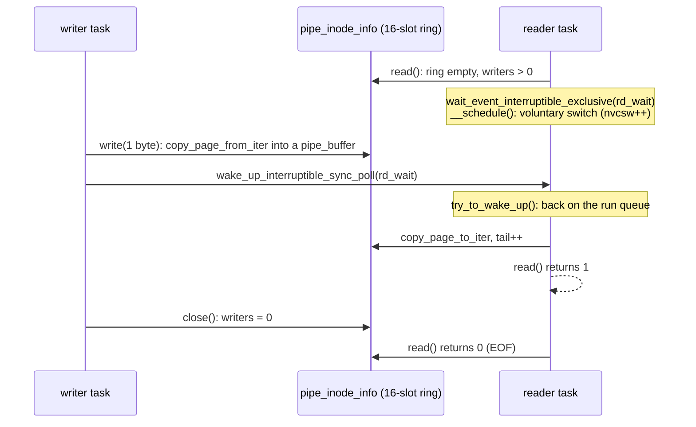

<div dir="rtl">

# یادداشت ۰۸ — IPC: pipe، حافظهٔ مشترک، سوکت UNIX و صف پیام

> ماژول ۰۲ · نسخهٔ انگلیسی: [`08-ipc-pipes-shm-sockets.en.md`](08-ipc-pipes-shm-sockets.en.md) · فهرست: [`INDEX.fa.md`](INDEX.fa.md)

## ۱. خلاصه

- پردازه‌ها فضای آدرس جدا دارند، پس هر سازوکار IPC یک **شیء کرنلی است که هر دو طرف به آن دسترسی دارند**: بافر pipe، جفت سوکت، نگاشت مشترک یک فایل یا صف پیام.
- سازوکارهای کپی‌کننده (pipe، سوکت، mqueue) برای هر پیام دو کپی انجام می‌دهند و همگام‌سازی را خودشان انجام می‌دهند (read تا رسیدن داده مسدود می‌ماند). حافظهٔ مشترک کپی ندارد اما **هیچ همگام‌سازی‌ای** هم ندارد: futex، semaphore یا یک پروتکل atomic را خودتان اضافه می‌کنید.
- رفتار مسدودکننده همان مسیر خواب و بیدارباش زمان‌بند در یادداشت ۰۴ است: خواندن از pipe خالی یعنی `wait_event_interruptible_exclusive()` ← `schedule()`، و نوشتن یعنی `wake_up_interruptible_sync_poll()`.

## ۲. توضیح مفصل

### شهود

pipe و سوکت مثل شکاف صندوق نامه‌اند: نامه را داخل می‌اندازید، کرنل نگهش می‌دارد و طرف دیگر بیرونش می‌کشد. حافظهٔ مشترک مثل تخته‌وایتبردی در یک اتاق مشترک است: فوری، اما اگر دو نفر همزمان بنویسند خراب می‌شود، مگر توافق کنند ماژیک دست چه کسی باشد.

### pipeها

- `pipe2(fds, flags)` ← `SYSCALL_DEFINE2(pipe2)` (`fs/pipe.c` خط 1056) یک `pipe_inode_info` روی mount داخلی `pipefs` و دو `struct file` می‌سازد: `fds[0]` سر خواندن و `fds[1]` سر نوشتن.
- بافر یک **حلقه از `pipe_buffer`ها** است که هر کدام به یک صفحه اشاره می‌کند. پیش‌فرض `PIPE_DEF_BUFFERS` = ۱۶ (`include/linux/pipe_fs_i.h` خط 5) ← ۶۴ کیلوبایت. `fcntl(F_SETPIPE_SZ)` آن را تا `/proc/sys/fs/pipe-max-size` (پیش‌فرض ۱ مگابایت) تغییر می‌دهد.
- `write()` کمتر یا مساوی `PIPE_BUF` (۴۰۹۶ بایت) **اتمی** است: هیچ‌وقت با دادهٔ نویسندهٔ دیگری در هم نمی‌آمیزد.
- خواندن از pipe خالی: اگر `pipe->writers == 0` باشد ۰ (EOF) برمی‌گرداند؛ اگر non-blocking باشد `-EAGAIN`؛ وگرنه روی `rd_wait` می‌خوابد.
- نوشتن روی pipe پر روی `wr_wait` می‌خوابد؛ نوشتن وقتی هیچ خواننده‌ای نمانده **`SIGPIPE`** (و `EPIPE`) می‌دهد.
- `splice()`، `vmsplice()` و `tee()` صفحه‌ها را بدون کپی به داخل یا خارج pipe منتقل می‌کنند (پایهٔ proxyهای zero-copy).
- **FIFO** (`mkfifo`) همان شیء است با نامی در فایل‌سیستم، تا پردازه‌های نامرتبط بتوانند بازش کنند.

### سوکت‌های UNIX domain

`socketpair(AF_UNIX, SOCK_STREAM, 0, sv)` یا `socket` + `bind("/run/x.sock")`. داده هنوز دو بار کپی می‌شود (به داخل یک `sk_buff` و بیرون از آن)، اما:

- `SOCK_STREAM`، `SOCK_DGRAM` (با مرز پیام) و `SOCK_SEQPACKET`؛
- **ارسال fd** با `SCM_RIGHTS` (socket activation در systemd، جداسازی امتیازها) و **اعتبارنامه** با `SO_PEERCRED`؛
- مجوزهای فایل‌سیستم روی مسیر سوکت برای کنترل دسترسی.

### حافظهٔ مشترک

| API | شیء کرنل | فضای نام |
|---|---|---|
| `mmap(MAP_SHARED \| MAP_ANONYMOUS)` قبل از `fork()` | شیء shmem، به ارث می‌رسد | فقط پردازه‌های مرتبط |
| `shm_open("/x")` در POSIX + `ftruncate` + `mmap` | فایلی در tmpfs در مسیر `/dev/shm/x` | نام فایل |
| `shmget(key)` در System V + `shmat` | `newseg()` ← `shmem_kernel_file_setup()` (`ipc/shm.c` خط 766) | کلیدهای عددی، `ipcs -m` |
| `memfd_create()` | فایل shmem بی‌نام که می‌شود از طریق سوکت UNIX فرستاد | fdها |

همهٔ این‌ها در نهایت **همان صفحه‌های فیزیکی‌اند که در دو `mm_struct` نگاشت شده‌اند** (ماژول ۴: نگاشت‌های مشترک و page cache). بعد از راه‌اندازی، خواندن و نوشتن فقط load و store معمولی است: بدون syscall، بدون کپی، بدون کرنل. برای انتظار برای طرف دیگر بدون چرخیدن، یک **futex** در صفحهٔ مشترک بگذارید (ماژول ۳): `FUTEX_WAIT` فقط وقتی می‌خوابد که کلمه هنوز مقدار مورد انتظار را دارد، و `FUTEX_WAKE` منتظرها را بیدار می‌کند.

### صف پیام و سیگنال

- `mq_open()` در POSIX (`ipc/mqueue.c`، mount‌شده در `/dev/mqueue`): مرز پیام، اولویت و `mq_notify`. محدودیت‌ها در `/proc/sys/fs/mqueue/`.
- `msgget()`/`msgsnd()` در System V: قدیمی‌تر و مبتنی بر کلید.
- سیگنال‌ها تقریباً هیچ داده‌ای حمل نمی‌کنند (`sigqueue` یک عدد صحیح اضافه می‌کند)؛ آن‌ها اعلان‌اند، نه کانال داده.

### انتخاب

| نیاز | استفاده کنید |
|---|---|
| جریان داده بین والد و فرزند، به سبک shell | pipe |
| درخواست و پاسخ بین سرویس‌های محلی نامرتبط، ارسال fd | سوکت UNIX |
| دادهٔ حجیم، تأخیر کم، هر دو طرف دست شماست | حافظهٔ مشترک + futex (یا یک حلقهٔ lock-free) |
| پیام‌های کوچک با اولویت | mqueue در POSIX |
| «اتفاقی افتاد» | eventfd، signalfd یا یک سیگنال |

## ۳. نمودار

</div>



<div dir="rtl">

## ۴. مثال عملی

منطق EOF و خواب، `linux/fs/pipe.c · anon_pipe_read() · v6.18.63` (خط‌های 370 تا 389):

</div>

```c
		if (!pipe->writers)
			break;
		if (ret)
			break;
		if ((filp->f_flags & O_NONBLOCK) ||
		    (iocb->ki_flags & IOCB_NOWAIT)) {
			ret = -EAGAIN;
			break;
		}
		mutex_unlock(&pipe->mutex);
		/*
		 * We only get here if we didn't actually read anything.
		 *
		 * But because we didn't read anything, at this point we can
		 * just return directly with -ERESTARTSYS if we're interrupted,
		 * since we've done any required wakeups and there's no need
		 * to mark anything accessed. And we've dropped the lock.
		 */
		if (wait_event_interruptible_exclusive(pipe->rd_wait, pipe_readable(pipe)) < 0)
			return -ERESTARTSYS;
```

<div dir="rtl">

هزینهٔ رفت‌وبرگشت سه سازوکار (تمرین تکمیلی آزمایش ۰۲.۳، `solution/ipc_rtt.c`) وقتی هر دو task روی CPU صفر سنجاق‌اند (`same`) یا روی CPUهای ۰ و ۱ (`split`). خروجی واقعی روی VM، میانهٔ ۵ اجرا برای هر کدام:

</div>

```text
$ for m in pipe unix shm; do ... ./solution/ipc_rtt $m $n $s ... done    (5 runs each; medians below)
mechanism  same (CPU 0, 200 000 rt)   split (CPU 0+1, 20 000 rt)
pipe        4 864 ns                   230 183 ns
unix        6 254 ns                   331 726 ns
shm+futex   3 323 ns                   251 987 ns
raw runs, pipe same:  7393 4864 4521 5301 3618
raw runs, shm split:  187160 232091 251987 266557 324172
```

<div dir="rtl">

روی یک CPU هر سازوکار در هر رفت‌وبرگشت دو context switch هزینه دارد و تفاوت‌ها هزینهٔ syscall و کپی است: shm + futex ارزان‌ترین است، چون هیچ داده‌ای کپی نمی‌شود. روی دو CPU، هزینه را بیدار کردن یک vCPU بیکار (یا مشغول) تعیین می‌کند، نه سازوکار IPC.

## ۵. حالت‌های خاص و دام‌ها

- **سر نوشتن فراموش‌شده.** تا وقتی *هر* پردازه‌ای (اغلب خود خواننده، یا خواهر و برادری که fd را به ارث برده) یک سر نوشتن را نگه دارد، خواننده هیچ‌وقت EOF نمی‌بیند. بلافاصله بعد از `fork()` سرهای بی‌استفاده را ببندید؛ از `O_CLOEXEC` استفاده کنید.
- **`SIGPIPE` سرورها را می‌کشد.** نوشتن روی pipe یا سوکتی که خواننده‌اش رفته، `SIGPIPE` می‌فرستد (عمل پیش‌فرض: پایان دادن). سرورها `SIGPIPE` را `SIG_IGN` می‌کنند یا از `MSG_NOSIGNAL` استفاده می‌کنند و `EPIPE` را مدیریت می‌کنند.
- **نوشتن‌های بزرگ‌تر از `PIPE_BUF`** وقتی چند نویسنده یک pipe را شریک‌اند در هم می‌آمیزند.
- **pipe پر = بن‌بست**: والد مقدار زیادی در stdin فرزند می‌نویسد در حالی که فرزند مقدار زیادی در stdoutش می‌نویسد که والد هنوز نمی‌خواند. هر دو مسدود می‌شوند. از `poll()` یا نخ استفاده کنید.
- **شیءهای System V بیشتر از پردازه‌ها عمر می‌کنند.** segmentهای `shmget` تا `IPC_RMID` یا بوت دوباره می‌مانند (`ipcs -m`، `ipcrm`). shm در POSIX تا `shm_unlink` در `/dev/shm` می‌ماند.
- **حافظهٔ مشترک با اشاره‌گر**: ناحیه ممکن است در هر پردازه در آدرس متفاوتی نگاشت شود. offset ذخیره کنید، نه اشاره‌گر.
- **containerها**: IPC در System V و mqueueهای POSIX برای هر IPC namespace جدا هستند (`CLONE_NEWIPC`، ماژول ۶).

## ۶. نکته‌های کلیدی امتحانی

- pipe = حلقهٔ `pipe_inode_info` با ۱۶ صفحه (۶۴ کیلوبایت) به‌طور پیش‌فرض؛ نوشتن‌های حداکثر `PIPE_BUF` یعنی ۴۰۹۶ بایت اتمی‌اند.
- EOF فقط وقتی `pipe->writers == 0` باشد؛ نوشتن بدون خواننده ← `SIGPIPE`/`EPIPE`.
- read مسدودکننده = `wait_event_interruptible_exclusive()` ← switch داوطلبانه؛ نوشتن با اشارهٔ `_sync_` بیدار می‌کند.
- سوکت UNIX: دو کپی، ارسال fd (`SCM_RIGHTS`) و اعتبارنامهٔ طرف مقابل.
- حافظهٔ مشترک: صفحه‌های shmem که دو بار نگاشت شده‌اند، بدون کپی و بدون همگام‌سازی داخلی (از futex استفاده کنید).
- `shmget` در SysV ← `newseg()` ← `shmem_kernel_file_setup()`.

## ۷. پیوندها

- درس: [§۲.۹ پردازه‌ها چطور با هم حرف می‌زنند؟](../lesson.fa.md)
- مرور کد: [§۷ `anon_pipe_read()`](../kernel-walkthrough.fa.md)، [§۸ `newseg()`](../kernel-walkthrough.fa.md)
- آزمایش‌ها: [۰۲.۱ fork-exec-pipe](../labs/01-fork-exec-pipe/README.md)، [۰۲.۳ ctxsw-pingpong](../labs/03-ctxsw-pingpong/README.md)
- آزمون: Q10 و Q11

</div>
