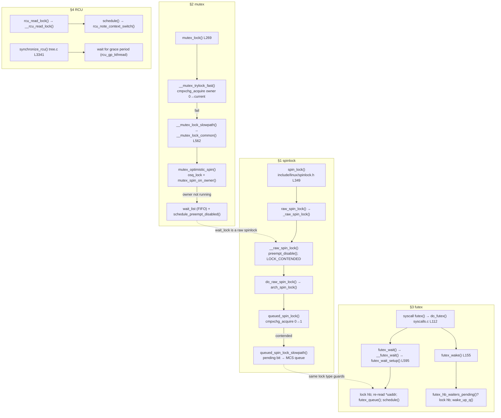

# 03 — Kernel walkthrough: locks, futex, RCU in Linux v6.18.63 (and OpenBSD)

> Every excerpt below was printed with `bash _shared/sources/cite.sh` from the pinned checkouts (Linux **v6.18.63**, OpenBSD **`8cada8c`**) on 2026-11-15. `/* ... */` marks lines cut for length; line numbers are the real ones. Farsi: [`kernel-walkthrough.fa.md`](kernel-walkthrough.fa.md).
> ARCH-SPECIFIC (x86-64) where the code reaches `arch/x86/`.

## 0. The call chains in one picture



---

## 1. Spinlocks: `include/linux/spinlock.h` → qspinlock

**Why it matters.** Every other primitive in this module (mutex `wait_lock`, futex bucket lock, semaphore lock, RCU node locks) is built on a spinlock. Its fast path is the cost floor for kernel synchronization.

### 1.1 The API layer

```c
// linux/include/linux/spinlock.h · spin_lock() · v6.18.63 · L349-352
static __always_inline void spin_lock(spinlock_t *lock)
{
	raw_spin_lock(&lock->rlock);
}
```
[Elixir](https://elixir.bootlin.com/linux/v6.18.63/source/include/linux/spinlock.h#L349)

- L349: `spinlock_t` is a wrapper. On a non-RT kernel it contains a `raw_spinlock_t rlock`.
- L351: all the work is in `raw_spin_lock()` (`#define raw_spin_lock(lock) _raw_spin_lock(lock)`, L217). On `PREEMPT_RT` this file is not used for `spinlock_t`: `include/linux/spinlock_rt.h` maps it onto an `rt_mutex` that can sleep (VERSION-DEPENDENT on config; Module 07).

```c
// linux/include/linux/spinlock_api_smp.h · __raw_spin_lock() · v6.18.63 · L130-144
static inline void __raw_spin_lock(raw_spinlock_t *lock)
{
	preempt_disable();
	spin_acquire(&lock->dep_map, 0, 0, _RET_IP_);
	LOCK_CONTENDED(lock, do_raw_spin_trylock, do_raw_spin_lock);
}
/* ... */
static inline void __raw_spin_unlock(raw_spinlock_t *lock)
{
	spin_release(&lock->dep_map, _RET_IP_);
	do_raw_spin_unlock(lock);
	preempt_enable();
}
```
[Elixir](https://elixir.bootlin.com/linux/v6.18.63/source/include/linux/spinlock_api_smp.h#L130)

| Line | What it does | Why |
|---|---|---|
| 132 | `preempt_disable()` | if the holder were preempted, every waiter would spin for a whole time slice |
| 133 | `spin_acquire()` | lockdep hook; compiles to nothing without `CONFIG_DEBUG_LOCK_ALLOC` |
| 134 | `LOCK_CONTENDED(lock, try, lock)` | with `CONFIG_LOCK_STAT` tries first and records contention; otherwise it is just `do_raw_spin_lock(lock)` (`include/linux/lockdep.h` L441/L467) |
| 141–143 | release in reverse order | the preemption window reopens only after the lock is free |

`do_raw_spin_lock()` calls `arch_spin_lock()` (`spinlock.h` L184–189), and `include/asm-generic/qspinlock.h` L147 defines `arch_spin_lock(l)` as `queued_spin_lock(l)`; x86 selects `ARCH_USE_QUEUED_SPINLOCKS` (`arch/x86/Kconfig` L140).

### 1.2 The qspinlock fast path and unlock

```c
// linux/include/asm-generic/qspinlock.h · queued_spin_lock() · v6.18.63 · L107-128
static __always_inline void queued_spin_lock(struct qspinlock *lock)
{
	int val = 0;

	if (likely(atomic_try_cmpxchg_acquire(&lock->val, &val, _Q_LOCKED_VAL)))
		return;

	queued_spin_lock_slowpath(lock, val);
}
/* ... */
static __always_inline void queued_spin_unlock(struct qspinlock *lock)
{
	/*
	 * unlock() needs release semantics:
	 */
	smp_store_release(&lock->locked, 0);
}
```
[Elixir](https://elixir.bootlin.com/linux/v6.18.63/source/include/asm-generic/qspinlock.h#L107)

- L111: one `lock cmpxchg` on x86: if the whole 32-bit word is 0 (unlocked, no pending, no queue), set the locked byte. **Acquire** ordering: nothing in the critical section can move above this.
- L114: on failure, `val` holds the value that was seen; the slow path uses it to decide between "pending" and "queue".
- L128: unlock is a plain byte store with **release** ordering. On x86-TSO a store is already ordered after earlier loads/stores, so `smp_store_release` is a compiler barrier plus `mov` (`arch/x86/include/asm/barrier.h` L59). No `lock` prefix is needed to unlock.

### 1.3 The 32-bit word and the slow path

```c
// linux/include/asm-generic/qspinlock_types.h · v6.18.63 · L51-65
 * Bitfields in the atomic value:
 *
 * When NR_CPUS < 16K
 *  0- 7: locked byte
 *     8: pending
 *  9-15: not used
 * 16-17: tail index
 * 18-31: tail cpu (+1)
```

| Bits | Field | Meaning |
|---|---|---|
| 0–7 | `locked` | owner present (a whole byte so unlock is a plain byte store) |
| 8 | `pending` | the first waiter spins on the lock word itself, no queue node yet |
| 16–17 | tail index | which of the CPU's 4 per-context MCS nodes (task, softirq, hardirq, NMI) |
| 18–31 | tail CPU + 1 | last CPU in the MCS queue (0 = no queue) |

```c
// linux/kernel/locking/qspinlock.c · queued_spin_lock_slowpath() · v6.18.63 · L277-301 (cut)
	old = xchg_tail(lock, tail);
	next = NULL;

	/*
	 * if there was a previous node; link it and wait until reaching the
	 * head of the waitqueue.
	 */
	if (old & _Q_TAIL_MASK) {
		prev = decode_tail(old, qnodes);

		/* Link @node into the waitqueue. */
		WRITE_ONCE(prev->next, node);

		pv_wait_node(node, prev);
		arch_mcs_spin_lock_contended(&node->locked);
		/* ... prefetchw(next) ... */
	}
```
[Elixir](https://elixir.bootlin.com/linux/v6.18.63/source/kernel/locking/qspinlock.c#L277)

- L277: atomically make *this CPU* the queue tail; `old` tells who was tail before.
- L284–288: link behind the previous waiter.
- L291: **spin on our own `node->locked`**, a per-CPU cache line. This is the MCS idea: N waiters spin on N different lines, so the lock word's cache line no longer bounces between all of them. Only the queue head spins on the lock word itself (L304–326).
- L138–142 (earlier in the same function): `pv_enabled()` / `virt_spin_lock()`: in a VM without paravirt spinlocks the kernel may fall back to plain test-and-set, because a fair queue suffers when the *hypervisor* preempts the vCPU that holds the lock (`arch/x86/include/asm/qspinlock.h` L88). Relevant to our VirtualBox guest; on aos-lab `dmesg` shows `kvm-guest: PV spinlocks enabled` and `PV qspinlock hash table entries: 256` (verified 2026-11-15), so the kernel uses the paravirt build of this function, `__pv_queued_spin_lock_slowpath` (compiled with `pv_enabled()` defined `true`, `qspinlock.c` L389–398), which skips the pending-bit spin and goes straight to `pv_queue`.

The full state machine, as the source draws it (`qspinlock.c` L114–128, triple = tail, pending, locked):

```text
 *              fast     :    slow                                  :    unlock
 * uncontended  (0,0,0) -:--> (0,0,1) ------------------------------:--> (*,*,0)
 * pending               :    (0,1,1) +--> (0,1,0)   \           |  :
 * uncontended           :    (n,x,y) +--> (n,0,0) --'           |  :
 *   queue               :       | ^--'                          |  :
 * contended             :    (*,x,y) +--> (*,0,0) ---> (*,0,1) -'  :
```

---

## 2. Mutex: `kernel/locking/mutex.c` (`mutex_lock()` L269)

**Why it matters.** The default sleeping lock in the kernel. It shows the "spin, then sleep" compromise and how a lock word can carry an owner pointer plus flags.

```c
// linux/kernel/locking/mutex.c · mutex_lock() · v6.18.63 · L269-276
void __sched mutex_lock(struct mutex *lock)
{
	might_sleep();

	if (!__mutex_trylock_fast(lock))
		__mutex_lock_slowpath(lock);
}
EXPORT_SYMBOL(mutex_lock);
```
[Elixir](https://elixir.bootlin.com/linux/v6.18.63/source/kernel/locking/mutex.c#L269)

- L269 `__sched`: the function is placed in `.sched.text`, so stack traces and `wchan` skip it and show the caller.
- L271 `might_sleep()`: with `CONFIG_DEBUG_ATOMIC_SLEEP`, warns if called with preemption or IRQs off (e.g. while holding a spinlock).
- L273–274: try the fast path; otherwise the slow path. This whole definition is under `#ifndef CONFIG_DEBUG_LOCK_ALLOC` (the `#endif` at L277): a lockdep kernel always takes the instrumented path.

```c
// linux/kernel/locking/mutex.c · __mutex_trylock_fast() · v6.18.63 · L150-168
static __always_inline bool __mutex_trylock_fast(struct mutex *lock)
{
	unsigned long curr = (unsigned long)current;
	unsigned long zero = 0UL;

	MUTEX_WARN_ON(lock->magic != lock);

	if (atomic_long_try_cmpxchg_acquire(&lock->owner, &zero, curr))
		return true;

	return false;
}

static __always_inline bool __mutex_unlock_fast(struct mutex *lock)
{
	unsigned long curr = (unsigned long)current;

	return atomic_long_try_cmpxchg_release(&lock->owner, &curr, 0UL);
}
```
[Elixir](https://elixir.bootlin.com/linux/v6.18.63/source/kernel/locking/mutex.c#L150)

- L152: the owner word stores the `task_struct *` of the holder. `task_struct` is at least 8-byte aligned, so the low 3 bits are free for flags: `MUTEX_FLAG_WAITERS 0x01`, `MUTEX_FLAG_HANDOFF 0x02`, `MUTEX_FLAG_PICKUP 0x04` (`kernel/locking/mutex.h` L32–36).
- L157: unlocked means owner == 0 exactly. Same pattern as `queued_spin_lock()`: one acquire CAS.
- L167: unlock fast path succeeds only if the word is *exactly* `current`, i.e. no flag set. If `MUTEX_FLAG_WAITERS` is set, the CAS fails and `__mutex_unlock_slowpath()` wakes a waiter. Same idea as the futex mutex in lab 04 (state 1 vs 2).

```c
// linux/kernel/locking/mutex.c · __mutex_lock_common() · v6.18.63 · L597-632 (cut)
	preempt_disable();
	mutex_acquire_nest(&lock->dep_map, subclass, 0, nest_lock, ip);

	trace_contention_begin(lock, LCB_F_MUTEX | LCB_F_SPIN);
	if (__mutex_trylock(lock) ||
	    mutex_optimistic_spin(lock, ww_ctx, NULL)) {
		/* got the lock, yay! */
		lock_acquired(&lock->dep_map, ip);
		/* ... */
		preempt_enable();
		return 0;
	}

	raw_spin_lock_irqsave(&lock->wait_lock, flags);
	/*
	 * After waiting to acquire the wait_lock, try again.
	 */
	if (__mutex_trylock(lock)) {
		/* ... */
		goto skip_wait;
	}
	/* ... */
		/* add waiting tasks to the end of the waitqueue (FIFO): */
		__mutex_add_waiter(lock, &waiter, &lock->wait_list);
```
[Elixir](https://elixir.bootlin.com/linux/v6.18.63/source/kernel/locking/mutex.c#L597)

- L597: preemption off while spinning, for the same reason as a spinlock.
- L598: lockdep records "this lock acquired while holding those" (§5).
- L600: the `lock:contention_begin` tracepoint; `perf lock contention` uses it.
- L601–602: try again, then **optimistic spin**: if the owner is running on another CPU it will probably release soon, and spinning is cheaper than two context switches.
- L612: the waiter list is protected by `wait_lock`, a *raw spinlock*: the sleeping lock is built on a spinning one.
- L632: FIFO queue; combined with `MUTEX_FLAG_HANDOFF` (the first waiter asks the unlocker to hand the lock over directly) this bounds starvation by spinners.

```c
// linux/kernel/locking/mutex.c · mutex_spin_on_owner() · v6.18.63 · L340-364
bool mutex_spin_on_owner(struct mutex *lock, struct task_struct *owner,
			 struct ww_acquire_ctx *ww_ctx, struct mutex_waiter *waiter)
{
	bool ret = true;

	lockdep_assert_preemption_disabled();

	while (__mutex_owner(lock) == owner) {
		/* ... comment on task_struct lifetime during the spin ... */
		barrier();

		/*
		 * Use vcpu_is_preempted to detect lock holder preemption issue.
		 */
		if (!owner_on_cpu(owner) || need_resched()) {
			ret = false;
			break;
		}
```
[Elixir](https://elixir.bootlin.com/linux/v6.18.63/source/kernel/locking/mutex.c#L340)

- L347: spin only while the *same* owner holds it. A new owner means progress happened; re-evaluate.
- L361 `!owner_on_cpu(owner)`: the owner went to sleep (or its vCPU was preempted by the hypervisor, via `vcpu_is_preempted`), so it won't release soon: stop spinning and sleep.
- L361 `need_resched()`: someone else needs this CPU; don't steal it by spinning.
- `mutex_optimistic_spin()` (L429) first takes `osq_lock(&lock->osq)`, an MCS queue, so only **one** spinner at a time watches the owner field (L443–449 "avoid a stampede of mutex spinners").

The rule in the comment at L523–525 is worth memorising: *"The caller must ensure that the mutex stays alive until this function has returned - mutex_unlock() can NOT directly be used to release an object such that another concurrent task can free it."* The unlocker may still touch `lock->wait_lock` after another task already acquired the mutex.

---

## 3. Futex: `kernel/futex/syscalls.c`, `waitwake.c`, `core.c`

**Why it matters.** Every `pthread_mutex_lock`, `pthread_cond_wait`, `sem_wait` and Go/Rust runtime park on Linux ends here when there is contention.

```c
// linux/kernel/futex/syscalls.c · do_futex() · v6.18.63 · L112-135 (cut)
long do_futex(u32 __user *uaddr, int op, u32 val, ktime_t *timeout,
		u32 __user *uaddr2, u32 val2, u32 val3)
{
	unsigned int flags = futex_to_flags(op);
	int cmd = op & FUTEX_CMD_MASK;
	/* ... FLAGS_CLOCKRT check ... */
	switch (cmd) {
	case FUTEX_WAIT:
		val3 = FUTEX_BITSET_MATCH_ANY;
		fallthrough;
	case FUTEX_WAIT_BITSET:
		return futex_wait(uaddr, flags, val, timeout, val3);
	case FUTEX_WAKE:
		val3 = FUTEX_BITSET_MATCH_ANY;
		fallthrough;
	case FUTEX_WAKE_BITSET:
		return futex_wake(uaddr, flags, val, val3);
```
[Elixir](https://elixir.bootlin.com/linux/v6.18.63/source/kernel/futex/syscalls.c#L112)

- L115: `FUTEX_PRIVATE_FLAG` (128) becomes "not `FLAGS_SHARED`": the key is (mm, address) instead of (inode/page, offset), which is cheaper.
- L116: strip the flags to get the command; `strace` prints it as `FUTEX_WAIT_PRIVATE`.
- L126–135: plain WAIT/WAKE are the bitset variants with "match any".

The heart of the protocol is the order inside `futex_wait_setup()`:

```c
// linux/kernel/futex/waitwake.c · futex_wait_setup() · v6.18.63 · L620-665 (cut)
retry:
	ret = get_futex_key(uaddr, flags, &q->key, FUTEX_READ);
	/* ... */
retry_private:
	if (1) {
		CLASS(hbr, hbr)(&q->key);
		auto hb = hbr.hb;

		futex_q_lock(q, hb);

		ret = futex_get_value_locked(&uval, uaddr);
		/* ... fault handling: unlock, get_user(), retry ... */
		if (uval != val) {
			futex_q_unlock(hb);
			return -EWOULDBLOCK;
		}
		/* ... */
		if (task == current)
			set_current_state(TASK_INTERRUPTIBLE|TASK_FREEZABLE);
		futex_queue(q, hb, task);
	}
```
[Elixir](https://elixir.bootlin.com/linux/v6.18.63/source/kernel/futex/waitwake.c#L620)

- L621: the key identifies the futex: for a private futex, `(current->mm, uaddr)`.
- L627: `CLASS(hbr, ...)`: scope-based reference to the hash bucket (new cleanup.h style, VERSION-DEPENDENT). In v6.16+ a process can have its **own private futex hash** (`futex_private_hash`, `PR_FUTEX_HASH` prctl, `core.c` `__futex_hash()` L373); otherwise the global hash is used.
- L630: `futex_q_lock()` increments the bucket's `waiters` count (with a full barrier) and takes `hb->lock`.
- L632: read the user word **with the bucket lock held**. If we read it first and locked later, a waker could change the value and find an empty bucket in between: a lost wake-up. The comment at L602–618 states the guarantee: *"it blocks ONLY if cond(var) is known to be true at the time of blocking"*.
- L647–649: value changed → `-EWOULDBLOCK` (`EAGAIN` in user space). The caller just retries its CAS. This is what lets lab 04's lock loop be correct.
- L664–665: set the task state *before* queueing, so a wake that comes right after `futex_queue()` (which drops `hb->lock`) is not lost.

The waker side:

```c
// linux/kernel/futex/waitwake.c · futex_wake() · v6.18.63 · L172-199 (cut)
	CLASS(hbr, hbr)(&key);
	auto hb = hbr.hb;

	/* Make sure we really have tasks to wakeup */
	if (!futex_hb_waiters_pending(hb))
		return ret;

	spin_lock(&hb->lock);

	plist_for_each_entry_safe(this, next, &hb->chain, list) {
		if (futex_match (&this->key, &key)) {
			/* ... PI check, bitset check ... */
			this->wake(&wake_q, this);
			if (++ret >= nr_wake)
				break;
		}
	}

	spin_unlock(&hb->lock);
	wake_up_q(&wake_q);
	return ret;
```
[Elixir](https://elixir.bootlin.com/linux/v6.18.63/source/kernel/futex/waitwake.c#L172)

- L176: fast exit without touching `hb->lock` if nobody waits. Safe only because of the barrier pairing described in the file's top comment (L58–96): the waiter does `waiters++; smp_mb(); read *futex`, the waker does `*futex = new; smp_mb(); read waiters`. That is exactly the **store-buffering** pattern of lab 05, and the comment concludes *"x==0 && y==0 is impossible"* — the outcome lab 05 *does* observe without the fence.
- L181: buckets are shared by unrelated futexes that hash together, so each entry's key is compared.
- L192–199: collect tasks in a `wake_q` under the lock, wake them after dropping it, so woken tasks don't immediately contend on `hb->lock`.

```c
// linux/kernel/futex/futex.h · struct futex_hash_bucket · v6.18.63 · L143-147
struct futex_hash_bucket {
	atomic_t waiters;
	spinlock_t lock;
	struct plist_head chain;
} ____cacheline_aligned_in_smp;
```

`plist` = priority-sorted list, so higher-priority (RT) waiters are woken first. `____cacheline_aligned_in_smp` keeps two buckets from sharing a cache line (false sharing, lab 01 extension).

---

## 4. RCU: `include/linux/rcupdate.h`, `kernel/rcu/tree.c`

**Why it matters.** RCU is how the kernel reads route tables, the dentry cache path walk (Module 05), the task list and many others without any lock on the read side.

```c
// linux/include/linux/rcupdate.h · rcu_read_lock() · v6.18.63 · L863-880
static __always_inline void rcu_read_lock(void)
{
	__rcu_read_lock();
	__acquire(RCU);
	rcu_lock_acquire(&rcu_lock_map);
	RCU_LOCKDEP_WARN(!rcu_is_watching(),
			 "rcu_read_lock() used illegally while idle");
}

/*
 * So where is rcu_write_lock()?  It does not exist, as there is no
 * way for writers to lock out RCU readers.  This is a feature, not
 * a bug -- this property is what provides RCU's performance benefits.
 * Of course, writers must coordinate with each other.  The normal
 * spinlock primitives work well for this, but any other technique may be
 * used as well.  RCU does not care how the writers keep out of each
 * others' way, as long as they do so.
 */
```
[Elixir](https://elixir.bootlin.com/linux/v6.18.63/source/include/linux/rcupdate.h#L863)

- L865: with `CONFIG_PREEMPT_RCU` (preemptible kernels) this increments `current->rcu_read_lock_nesting` (`kernel/rcu/tree_plugin.h` L412, `rcu_preempt_read_enter()`); without it, it is just `preempt_disable()`. Either way: **no atomic instruction, no shared write**.
- L866: `__acquire(RCU)` is for the `sparse` checker only.
- L867: lockdep tracks RCU read sections like a lock (so it can warn on `synchronize_rcu()` inside one).
- L872–879: writers exclude each other with ordinary locks; nothing excludes readers.

```c
// linux/include/linux/rcupdate.h · rcu_assign_pointer() · v6.18.63 · L588-597
#define rcu_assign_pointer(p, v)					      \
do {									      \
	uintptr_t _r_a_p__v = (uintptr_t)(v);				      \
	rcu_check_sparse(p, __rcu);					      \
									      \
	if (__builtin_constant_p(v) && (_r_a_p__v) == (uintptr_t)NULL)	      \
		WRITE_ONCE((p), (typeof(p))(_r_a_p__v));		      \
	else								      \
		smp_store_release(&p, RCU_INITIALIZER((typeof(p))_r_a_p__v)); \
} while (0)
```
[Elixir](https://elixir.bootlin.com/linux/v6.18.63/source/include/linux/rcupdate.h#L588)

- L596: **publish = release store**: all initialisation of the new object becomes visible before the pointer does. The reader's `rcu_dereference()` relies on address dependency ordering (free on x86 and Arm64).
- L593–594: storing NULL publishes no data, so a plain `WRITE_ONCE` is enough.

```c
// linux/kernel/rcu/tree.c · synchronize_rcu() · v6.18.63 · L3341-3356
void synchronize_rcu(void)
{
	unsigned long flags;
	struct rcu_node *rnp;

	RCU_LOCKDEP_WARN(lock_is_held(&rcu_bh_lock_map) ||
			 lock_is_held(&rcu_lock_map) ||
			 lock_is_held(&rcu_sched_lock_map),
			 "Illegal synchronize_rcu() in RCU read-side critical section");
	if (!rcu_blocking_is_gp()) {
		if (rcu_gp_is_expedited())
			synchronize_rcu_expedited();
		else
			synchronize_rcu_normal();
		return;
	}
```
[Elixir](https://elixir.bootlin.com/linux/v6.18.63/source/kernel/rcu/tree.c#L3341)

- L3346–3349: waiting for a grace period from inside a reader would wait for yourself: a self-deadlock, caught by lockdep.
- L3350: `rcu_blocking_is_gp()` is true only on a single-CPU, non-preemptible system early in boot, where any blocking call is itself a grace period (L3358–3376 handle that case).
- L3351–3354: expedited (IPIs to all CPUs, fast but disruptive) or normal (wait for `rcu_gp_kthread` to see every CPU pass a quiescent state). `call_rcu()` (L3241) is the asynchronous version: queue a callback and return immediately.

How does a *preempted* reader keep the grace period open? The scheduler tells RCU:

```c
// linux/kernel/rcu/tree_plugin.h · rcu_note_context_switch() · v6.18.63 · L324-340
void rcu_note_context_switch(bool preempt)
{
	struct task_struct *t = current;
	struct rcu_data *rdp = this_cpu_ptr(&rcu_data);
	struct rcu_node *rnp;

	trace_rcu_utilization(TPS("Start context switch"));
	lockdep_assert_irqs_disabled();
	WARN_ONCE(!preempt && rcu_preempt_depth() > 0, "Voluntary context switch within RCU read-side critical section!");
	if (rcu_preempt_depth() > 0 &&
	    !t->rcu_read_unlock_special.b.blocked) {

		/* Possibly blocking in an RCU read-side critical section. */
		rnp = rdp->mynode;
		raw_spin_lock_rcu_node(rnp);
		t->rcu_read_unlock_special.b.blocked = true;
		t->rcu_blocked_node = rnp;
```
[Elixir](https://elixir.bootlin.com/linux/v6.18.63/source/kernel/rcu/tree_plugin.h#L324)

- L332: *sleeping* inside an RCU reader is a bug; being *preempted* is allowed in preemptible RCU.
- L333–340: a preempted reader is recorded on its `rcu_node`'s `blkd_tasks` list, so the grace period waits for it even though its CPU has moved on. Its outermost `rcu_read_unlock()` removes it.

---

## 5. Preview for Module 07 and lockdep: `rtmutex.c`, `lockdep.c`

```c
// linux/kernel/locking/rtmutex.c · __rt_mutex_lock() · v6.18.63 · L1813-1822
static __always_inline int __rt_mutex_lock(struct rt_mutex_base *lock,
					   unsigned int state)
{
	lockdep_assert(!current->pi_blocked_on);

	if (likely(rt_mutex_try_acquire(lock)))
		return 0;

	return rt_mutex_slowlock(lock, NULL, state);
}
```
[Elixir](https://elixir.bootlin.com/linux/v6.18.63/source/kernel/locking/rtmutex.c#L1813)

Same shape as `mutex_lock()`: one CAS (`rt_mutex_cmpxchg_acquire(lock, NULL, current)`, L226), then a slow path. The difference is in the slow path: `rt_mutex_adjust_prio_chain()` (L678) walks *waiter → lock → owner → lock that owner waits for → …* and boosts each owner to the top waiter's priority (**priority inheritance**). Its comment (L648–671) lists the 13 steps; the walk is bounded and also detects deadlocks (a chain that returns to the start). Module 07 uses this against priority inversion.

```c
// linux/kernel/locking/lockdep.c · check_noncircular() · v6.18.63 · L2169-2190
/*
 * Prove that the dependency graph starting at <src> can not
 * lead to <target>. If it can, there is a circle when adding
 * <target> -> <src> dependency.
 *
 * Print an error and return BFS_RMATCH if it does.
 */
static noinline enum bfs_result
check_noncircular(struct held_lock *src, struct held_lock *target,
		  struct lock_trace **const trace)
{
	enum bfs_result ret;
	struct lock_list *target_entry;
	struct lock_list src_entry;

	bfs_init_root(&src_entry, src);

	debug_atomic_inc(nr_cyclic_checks);

	ret = check_path(target, &src_entry, hlock_conflict, NULL, &target_entry);
```
[Elixir](https://elixir.bootlin.com/linux/v6.18.63/source/kernel/locking/lockdep.c#L2169)

- Lockdep works on lock **classes** (one per lock initialisation site), not instances, so one AB-BA ordering anywhere in the kernel is enough to warn.
- L2188: breadth-first search in the dependency graph; a match means adding the new edge would close a cycle. The report starts with `WARNING: possible circular locking dependency detected` (`pr_warn` at L1990). Lab 06's `lockdep/` module triggers it on a lockdep kernel.

---

## 6. OpenBSD comparison

### 6.1 Spinning mutex: `mtx_enter()` vs `queued_spin_lock()`

```c
// openbsd/sys/kern/kern_lock.c · mtx_enter() · 8cada8c · L406-435 (cut)
	if (mtx->mtx_wantipl != IPL_NONE)
		s = splraise(mtx->mtx_wantipl);

	owner = mtx_cas(mtx, 0, self);
	if (owner == 0) {
		/* we got the lock first go. this is the fast path */
		goto locked;
	}
	/* ... DIAGNOSTIC: panic("mtx %p: locking against myself") ... */
	/* we're going to have to spin for it now */
	spc->spc_spinning++;

	for (spins = 0; spins < 40; spins++) {
		if (ISSET(owner, 1)) {
			/* don't spin if cpus are already parked */
			break;
		}
		CPU_BUSY_CYCLE();
		owner = mtx->mtx_owner;
		if (owner == 0) {
			owner = mtx_cas(mtx, 0, self);
			if (owner == 0)
				goto spinlocked;
		}
	}
```
[GitHub](https://github.com/openbsd/src/blob/8cada8c/sys/kern/kern_lock.c#L406)

- L406–407: an OpenBSD `struct mutex` is declared with the interrupt level it protects against and raises the IPL itself: the equivalent of Linux's `spin_lock_irqsave()` chosen at init time.
- L409: owner = `curcpu()` (a `struct cpu_info *`), not a thread: it is a spinning lock.
- L423: bounded spin (40), then "park" (L438): waiters queue in a parking lot and each spins on its own `w.wait` flag (L454) — the same local-spinning idea as MCS.

### 6.2 Sleeping lock: `rw_do_enter_write()` vs `__mutex_lock_common()`

```c
// openbsd/sys/kern/kern_rwlock.c · rw_do_enter_write() · 8cada8c · L237-298 (cut)
	owner = rw_cas(&rwl->rwl_owner, 0, self);
	if (owner == 0) {
		/* wow, we won. so easy */
		goto locked;
	}
	if (__predict_false(owner == self)) {
		panic("%s rwlock %p: enter write deadlock",
		    rwl->rwl_name, rwl);
	}
	/* ... if (!_kernel_lock_held()) ... */
		for (spins = 0; spins < RW_SPINS; spins++) {
			CPU_BUSY_CYCLE();
			owner = atomic_load_long(&rwl->rwl_owner);
			if (owner != 0)
				continue;
			owner = rw_cas(&rwl->rwl_owner, 0, self);
			if (owner == 0)
				goto locked;
		}
	/* ... */
	rw_inc(&rwl->rwl_waiters);
	membar_producer();
	do {
		sleep_setup(&rwl->rwl_waiters, prio, rwl->rwl_name);
		membar_consumer();
		owner = atomic_load_long(&rwl->rwl_owner);
		error = sleep_finish(RW_SLEEP_TMO, owner != 0);
```
[GitHub](https://github.com/openbsd/src/blob/8cada8c/sys/kern/kern_rwlock.c#L237)

- L237: same one-CAS fast path as `__mutex_trylock_fast()`.
- L243–246: recursive write lock → immediate **panic**. Linux silently deadlocks there (lockdep reports *possible recursive locking*, `lockdep.c` L3050).
- L254, L264: no spinning while holding the big `KERNEL_LOCK`; then a **fixed** number of spins, whether or not the owner is running. Linux spins exactly as long as the owner is on a CPU.
- L292–298: announce the waiter, then `sleep_setup()`/`sleep_finish(..., owner != 0)`: re-check the condition after registering on the sleep channel — the same lost-wake-up rule as futex.

### 6.3 Futex: register-then-check vs lock-check-register

```c
// openbsd/sys/kern/sys_futex.c · futex_wait() · 8cada8c · L278-306 (cut)
	futex_addrs(p, &f, uaddr, flags);
	fsq = futex_get_slpque(&f);

	/* Mark futex as waiting. */
	f.ft_fsq = fsq;
	f.ft_proc = p;
	rw_enter_write(&fsq->fsq_lock);
	/* Make the waiting futex visible to wake/requeue */
	TAILQ_INSERT_TAIL(&fsq->fsq_list, &f, ft_entry);
	rw_exit_write(&fsq->fsq_lock);

	/*
	 * Do not return before f has been removed from the slpque!
	 */

	/*
	 * Read user space futex value
	 */
	if ((error = copyin32(uaddr, &cval)) != 0)
		goto exit;

	/* If the value changed, stop here. */
	if (cval != val) {
		error = EAGAIN;
		goto exit;
	}

	sleep_setup(&f, PWAIT|PCATCH, "fsleep");
	error = sleep_finish(nsecs, f.ft_proc != NULL);
```
[GitHub](https://github.com/openbsd/src/blob/8cada8c/sys/kern/sys_futex.c#L278)

- L284–287: OpenBSD **first** makes the waiter visible (under an *rwlock*, which may sleep) and only **then** reads the user word (L296). A waker that changes the word after L287 will find the waiter and clear `f.ft_proc`, so `sleep_finish(..., f.ft_proc != NULL)` won't sleep.
- Linux reads the word *while holding* the bucket spinlock and queues before unlocking. Both close the same window; Linux's order lets it avoid queueing when the value already changed, OpenBSD's lets the bucket lock be a sleeping lock.
- OpenBSD implements only `FUTEX_WAIT`, `FUTEX_WAKE`, `FUTEX_REQUEUE` (`sys_futex()` L136); no PI futexes, no bitsets.

### 6.4 RCU vs SMR: how a grace period is detected

```c
// openbsd/sys/kern/kern_smr.c · smr_grace_wait() · 8cada8c · L145-168
void
smr_grace_wait(void)
{
#ifdef MULTIPROCESSOR
	CPU_INFO_ITERATOR cii;
	struct cpu_info *ci;
	unsigned char smrgp;

	smrgp = READ_ONCE(smr_grace_period) + 1;
	WRITE_ONCE(smr_grace_period, smrgp);

	curcpu()->ci_schedstate.spc_smrgp = smrgp;

	CPU_INFO_FOREACH(cii, ci) {
		if (!CPU_IS_RUNNING(ci))
			continue;
		if (READ_ONCE(ci->ci_schedstate.spc_smrgp) == smrgp)
			continue;
		sched_peg_curproc(ci);
		KASSERT(ci->ci_schedstate.spc_smrgp == smrgp);
	}
	sched_unpeg_curproc();
#endif /* MULTIPROCESSOR */
}
```
[GitHub](https://github.com/openbsd/src/blob/8cada8c/sys/kern/kern_smr.c#L145)

- L153–156: start a new grace-period number.
- L158–165: for every running CPU that hasn't noted the new number yet, **move this thread onto that CPU** (`sched_peg_curproc`). Getting to run there proves that CPU context-switched, i.e. left any SMR read section (SMR readers may not sleep). This is the textbook "toy RCU" grace period, done for real.
- `smr_read_enter()` (L178) does nothing except a depth counter under `DIAGNOSTIC`. Linux's non-preemptible RCU reader is similarly almost free; Linux's *preemptible* RCU reader adds a nesting counter and the `blkd_tasks` machinery (§4).
- `smr_thread()` (L82) batches deferred callbacks and runs `smr_grace_wait()` once per batch, like `call_rcu()` + `rcu_gp_kthread`.

### 6.5 Trade-off table

| Design choice | Linux v6.18.63 | OpenBSD 8cada8c | Trade-off |
|---|---|---|---|
| Spinning lock | `spinlock_t` → qspinlock: 4-byte word, pending bit, per-CPU MCS nodes | `struct mutex`: owner = CPU, 40 spins then parking lot | qspinlock is fair and scales to hundreds of CPUs in 4 bytes; OpenBSD's is simpler and folds IPL handling into the lock |
| Interrupt protection | caller chooses `spin_lock_irqsave()` per call site | IPL fixed at `mtx_init()` | per-call flexibility vs. impossible-to-forget |
| Sleeping lock spin policy | spin while owner on CPU (`mutex_spin_on_owner`), one spinner via OSQ | fixed `RW_SPINS`, none while holding `KERNEL_LOCK` | adaptive is better under load; fixed is predictable and cheap to reason about |
| Recursive lock | deadlocks; lockdep warns (debug kernels) | `panic()` immediately | Linux keeps production kernels fast; OpenBSD fails loudly and early |
| Lock-order checker | lockdep (`CONFIG_PROVE_LOCKING`), class-based, off in distro kernels | WITNESS (`WITNESS_CHECKORDER`), off in GENERIC | same idea; both cost too much for production |
| Futex bucket lock | spinlock; read word under lock, then queue | rwlock; queue first, then read word | Linux avoids a queue/dequeue when the value changed; OpenBSD may sleep while taking the bucket lock |
| Futex feature set | WAIT/WAKE/REQUEUE/PI/bitset, `futex_waitv`, NUMA and private hashes | WAIT/WAKE/REQUEUE | Linux serves RT and Wine/Proton; OpenBSD keeps the kernel small |
| Read-mostly reclamation | RCU: tree of `rcu_node`s, quiescent states reported per CPU, preemptible readers, expedited GPs | SMR: one thread pegs itself to each CPU in turn, non-sleeping readers | RCU scales to thousands of CPUs with low GP overhead; SMR is ~400 lines and easy to verify |
| Global lock | none (BKL removed in 2.6.39) | `KERNEL_LOCK` (`__mp_lock`, `kern_lock.c` L64) still guards parts of the kernel | fine-grained everywhere vs. incremental unlocking |
