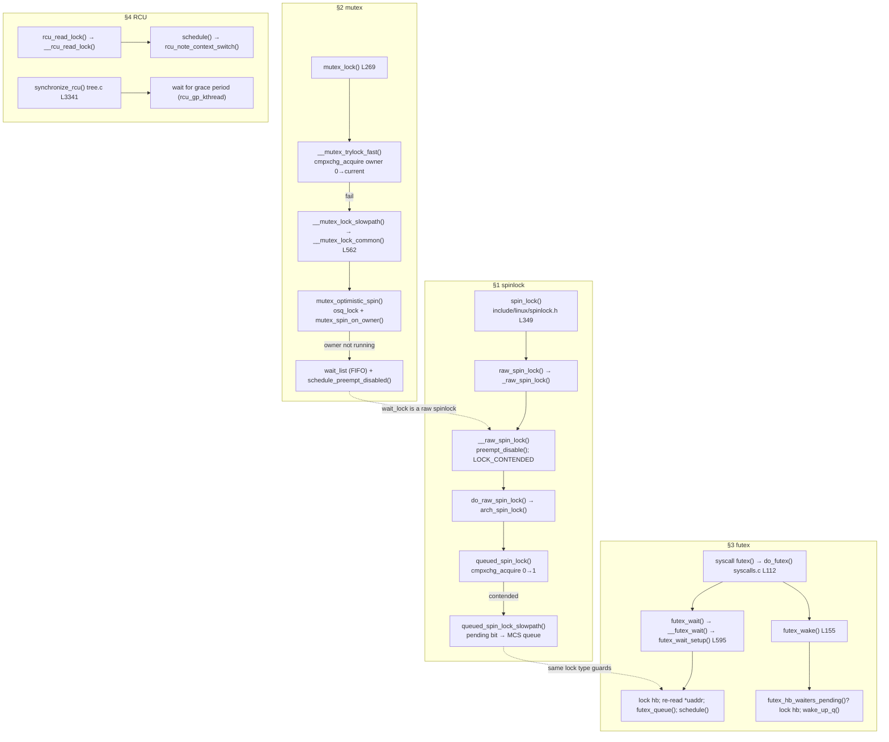

<div dir="rtl">

# ۰۳ — بررسی کد کرنل: قفل‌ها، futex و RCU در Linux v6.18.63 (و OpenBSD)

> همهٔ گزیده‌های زیر در تاریخ 2026-11-15 با `bash _shared/sources/cite.sh` از checkoutهای ثابت (Linux **v6.18.63** و OpenBSD **`8cada8c`**) چاپ شده‌اند. `/* ... */` جای خط‌هایی است که برای کوتاهی حذف شده‌اند؛ شمارهٔ خط‌ها همان شمارهٔ واقعی است. نسخهٔ انگلیسی: [`kernel-walkthrough.en.md`](kernel-walkthrough.en.md).
> هر جا کد به `arch/x86/` می‌رسد، وابسته به معماری (x86-64) است (ARCH-SPECIFIC).

## ۰. زنجیرهٔ فراخوانی‌ها در یک تصویر

</div>



<div dir="rtl">

---

## ۱. Spinlockها: از `include/linux/spinlock.h` تا qspinlock

**چرا مهم است.** همهٔ primitiveهای دیگر این ماژول (`wait_lock` در mutex، قفل bucket در futex، قفل semaphore، قفل‌های گرهٔ RCU) روی یک spinlock ساخته شده‌اند. مسیر سریع آن کف هزینهٔ همگام‌سازی در کرنل است.

### ۱.۱ لایهٔ API

</div>

```c
// linux/include/linux/spinlock.h · spin_lock() · v6.18.63 · L349-352
static __always_inline void spin_lock(spinlock_t *lock)
{
	raw_spin_lock(&lock->rlock);
}
```

<div dir="rtl">

[Elixir](https://elixir.bootlin.com/linux/v6.18.63/source/include/linux/spinlock.h#L349)

- L349: `spinlock_t` فقط یک پوشش (wrapper) است. در کرنل غیر RT درونش یک `raw_spinlock_t rlock` قرار دارد.
- L351: همهٔ کار در `raw_spin_lock()` انجام می‌شود (`#define raw_spin_lock(lock) _raw_spin_lock(lock)`، L217). در `PREEMPT_RT` این فایل برای `spinlock_t` به کار نمی‌رود: `include/linux/spinlock_rt.h` آن را روی یک `rt_mutex` می‌نشاند که می‌تواند بخوابد (VERSION-DEPENDENT، وابسته به پیکربندی؛ ماژول ۰۷).

</div>

```c
// linux/include/linux/spinlock_api_smp.h · __raw_spin_lock() · v6.18.63 · L130-144
static inline void __raw_spin_lock(raw_spinlock_t *lock)
{
	preempt_disable();
	spin_acquire(&lock->dep_map, 0, 0, _RET_IP_);
	LOCK_CONTENDED(lock, do_raw_spin_trylock, do_raw_spin_lock);
}
/* ... */
static inline void __raw_spin_unlock(raw_spinlock_t *lock)
{
	spin_release(&lock->dep_map, _RET_IP_);
	do_raw_spin_unlock(lock);
	preempt_enable();
}
```

<div dir="rtl">

[Elixir](https://elixir.bootlin.com/linux/v6.18.63/source/include/linux/spinlock_api_smp.h#L130)

| خط | چه می‌کند | چرا |
|---|---|---|
| 132 | `preempt_disable()` | اگر نگه‌دارندهٔ قفل preempt می‌شد، همهٔ منتظرها یک time slice کامل spin می‌کردند |
| 133 | `spin_acquire()` | hook مربوط به lockdep؛ بدون `CONFIG_DEBUG_LOCK_ALLOC` به هیچ کامپایل می‌شود |
| 134 | `LOCK_CONTENDED(lock, try, lock)` | با `CONFIG_LOCK_STAT` اول try می‌کند و رقابت را ثبت می‌کند؛ در غیر این صورت فقط `do_raw_spin_lock(lock)` است (`include/linux/lockdep.h` L441/L467) |
| 141–143 | آزادسازی به ترتیب معکوس | پنجرهٔ preemption فقط بعد از آزاد شدن قفل دوباره باز می‌شود |

`do_raw_spin_lock()` تابع `arch_spin_lock()` را صدا می‌زند (`spinlock.h` L184–189)، و `include/asm-generic/qspinlock.h` در L147 `arch_spin_lock(l)` را به‌صورت `queued_spin_lock(l)` تعریف می‌کند؛ x86 گزینهٔ `ARCH_USE_QUEUED_SPINLOCKS` را انتخاب می‌کند (`arch/x86/Kconfig` L140).

### ۱.۲ مسیر سریع qspinlock و unlock

</div>

```c
// linux/include/asm-generic/qspinlock.h · queued_spin_lock() · v6.18.63 · L107-128
static __always_inline void queued_spin_lock(struct qspinlock *lock)
{
	int val = 0;

	if (likely(atomic_try_cmpxchg_acquire(&lock->val, &val, _Q_LOCKED_VAL)))
		return;

	queued_spin_lock_slowpath(lock, val);
}
/* ... */
static __always_inline void queued_spin_unlock(struct qspinlock *lock)
{
	/*
	 * unlock() needs release semantics:
	 */
	smp_store_release(&lock->locked, 0);
}
```

<div dir="rtl">

[Elixir](https://elixir.bootlin.com/linux/v6.18.63/source/include/asm-generic/qspinlock.h#L107)

- L111: روی x86 یک `lock cmpxchg`: اگر کل واژهٔ ۳۲ بیتی 0 باشد (قفل آزاد، بدون pending، بدون صف)، بایت locked را set می‌کند. ترتیب **acquire**: هیچ چیزی از critical section نمی‌تواند به بالای این دستور جابه‌جا شود.
- L114: در صورت شکست، `val` مقداری را نگه می‌دارد که دیده شده؛ مسیر کند از آن برای انتخاب بین «pending» و «صف» استفاده می‌کند.
- L128: unlock یک store سادهٔ یک‌بایتی با ترتیب **release** است. در x86-TSO هر store خودبه‌خود بعد از loadها و storeهای قبلی مرتب است، پس `smp_store_release` فقط یک compiler barrier به‌علاوهٔ `mov` است (`arch/x86/include/asm/barrier.h` L59). برای unlock هیچ پیشوند `lock` لازم نیست.

### ۱.۳ واژهٔ ۳۲ بیتی و مسیر کند

</div>

```c
// linux/include/asm-generic/qspinlock_types.h · v6.18.63 · L51-65
 * Bitfields in the atomic value:
 *
 * When NR_CPUS < 16K
 *  0- 7: locked byte
 *     8: pending
 *  9-15: not used
 * 16-17: tail index
 * 18-31: tail cpu (+1)
```

<div dir="rtl">

| بیت‌ها | فیلد | معنا |
|---|---|---|
| 0–7 | `locked` | مالک وجود دارد (یک بایت کامل، تا unlock یک store سادهٔ یک‌بایتی باشد) |
| 8 | `pending` | اولین منتظر روی خود واژهٔ قفل spin می‌کند و هنوز گرهٔ صف ندارد |
| 16–17 | tail index | کدام‌یک از ۴ گرهٔ MCS هر CPU به ازای هر context (task، softirq، hardirq، NMI) |
| 18–31 | tail CPU + 1 | آخرین CPU در صف MCS (0 = صفی وجود ندارد) |

</div>

```c
// linux/kernel/locking/qspinlock.c · queued_spin_lock_slowpath() · v6.18.63 · L277-301 (cut)
	old = xchg_tail(lock, tail);
	next = NULL;

	/*
	 * if there was a previous node; link it and wait until reaching the
	 * head of the waitqueue.
	 */
	if (old & _Q_TAIL_MASK) {
		prev = decode_tail(old, qnodes);

		/* Link @node into the waitqueue. */
		WRITE_ONCE(prev->next, node);

		pv_wait_node(node, prev);
		arch_mcs_spin_lock_contended(&node->locked);
		/* ... prefetchw(next) ... */
	}
```

<div dir="rtl">

[Elixir](https://elixir.bootlin.com/linux/v6.18.63/source/kernel/locking/qspinlock.c#L277)

- L277: به‌صورت اتمی *همین CPU* را دم (tail) صف می‌کند؛ `old` می‌گوید قبلاً چه کسی tail بوده است.
- L284–288: پشت منتظر قبلی لینک می‌شود.
- L291: **روی `node->locked` خودمان spin می‌کنیم**، که یک cache line مخصوص همان CPU است. ایدهٔ MCS همین است: N منتظر روی N خط متفاوت spin می‌کنند، پس cache line واژهٔ قفل دیگر بین همهٔ آن‌ها پاس‌کاری نمی‌شود. فقط سرِ صف روی خود واژهٔ قفل spin می‌کند (L304–326).
- L138–142 (کمی قبل‌تر در همان تابع): `pv_enabled()` / `virt_spin_lock()`: در یک VM بدون paravirt spinlock، کرنل ممکن است به test-and-set ساده برگردد، چون یک صف منصفانه وقتی *hypervisor* آن vCPUای را که قفل را نگه داشته preempt کند آسیب می‌بیند (`arch/x86/include/asm/qspinlock.h` L88). این برای مهمان VirtualBox ما مهم است؛ روی aos-lab خروجی `dmesg` پیام‌های `kvm-guest: PV spinlocks enabled` و `PV qspinlock hash table entries: 256` را نشان می‌دهد (بررسی‌شده در 2026-11-15)؛ پس کرنل نسخهٔ paravirt همین تابع یعنی `__pv_queued_spin_lock_slowpath` را به کار می‌برد (که با `pv_enabled()` برابر `true` کامپایل شده، `qspinlock.c` خط‌های L389 تا L398) و بی‌درنگ به `pv_queue` می‌رود.

ماشین حالت کامل، همان‌طور که خود سورس رسم کرده است (`qspinlock.c` L114–128، سه‌تایی = tail، pending، locked):

</div>

```text
 *              fast     :    slow                                  :    unlock
 * uncontended  (0,0,0) -:--> (0,0,1) ------------------------------:--> (*,*,0)
 * pending               :    (0,1,1) +--> (0,1,0)   \           |  :
 * uncontended           :    (n,x,y) +--> (n,0,0) --'           |  :
 *   queue               :       | ^--'                          |  :
 * contended             :    (*,x,y) +--> (*,0,0) ---> (*,0,1) -'  :
```

<div dir="rtl">

---

## ۲. Mutex: `kernel/locking/mutex.c` (`mutex_lock()` در L269)

**چرا مهم است.** قفل خوابندهٔ پیش‌فرض کرنل است. مصالحهٔ «اول spin، بعد sleep» را نشان می‌دهد، و این‌که چطور یک واژهٔ قفل می‌تواند هم اشاره‌گر مالک و هم چند flag را حمل کند.

</div>

```c
// linux/kernel/locking/mutex.c · mutex_lock() · v6.18.63 · L269-276
void __sched mutex_lock(struct mutex *lock)
{
	might_sleep();

	if (!__mutex_trylock_fast(lock))
		__mutex_lock_slowpath(lock);
}
EXPORT_SYMBOL(mutex_lock);
```

<div dir="rtl">

[Elixir](https://elixir.bootlin.com/linux/v6.18.63/source/kernel/locking/mutex.c#L269)

- L269 `__sched`: تابع در بخش `.sched.text` قرار می‌گیرد، پس stack traceها و `wchan` از آن رد می‌شوند و فراخواننده را نشان می‌دهند.
- L271 `might_sleep()`: با `CONFIG_DEBUG_ATOMIC_SLEEP`، اگر با preemption یا IRQ خاموش صدا زده شود (مثلاً وقتی یک spinlock در دست است) هشدار می‌دهد.
- L273–274: مسیر سریع را امتحان می‌کند؛ وگرنه مسیر کند. کل این تعریف زیر `#ifndef CONFIG_DEBUG_LOCK_ALLOC` است (`#endif` در L277): کرنل دارای lockdep همیشه مسیر instrument‌شده را می‌رود.

</div>

```c
// linux/kernel/locking/mutex.c · __mutex_trylock_fast() · v6.18.63 · L150-168
static __always_inline bool __mutex_trylock_fast(struct mutex *lock)
{
	unsigned long curr = (unsigned long)current;
	unsigned long zero = 0UL;

	MUTEX_WARN_ON(lock->magic != lock);

	if (atomic_long_try_cmpxchg_acquire(&lock->owner, &zero, curr))
		return true;

	return false;
}

static __always_inline bool __mutex_unlock_fast(struct mutex *lock)
{
	unsigned long curr = (unsigned long)current;

	return atomic_long_try_cmpxchg_release(&lock->owner, &curr, 0UL);
}
```

<div dir="rtl">

[Elixir](https://elixir.bootlin.com/linux/v6.18.63/source/kernel/locking/mutex.c#L150)

- L152: واژهٔ owner اشاره‌گر `task_struct *` نگه‌دارنده را ذخیره می‌کند. `task_struct` دست‌کم ۸ بایتی هم‌تراز (aligned) است، پس ۳ بیت پایین برای flagها آزادند: `MUTEX_FLAG_WAITERS 0x01`، `MUTEX_FLAG_HANDOFF 0x02`، `MUTEX_FLAG_PICKUP 0x04` (`kernel/locking/mutex.h` L32–36).
- L157: آزاد یعنی owner دقیقاً برابر 0. همان الگوی `queued_spin_lock()`: یک CAS با acquire.
- L167: مسیر سریع unlock فقط وقتی موفق است که واژه *دقیقاً* برابر `current` باشد، یعنی هیچ flagای set نشده باشد. اگر `MUTEX_FLAG_WAITERS` set باشد، CAS شکست می‌خورد و `__mutex_unlock_slowpath()` یک منتظر را بیدار می‌کند. همان ایدهٔ mutex مبتنی بر futex در آزمایش ۰۴ (حالت 1 در برابر 2).

</div>

```c
// linux/kernel/locking/mutex.c · __mutex_lock_common() · v6.18.63 · L597-632 (cut)
	preempt_disable();
	mutex_acquire_nest(&lock->dep_map, subclass, 0, nest_lock, ip);

	trace_contention_begin(lock, LCB_F_MUTEX | LCB_F_SPIN);
	if (__mutex_trylock(lock) ||
	    mutex_optimistic_spin(lock, ww_ctx, NULL)) {
		/* got the lock, yay! */
		lock_acquired(&lock->dep_map, ip);
		/* ... */
		preempt_enable();
		return 0;
	}

	raw_spin_lock_irqsave(&lock->wait_lock, flags);
	/*
	 * After waiting to acquire the wait_lock, try again.
	 */
	if (__mutex_trylock(lock)) {
		/* ... */
		goto skip_wait;
	}
	/* ... */
		/* add waiting tasks to the end of the waitqueue (FIFO): */
		__mutex_add_waiter(lock, &waiter, &lock->wait_list);
```

<div dir="rtl">

[Elixir](https://elixir.bootlin.com/linux/v6.18.63/source/kernel/locking/mutex.c#L597)

- L597: در حین spin، preemption خاموش است؛ به همان دلیلِ spinlock.
- L598: lockdep ثبت می‌کند «این قفل در حالی گرفته شد که آن قفل‌ها در دست بودند» (§۵).
- L600: tracepoint با نام `lock:contention_begin`؛ `perf lock contention` از آن استفاده می‌کند.
- L601–602: دوباره امتحان می‌کند، بعد **optimistic spin**: اگر مالک روی CPU دیگری در حال اجراست احتمالاً به‌زودی آزادش می‌کند، و spin ارزان‌تر از دو context switch است.
- L612: فهرست منتظرها با `wait_lock` محافظت می‌شود که یک *raw spinlock* است: قفل خوابنده روی یک قفل چرخان ساخته شده است.
- L632: صف FIFO؛ در ترکیب با `MUTEX_FLAG_HANDOFF` (اولین منتظر از unlockکننده می‌خواهد قفل را مستقیم به او تحویل دهد) گرسنگی ناشی از spinکننده‌ها را محدود می‌کند.

</div>

```c
// linux/kernel/locking/mutex.c · mutex_spin_on_owner() · v6.18.63 · L340-364
bool mutex_spin_on_owner(struct mutex *lock, struct task_struct *owner,
			 struct ww_acquire_ctx *ww_ctx, struct mutex_waiter *waiter)
{
	bool ret = true;

	lockdep_assert_preemption_disabled();

	while (__mutex_owner(lock) == owner) {
		/* ... comment on task_struct lifetime during the spin ... */
		barrier();

		/*
		 * Use vcpu_is_preempted to detect lock holder preemption issue.
		 */
		if (!owner_on_cpu(owner) || need_resched()) {
			ret = false;
			break;
		}
```

<div dir="rtl">

[Elixir](https://elixir.bootlin.com/linux/v6.18.63/source/kernel/locking/mutex.c#L340)

- L347: فقط تا وقتی spin می‌کند که *همان* مالک قفل را دارد. مالک جدید یعنی پیشرفتی رخ داده است؛ دوباره ارزیابی کن.
- L361 `!owner_on_cpu(owner)`: مالک به خواب رفته (یا vCPU آن توسط hypervisor preempt شده، از طریق `vcpu_is_preempted`)، پس به‌زودی آزاد نمی‌کند: spin را متوقف کن و بخواب.
- L361 `need_resched()`: کس دیگری به این CPU نیاز دارد؛ با spin کردن آن را ندزد.
- `mutex_optimistic_spin()` (L429) اول `osq_lock(&lock->osq)` را می‌گیرد که یک صف MCS است، پس در هر لحظه فقط **یک** spinکننده فیلد owner را تماشا می‌کند (L443–449: «avoid a stampede of mutex spinners»).

قاعدهٔ کامنت L523–525 ارزش حفظ کردن دارد: *"The caller must ensure that the mutex stays alive until this function has returned - mutex_unlock() can NOT directly be used to release an object such that another concurrent task can free it."* یعنی unlockکننده ممکن است پس از آن‌که task دیگری mutex را گرفته، هنوز به `lock->wait_lock` دست بزند.

---

## ۳. Futex: `kernel/futex/syscalls.c`، `waitwake.c`، `core.c`

**چرا مهم است.** هر `pthread_mutex_lock`، `pthread_cond_wait`، `sem_wait` و park در runtimeهای Go/Rust روی Linux، وقتی رقابت وجود دارد، به این‌جا ختم می‌شود.

</div>

```c
// linux/kernel/futex/syscalls.c · do_futex() · v6.18.63 · L112-135 (cut)
long do_futex(u32 __user *uaddr, int op, u32 val, ktime_t *timeout,
		u32 __user *uaddr2, u32 val2, u32 val3)
{
	unsigned int flags = futex_to_flags(op);
	int cmd = op & FUTEX_CMD_MASK;
	/* ... FLAGS_CLOCKRT check ... */
	switch (cmd) {
	case FUTEX_WAIT:
		val3 = FUTEX_BITSET_MATCH_ANY;
		fallthrough;
	case FUTEX_WAIT_BITSET:
		return futex_wait(uaddr, flags, val, timeout, val3);
	case FUTEX_WAKE:
		val3 = FUTEX_BITSET_MATCH_ANY;
		fallthrough;
	case FUTEX_WAKE_BITSET:
		return futex_wake(uaddr, flags, val, val3);
```

<div dir="rtl">

[Elixir](https://elixir.bootlin.com/linux/v6.18.63/source/kernel/futex/syscalls.c#L112)

- L115: `FUTEX_PRIVATE_FLAG` (128) به «نبودِ `FLAGS_SHARED`» تبدیل می‌شود: کلید به‌جای (inode/page، offset) برابر (mm، address) است، که ارزان‌تر است.
- L116: flagها را جدا می‌کند تا فرمان به دست آید؛ `strace` آن را `FUTEX_WAIT_PRIVATE` چاپ می‌کند.
- L126–135: WAIT/WAKE ساده همان گونه‌های bitset با «match any» هستند.

قلب پروتکل، ترتیب کارها درون `futex_wait_setup()` است:

</div>

```c
// linux/kernel/futex/waitwake.c · futex_wait_setup() · v6.18.63 · L620-665 (cut)
retry:
	ret = get_futex_key(uaddr, flags, &q->key, FUTEX_READ);
	/* ... */
retry_private:
	if (1) {
		CLASS(hbr, hbr)(&q->key);
		auto hb = hbr.hb;

		futex_q_lock(q, hb);

		ret = futex_get_value_locked(&uval, uaddr);
		/* ... fault handling: unlock, get_user(), retry ... */
		if (uval != val) {
			futex_q_unlock(hb);
			return -EWOULDBLOCK;
		}
		/* ... */
		if (task == current)
			set_current_state(TASK_INTERRUPTIBLE|TASK_FREEZABLE);
		futex_queue(q, hb, task);
	}
```

<div dir="rtl">

[Elixir](https://elixir.bootlin.com/linux/v6.18.63/source/kernel/futex/waitwake.c#L620)

- L621: کلید، futex را شناسایی می‌کند: برای futex خصوصی، `(current->mm, uaddr)`.
- L627: `CLASS(hbr, ...)`: ارجاع scope-based به hash bucket (سبک جدید cleanup.h، VERSION-DEPENDENT). از v6.16 به بعد یک process می‌تواند **hash خصوصی futex خودش** را داشته باشد (`futex_private_hash`، prctl با نام `PR_FUTEX_HASH`، `core.c` `__futex_hash()` L373)؛ در غیر این صورت hash سراسری استفاده می‌شود.
- L630: `futex_q_lock()` شمارندهٔ `waiters` آن bucket را (با یک full barrier) افزایش می‌دهد و `hb->lock` را می‌گیرد.
- L632: واژهٔ کاربر را **در حالی که قفل bucket در دست است** می‌خواند. اگر اول می‌خواندیم و بعد قفل می‌کردیم، یک بیدارکننده می‌توانست در این فاصله مقدار را عوض کند و bucket را خالی ببیند: یک lost wake-up. کامنت L602–618 این تضمین را بیان می‌کند: *"it blocks ONLY if cond(var) is known to be true at the time of blocking"*.
- L647–649: مقدار عوض شده ← `-EWOULDBLOCK` (در فضای کاربر `EAGAIN`). فراخواننده فقط CAS خود را دوباره امتحان می‌کند. همین است که حلقهٔ قفل آزمایش ۰۴ را درست می‌کند.
- L664–665: حالت task را *قبل از* صف‌شدن تنظیم می‌کند، تا wakeای که درست بعد از `futex_queue()` (که `hb->lock` را رها می‌کند) می‌رسد گم نشود.

سمت بیدارکننده:

</div>

```c
// linux/kernel/futex/waitwake.c · futex_wake() · v6.18.63 · L172-199 (cut)
	CLASS(hbr, hbr)(&key);
	auto hb = hbr.hb;

	/* Make sure we really have tasks to wakeup */
	if (!futex_hb_waiters_pending(hb))
		return ret;

	spin_lock(&hb->lock);

	plist_for_each_entry_safe(this, next, &hb->chain, list) {
		if (futex_match (&this->key, &key)) {
			/* ... PI check, bitset check ... */
			this->wake(&wake_q, this);
			if (++ret >= nr_wake)
				break;
		}
	}

	spin_unlock(&hb->lock);
	wake_up_q(&wake_q);
	return ret;
```

<div dir="rtl">

[Elixir](https://elixir.bootlin.com/linux/v6.18.63/source/kernel/futex/waitwake.c#L172)

- L176: اگر هیچ‌کس منتظر نباشد، بدون دست زدن به `hb->lock` سریع خارج می‌شود. این فقط به‌خاطر جفت‌شدن barrierها که در کامنت بالای فایل (L58–96) توضیح داده شده امن است: منتظر `waiters++; smp_mb(); read *futex` را انجام می‌دهد و بیدارکننده `*futex = new; smp_mb(); read waiters` را. این دقیقاً الگوی **store-buffering** آزمایش ۰۵ است، و کامنت نتیجه می‌گیرد *"x==0 && y==0 is impossible"* — همان نتیجه‌ای که آزمایش ۰۵ بدون fence واقعاً *مشاهده می‌کند*.
- L181: futexهای نامرتبطی که به یک خانه hash می‌شوند bucket مشترک دارند، پس کلید هر ورودی مقایسه می‌شود.
- L192–199: taskها را زیر قفل در یک `wake_q` جمع می‌کند و بعد از رها کردن قفل بیدارشان می‌کند، تا taskهای بیدارشده بلافاصله سر `hb->lock` رقابت نکنند.

</div>

```c
// linux/kernel/futex/futex.h · struct futex_hash_bucket · v6.18.63 · L143-147
struct futex_hash_bucket {
	atomic_t waiters;
	spinlock_t lock;
	struct plist_head chain;
} ____cacheline_aligned_in_smp;
```

<div dir="rtl">

`plist` یعنی فهرست مرتب‌شده بر اساس اولویت، پس منتظرهای با اولویت بالاتر (RT) زودتر بیدار می‌شوند. `____cacheline_aligned_in_smp` نمی‌گذارد دو bucket یک cache line مشترک داشته باشند (false sharing، تمرین تکمیلی آزمایش ۰۱).

---

## ۴. RCU: `include/linux/rcupdate.h`، `kernel/rcu/tree.c`

**چرا مهم است.** RCU همان راهی است که کرنل با آن جدول‌های مسیریابی، پیمایش مسیر در dentry cache (ماژول ۰۵)، فهرست taskها و بسیاری چیزهای دیگر را بدون هیچ قفلی در سمت خواندن می‌خواند.

</div>

```c
// linux/include/linux/rcupdate.h · rcu_read_lock() · v6.18.63 · L863-880
static __always_inline void rcu_read_lock(void)
{
	__rcu_read_lock();
	__acquire(RCU);
	rcu_lock_acquire(&rcu_lock_map);
	RCU_LOCKDEP_WARN(!rcu_is_watching(),
			 "rcu_read_lock() used illegally while idle");
}

/*
 * So where is rcu_write_lock()?  It does not exist, as there is no
 * way for writers to lock out RCU readers.  This is a feature, not
 * a bug -- this property is what provides RCU's performance benefits.
 * Of course, writers must coordinate with each other.  The normal
 * spinlock primitives work well for this, but any other technique may be
 * used as well.  RCU does not care how the writers keep out of each
 * others' way, as long as they do so.
 */
```

<div dir="rtl">

[Elixir](https://elixir.bootlin.com/linux/v6.18.63/source/include/linux/rcupdate.h#L863)

- L865: با `CONFIG_PREEMPT_RCU` (کرنل‌های preemptible) این کار `current->rcu_read_lock_nesting` را افزایش می‌دهد (`kernel/rcu/tree_plugin.h` L412، `rcu_preempt_read_enter()`)؛ بدون آن فقط `preempt_disable()` است. در هر دو حالت: **نه دستور اتمی، نه نوشتن مشترک**.
- L866: `__acquire(RCU)` فقط برای بررسی‌کنندهٔ `sparse` است.
- L867: lockdep بخش‌های خواندن RCU را مثل یک قفل دنبال می‌کند (تا بتواند دربارهٔ `synchronize_rcu()` درون یکی از آن‌ها هشدار دهد).
- L872–879: نویسنده‌ها با قفل‌های معمولی همدیگر را کنار می‌گذارند؛ هیچ چیزی خواننده‌ها را کنار نمی‌گذارد.

</div>

```c
// linux/include/linux/rcupdate.h · rcu_assign_pointer() · v6.18.63 · L588-597
#define rcu_assign_pointer(p, v)					      \
do {									      \
	uintptr_t _r_a_p__v = (uintptr_t)(v);				      \
	rcu_check_sparse(p, __rcu);					      \
									      \
	if (__builtin_constant_p(v) && (_r_a_p__v) == (uintptr_t)NULL)	      \
		WRITE_ONCE((p), (typeof(p))(_r_a_p__v));		      \
	else								      \
		smp_store_release(&p, RCU_INITIALIZER((typeof(p))_r_a_p__v)); \
} while (0)
```

<div dir="rtl">

[Elixir](https://elixir.bootlin.com/linux/v6.18.63/source/include/linux/rcupdate.h#L588)

- L596: **انتشار (publish) = release store**: همهٔ مقداردهی‌های اولیهٔ شیء جدید پیش از اشاره‌گر قابل‌مشاهده می‌شوند. `rcu_dereference()` در سمت خواننده به address dependency ordering تکیه می‌کند (که روی x86 و Arm64 مجانی است).
- L593–594: ذخیرهٔ NULL هیچ داده‌ای منتشر نمی‌کند، پس یک `WRITE_ONCE` ساده کافی است.

</div>

```c
// linux/kernel/rcu/tree.c · synchronize_rcu() · v6.18.63 · L3341-3356
void synchronize_rcu(void)
{
	unsigned long flags;
	struct rcu_node *rnp;

	RCU_LOCKDEP_WARN(lock_is_held(&rcu_bh_lock_map) ||
			 lock_is_held(&rcu_lock_map) ||
			 lock_is_held(&rcu_sched_lock_map),
			 "Illegal synchronize_rcu() in RCU read-side critical section");
	if (!rcu_blocking_is_gp()) {
		if (rcu_gp_is_expedited())
			synchronize_rcu_expedited();
		else
			synchronize_rcu_normal();
		return;
	}
```

<div dir="rtl">

[Elixir](https://elixir.bootlin.com/linux/v6.18.63/source/kernel/rcu/tree.c#L3341)

- L3346–3349: منتظر ماندن برای یک grace period از درون یک خواننده یعنی منتظر ماندن برای خودت: یک self-deadlock، که lockdep آن را می‌گیرد.
- L3350: `rcu_blocking_is_gp()` فقط روی یک سیستم تک‌CPU و غیر preemptible در اوایل boot درست است، جایی که هر فراخوانی blocking خودش یک grace period است (L3358–3376 به این حالت رسیدگی می‌کنند).
- L3351–3354: expedited (IPI به همهٔ CPUها، سریع ولی مزاحم) یا normal (منتظر ماندن تا `rcu_gp_kthread` ببیند هر CPU از یک quiescent state گذشته است). `call_rcu()` (L3241) نسخهٔ ناهمگام است: یک callback در صف می‌گذارد و فوراً برمی‌گردد.

یک خوانندهٔ *preempt‌شده* چطور grace period را باز نگه می‌دارد؟ scheduler به RCU خبر می‌دهد:

</div>

```c
// linux/kernel/rcu/tree_plugin.h · rcu_note_context_switch() · v6.18.63 · L324-340
void rcu_note_context_switch(bool preempt)
{
	struct task_struct *t = current;
	struct rcu_data *rdp = this_cpu_ptr(&rcu_data);
	struct rcu_node *rnp;

	trace_rcu_utilization(TPS("Start context switch"));
	lockdep_assert_irqs_disabled();
	WARN_ONCE(!preempt && rcu_preempt_depth() > 0, "Voluntary context switch within RCU read-side critical section!");
	if (rcu_preempt_depth() > 0 &&
	    !t->rcu_read_unlock_special.b.blocked) {

		/* Possibly blocking in an RCU read-side critical section. */
		rnp = rdp->mynode;
		raw_spin_lock_rcu_node(rnp);
		t->rcu_read_unlock_special.b.blocked = true;
		t->rcu_blocked_node = rnp;
```

<div dir="rtl">

[Elixir](https://elixir.bootlin.com/linux/v6.18.63/source/kernel/rcu/tree_plugin.h#L324)

- L332: *خوابیدن* درون یک خوانندهٔ RCU باگ است؛ *preempt شدن* در preemptible RCU مجاز است.
- L333–340: خوانندهٔ preempt‌شده روی فهرست `blkd_tasks` گرهٔ `rcu_node` خودش ثبت می‌شود، پس grace period منتظرش می‌ماند حتی اگر CPUاش سراغ کار دیگری رفته باشد. بیرونی‌ترین `rcu_read_unlock()` آن را حذف می‌کند.

---

## ۵. پیش‌نمایش ماژول ۰۷ و lockdep: `rtmutex.c`، `lockdep.c`

</div>

```c
// linux/kernel/locking/rtmutex.c · __rt_mutex_lock() · v6.18.63 · L1813-1822
static __always_inline int __rt_mutex_lock(struct rt_mutex_base *lock,
					   unsigned int state)
{
	lockdep_assert(!current->pi_blocked_on);

	if (likely(rt_mutex_try_acquire(lock)))
		return 0;

	return rt_mutex_slowlock(lock, NULL, state);
}
```

<div dir="rtl">

[Elixir](https://elixir.bootlin.com/linux/v6.18.63/source/kernel/locking/rtmutex.c#L1813)

همان شکل `mutex_lock()`: یک CAS (`rt_mutex_cmpxchg_acquire(lock, NULL, current)`، L226)، سپس یک مسیر کند. تفاوت در مسیر کند است: `rt_mutex_adjust_prio_chain()` (L678) زنجیرهٔ *منتظر ← قفل ← مالک ← قفلی که آن مالک منتظرش است ← …* را پیمایش می‌کند و هر مالک را تا اولویت بالاترین منتظر بالا می‌برد (**priority inheritance**). کامنت آن (L648–671) ۱۳ گام را فهرست می‌کند؛ این پیمایش محدود است و deadlockها را هم تشخیص می‌دهد (زنجیره‌ای که به نقطهٔ شروع برمی‌گردد). ماژول ۰۷ از این در برابر priority inversion استفاده می‌کند.

</div>

```c
// linux/kernel/locking/lockdep.c · check_noncircular() · v6.18.63 · L2169-2190
/*
 * Prove that the dependency graph starting at <src> can not
 * lead to <target>. If it can, there is a circle when adding
 * <target> -> <src> dependency.
 *
 * Print an error and return BFS_RMATCH if it does.
 */
static noinline enum bfs_result
check_noncircular(struct held_lock *src, struct held_lock *target,
		  struct lock_trace **const trace)
{
	enum bfs_result ret;
	struct lock_list *target_entry;
	struct lock_list src_entry;

	bfs_init_root(&src_entry, src);

	debug_atomic_inc(nr_cyclic_checks);

	ret = check_path(target, &src_entry, hlock_conflict, NULL, &target_entry);
```

<div dir="rtl">

[Elixir](https://elixir.bootlin.com/linux/v6.18.63/source/kernel/locking/lockdep.c#L2169)

- lockdep روی **کلاس‌های** قفل کار می‌کند (یکی به ازای هر محل مقداردهی اولیهٔ قفل)، نه نمونه‌ها، پس یک ترتیب AB-BA در هر جای کرنل برای هشدار کافی است.
- L2188: جست‌وجوی سطح‌به‌سطح (BFS) در گراف وابستگی؛ یک تطابق یعنی افزودن یال جدید یک دور را می‌بندد. گزارش با `WARNING: possible circular locking dependency detected` شروع می‌شود (`pr_warn` در L1990). ماژول `lockdep/` در آزمایش ۰۶ آن را روی یک کرنل دارای lockdep فعال می‌کند.

---

## ۶. مقایسه با OpenBSD

### ۶.۱ Mutex چرخان: `mtx_enter()` در برابر `queued_spin_lock()`

</div>

```c
// openbsd/sys/kern/kern_lock.c · mtx_enter() · 8cada8c · L406-435 (cut)
	if (mtx->mtx_wantipl != IPL_NONE)
		s = splraise(mtx->mtx_wantipl);

	owner = mtx_cas(mtx, 0, self);
	if (owner == 0) {
		/* we got the lock first go. this is the fast path */
		goto locked;
	}
	/* ... DIAGNOSTIC: panic("mtx %p: locking against myself") ... */
	/* we're going to have to spin for it now */
	spc->spc_spinning++;

	for (spins = 0; spins < 40; spins++) {
		if (ISSET(owner, 1)) {
			/* don't spin if cpus are already parked */
			break;
		}
		CPU_BUSY_CYCLE();
		owner = mtx->mtx_owner;
		if (owner == 0) {
			owner = mtx_cas(mtx, 0, self);
			if (owner == 0)
				goto spinlocked;
		}
	}
```

<div dir="rtl">

[GitHub](https://github.com/openbsd/src/blob/8cada8c/sys/kern/kern_lock.c#L406)

- L406–407: یک `struct mutex` در OpenBSD همراه با سطح وقفه‌ای که در برابرش محافظت می‌کند تعریف می‌شود و خودش IPL را بالا می‌برد: معادل `spin_lock_irqsave()` در Linux که در زمان مقداردهی اولیه انتخاب شده است.
- L409: owner برابر `curcpu()` است (یک `struct cpu_info *`)، نه یک نخ: این یک قفل چرخان است.
- L423: spin محدود (۴۰ بار)، سپس «park» (L438): منتظرها در یک parking lot صف می‌کشند و هر کدام روی flag خودش یعنی `w.wait` spin می‌کند (L454) — همان ایدهٔ spin محلیِ MCS.

### ۶.۲ قفل خوابنده: `rw_do_enter_write()` در برابر `__mutex_lock_common()`

</div>

```c
// openbsd/sys/kern/kern_rwlock.c · rw_do_enter_write() · 8cada8c · L237-298 (cut)
	owner = rw_cas(&rwl->rwl_owner, 0, self);
	if (owner == 0) {
		/* wow, we won. so easy */
		goto locked;
	}
	if (__predict_false(owner == self)) {
		panic("%s rwlock %p: enter write deadlock",
		    rwl->rwl_name, rwl);
	}
	/* ... if (!_kernel_lock_held()) ... */
		for (spins = 0; spins < RW_SPINS; spins++) {
			CPU_BUSY_CYCLE();
			owner = atomic_load_long(&rwl->rwl_owner);
			if (owner != 0)
				continue;
			owner = rw_cas(&rwl->rwl_owner, 0, self);
			if (owner == 0)
				goto locked;
		}
	/* ... */
	rw_inc(&rwl->rwl_waiters);
	membar_producer();
	do {
		sleep_setup(&rwl->rwl_waiters, prio, rwl->rwl_name);
		membar_consumer();
		owner = atomic_load_long(&rwl->rwl_owner);
		error = sleep_finish(RW_SLEEP_TMO, owner != 0);
```

<div dir="rtl">

[GitHub](https://github.com/openbsd/src/blob/8cada8c/sys/kern/kern_rwlock.c#L237)

- L237: همان مسیر سریع تک‌CASی `__mutex_trylock_fast()`.
- L243–246: قفل نوشتن بازگشتی ← **panic** فوری. Linux در این‌جا بی‌صدا به deadlock می‌افتد (lockdep گزارش *possible recursive locking* می‌دهد، `lockdep.c` L3050).
- L254، L264: تا وقتی `KERNEL_LOCK` بزرگ در دست است spin نمی‌کند؛ سپس تعداد **ثابتی** spin، چه مالک در حال اجرا باشد چه نه. Linux دقیقاً تا وقتی spin می‌کند که مالک روی یک CPU است.
- L292–298: منتظر را اعلام می‌کند، سپس `sleep_setup()`/`sleep_finish(..., owner != 0)`: پس از ثبت روی sleep channel شرط را دوباره بررسی می‌کند — همان قاعدهٔ lost wake-up در futex.

### ۶.۳ Futex: اول ثبت و بعد بررسی، در برابر قفل، بررسی، ثبت

</div>

```c
// openbsd/sys/kern/sys_futex.c · futex_wait() · 8cada8c · L278-306 (cut)
	futex_addrs(p, &f, uaddr, flags);
	fsq = futex_get_slpque(&f);

	/* Mark futex as waiting. */
	f.ft_fsq = fsq;
	f.ft_proc = p;
	rw_enter_write(&fsq->fsq_lock);
	/* Make the waiting futex visible to wake/requeue */
	TAILQ_INSERT_TAIL(&fsq->fsq_list, &f, ft_entry);
	rw_exit_write(&fsq->fsq_lock);

	/*
	 * Do not return before f has been removed from the slpque!
	 */

	/*
	 * Read user space futex value
	 */
	if ((error = copyin32(uaddr, &cval)) != 0)
		goto exit;

	/* If the value changed, stop here. */
	if (cval != val) {
		error = EAGAIN;
		goto exit;
	}

	sleep_setup(&f, PWAIT|PCATCH, "fsleep");
	error = sleep_finish(nsecs, f.ft_proc != NULL);
```

<div dir="rtl">

[GitHub](https://github.com/openbsd/src/blob/8cada8c/sys/kern/sys_futex.c#L278)

- L284–287: OpenBSD **اول** منتظر را قابل‌مشاهده می‌کند (زیر یک *rwlock*، که ممکن است بخوابد) و **بعد** واژهٔ کاربر را می‌خواند (L296). بیدارکننده‌ای که پس از L287 واژه را عوض کند منتظر را پیدا می‌کند و `f.ft_proc` را پاک می‌کند، پس `sleep_finish(..., f.ft_proc != NULL)` نمی‌خوابد.
- Linux واژه را *در حالی که* spinlock مربوط به bucket را در دست دارد می‌خواند و پیش از unlock صف می‌شود. هر دو همان پنجره را می‌بندند؛ ترتیب Linux اجازه می‌دهد وقتی مقدار از قبل عوض شده از صف‌شدن پرهیز کند، و ترتیب OpenBSD اجازه می‌دهد قفل bucket یک قفل خوابنده باشد.
- OpenBSD فقط `FUTEX_WAIT`، `FUTEX_WAKE` و `FUTEX_REQUEUE` را پیاده می‌کند (`sys_futex()` L136)؛ نه PI futex دارد، نه bitset.

### ۶.۴ RCU در برابر SMR: grace period چطور تشخیص داده می‌شود

</div>

```c
// openbsd/sys/kern/kern_smr.c · smr_grace_wait() · 8cada8c · L145-168
void
smr_grace_wait(void)
{
#ifdef MULTIPROCESSOR
	CPU_INFO_ITERATOR cii;
	struct cpu_info *ci;
	unsigned char smrgp;

	smrgp = READ_ONCE(smr_grace_period) + 1;
	WRITE_ONCE(smr_grace_period, smrgp);

	curcpu()->ci_schedstate.spc_smrgp = smrgp;

	CPU_INFO_FOREACH(cii, ci) {
		if (!CPU_IS_RUNNING(ci))
			continue;
		if (READ_ONCE(ci->ci_schedstate.spc_smrgp) == smrgp)
			continue;
		sched_peg_curproc(ci);
		KASSERT(ci->ci_schedstate.spc_smrgp == smrgp);
	}
	sched_unpeg_curproc();
#endif /* MULTIPROCESSOR */
}
```

<div dir="rtl">

[GitHub](https://github.com/openbsd/src/blob/8cada8c/sys/kern/kern_smr.c#L145)

- L153–156: یک شمارهٔ grace period جدید شروع می‌کند.
- L158–165: برای هر CPU در حال اجرا که هنوز شمارهٔ جدید را ثبت نکرده، **این نخ را روی آن CPU می‌برد** (`sched_peg_curproc`). این‌که توانسته آن‌جا اجرا شود ثابت می‌کند آن CPU یک context switch انجام داده، یعنی از هر بخش خواندن SMR خارج شده است (خواننده‌های SMR اجازهٔ خوابیدن ندارند). این همان grace period «RCU اسباب‌بازی» کتاب‌های درسی است، که واقعاً پیاده شده.
- `smr_read_enter()` (L178) کاری جز یک شمارندهٔ عمق زیر `DIAGNOSTIC` انجام نمی‌دهد. خوانندهٔ RCU غیر preemptible در Linux هم تقریباً به همین اندازه مجانی است؛ خوانندهٔ RCU *preemptible* در Linux یک شمارندهٔ nesting و سازوکار `blkd_tasks` را اضافه می‌کند (§۴).
- `smr_thread()` (L82) callbackهای به‌تعویق‌افتاده را دسته‌بندی می‌کند و برای هر دسته یک بار `smr_grace_wait()` را اجرا می‌کند، شبیه `call_rcu()` + `rcu_gp_kthread`.

### ۶.۵ جدول مصالحه‌ها

| انتخاب طراحی | Linux v6.18.63 | OpenBSD 8cada8c | مصالحه |
|---|---|---|---|
| قفل چرخان | `spinlock_t` ← qspinlock: واژهٔ ۴ بایتی، بیت pending، گره‌های MCS به ازای هر CPU | `struct mutex`: owner = CPU، ۴۰ بار spin و سپس parking lot | qspinlock منصفانه است و در ۴ بایت تا صدها CPU مقیاس‌پذیر است؛ مال OpenBSD ساده‌تر است و مدیریت IPL را در خود قفل جا می‌دهد |
| محافظت در برابر وقفه | فراخواننده در هر محل فراخوانی `spin_lock_irqsave()` را انتخاب می‌کند | IPL در `mtx_init()` ثابت می‌شود | انعطاف به ازای هر فراخوانی در برابر چیزی که فراموش کردنش ناممکن است |
| سیاست spin در قفل خوابنده | spin تا وقتی مالک روی CPU است (`mutex_spin_on_owner`)، یک spinکننده از طریق OSQ | `RW_SPINS` ثابت، و هیچ spinای وقتی `KERNEL_LOCK` در دست است | تطبیقی زیر بار بهتر است؛ ثابت پیش‌بینی‌پذیر است و استدلال درباره‌اش ارزان است |
| قفل بازگشتی | deadlock؛ lockdep هشدار می‌دهد (کرنل‌های debug) | `panic()` فوری | Linux کرنل‌های production را سریع نگه می‌دارد؛ OpenBSD زود و با سروصدا شکست می‌خورد |
| بررسی‌کنندهٔ ترتیب قفل | lockdep (`CONFIG_PROVE_LOCKING`)، مبتنی بر کلاس، در کرنل‌های توزیع‌ها خاموش | WITNESS (`WITNESS_CHECKORDER`)، در GENERIC خاموش | ایدهٔ یکسان؛ هزینهٔ هر دو برای production زیاد است |
| قفل bucket در futex | spinlock؛ خواندن واژه زیر قفل، سپس صف‌شدن | rwlock؛ اول صف‌شدن، سپس خواندن واژه | Linux وقتی مقدار عوض شده از صف‌شدن/خروج از صف پرهیز می‌کند؛ OpenBSD ممکن است هنگام گرفتن قفل bucket بخوابد |
| مجموعهٔ قابلیت‌های futex | WAIT/WAKE/REQUEUE/PI/bitset، `futex_waitv`، hashهای NUMA و خصوصی | WAIT/WAKE/REQUEUE | Linux به RT و Wine/Proton خدمت می‌کند؛ OpenBSD کرنل را کوچک نگه می‌دارد |
| بازپس‌گیری حافظه در داده‌های عمدتاً خواندنی | RCU: درختی از `rcu_node`ها، گزارش quiescent state به ازای هر CPU، خواننده‌های preemptible، GPهای expedited | SMR: یک نخ به نوبت خودش را به هر CPU می‌چسباند، خواننده‌های غیرخوابنده | RCU با سربار کم GP تا هزاران CPU مقیاس‌پذیر است؛ SMR حدود ۴۰۰ خط است و راستی‌آزمایی‌اش آسان است |
| قفل سراسری | ندارد (BKL در 2.6.39 حذف شد) | `KERNEL_LOCK` (`__mp_lock`، `kern_lock.c` L64) هنوز از بخش‌هایی از کرنل محافظت می‌کند | ریزدانه در همه‌جا در برابر آزادسازی تدریجی |

</div>
