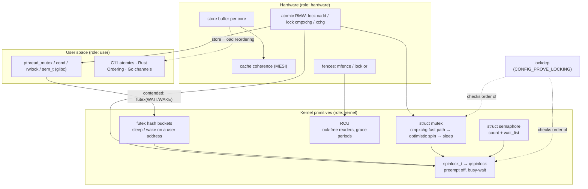
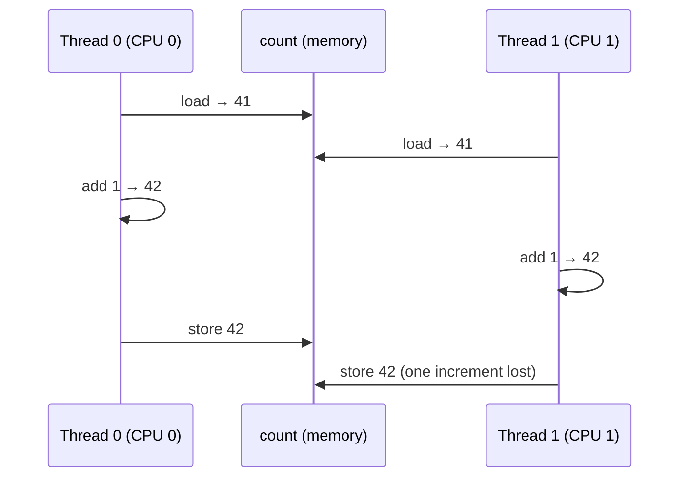
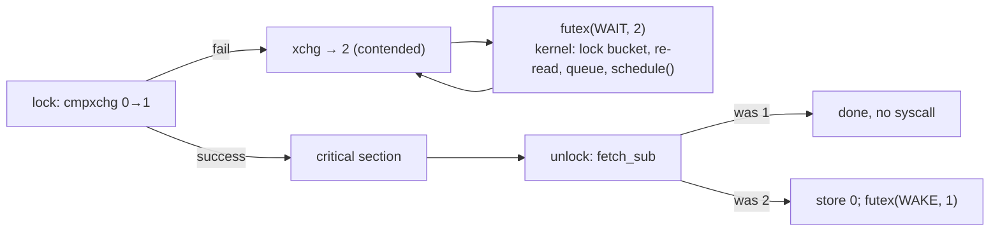

# 03 — Concurrency & Synchronization

> Course: Advanced Operating Systems · Term 1 · Pins: Linux **v6.18.63**, OpenBSD **`8cada8c`** · Arch: **x86-64**
> Time: ~18 h (lesson + 10 notes ≈ 8 h, 6 labs ≈ 10 h) · Farsi: [`lesson.fa.md`](lesson.fa.md) · Walkthrough: [`kernel-walkthrough.en.md`](kernel-walkthrough.en.md) · Notes: [`notes/INDEX.en.md`](notes/INDEX.en.md) · Slides: [`slides/`](slides/)

**Depends on:**
- **Module 01**: user/kernel mode, system calls (`futex()` is one), interrupts (why a spinlock must sometimes disable them).
- **Module 02**: threads share one address space, the scheduler can preempt a thread anywhere, `schedule()` and wait queues, `clone()`.
- **Module 00**: the `aos-lab` VM, `cite.sh`, and the `--lockdep` kernel flavor of lab 00.3.

**Used by:** Module 04 (page-table and LRU locking, `mmap_lock`), Module 05 (inode/page-cache locks, RCU path walk), Module 07 (priority inversion, `rtmutex`, `PREEMPT_RT`).

## 1. Learning objectives

- Explain why `count++` on two threads loses updates, and name the three ways to fix it (lock, atomic RMW, don't share).
- Read a C11/Rust memory ordering (`relaxed`, `acquire`, `release`, `seq_cst`) and predict what x86-TSO actually allows; reproduce store-buffering reordering on a real CPU.
- Choose between spinlock, mutex, semaphore, rwlock, and RCU for a given critical section, and justify it with the kernel's own fast and slow paths.
- Build a futex-based mutex and show with `strace`/`bpftrace` that the uncontended path never enters the kernel.
- Diagnose a deadlock from a thread dump, state the four Coffman conditions, and break one of them.

## 2. Glossary

| Term | Definition |
|---|---|
| **Race condition** | The result depends on the timing of two or more threads. A *data race* is the special case of two unsynchronized accesses to the same location, at least one a write (undefined behavior in C11). |
| **Critical section** | Code that touches shared state and must not run in two threads at once. |
| **Atomic operation** | An operation no other CPU can observe half-done, e.g. `lock xadd` on x86-64. Atomicity says nothing about *ordering* with other memory accesses. |
| **Memory ordering** | Which reorderings of loads/stores other CPUs may observe. Set per operation in C11 (`memory_order_*`) and Rust (`Ordering::*`). |
| **x86-TSO** | x86's memory model, "Total Store Order": only store→load reordering is visible (through the store buffer). |
| **Memory barrier / fence** | An instruction that forbids some reorderings, e.g. `mfence` or a `lock`-prefixed no-op; `smp_mb()` in the kernel. |
| **CAS / cmpxchg** | Compare-and-swap: write `new` only if the location still holds `old`; the basic building block of locks. |
| **Spinlock** | A lock whose waiters busy-wait on the CPU. In Linux it also disables preemption. |
| **qspinlock** | Linux's spinlock implementation: a 32-bit word with a locked byte, a pending bit and an MCS queue tail. |
| **Mutex** | A sleeping lock with an owner. Linux's `struct mutex` spins first while the owner runs ("optimistic spinning"). |
| **Semaphore** | A counter with P (`down`, wait while 0) and V (`up`). |
| **Condition variable** | A wait queue tied to a mutex and a predicate; `pthread_cond_wait` atomically unlocks and sleeps. |
| **Futex** | "Fast user-space mutex": an `int` in user memory plus the `futex()` syscall to sleep/wake on it. The base of every glibc lock. |
| **RCU** | Read-Copy-Update: readers take no lock, writers publish a new copy and wait for a *grace period* before freeing the old one. |
| **Grace period** | Interval after which every reader that could see the old version has finished. |
| **SMR** | OpenBSD's "safe memory reclamation", its RCU equivalent (`kern_smr.c`). |
| **Deadlock** | A cycle of threads, each waiting for a lock another one holds. |
| **Starvation** | A thread waits indefinitely even though the system as a whole makes progress. |
| **lockdep** | Linux's run-time lock-order validator (`CONFIG_PROVE_LOCKING`); reports *possible* deadlocks before they happen. |
| **WITNESS** | OpenBSD's equivalent of lockdep (`WITNESS_CHECKORDER` in `kern_rwlock.c`). |

## 3. Big picture



| Question | Answer in one line | Where |
|---|---|---|
| Who can interrupt my critical section? | other CPUs (always), preemption, interrupts, signals | §4.1, §4.3 |
| What does the CPU reorder? | on x86 only store→load; on Arm/POWER much more | §4.2, lab 05 |
| Spin or sleep? | spin if the hold time is shorter than two context switches *and* you can't sleep | §4.3 |
| How is the kernel avoided? | futex: atomic in user space, syscall only on contention | §4.4, lab 04 |
| How do readers avoid locks entirely? | RCU / SMR | §4.6 |
| Why did everything stop? | a lock cycle (deadlock) or a starving waiter | §4.7, labs 03, 06 |

## 4. Concepts

### 4.1 What goes wrong when two threads run `count++`?

`count++` compiles to **load, add, store**. Two threads can both load 41 and both store 42: one increment is lost. That is a *race condition*; the three instructions form a *critical section*.



Three fixes, all measured in **lab 01**: (1) a lock around the section, (2) a single atomic RMW (`lock xadd`), (3) don't share: per-thread counters summed at the end. Correct solutions need: mutual exclusion, progress, bounded waiting. Detail: [note 01](notes/01-race-conditions-critical-sections.en.md).

### 4.2 What does the hardware actually promise?

Atomicity and ordering are separate properties. An aligned 64-bit `mov` is atomic on x86-64 but can still be *reordered* with a later load.

| Reordering | x86-TSO | Arm64 / POWER | C11 `relaxed` |
|---|---|---|---|
| store → load (different addresses) | **allowed** (store buffer) | allowed | allowed |
| store → store | forbidden | allowed | allowed |
| load → load, load → store | forbidden | allowed | allowed |
| atomic RMW (`lock` prefix) | full barrier | depends on instruction | per `memory_order` |

The store-buffering litmus test (`x=1; r0=y` ‖ `y=1; r1=x`) can end with `r0==r1==0` on x86. **Lab 05** counts how often this happens in a million runs and shows that `atomic_thread_fence(memory_order_seq_cst)` (a full StoreLoad barrier; see the disassembly in the lab) brings it to zero. The kernel uses the same pattern internally: the futex wake path relies on a pair of `smp_mb()` precisely so this outcome cannot happen (walkthrough §3). Detail: [note 02](notes/02-atomics-c11-memory-model.en.md), [note 03](notes/03-x86-tso-and-barriers.en.md).

### 4.3 Spin or sleep?

| | Spinlock (`spin_lock`) | Mutex (`mutex_lock`) |
|---|---|---|
| Waiter | busy-waits on the CPU | spins while the owner runs, then sleeps |
| Preemption while held | disabled | allowed |
| May the holder sleep? | **no** | yes |
| Usable in interrupt context | yes (`_irqsave`) | no |
| Owner tracked | no (only in debug builds) | yes (`lock->owner` = task pointer) |
| Fast path | one `cmpxchg` (acquire) | one `cmpxchg` (acquire) |

Both fast paths are a single compare-and-swap. They differ in what happens on failure: `queued_spin_lock_slowpath()` queues the CPU in an MCS list and spins on a *local* cache line; `__mutex_lock_common()` spins only while the owner is on a CPU (`mutex_spin_on_owner()`), then adds itself to `wait_list` and calls `schedule()`. Detail: [note 04](notes/04-spinlocks-qspinlock.en.md), [note 05](notes/05-mutex-optimistic-spinning.en.md), walkthrough §1–2.

### 4.4 How does a sleeping lock avoid a syscall?

A futex is just a 32-bit word in user memory. Lock = `cmpxchg 0→1` in user space. Only if that fails does the thread call `futex(FUTEX_WAIT, val)`, which sleeps **only if the word still equals `val`** (checked under the hash-bucket lock, so a wake-up cannot slip between the check and the sleep). Unlock = atomic store 0, and `futex(FUTEX_WAKE)` only if someone might be waiting.



**Lab 04** builds this mutex in ~60 lines and counts the syscalls with `strace -c` and `bpftrace`. Detail: [note 07](notes/07-futex-user-kernel-split.en.md), walkthrough §3.

### 4.5 How do threads wait for a condition?

| Tool | State | Waits until | Classic use |
|---|---|---|---|
| Semaphore | integer count | count > 0 | bounded buffer (`empty`, `full`), resource pools |
| Condition variable + mutex | your own predicate | someone signals *and* your predicate is true (re-check in `while`) | any predicate: "queue not empty", "no writer" |
| rwlock | readers count + writer flag | no writer (read) / nobody (write) | read-mostly data |
| Go channel | runtime queue | slot free / item present | producer-consumer without shared state |

**Lab 02** builds Producer-Consumer three ways (semaphores, condvars, Go channel) and compares them; **lab 03** shows that glibc's default `pthread_rwlock` prefers readers and can starve a writer. Detail: [note 06](notes/06-semaphores-condition-variables.en.md), [note 10](notes/10-classic-problems.en.md).

### 4.6 How can readers run with no lock at all?

RCU splits an update into *remove* and *reclaim*. The writer publishes a new version with `rcu_assign_pointer()` (a release store); readers inside `rcu_read_lock()` … `rcu_read_unlock()` see either the old or the new version, never half of one. The old version is freed only after a *grace period*: every CPU has passed a quiescent state (context switch, idle, user mode), so no reader can still hold it.

```mermaid
sequenceDiagram
  participant R1 as Reader 1
  participant W as Writer
  participant R2 as Reader 2
  R1->>R1: rcu_read_lock(); p = rcu_dereference(gp) → old
  W->>W: new = copy(old); modify
  W->>W: rcu_assign_pointer(gp, new)
  R2->>R2: rcu_read_lock(); p → new
  W->>W: synchronize_rcu() … waits
  R1->>R1: rcu_read_unlock()
  Note over W: grace period ends
  W->>W: kfree(old)
```

OpenBSD's SMR does the same job with a much simpler grace-period detector: `smr_grace_wait()` moves the calling thread onto every CPU in turn. Detail: [note 08](notes/08-rcu.en.md), walkthrough §4 and §6.

### 4.7 Why does everything stop?

Deadlock needs all four **Coffman conditions**: mutual exclusion, hold-and-wait, no preemption, circular wait. Break any one. In practice you break *circular wait* with a global lock order (by address, by level), which is exactly what the kernel's lockdep checks at run time: it records every "A held while taking B" edge and warns when a new edge would close a cycle — even if the deadlock never actually happened. **Lab 06** creates an AB-BA deadlock, reads it from a `gdb` thread dump and `/proc/<pid>/task/*/stack`, gets the same diagnosis from ThreadSanitizer and helgrind without hanging, and fixes it with address ordering. Starvation (lab 03) is a different failure: progress exists, but not for everyone. Detail: [note 09](notes/09-deadlock-coffman-lockdep.en.md).

## 5. Where this lives in Linux

| Topic | File (v6.18.63) | Entry point | Walkthrough |
|---|---|---|---|
| spinlock API | `include/linux/spinlock.h`, `include/linux/spinlock_api_smp.h` | `spin_lock()` → `__raw_spin_lock()` | §1 |
| qspinlock | `include/asm-generic/qspinlock.h`, `kernel/locking/qspinlock.c` | `queued_spin_lock()` | §1 |
| mutex | `kernel/locking/mutex.c` | `mutex_lock()` L269 | §2 |
| futex | `kernel/futex/syscalls.c`, `waitwake.c`, `core.c` | `do_futex()`, `futex_wait_setup()`, `futex_wake()` | §3 |
| RCU | `include/linux/rcupdate.h`, `kernel/rcu/tree.c`, `tree_plugin.h` | `synchronize_rcu()`, `call_rcu()` | §4 |
| rt_mutex (M7 preview) | `kernel/locking/rtmutex.c` | `rt_mutex_adjust_prio_chain()` | §5 |
| lockdep | `kernel/locking/lockdep.c` | `check_noncircular()` | §5 |
| semaphores | `kernel/locking/semaphore.c` | `down()`, `up()` | note 06 |
| x86 barriers | `arch/x86/include/asm/barrier.h` | `mb()`, `__smp_mb()` | note 03 |
| OpenBSD | `sys/kern/kern_lock.c`, `kern_rwlock.c`, `sys_futex.c`, `kern_smr.c` | `mtx_enter()`, `rw_do_enter_write()`, `futex_wait()`, `smr_grace_wait()` | §6 |

## 6. Common misconceptions

| Misconception | Reality |
|---|---|
| "`volatile` makes it thread-safe." | `volatile` forces each access to happen; it gives neither atomicity nor ordering. Lab 01 uses a `volatile` counter and still loses updates. |
| "x86 is sequentially consistent." | No: store→load reordering is visible. Lab 05 measures it. |
| "An atomic variable makes the surrounding code correct." | Atomicity covers one operation. Two atomic operations in a row are not one atomic operation. |
| "A mutex always enters the kernel." | glibc's mutex is a futex: uncontended lock/unlock make no syscall (lab 04). The kernel's own mutex also spins before sleeping. |
| "Spinlocks are faster, use them everywhere." | Only for short sections that never sleep. A spinning waiter burns a CPU; in user space the holder can be preempted, so spinning can last a whole time slice. |
| "`pthread_cond_wait` returns only when signaled and the condition is true." | It can wake spuriously or after another thread consumed the item. Always `while (!pred) wait`. |
| "RCU readers are free, so RCU is always better." | Readers are nearly free; writers pay (copy + grace period) and memory is held longer. RCU fits read-mostly data. |
| "No deadlock in testing = no deadlock." | Lock-order bugs hide until timing is unlucky. Use lockdep / TSan / helgrind, which flag the *order*, not the hang. |

## 7. Self-check

1. Two threads each do `count++` 1,000,000 times on a `volatile long`. Give the possible range of the final value and explain the minimum.
2. Which single reordering does x86-TSO allow, and which instruction removes it?
3. Why does `__raw_spin_lock()` call `preempt_disable()` before it touches the lock?
4. `mutex_spin_on_owner()` stops spinning when `!owner_on_cpu(owner) || need_resched()`. Why each condition?
5. Why must `futex_wait_setup()` re-read the user word *after* taking the hash-bucket lock?
6. A writer on glibc's default rwlock never gets the lock. Which classic problem is this, and what are two fixes?
7. Why may an RCU reader not call `synchronize_rcu()`?
8. State the four Coffman conditions and say which one lock ordering breaks.

Answers: [`quiz.en.md`](quiz.en.md) covers each of these in more depth.
