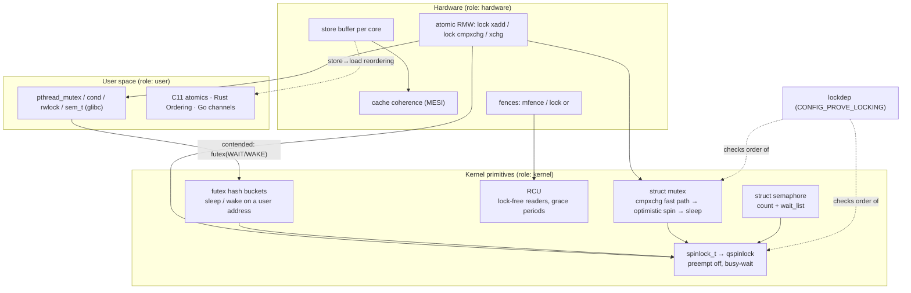
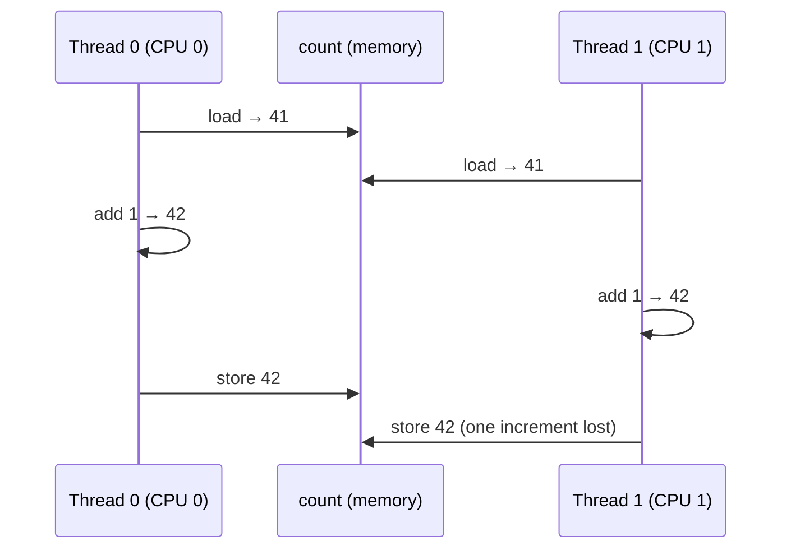
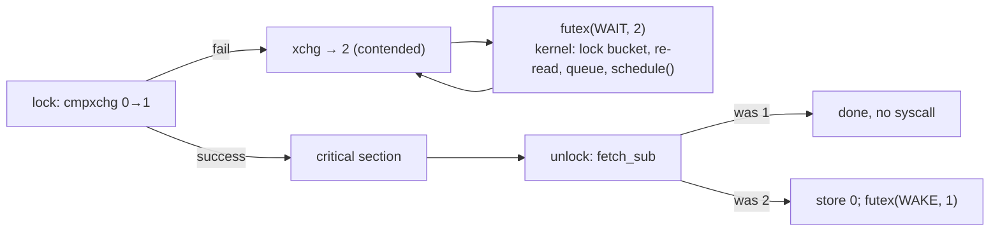

<div dir="rtl">

# ۰۳ — هم‌روندی و همگام‌سازی (Concurrency & Synchronization)

> درس: سیستم‌عامل پیشرفته · ترم ۱ · نسخه‌های ثابت: Linux **v6.18.63** و OpenBSD **`8cada8c`** · معماری: **x86-64**
> زمان: حدود ۱۸ ساعت (درس و ۱۰ یادداشت حدود ۸ ساعت، ۶ آزمایش حدود ۱۰ ساعت) · نسخهٔ انگلیسی: [`lesson.en.md`](lesson.en.md) · بررسی کد کرنل: [`kernel-walkthrough.fa.md`](kernel-walkthrough.fa.md) · یادداشت‌ها: [`notes/INDEX.fa.md`](notes/INDEX.fa.md) · اسلایدها: [`slides/`](slides/)

**پیش‌نیازها:**
- **ماژول ۰۱**: حالت کاربر و کرنل، فراخوانی سیستمی (`futex()` هم یکی از آن‌هاست)، وقفه‌ها (چرا spinlock گاهی باید وقفه را خاموش کند).
- **ماژول ۰۲**: نخ‌ها یک فضای آدرس مشترک دارند، scheduler می‌تواند هر جایی نخ را preempt کند، `schedule()` و صف‌های انتظار، `clone()`.
- **ماژول ۰۰**: VM با نام `aos-lab`، ابزار `cite.sh` و گونهٔ `--lockdep` کرنل در آزمایش ۰۰.۳.

**ماژول‌هایی که از این استفاده می‌کنند:** ماژول ۰۴ (قفل جدول صفحه و LRU، `mmap_lock`)، ماژول ۰۵ (قفل inode و page cache، پیمایش مسیر با RCU)، ماژول ۰۷ (وارونگی اولویت، `rtmutex`، `PREEMPT_RT`).

## ۱. هدف‌های یادگیری

- توضیح دهید چرا `count++` روی دو نخ به‌روزرسانی‌ها را گم می‌کند، و سه راه درمانش را نام ببرید: قفل، RMW اتمی، و اشتراک‌نگذاشتن.
- یک memory ordering در C11 یا Rust (`relaxed`، `acquire`، `release`، `seq_cst`) را بخوانید و پیش‌بینی کنید x86-TSO واقعاً چه چیزی را مجاز می‌داند؛ و جابه‌جایی store-buffering را روی یک CPU واقعی بازتولید کنید.
- برای یک critical section مشخص بین spinlock، mutex، semaphore، rwlock و RCU انتخاب کنید و انتخابتان را با مسیرهای سریع و کند خود کرنل توجیه کنید.
- یک mutex مبتنی بر futex بسازید و با `strace` و `bpftrace` نشان دهید که مسیر بدون رقابت هیچ‌وقت وارد کرنل نمی‌شود.
- یک deadlock را از روی thread dump تشخیص دهید، چهار شرط Coffman را بگویید و یکی را بشکنید.

## ۲. واژه‌نامه

| اصطلاح | تعریف |
|---|---|
| **Race condition** | نتیجه به زمان‌بندی دو یا چند نخ بستگی دارد. *Data race* حالت خاص آن است: دو دسترسی همگام‌نشده به یک خانهٔ حافظه که دست‌کم یکی نوشتن است؛ در C11 رفتار تعریف‌نشده (UB) است. |
| **Critical section** | تکه‌کدی که به حالت مشترک دست می‌زند و نباید هم‌زمان در دو نخ اجرا شود. |
| **Atomic operation** | عملی که هیچ CPU دیگری آن را نیمه‌کاره نمی‌بیند؛ مثل `lock xadd` روی x86-64. اتمی بودن چیزی دربارهٔ *ترتیب* نسبت به دسترسی‌های دیگر نمی‌گوید. |
| **Memory ordering** | این‌که CPUهای دیگر کدام جابه‌جایی‌های load و store را ممکن است ببینند. در C11 با `memory_order_*` و در Rust با `Ordering::*` برای هر عمل جدا تعیین می‌شود. |
| **x86-TSO** | مدل حافظهٔ x86 یعنی Total Store Order: فقط جابه‌جایی store→load (از راه store buffer) دیده می‌شود. |
| **Memory barrier / fence** | دستوری که بعضی جابه‌جایی‌ها را ممنوع می‌کند، مثل `mfence` یا یک دستور بی‌اثرِ دارای پیشوند `lock`؛ در کرنل `smp_mb()`. |
| **CAS / cmpxchg** | Compare-and-swap: مقدار `new` را فقط وقتی بنویس که خانه هنوز `old` باشد؛ آجر پایهٔ همهٔ قفل‌ها. |
| **Spinlock** | قفلی که منتظرهایش روی CPU در حلقه می‌چرخند. در لینوکس preemption را هم خاموش می‌کند. |
| **qspinlock** | پیاده‌سازی spinlock در لینوکس: یک کلمهٔ ۳۲بیتی با یک بایت قفل، یک بیت pending و انتهای یک صف MCS. |
| **Mutex** | قفل خوابیدنی که مالک دارد. `struct mutex` لینوکس اول تا وقتی مالک در حال اجراست می‌چرخد («optimistic spinning»). |
| **Semaphore** | یک شمارنده با دو عمل P (`down`، تا صفر است صبر کن) و V (`up`). |
| **Condition variable** | صف انتظاری که به یک mutex و یک شرط (predicate) گره خورده است؛ `pthread_cond_wait` به‌صورت اتمی قفل را آزاد می‌کند و می‌خوابد. |
| **Futex** | «mutex سریع فضای کاربر»: یک `int` در حافظهٔ کاربر به‌اضافهٔ syscall به نام `futex()` برای خوابیدن و بیدارکردن روی آن. پایهٔ همهٔ قفل‌های glibc. |
| **RCU** | Read-Copy-Update: خواننده‌ها هیچ قفلی نمی‌گیرند؛ نویسنده نسخهٔ تازه را منتشر می‌کند و پیش از آزادکردن نسخهٔ قدیم یک *grace period* صبر می‌کند. |
| **Grace period** | بازه‌ای که پس از آن هر خواننده‌ای که ممکن بود نسخهٔ قدیم را ببیند کارش تمام شده است. |
| **SMR** | «safe memory reclamation» در OpenBSD، معادل RCU (`kern_smr.c`). |
| **Deadlock** | چرخه‌ای از نخ‌ها که هر کدام منتظر قفلی است که دیگری نگه داشته. |
| **Starvation** | نخی بی‌نهایت منتظر می‌ماند، هرچند سیستم در کل پیش می‌رود. |
| **lockdep** | اعتبارسنج ترتیب قفل‌ها در زمان اجرا در لینوکس (`CONFIG_PROVE_LOCKING`)؛ deadlockهای *ممکن* را پیش از رخ‌دادن گزارش می‌کند. |
| **WITNESS** | معادل lockdep در OpenBSD (`WITNESS_CHECKORDER` در `kern_rwlock.c`). |

## ۳. تصویر کلی

</div>



<div dir="rtl">

| پرسش | پاسخ یک‌خطی | کجا |
|---|---|---|
| چه کسی می‌تواند critical section من را قطع کند؟ | CPUهای دیگر (همیشه)، preemption، وقفه‌ها، signalها | §۴.۱ و §۴.۳ |
| CPU چه چیزی را جابه‌جا می‌کند؟ | روی x86 فقط store→load؛ روی Arm و POWER خیلی بیشتر | §۴.۲، آزمایش ۰۵ |
| بچرخیم یا بخوابیم؟ | بچرخید اگر زمان نگه‌داشتن قفل از دو context switch کمتر است *و* نمی‌توانید بخوابید | §۴.۳ |
| چطور از کرنل پرهیز می‌شود؟ | futex: عمل اتمی در فضای کاربر، syscall فقط هنگام رقابت | §۴.۴، آزمایش ۰۴ |
| خواننده‌ها چطور کاملاً بی‌قفل کار می‌کنند؟ | RCU و SMR | §۴.۶ |
| چرا همه‌چیز ایستاد؟ | چرخهٔ قفل (deadlock) یا منتظری که گرسنه مانده | §۴.۷، آزمایش‌های ۰۳ و ۰۶ |

## ۴. مفاهیم

<a id="41-what-goes-wrong-when-two-threads-run-count"></a>
### ۴.۱ وقتی دو نخ `count++` اجرا می‌کنند چه اشکالی پیش می‌آید؟

`count++` به سه دستور ترجمه می‌شود: **load، add، store**. ممکن است هر دو نخ عدد ۴۱ را بخوانند و هر دو ۴۲ بنویسند؛ یکی از افزایش‌ها گم می‌شود. این یک *race condition* است و آن سه دستور یک *critical section* می‌سازند.

</div>



<div dir="rtl">

سه راه درمان که در **آزمایش ۰۱** اندازه‌گیری می‌شوند: (۱) قفلی دور این بخش، (۲) یک RMW اتمی (`lock xadd`)، (۳) اشتراک‌نگذاشتن: شمارندهٔ جدا برای هر نخ و جمع در پایان. هر راه‌حل درست باید سه ویژگی داشته باشد: انحصار متقابل (mutual exclusion)، پیشرفت (progress) و انتظار محدود (bounded waiting). جزئیات: [یادداشت ۰۱](notes/01-race-conditions-critical-sections.fa.md).

<a id="42-what-does-the-hardware-actually-promise"></a>
### ۴.۲ سخت‌افزار واقعاً چه قولی می‌دهد؟

اتمی بودن و ترتیب دو ویژگی جدا هستند. یک `mov` شصت‌وچهاربیتیِ هم‌تراز روی x86-64 اتمی است، ولی باز هم ممکن است با یک load بعدی *جابه‌جا* دیده شود.

| جابه‌جایی | x86-TSO | Arm64 / POWER | C11 `relaxed` |
|---|---|---|---|
| store ← load (آدرس‌های متفاوت) | **مجاز** (store buffer) | مجاز | مجاز |
| store ← store | ممنوع | مجاز | مجاز |
| load ← load و load ← store | ممنوع | مجاز | مجاز |
| RMW اتمی (پیشوند `lock`) | barrier کامل | بسته به دستور | طبق `memory_order` |

آزمون litmus به نام store-buffering (`x=1; r0=y` در یک نخ و `y=1; r1=x` در نخ دیگر) روی x86 می‌تواند با `r0==r1==0` تمام شود. **آزمایش ۰۵** می‌شمارد این در یک میلیون اجرا چند بار رخ می‌دهد و نشان می‌دهد `atomic_thread_fence(memory_order_seq_cst)` (یک barrier کامل از نوع StoreLoad؛ disassembly را در آزمایش ببینید) آن را صفر می‌کند. خود کرنل هم همین الگو را دارد: مسیر بیدارکردن futex به یک جفت `smp_mb()` تکیه می‌کند تا دقیقاً همین نتیجه ناممکن شود (بررسی کد، §۳). جزئیات: [یادداشت ۰۲](notes/02-atomics-c11-memory-model.fa.md) و [یادداشت ۰۳](notes/03-x86-tso-and-barriers.fa.md).

<a id="43-spin-or-sleep"></a>
### ۴.۳ بچرخیم یا بخوابیم؟

| | Spinlock (`spin_lock`) | Mutex (`mutex_lock`) |
|---|---|---|
| منتظر | روی CPU در حلقه می‌چرخد | تا مالک در حال اجراست می‌چرخد، بعد می‌خوابد |
| preemption هنگام نگه‌داشتن | خاموش | مجاز |
| آیا نگه‌دارنده می‌تواند بخوابد؟ | **نه** | بله |
| در interrupt context | بله (`_irqsave`) | نه |
| ثبت مالک | نه (فقط در buildهای debug) | بله (`lock->owner` اشاره‌گر task است) |
| مسیر سریع | یک `cmpxchg` با acquire | یک `cmpxchg` با acquire |

هر دو مسیر سریع یک compare-and-swap است. فرقشان در شکست است: `queued_spin_lock_slowpath()` CPU را در یک صف MCS می‌گذارد و روی یک cache line *محلی* می‌چرخد؛ `__mutex_lock_common()` فقط تا وقتی مالک روی یک CPU است می‌چرخد (`mutex_spin_on_owner()`)، بعد خودش را به `wait_list` اضافه می‌کند و `schedule()` را صدا می‌زند. جزئیات: [یادداشت ۰۴](notes/04-spinlocks-qspinlock.fa.md)، [یادداشت ۰۵](notes/05-mutex-optimistic-spinning.fa.md)، بررسی کد §۱ و §۲.

<a id="44-how-does-a-sleeping-lock-avoid-a-syscall"></a>
### ۴.۴ یک قفل خوابیدنی چطور از syscall پرهیز می‌کند؟

futex فقط یک کلمهٔ ۳۲بیتی در حافظهٔ کاربر است. گرفتن قفل یعنی `cmpxchg 0→1` در فضای کاربر. فقط اگر شکست بخورد نخ `futex(FUTEX_WAIT, val)` را صدا می‌زند، که **فقط اگر کلمه هنوز برابر `val` باشد** می‌خوابد. این بررسی زیر قفل hash bucket انجام می‌شود، پس بیدارباشی نمی‌تواند بین بررسی و خوابیدن گم شود. آزادکردن یعنی store اتمی صفر، و `futex(FUTEX_WAKE)` فقط اگر ممکن است کسی منتظر باشد.

</div>



<div dir="rtl">

**آزمایش ۰۴** این mutex را در حدود ۶۰ خط می‌سازد و syscallها را با `strace -c` و `bpftrace` می‌شمارد. جزئیات: [یادداشت ۰۷](notes/07-futex-user-kernel-split.fa.md)، بررسی کد §۳.

<a id="45-how-do-threads-wait-for-a-condition"></a>
### ۴.۵ نخ‌ها چطور منتظر یک شرط می‌مانند؟

| ابزار | حالت | تا کی صبر می‌کند | کاربرد کلاسیک |
|---|---|---|---|
| Semaphore | یک عدد صحیح | تا شمارنده بزرگ‌تر از صفر شود | بافر محدود (`empty` و `full`)، استخر منابع |
| Condition variable و mutex | شرط دلخواه خودتان | تا کسی signal دهد *و* شرط شما درست باشد (در `while` دوباره بررسی کنید) | هر شرطی: «صف خالی نیست»، «نویسنده‌ای نیست» |
| rwlock | تعداد خواننده و پرچم نویسنده | نبود نویسنده (خواندن) یا نبود هیچ‌کس (نوشتن) | داده‌ای که بیشتر خوانده می‌شود |
| کانال Go | صف runtime | جای خالی یا آیتم موجود | Producer-Consumer بدون حالت مشترک |

**آزمایش ۰۲** مسئلهٔ Producer-Consumer را به سه روش می‌سازد (semaphore، condvar، کانال Go) و مقایسه می‌کند؛ **آزمایش ۰۳** نشان می‌دهد `pthread_rwlock` پیش‌فرض glibc خواننده‌ها را ترجیح می‌دهد و می‌تواند نویسنده را گرسنه نگه دارد. جزئیات: [یادداشت ۰۶](notes/06-semaphores-condition-variables.fa.md) و [یادداشت ۱۰](notes/10-classic-problems.fa.md).

<a id="46-how-can-readers-run-with-no-lock-at-all"></a>
### ۴.۶ خواننده‌ها چطور بدون هیچ قفلی اجرا می‌شوند؟

RCU به‌روزرسانی را به دو بخش *حذف* و *بازپس‌گیری* تقسیم می‌کند. نویسنده نسخهٔ تازه را با `rcu_assign_pointer()` منتشر می‌کند (یک release store)؛ خواننده‌ها بین `rcu_read_lock()` و `rcu_read_unlock()` یا نسخهٔ قدیم را می‌بینند یا نسخهٔ تازه را، هرگز نیمی از یکی را. نسخهٔ قدیم فقط پس از یک *grace period* آزاد می‌شود: هر CPU از یک quiescent state گذشته است (context switch، idle یا حالت کاربر)، پس هیچ خواننده‌ای ممکن نیست هنوز آن را در دست داشته باشد.

</div>

```mermaid
sequenceDiagram
  participant R1 as Reader 1
  participant W as Writer
  participant R2 as Reader 2
  R1->>R1: rcu_read_lock(); p = rcu_dereference(gp) → old
  W->>W: new = copy(old); modify
  W->>W: rcu_assign_pointer(gp, new)
  R2->>R2: rcu_read_lock(); p → new
  W->>W: synchronize_rcu() … waits
  R1->>R1: rcu_read_unlock()
  Note over W: grace period ends
  W->>W: kfree(old)
```

<div dir="rtl">

SMR در OpenBSD همین کار را با تشخیص‌دهندهٔ grace period بسیار ساده‌تری انجام می‌دهد: `smr_grace_wait()` نخ فراخواننده را یکی‌یکی روی همهٔ CPUها می‌برد. جزئیات: [یادداشت ۰۸](notes/08-rcu.fa.md)، بررسی کد §۴ و §۶.

<a id="47-why-does-everything-stop"></a>
### ۴.۷ چرا همه‌چیز می‌ایستد؟

deadlock به هر چهار **شرط Coffman** نیاز دارد: انحصار متقابل، نگه‌داشتن و منتظرماندن (hold-and-wait)، نبود preemption، و انتظار چرخه‌ای. یکی را بشکنید کافی است. در عمل *انتظار چرخه‌ای* را با یک ترتیب سراسری قفل‌ها می‌شکنند (بر اساس آدرس یا سطح)، و lockdep کرنل دقیقاً همین را در زمان اجرا بررسی می‌کند: هر یال «A نگه داشته شد و B گرفته شد» را ثبت می‌کند و وقتی یال تازه‌ای چرخه را ببندد هشدار می‌دهد، حتی اگر deadlock هرگز واقعاً رخ نداده باشد. **آزمایش ۰۶** یک deadlock از نوع AB-BA می‌سازد، آن را از thread dump در `gdb` و از `/proc/<pid>/task/*/stack` می‌خواند، همان تشخیص را بدون قفل‌شدن برنامه از ThreadSanitizer و helgrind می‌گیرد و با ترتیب آدرس درستش می‌کند. Starvation (آزمایش ۰۳) شکست دیگری است: پیشرفت هست، ولی نه برای همه. جزئیات: [یادداشت ۰۹](notes/09-deadlock-coffman-lockdep.fa.md).

## ۵. این‌ها در لینوکس کجا هستند

</div>

| Topic | File (v6.18.63) | Entry point | Walkthrough |
|---|---|---|---|
| spinlock API | `include/linux/spinlock.h`, `include/linux/spinlock_api_smp.h` | `spin_lock()` → `__raw_spin_lock()` | §1 |
| qspinlock | `include/asm-generic/qspinlock.h`, `kernel/locking/qspinlock.c` | `queued_spin_lock()` | §1 |
| mutex | `kernel/locking/mutex.c` | `mutex_lock()` L269 | §2 |
| futex | `kernel/futex/syscalls.c`, `waitwake.c`, `core.c` | `do_futex()`, `futex_wait_setup()`, `futex_wake()` | §3 |
| RCU | `include/linux/rcupdate.h`, `kernel/rcu/tree.c`, `tree_plugin.h` | `synchronize_rcu()`, `call_rcu()` | §4 |
| rt_mutex (M7 preview) | `kernel/locking/rtmutex.c` | `rt_mutex_adjust_prio_chain()` | §5 |
| lockdep | `kernel/locking/lockdep.c` | `check_noncircular()` | §5 |
| semaphores | `kernel/locking/semaphore.c` | `down()`, `up()` | note 06 |
| x86 barriers | `arch/x86/include/asm/barrier.h` | `mb()`, `__smp_mb()` | note 03 |
| OpenBSD | `sys/kern/kern_lock.c`, `kern_rwlock.c`, `sys_futex.c`, `kern_smr.c` | `mtx_enter()`, `rw_do_enter_write()`, `futex_wait()`, `smr_grace_wait()` | §6 |

<div dir="rtl">

## ۶. برداشت‌های نادرست رایج

| برداشت نادرست | واقعیت |
|---|---|
| «`volatile` برنامه را thread-safe می‌کند.» | `volatile` فقط مجبور می‌کند هر دسترسی واقعاً انجام شود؛ نه اتمی بودن می‌دهد نه ترتیب. آزمایش ۰۱ از شمارندهٔ `volatile` استفاده می‌کند و باز هم به‌روزرسانی گم می‌شود. |
| «x86 sequentially consistent است.» | نه؛ جابه‌جایی store→load دیده می‌شود. آزمایش ۰۵ آن را اندازه می‌گیرد. |
| «یک متغیر اتمی کد اطرافش را درست می‌کند.» | اتمی بودن فقط یک عمل را پوشش می‌دهد. دو عمل اتمی پشت‌سرهم یک عمل اتمی نیستند. |
| «mutex همیشه وارد کرنل می‌شود.» | mutex در glibc یک futex است: گرفتن و آزادکردن بدون رقابت هیچ syscallی ندارد (آزمایش ۰۴). mutex خود کرنل هم پیش از خوابیدن می‌چرخد. |
| «spinlock سریع‌تر است، همه‌جا از آن استفاده کنید.» | فقط برای بخش‌های کوتاهی که هرگز نمی‌خوابند. منتظرِ در حال چرخش یک CPU را می‌سوزاند؛ در فضای کاربر نگه‌دارنده ممکن است preempt شود و چرخیدن یک time slice کامل طول بکشد. |
| «`pthread_cond_wait` فقط وقتی برمی‌گردد که signal آمده و شرط درست است.» | ممکن است بی‌دلیل (spurious) بیدار شود یا پس از آن‌که نخ دیگری آیتم را برداشته. همیشه `while (!pred) wait`. |
| «خواننده‌های RCU رایگان‌اند، پس RCU همیشه بهتر است.» | خواننده‌ها تقریباً رایگان‌اند؛ نویسنده‌ها هزینه می‌دهند (کپی و grace period) و حافظه بیشتر نگه داشته می‌شود. RCU برای دادهٔ بیشتر-خواندنی است. |
| «در تست deadlock ندیدیم، پس deadlock نیست.» | باگ ترتیب قفل تا وقتی زمان‌بندی بدشانس نباشد پنهان می‌ماند. از lockdep، TSan یا helgrind استفاده کنید که *ترتیب* را علامت می‌زنند، نه خودِ قفل‌شدن را. |

## ۷. پرسش‌های خودسنجی

۱. دو نخ هر کدام ۱٬۰۰۰٬۰۰۰ بار `count++` را روی یک `volatile long` اجرا می‌کنند. بازهٔ ممکن مقدار نهایی را بگویید و کمینه را توضیح دهید.
۲. x86-TSO کدام تک جابه‌جایی را مجاز می‌داند، و کدام دستور آن را حذف می‌کند؟
۳. چرا `__raw_spin_lock()` پیش از دست‌زدن به قفل `preempt_disable()` را صدا می‌زند؟
۴. `mutex_spin_on_owner()` وقتی `!owner_on_cpu(owner) || need_resched()` درست شود چرخیدن را متوقف می‌کند. هر شرط برای چیست؟
۵. چرا `futex_wait_setup()` باید کلمهٔ کاربر را *پس از* گرفتن قفل hash bucket دوباره بخواند؟
۶. نویسنده‌ای روی rwlock پیش‌فرض glibc هرگز قفل را نمی‌گیرد. این کدام مسئلهٔ کلاسیک است و دو راه‌حلش چیست؟
۷. چرا یک خوانندهٔ RCU نباید `synchronize_rcu()` را صدا بزند؟
۸. چهار شرط Coffman را بگویید و بگویید ترتیب‌دادن قفل‌ها کدام را می‌شکند.

پاسخ‌ها: [`quiz.fa.md`](quiz.fa.md) هر کدام را عمیق‌تر پوشش می‌دهد.

</div>
