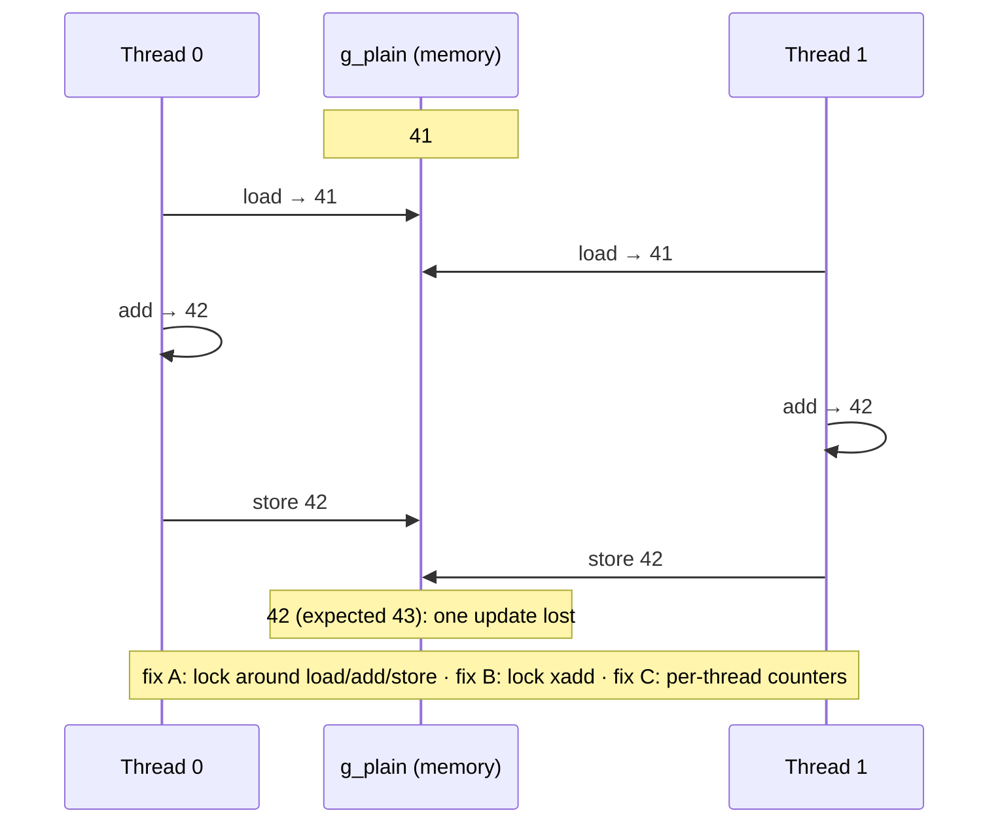

# 01 — Race conditions and critical sections

> Module 03 · Concurrency & Synchronization · Linux v6.18.63 · OpenBSD 8cada8c · Farsi: [01-race-conditions-critical-sections.fa.md](01-race-conditions-critical-sections.fa.md)

## 1. Summary

- A **race condition** is any bug whose outcome depends on how threads interleave. A **data race** is the narrower C11 term: two unsynchronized accesses to one location, at least one a write. It is undefined behavior.
- A **critical section** is the code that touches shared state. A correct protocol for it gives mutual exclusion, progress and bounded waiting.
- There are only three fixes: serialize the section (a lock), make it one indivisible instruction (an atomic RMW), or stop sharing (per-thread data, merged later). Lab 01 measures all three.

## 2. Explanation

### 2.1 Intuition: `count++` is three steps

`count++` on x86-64 compiles to a load, an add and a store (or one `add` to memory, which the CPU still executes as read-modify-write unless it carries a `lock` prefix). If two threads both load 41, both store 42. One increment is lost and no error is raised. The program is not "slightly wrong under load": its result is decided by timing.

| Term | Definition | Example |
|---|---|---|
| Race condition | Correctness depends on interleaving | check-then-act on a file (`access()` then `open()`), lost updates |
| Data race | Two concurrent accesses, ≥1 write, no happens-before order | `g_plain++` from two threads in lab 01 |
| Critical section | The code region that must not interleave | load-add-store of the counter |
| Atomicity violation | Two individually atomic ops whose *combination* must be atomic | `if (atomic_load(&x) == 0) atomic_store(&x, 1);` |

A program can have a race condition with no data race (every access is atomic, but the logic between them isn't), and a data race that happens to give the right answer on x86. C11 does not care: a data race on a non-atomic object makes the **whole program** undefined, so the compiler may cache, split or remove the accesses.

### 2.2 What a correct critical-section protocol must give

| Requirement | Meaning | Violated by |
|---|---|---|
| Mutual exclusion | at most one thread inside | no lock, or a broken flag protocol |
| Progress | if nobody is inside, someone who wants in eventually gets in | strict alternation (`turn` only) |
| Bounded waiting | a waiting thread is overtaken a bounded number of times | unfair spinlocks, reader-preferring rwlocks (lab 03) |

**Peterson's algorithm** meets all three for two threads with plain loads and stores:

```c
// Peterson for thread i (j = 1 - i); flag[] and turn are shared
flag[i] = 1;          // I want to enter
turn = j;             // but you go first
while (flag[j] && turn == j)
    ;                 // wait
/* critical section */
flag[i] = 0;
```

It is correct only under **sequential consistency**. On x86-TSO the store `flag[i] = 1` can sit in the store buffer while the load of `flag[j]` reads 0 from cache. Both threads then see the other's flag as 0 and both enter. That is exactly the store→load reordering of the store-buffering litmus test that [lab 05](../labs/05-litmus-sb/README.md) measures. The fix is a full barrier (`atomic_thread_fence(memory_order_seq_cst)`, `smp_mb()` in the kernel) between the stores and the loop. See [note 03](03-x86-tso-and-barriers.en.md).

### 2.3 Where concurrency comes from in the kernel

| Source | Can interrupt your code | Protection |
|---|---|---|
| Another CPU | anywhere, any time | spinlock / mutex / atomic / RCU |
| Preemption (`CONFIG_PREEMPT*`) | at any point where preemption is enabled | `preempt_disable()`, or any spinlock (it disables preemption) |
| Hardware interrupt | anywhere IRQs are enabled | `spin_lock_irqsave()`, `local_irq_save()` |
| Softirq / tasklet | on IRQ exit, `local_bh_enable()` | `spin_lock_bh()` |
| Sleeping in the section | `kmalloc(GFP_KERNEL)`, `copy_from_user()` | use a mutex, not a spinlock |

User space has fewer sources (other threads, signals), but the same rule: if two execution contexts can touch the data, you need a protocol.

### 2.4 Detecting races

- **ThreadSanitizer** (`gcc -fsanitize=thread`) instruments every memory access and keeps a vector clock per thread. It reports two accesses that are not ordered by any happens-before edge (lock release → acquire, thread create/join, atomics). It finds the race even in a run where the answer happened to be correct. Cost: roughly 5–15× slower, 5–10× memory.
- **KCSAN** is the kernel's sampling data-race detector (`kernel/kcsan/core.c`, `include/linux/kcsan-checks.h`, both present in the checkout). It watches a sampled access with a watchpoint and reports if another CPU touches the same address meanwhile. Accesses marked with `READ_ONCE()`/`WRITE_ONCE()` count as "marked" (intentionally racy, but not torn).

## 3. Diagram



## 4. Worked example

### 4.1 The lab 01 worker loop

```c
// labs/01-data-race/race.c · worker() (lab code)
static void *worker(void *arg)
{
    (void)arg;
    for (long i = 0; i < g_iters; i++) {
        switch (g_mode) {
        case MODE_RACE:
            g_plain++;                      // load, add, store: 3 steps
            break;
        case MODE_MUTEX:
            pthread_mutex_lock(&g_lock);
            g_plain++;
            pthread_mutex_unlock(&g_lock);
            break;
        case MODE_ATOMIC:
            atomic_fetch_add_explicit(&g_atomic, 1, memory_order_relaxed);
            break;
        }
    }
    return NULL;
}
```

- `g_plain` is `static volatile long`. `volatile` forces one load and one store per iteration, so gcc cannot fold the loop into `g_plain += g_iters`. It does **not** make the increment atomic.
- `MODE_MUTEX` serializes the three steps (fix A). `MODE_ATOMIC` turns them into one `lock xadd` (fix B). The extension `solution/sharded.c` is fix C.

Real run: gcc 13 in Docker on the Windows host (WSL2), not the course VM — VM numbers are in the lab README.

```text
mode=race   threads=4 expected=4000000 got=1625176 lost=2374824 time=0.019s ns/inc=4.7
mode=mutex  threads=4 expected=4000000 got=4000000 lost=0 time=0.181s ns/inc=45.2
mode=atomic threads=4 expected=4000000 got=4000000 lost=0 time=0.121s ns/inc=30.2
```

More than half of the increments vanished. The correct versions are 6–10× slower per increment because four cores fight over one cache line.

### 4.2 What ThreadSanitizer says

Same environment (`setarch x86_64 -R` was needed in Docker because TSan rejects the randomized memory layout there):

```text
WARNING: ThreadSanitizer: data race (pid=12)
  Read of size 8 at 0x000000404110 by thread T2:
    #0 worker 01-data-race/race.c:33 (rt+0x4012ed)
  Previous write of size 8 at 0x000000404110 by thread T1:
    #0 worker 01-data-race/race.c:33 (rt+0x401302)
  Location is global 'g_plain' of size 8 at 0x000000404110 (rt+0x404110)
...
mode=race   threads=2 expected=2000 got=2000 lost=0 time=0.006s ns/inc=2816.9
```

Read the report in this order: the two **accesses** (read by T2, earlier write by T1, both at line 33), the **location** (global `g_plain`), then the thread-creation stacks. Note the last line: with only 1000 iterations the answer was *correct*, yet TSan still reported the race. TSan finds the missing ordering, not the wrong output.

### 4.3 How the kernel marks an intentional plain access

```c
linux/include/asm-generic/rwonce.h · READ_ONCE / WRITE_ONCE · v6.18.63 · L44-62
   44  #define __READ_ONCE(x)	(*(const volatile __unqual_scalar_typeof(x) *)&(x))
   47  #define READ_ONCE(x)							\
   48  ({									\
   49  	compiletime_assert_rwonce_type(x);				\
   50  	__READ_ONCE(x);							\
   51  })
   53  #define __WRITE_ONCE(x, val)						\
   54  do {									\
   55  	*(volatile typeof(x) *)&(x) = (val);				\
   56  } while (0)
   58  #define WRITE_ONCE(x, val)						\
   59  do {									\
   60  	compiletime_assert_rwonce_type(x);				\
   61  	__WRITE_ONCE(x, val);						\
   62  } while (0)
```

Elixir: https://elixir.bootlin.com/linux/v6.18.63/source/include/asm-generic/rwonce.h#L44

- **L44**: a `volatile` access through a cast: the compiler must emit exactly one load, not cache it in a register, not re-read it.
- **L49, L60**: `compiletime_assert_rwonce_type()` rejects types that cannot be loaded in one instruction, so the access is never **torn** into two halves.
- **L55**: the store counterpart.
- What it does *not* give: no atomic RMW and no CPU ordering. `WRITE_ONCE(x, x + 1)` from two CPUs still loses updates, exactly like lab 01's `volatile` counter. It is the kernel's way to say "this race is intended, and I need each access to happen once" (KCSAN then treats it as marked).

## 5. Edge cases & pitfalls

- **"It passed 1000 runs."** Races are timing-dependent. A single-core VM, a debugger or a `printf` can hide them. Use TSan, not repetition.
- **`volatile` ≠ atomic.** It is for MMIO and signal handlers. It gives neither RMW atomicity nor ordering between CPUs.
- **Check-then-act.** `if (!map.contains(k)) map.insert(k, v);` is a race even if each call is internally locked. Hold one lock across both, or use an atomic "insert if absent".
- **Torn reads.** A 64-bit value on a 32-bit CPU, or a struct, can be read half-old half-new. That's why `READ_ONCE()` refuses non-scalar types.
- **Benign races are rarely benign.** Under C11 the compiler may assume no data race and, for example, hoist a load out of a polling loop, turning it into an infinite loop. Use `atomic_load_explicit(..., memory_order_relaxed)` for intentionally racy reads.
- **Per-CPU/per-thread counters** (fix C) need padding to a cache line, or neighbouring counters share a line and the cores still fight (false sharing; lab 01 extension).
- **TSan in containers**: "unexpected memory mapping" means the address-space layout is incompatible. Run with `setarch $(uname -m) -R`. On the course VM it works directly (see the lab README).

## 6. Exam key points

- Race condition = timing-dependent result. Data race = unsynchronized conflicting accesses = UB in C11/C++11.
- Critical-section requirements: mutual exclusion, progress, bounded waiting.
- `count++` = load + add + store. Fixes: lock (serialize), atomic RMW (`lock xadd`), no sharing (merge at the end).
- Peterson's algorithm needs sequential consistency. On x86-TSO it fails without a full fence between "set my flag" and "read your flag".
- Kernel concurrency sources: other CPUs, preemption, hardirq, softirq. Each has its own protection primitive.
- `READ_ONCE`/`WRITE_ONCE` prevent compiler tearing/fusing, not CPU reordering and not lost updates.
- TSan reports missing happens-before even when the output was right. KCSAN is the kernel analogue.

## 7. Links

- Lesson: [4.1 What goes wrong when two threads run `count++`?](../lesson.en.md#41-what-goes-wrong-when-two-threads-run-count)
- Walkthrough: [kernel-walkthrough.en.md](../kernel-walkthrough.en.md)
- Notes: [02 atomics](02-atomics-c11-memory-model.en.md) · [03 x86-TSO and barriers](03-x86-tso-and-barriers.en.md) · [04 spinlocks](04-spinlocks-qspinlock.en.md) · [05 mutex](05-mutex-optimistic-spinning.en.md)
- Labs: [01 data race](../labs/01-data-race/README.md) · [05 store-buffering litmus](../labs/05-litmus-sb/README.md) (why Peterson breaks)
- Quiz: [Q1](../quiz.en.md) (race / critical section) · [Q11](../quiz.en.md) (reading a TSan report)
