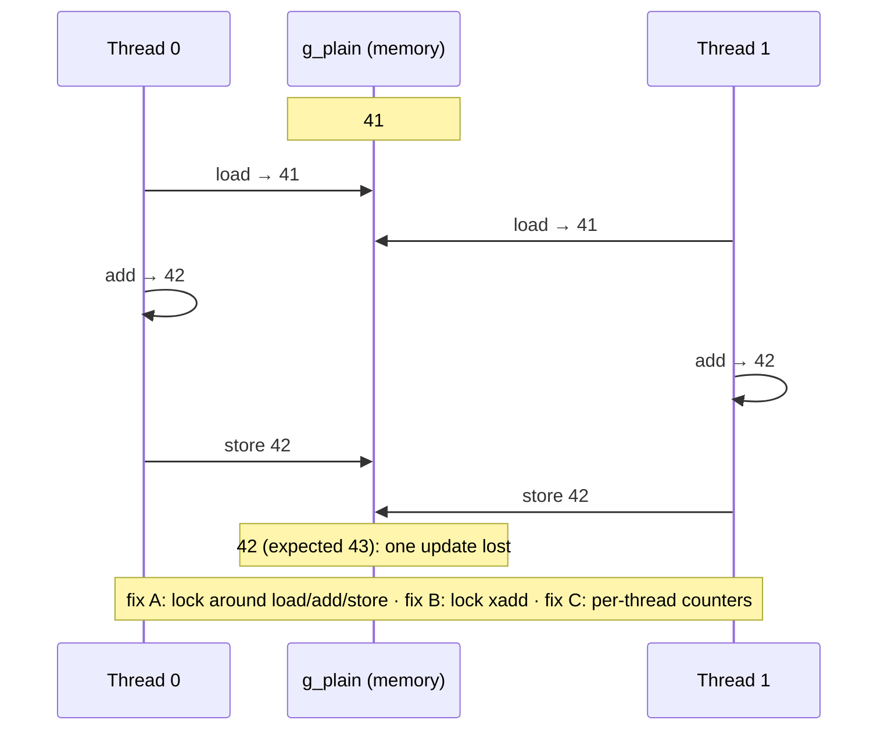

<div dir="rtl">

# ۰۱ — Race condition و critical section

> ماژول ۰۳ · همروندی و همگام‌سازی · Linux v6.18.63 · OpenBSD 8cada8c · نسخهٔ انگلیسی: [01-race-conditions-critical-sections.en.md](01-race-conditions-critical-sections.en.md)

## ۱. خلاصه

- **Race condition** هر باگی است که نتیجه‌اش به ترتیب درهم‌رفتن نخ‌ها بستگی دارد. **Data race** اصطلاح دقیق‌تر C11 است: دو دسترسیِ بدون همگام‌سازی به یک خانهٔ حافظه که دست‌کم یکی نوشتن است. این رفتار تعریف‌نشده (UB) است.
- **Critical section** کدی است که به وضعیت مشترک دست می‌زند. پروتکل درست برای آن سه چیز می‌دهد: mutual exclusion، progress و bounded waiting.
- فقط سه راه‌حل وجود دارد: بخش را سریالی کنیم (قفل)، آن را یک دستور تجزیه‌ناپذیر کنیم (atomic RMW)، یا اصلاً اشتراک نگذاریم (دادهٔ مخصوص هر نخ که آخر کار جمع می‌شود). آزمایش ۰۱ هر سه را اندازه می‌گیرد.

## ۲. توضیح

### ۲.۱ شهود: `count++` سه گام است

`count++` روی x86-64 به load، add و store ترجمه می‌شود (یا یک `add` روی حافظه، که CPU باز هم آن را به شکل خواندن-تغییر-نوشتن اجرا می‌کند، مگر پیشوند `lock` داشته باشد). اگر دو نخ هر دو ۴۱ را بخوانند، هر دو ۴۲ می‌نویسند. یک افزایش گم می‌شود و هیچ خطایی هم دیده نمی‌شود. برنامه «زیر بار کمی خطا دارد» نیست؛ نتیجه‌اش را زمان‌بندی تعیین می‌کند.

| اصطلاح | تعریف | مثال |
|---|---|---|
| Race condition | درستی به ترتیب درهم‌رفتن وابسته است | بررسی-سپس-اقدام روی فایل (`access()` و بعد `open()`)، به‌روزرسانی‌های گم‌شده |
| Data race | دو دسترسی هم‌زمان، دست‌کم یکی نوشتن، بدون ترتیب happens-before | `g_plain++` از دو نخ در آزمایش ۰۱ |
| Critical section | ناحیه‌ای از کد که نباید درهم برود | load-add-store شمارنده |
| Atomicity violation | دو عمل که هر کدام اتمی‌اند ولی *ترکیبشان* باید اتمی باشد | <span dir="ltr">`if (atomic_load(&x) == 0) atomic_store(&x, 1);`</span> |

برنامه می‌تواند race condition داشته باشد بدون data race (همهٔ دسترسی‌ها اتمی‌اند ولی منطق بینشان نه)، و می‌تواند data race داشته باشد که روی x86 اتفاقاً جواب درست بدهد. C11 به این اهمیت نمی‌دهد: data race روی شیء غیراتمی **کل برنامه** را تعریف‌نشده می‌کند، پس کامپایلر اجازه دارد دسترسی‌ها را cache کند، بشکند یا حذف کند.

### ۲.۲ پروتکل درست critical section چه باید بدهد

| شرط | معنا | چه چیزی نقضش می‌کند |
|---|---|---|
| Mutual exclusion | حداکثر یک نخ داخل باشد | نبود قفل، یا پروتکل پرچمی معیوب |
| Progress | اگر کسی داخل نیست، بالاخره یکی از متقاضی‌ها وارد شود | نوبت‌دهی سخت (فقط `turn`) |
| Bounded waiting | نخ منتظر فقط تعداد محدودی بار جا بماند | spinlockهای غیرمنصف، rwlockهای طرفدار خواننده (آزمایش ۰۳) |

**الگوریتم Peterson** برای دو نخ، فقط با load و store ساده، هر سه شرط را برآورده می‌کند:

</div>

```c
// Peterson for thread i (j = 1 - i); flag[] and turn are shared
flag[i] = 1;          // I want to enter
turn = j;             // but you go first
while (flag[j] && turn == j)
    ;                 // wait
/* critical section */
flag[i] = 0;
```

<div dir="rtl">

این الگوریتم فقط با فرض **sequential consistency** درست است. روی x86-TSO، store مربوط به <span dir="ltr">`flag[i] = 1`</span> می‌تواند در store buffer بماند در حالی که load مربوط به <span dir="ltr">`flag[j]`</span> مقدار ۰ را از cache می‌خواند. آن‌وقت هر دو نخ پرچم دیگری را ۰ می‌بینند و هر دو وارد می‌شوند. این دقیقاً همان جابه‌جایی store→load در litmus test از نوع store-buffering است که [آزمایش ۰۵](../labs/05-litmus-sb/README.md) اندازه می‌گیرد. راه‌حل یک barrier کامل است (`atomic_thread_fence(memory_order_seq_cst)`، یا `smp_mb()` در کرنل) بین storeها و حلقه. [یادداشت ۰۳](03-x86-tso-and-barriers.fa.md) را ببینید.

### ۲.۳ همروندی در کرنل از کجا می‌آید

| منبع | کجا می‌تواند وسط کد شما بیاید | محافظت |
|---|---|---|
| CPU دیگر | هر جا، هر زمان | spinlock / mutex / atomic / RCU |
| Preemption (`CONFIG_PREEMPT*`) | هر نقطه‌ای که preemption روشن است | `preempt_disable()`، یا هر spinlock (خودش preemption را خاموش می‌کند) |
| وقفهٔ سخت‌افزاری | هر جا IRQ روشن است | `spin_lock_irqsave()`، `local_irq_save()` |
| Softirq / tasklet | هنگام خروج از IRQ، `local_bh_enable()` | `spin_lock_bh()` |
| خوابیدن داخل بخش | `kmalloc(GFP_KERNEL)`، `copy_from_user()` | به‌جای spinlock از mutex استفاده کنید |

فضای کاربر منابع کم‌تری دارد (نخ‌های دیگر، سیگنال‌ها) ولی قاعده همان است: اگر دو بستر اجرایی می‌توانند به داده دست بزنند، پروتکل لازم است.

### ۲.۴ پیدا کردن raceها

- **ThreadSanitizer** (<span dir="ltr">`gcc -fsanitize=thread`</span>) همهٔ دسترسی‌های حافظه را instrument می‌کند و برای هر نخ یک vector clock نگه می‌دارد. دو دسترسی را گزارش می‌کند که هیچ لبهٔ happens-before (رهاکردن قفل ← گرفتنش، ساخت و join نخ، اتمی‌ها) ترتیبشان را مشخص نکرده باشد. race را حتی در اجرایی که جواب اتفاقاً درست بوده پیدا می‌کند. هزینه: تقریباً ۵ تا ۱۵ برابر کندتر و ۵ تا ۱۰ برابر حافظه.
- **KCSAN** آشکارساز نمونه‌گیرِ data race در کرنل است (<span dir="ltr">`kernel/kcsan/core.c`</span> و <span dir="ltr">`include/linux/kcsan-checks.h`</span>، هر دو در checkout موجودند). روی یک دسترسیِ نمونه‌گیری‌شده watchpoint می‌گذارد و اگر CPU دیگری در همان فاصله به همان آدرس دست بزند گزارش می‌دهد. دسترسی‌هایی که با `READ_ONCE()` و `WRITE_ONCE()` علامت خورده‌اند «علامت‌دار» حساب می‌شوند (عمداً racy، ولی پاره نمی‌شوند).

## ۳. نمودار

</div>



<div dir="rtl">

## ۴. مثال حل‌شده

### ۴.۱ حلقهٔ worker در آزمایش ۰۱

</div>

```c
// labs/01-data-race/race.c · worker() (lab code)
static void *worker(void *arg)
{
    (void)arg;
    for (long i = 0; i < g_iters; i++) {
        switch (g_mode) {
        case MODE_RACE:
            g_plain++;                      // load, add, store: 3 steps
            break;
        case MODE_MUTEX:
            pthread_mutex_lock(&g_lock);
            g_plain++;
            pthread_mutex_unlock(&g_lock);
            break;
        case MODE_ATOMIC:
            atomic_fetch_add_explicit(&g_atomic, 1, memory_order_relaxed);
            break;
        }
    }
    return NULL;
}
```

<div dir="rtl">

- `g_plain` از نوع <span dir="ltr">`static volatile long`</span> است. `volatile` در هر دور یک load و یک store را اجباری می‌کند تا gcc نتواند حلقه را به <span dir="ltr">`g_plain += g_iters`</span> خلاصه کند. ولی افزایش را اتمی **نمی‌کند**.
- `MODE_MUTEX` سه گام را سریالی می‌کند (راه‌حل الف). `MODE_ATOMIC` آن‌ها را یک دستور `lock xadd` می‌کند (راه‌حل ب). فایل تمرین تکمیلی <span dir="ltr">`solution/sharded.c`</span> راه‌حل ج است.

real run: gcc 13 in Docker on the Windows host (WSL2), not the course VM — VM numbers are in the lab README.

</div>

```text
mode=race   threads=4 expected=4000000 got=1625176 lost=2374824 time=0.019s ns/inc=4.7
mode=mutex  threads=4 expected=4000000 got=4000000 lost=0 time=0.181s ns/inc=45.2
mode=atomic threads=4 expected=4000000 got=4000000 lost=0 time=0.121s ns/inc=30.2
```

<div dir="rtl">

بیش از نیمی از افزایش‌ها ناپدید شد. نسخه‌های درست به ازای هر افزایش ۶ تا ۱۰ برابر کندترند، چون چهار هسته سر یک cache line دعوا می‌کنند.

### ۴.۲ گزارش ThreadSanitizer

در همان محیط (در Docker لازم بود با <span dir="ltr">`setarch x86_64 -R`</span> اجرا شود، چون TSan آن‌جا چیدمان تصادفی حافظه را نمی‌پذیرد):

</div>

```text
WARNING: ThreadSanitizer: data race (pid=12)
  Read of size 8 at 0x000000404110 by thread T2:
    #0 worker 01-data-race/race.c:33 (rt+0x4012ed)
  Previous write of size 8 at 0x000000404110 by thread T1:
    #0 worker 01-data-race/race.c:33 (rt+0x401302)
  Location is global 'g_plain' of size 8 at 0x000000404110 (rt+0x404110)
...
mode=race   threads=2 expected=2000 got=2000 lost=0 time=0.006s ns/inc=2816.9
```

<div dir="rtl">

گزارش را به این ترتیب بخوانید: دو **دسترسی** (خواندن توسط T2 و نوشتن قبلی توسط T1، هر دو در خط ۳۳)، **محل** (متغیر سراسری `g_plain`)، و بعد stackهای ساخت نخ‌ها. به خط آخر دقت کنید: با فقط ۱۰۰۰ دور جواب *درست* بود و باز هم TSan race را گزارش کرد. TSan نبودِ ترتیب را پیدا می‌کند، نه خروجی غلط را.

### ۴.۳ کرنل دسترسی سادهٔ عمدی را چطور علامت می‌زند

</div>

```c
linux/include/asm-generic/rwonce.h · READ_ONCE / WRITE_ONCE · v6.18.63 · L44-62
   44  #define __READ_ONCE(x)	(*(const volatile __unqual_scalar_typeof(x) *)&(x))
   47  #define READ_ONCE(x)							\
   48  ({									\
   49  	compiletime_assert_rwonce_type(x);				\
   50  	__READ_ONCE(x);							\
   51  })
   53  #define __WRITE_ONCE(x, val)						\
   54  do {									\
   55  	*(volatile typeof(x) *)&(x) = (val);				\
   56  } while (0)
   58  #define WRITE_ONCE(x, val)						\
   59  do {									\
   60  	compiletime_assert_rwonce_type(x);				\
   61  	__WRITE_ONCE(x, val);						\
   62  } while (0)
```

<div dir="rtl">

Elixir: <span dir="ltr">https://elixir.bootlin.com/linux/v6.18.63/source/include/asm-generic/rwonce.h#L44</span>

- **خط ۴۴**: دسترسی `volatile` از راه cast: کامپایلر باید دقیقاً یک load تولید کند، نه آن را در register نگه دارد و نه دوباره بخواند.
- **خط ۴۹ و ۶۰**: `compiletime_assert_rwonce_type()` نوع‌هایی را که با یک دستور خوانده نمی‌شوند رد می‌کند، تا دسترسی هرگز به دو نیمه **پاره** نشود.
- **خط ۵۵**: همتای store.
- چه چیزی *نمی‌دهد*: نه RMW اتمی و نه ترتیب در سطح CPU. <span dir="ltr">`WRITE_ONCE(x, x + 1)`</span> از دو CPU هنوز به‌روزرسانی‌ها را گم می‌کند، درست مثل شمارندهٔ `volatile` آزمایش ۰۱. این روش کرنل برای گفتن این است که «این race عمدی است و لازم دارم هر دسترسی دقیقاً یک بار انجام شود» (KCSAN هم آن را علامت‌دار حساب می‌کند).

## ۵. حالت‌های مرزی و دام‌ها

- **«هزار بار اجرا شد و درست بود.»** raceها به زمان‌بندی وابسته‌اند. VM تک‌هسته‌ای، debugger یا یک `printf` می‌تواند پنهانشان کند. از TSan استفاده کنید، نه تکرار.
- **`volatile` یعنی اتمی نیست.** برای MMIO و signal handlerهاست. نه اتمی‌بودن RMW می‌دهد و نه ترتیب بین CPUها.
- **بررسی-سپس-اقدام.** <span dir="ltr">`if (!map.contains(k)) map.insert(k, v);`</span> race است، حتی اگر هر فراخوانی داخلش قفل داشته باشد. یک قفل را روی هر دو نگه دارید یا از «درج اگر نبود» اتمی استفاده کنید.
- **خواندن پاره.** مقدار ۶۴ بیتی روی CPU سی‌ودو بیتی، یا یک struct، می‌تواند نیمه‌قدیمی نیمه‌جدید خوانده شود. به همین دلیل `READ_ONCE()` نوع غیراسکالر را نمی‌پذیرد.
- **raceهای «بی‌خطر» به‌ندرت بی‌خطرند.** در C11 کامپایلر فرض می‌کند data race نیست و مثلاً می‌تواند load را از حلقهٔ انتظار بیرون بکشد و آن را حلقهٔ بی‌پایان کند. برای خواندن عمداً racy از <span dir="ltr">`atomic_load_explicit(..., memory_order_relaxed)`</span> استفاده کنید.
- **شمارنده‌های per-CPU یا per-thread** (راه‌حل ج) باید تا اندازهٔ یک cache line padding داشته باشند، وگرنه شمارنده‌های همسایه یک خط مشترک دارند و هسته‌ها باز هم دعوا می‌کنند (false sharing؛ تمرین تکمیلی آزمایش ۰۱).
- **TSan در container**: پیام «unexpected memory mapping» یعنی چیدمان فضای آدرس سازگار نیست. با <span dir="ltr">`setarch $(uname -m) -R`</span> اجرا کنید. روی VM درس مستقیم کار می‌کند (README آزمایش را ببینید).

## ۶. نکته‌های کلیدی امتحان

- Race condition یعنی نتیجهٔ وابسته به زمان‌بندی. Data race یعنی دسترسی‌های متعارضِ بدون همگام‌سازی، که در C11 و C++11 رفتار تعریف‌نشده است.
- شرایط critical section: mutual exclusion، progress، bounded waiting.
- `count++` یعنی load + add + store. راه‌حل‌ها: قفل (سریالی‌کردن)، atomic RMW (`lock xadd`)، عدم اشتراک (جمع در پایان).
- الگوریتم Peterson به sequential consistency نیاز دارد. روی x86-TSO بدون fence کامل بین «پرچم خودم را بگذارم» و «پرچم تو را بخوانم» شکست می‌خورد.
- منابع همروندی در کرنل: CPUهای دیگر، preemption، hardirq، softirq. هر کدام ابزار محافظت خودش را دارد.
- `READ_ONCE` و `WRITE_ONCE` جلوی پاره‌کردن و ادغام دسترسی توسط کامپایلر را می‌گیرند، نه جابه‌جایی CPU را و نه گم‌شدن به‌روزرسانی را.
- TSan نبودِ happens-before را حتی وقتی خروجی درست بوده گزارش می‌کند. KCSAN معادل آن در کرنل است.

## ۷. پیوندها

- درس: [۴.۱ وقتی دو نخ `count++` اجرا می‌کنند چه خراب می‌شود؟](../lesson.fa.md#41-what-goes-wrong-when-two-threads-run-count)
- مرور کد کرنل: [kernel-walkthrough.fa.md](../kernel-walkthrough.fa.md)
- یادداشت‌ها: [۰۲ اتمی‌ها](02-atomics-c11-memory-model.fa.md) · [۰۳ مدل x86-TSO و barrierها](03-x86-tso-and-barriers.fa.md) · [۰۴ spinlock](04-spinlocks-qspinlock.fa.md) · [۰۵ mutex](05-mutex-optimistic-spinning.fa.md)
- آزمایش‌ها: [۰۱ data race](../labs/01-data-race/README.md) · [۰۵ litmus از نوع store-buffering](../labs/05-litmus-sb/README.md) (چرا Peterson می‌شکند)
- آزمون: [پرسش ۱](../quiz.fa.md) (race و critical section) · [پرسش ۱۱](../quiz.fa.md) (خواندن گزارش TSan)

</div>
