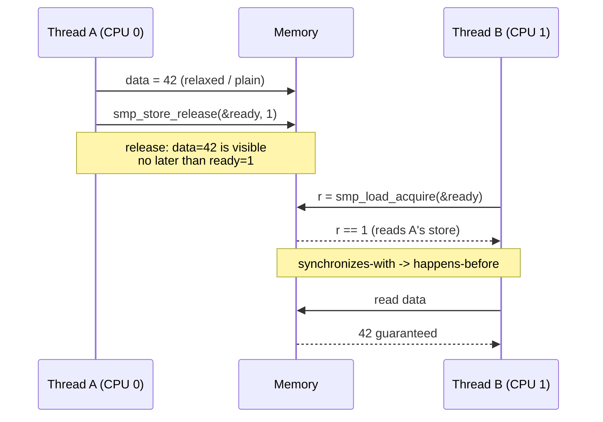

# 02 — Atomics and the C11 memory model

> Module 03 · Concurrency & Synchronization · Linux v6.18.63 · OpenBSD 8cada8c · Farsi: [02-atomics-c11-memory-model.fa.md](02-atomics-c11-memory-model.fa.md)

## 1. Summary

- "Atomic" means two separate things: the operation is **indivisible** (no one sees half of it), and it carries an **ordering** guarantee for the memory operations around it.
- C11 gives five orderings: `relaxed`, `acquire`, `release`, `acq_rel`, `seq_cst`. A release store that an acquire load reads creates **synchronizes-with**, and from that **happens-before**.
- The Linux kernel does not use C11 atomics. It has its own model (LKMM) and API (`READ_ONCE`, `smp_store_release`, `atomic_try_cmpxchg_acquire`, `smp_mb`), and on x86-64 most of them compile to plain `mov`.

## 2. Explanation

### 2.1 Two properties, not one

Take `counter++` from [lab 03.1](../labs/01-data-race/README.md). It fails for a reason that has nothing to do with ordering. It is three steps (load, add, store), and another core's store can land between them. The fix for that is **atomicity**: a single read-modify-write (RMW) instruction such as `lock xadd`.

Ordering is a different problem. Look at this:

```c
data = 42;        // plain store
ready = 1;        // flag
```

Each store is atomic on its own (aligned `int` stores never tear on x86-64). Another thread can still see `ready == 1` and then read the old `data`, because neither the compiler nor the CPU is required to keep the two stores in program order. Ordering decides **which other memory operations become visible together with this one**.

| Property | Question it answers | Tool |
|---|---|---|
| Atomicity | Can anyone observe a half-done operation? | RMW instructions (`lock` prefix), aligned word access |
| Ordering | In what order do other cores see my loads/stores? | memory_order arguments, fences, barriers |
| Visibility (compiler) | Will the compiler keep this access at all? | `atomic_*`, `volatile`, `READ_ONCE` |

### 2.2 The C11 orderings

| `memory_order` | Guarantee | Typical use |
|---|---|---|
| `relaxed` | Atomic only. No ordering with other variables | statistics counters, `fetch_add` on a ticket |
| `release` (stores) | All my earlier reads and writes become visible **before** this store | unlock, "publish" a pointer or flag |
| `acquire` (loads) | None of my later reads and writes can move **before** this load | lock, "consume" a published flag |
| `acq_rel` (RMW) | both: acquire on the read part, release on the write part | `cmpxchg` in lock-free stacks |
| `seq_cst` | acq_rel, **plus** one global total order of all seq_cst operations | default; the only one that forbids the store-buffering outcome |

### 2.3 Happens-before

The formal rule fits on one line. If thread A does a **release** store to `M` and thread B does an **acquire** load of `M` that **reads that value**, then A's store *synchronizes-with* B's load. Everything A did before the store *happens-before* everything B does after the load.

A **data race** is two accesses to the same location from different threads, at least one a write, at least one non-atomic, and not ordered by happens-before. In C11 a data race is **undefined behaviour**, not just "a wrong number". The compiler may assume a race never happens. It can merge loads, hoist them out of loops, or invent stores. That is why lab 03.1 marks the racy counter `volatile`: without it `gcc -O2` may fold the whole loop into one add, and the race would disappear in a misleading way.

### 2.4 Why seq_cst is special

Release/acquire orders **pairs** of threads that communicate through one variable. It does **not** forbid the store-buffering (SB) outcome from [lab 03.5](../labs/05-litmus-sb/README.md):

```text
T0: x = 1 (release); r0 = y (acquire)     T1: y = 1 (release); r1 = x (acquire)
r0 == 0 && r1 == 0   -> allowed with release/acquire, forbidden with seq_cst
```

Only a **store→load** barrier forbids it, and on x86-64 that is the one reordering the hardware does (see [note 03](03-x86-tso-and-barriers.en.md)). This is why `seq_cst` stores and fences cost real instructions on x86, while acquire/release cost nothing.

### 2.5 The kernel's own model (LKMM)

The kernel is written in C, but it does **not** use `<stdatomic.h>`. It uses its own primitives with semantics defined by the Linux-Kernel Memory Model. The prose specification is `Documentation/memory-barriers.txt`, which is present in our checkout. The formal model lives in `tools/memory-model/`, which is **not** in our sparse checkout (UNVERIFIED here; browse it on Elixir or add it with `git -C _shared/sources/linux sparse-checkout add tools/memory-model`).

| C11 | Linux kernel | x86-64 code (gcc 13, see §4) |
|---|---|---|
| `atomic_load_explicit(.., relaxed)` | `READ_ONCE(x)` | `mov` |
| `atomic_store_explicit(.., relaxed)` | `WRITE_ONCE(x, v)` | `mov` |
| `atomic_load_explicit(.., acquire)` | `smp_load_acquire(p)` | `mov` |
| `atomic_store_explicit(.., release)` | `smp_store_release(p, v)` | `mov` |
| `atomic_store_explicit(.., seq_cst)` | `smp_store_mb(var, v)` (`xchg` on x86) | `xchg` |
| `atomic_fetch_add` | `atomic_fetch_add()` / `atomic_inc()` | `lock xadd` / `lock incl` |
| `atomic_compare_exchange_strong(.., acquire)` | `atomic_try_cmpxchg_acquire()` | `lock cmpxchg` |
| `atomic_thread_fence(seq_cst)` | `smp_mb()` | `lock orq $0,(%rsp)` (gcc) / `lock addl $0,-4(%rsp)` (kernel) |
| `atomic_thread_fence(acq_rel)` | `smp_rmb()` / `smp_wmb()` | nothing (compiler barrier) |

Differences that matter:

- The kernel has **address and control dependencies**. `rcu_dereference()` relies on the CPU not reordering a load with a later load through the pointer it returned ([note 08](08-rcu.en.md)). C11's `memory_order_consume` was meant for this, but compilers implement it as acquire.
- Kernel value-returning RMW atomics (`atomic_inc_return`, `xchg`, `cmpxchg`) are **fully ordered**. Non-returning ones (`atomic_inc`) are unordered. See `Documentation/atomic_t.txt`, which is in the checkout.
- **Rust** follows the C++20 model: `Ordering::{Relaxed, Release, Acquire, AcqRel, SeqCst}` mean the same as the C11 names. Rust code inside the kernel calls the kernel's own primitives, not `core::sync::atomic`.

## 3. Diagram



## 4. Worked example

### 4.1 Release/acquire inside the kernel's spinlock

The qspinlock fast path is a release/acquire pair around the critical section:

```text
linux/include/asm-generic/qspinlock.h · queued_spin_lock() · v6.18.63 · L107-115
  107  static __always_inline void queued_spin_lock(struct qspinlock *lock)
  108  {
  109  	int val = 0;
  110
  111  	if (likely(atomic_try_cmpxchg_acquire(&lock->val, &val, _Q_LOCKED_VAL)))
  112  		return;
  113
  114  	queued_spin_lock_slowpath(lock, val);
  115  }
```

<https://elixir.bootlin.com/linux/v6.18.63/source/include/asm-generic/qspinlock.h#L107>

- **L109**: the expected value is `0`, which means unlocked, no pending bit, no queue.
- **L111**: one atomic RMW. If the word is 0, it becomes `_Q_LOCKED_VAL` (1). `_acquire` means that no load or store from the critical section can be performed before the lock is seen as taken. `try_` means that on failure `val` is updated with the value actually seen, so the slow path doesn't need to re-read it.
- **L114**: contended. Go queue up (MCS). See [note 04](04-spinlocks-qspinlock.en.md).

```text
linux/include/asm-generic/qspinlock.h · queued_spin_unlock() · v6.18.63 · L123-129
  123  static __always_inline void queued_spin_unlock(struct qspinlock *lock)
  124  {
  125  	/*
  126  	 * unlock() needs release semantics:
  127  	 */
  128  	smp_store_release(&lock->locked, 0);
  129  }
```

<https://elixir.bootlin.com/linux/v6.18.63/source/include/asm-generic/qspinlock.h#L123>

- **L128**: a plain byte store with **release**. Every write made inside the critical section becomes visible before the next owner's `cmpxchg_acquire` succeeds. Unlock needs no RMW: only the owner writes `locked = 0`, so the store just has to be ordered, not made atomic against other writers.

The mutex fast path is the same idea, with `current` as the value (`kernel/locking/mutex.c` L157, `atomic_long_try_cmpxchg_acquire(&lock->owner, &zero, curr)`; see [note 05](05-mutex-optimistic-spinning.en.md)).

### 4.2 What the orderings cost on x86-64

The C11 functions were compiled with `gcc -Wall -Wextra -O2 -c` and disassembled with `objdump -d`. This is real output from **gcc 13.5.0 (Docker on the host), x86-64**, not from the VM:

```text
store_relaxed:  mov    %edi,0x0(%rip)
store_release:  mov    %edi,0x0(%rip)
store_seq_cst:  xchg   %edi,0x0(%rip)
load_acquire:   mov    0x0(%rip),%eax
load_seq_cst:   mov    0x0(%rip),%eax
fetch_add:      mov    %edi,%eax
                lock xadd %eax,0x0(%rip)
cas_acquire:    mov    %edi,%eax
                lock cmpxchg %esi,0x0(%rip)
                sete   %al
fence_seq_cst:  lock orq $0x0,(%rsp)
fence_acq_rel:  ret
```

Reading it:

| Line | Meaning |
|---|---|
| relaxed = release = `mov` | x86-TSO already keeps store→store order, so release is free |
| acquire = seq_cst load = `mov` | TSO keeps load→load and load→store order, so acquire is free |
| seq_cst store = `xchg` | `xchg` with memory is implicitly `lock`ed and drains the store buffer. This is the store→load barrier |
| `lock xadd`, `lock cmpxchg` | RMW atomicity; every `lock` instruction is also a full barrier on x86 |
| seq_cst fence = `lock orq $0,(%rsp)` | gcc 13 uses a locked no-op on the stack instead of `mfence` (cheaper on many CPUs). The kernel's `__smp_mb()` uses the same trick: `lock addl $0,-4(%rsp)` (`arch/x86/include/asm/barrier.h` L53). VERSION-DEPENDENT: older gcc emitted `mfence` |
| acq_rel fence = nothing | only a compiler barrier on x86 |

ARCH-SPECIFIC (x86-64): on Arm64 `release` becomes `stlr`, `acquire` becomes `ldar`, and `relaxed` really is weaker. Code that "works" with relaxed on x86 can break there ([lab 03.5](../labs/05-litmus-sb/README.md) extension, the MP test).

## 5. Edge cases & pitfalls

| Pitfall | Why it is wrong | Fix |
|---|---|---|
| "`volatile` makes it thread-safe" | `volatile` stops compiler folding only. No atomic RMW, no CPU ordering | `atomic_*` / `_Atomic`, or a lock |
| Relaxed flag + plain data ("works on my laptop") | x86 hides the bug. Arm/POWER and the compiler may reorder | release on the flag store, acquire on the flag load |
| Acquire/release to stop store→load reordering | They don't (SB outcome still allowed) | `seq_cst` or `atomic_thread_fence(seq_cst)` / `smp_mb()` |
| Atomic variable, non-atomic invariant | `a` and `b` each atomic does not make `a+b` consistent | lock, or pack both into one word for a single cmpxchg |
| `cmpxchg` loop ignoring ABA | value went A→B→A, cmpxchg succeeds on stale state | tags/counters, hazard pointers, RCU |
| Mixing C11 atomics in kernel code | the kernel ignores `<stdatomic.h>` | `READ_ONCE`, `smp_*`, `atomic_t` API |
| Unaligned or > 8-byte "atomic" | may tear or fall back to a lock (`atomic_is_lock_free`) | aligned machine words |

## 6. Exam key points

- Atomicity (indivisible) and ordering (visibility order) are **independent** properties.
- A release store read by an acquire load → synchronizes-with → happens-before.
- C11 data race = **undefined behaviour**, not just a lost update.
- Only `seq_cst` (or a full fence) forbids the SB outcome `r0 == r1 == 0`.
- x86-64: acquire and release loads/stores are plain `mov`. A seq_cst store is `xchg`. A full fence is `mfence` or a `lock`ed no-op. Every `lock` RMW is a full barrier.
- The kernel uses the LKMM (`Documentation/memory-barriers.txt`), not C11. `smp_store_release`/`smp_load_acquire` ≈ C11 release/acquire, and `smp_mb()` ≈ seq_cst fence.
- Kernel value-returning atomics are fully ordered. Void ones are relaxed.
- `queued_spin_lock` = `cmpxchg_acquire`, `queued_spin_unlock` = `smp_store_release`: the minimum needed for a correct lock.

## 7. Links

- Lesson: [§4.2 What does the hardware actually promise?](../lesson.en.md#42-what-does-the-hardware-actually-promise)
- Walkthrough: [kernel-walkthrough.en.md](../kernel-walkthrough.en.md) (spinlock and mutex fast paths)
- Labs: [03.1 data race → TSan → mutex → atomics](../labs/01-data-race/README.md), [03.5 store-buffering litmus test](../labs/05-litmus-sb/README.md)
- Quiz: [Q2 (acquire/release)](../quiz.en.md), Q8 (`queued_spin_unlock`), Q15 (SB fence design)
- Related notes: [03 x86-TSO and barriers](03-x86-tso-and-barriers.en.md), [04 spinlocks](04-spinlocks-qspinlock.en.md), [07 futex](07-futex-user-kernel-split.en.md), [08 RCU](08-rcu.en.md)
- Sources: `linux/Documentation/memory-barriers.txt`, `linux/Documentation/atomic_t.txt` (both in the checkout, v6.18.63)
