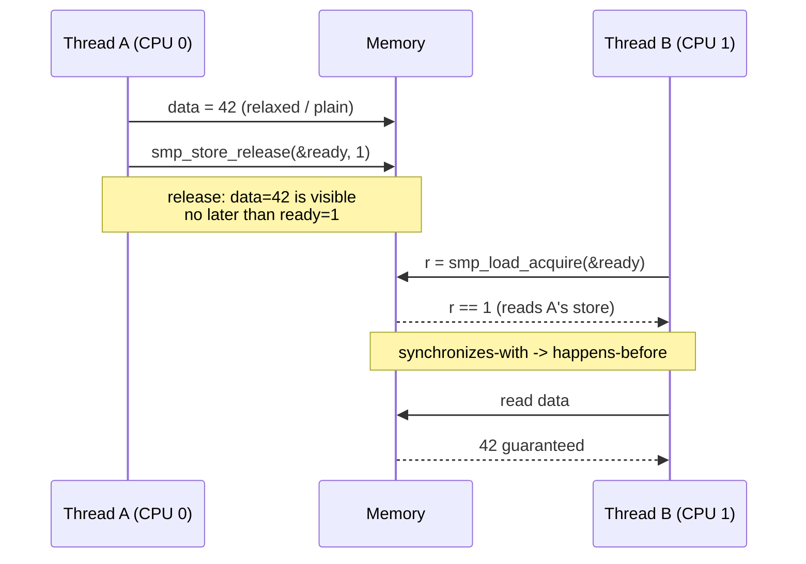

<div dir="rtl">

# ۰۲ — Atomicها و مدل حافظهٔ C11

> ماژول ۰۳ · همروندی و همگام‌سازی · Linux v6.18.63 · OpenBSD 8cada8c · نسخهٔ انگلیسی: [02-atomics-c11-memory-model.en.md](02-atomics-c11-memory-model.en.md)

## ۱. خلاصه

- «Atomic» دو معنای جدا دارد: عملیات **تجزیه‌ناپذیر** است (هیچ‌کس نیمه‌کارهٔ آن را نمی‌بیند)، و یک تضمین **ترتیب (ordering)** هم برای عملیات حافظهٔ اطرافش می‌دهد.
- C11 پنج ترتیب دارد: `relaxed`، `acquire`، `release`، `acq_rel` و `seq_cst`. وقتی یک load از نوع acquire مقدارِ یک store از نوع release را بخواند، رابطهٔ **synchronizes-with** برقرار می‌شود و از آن رابطهٔ **happens-before** به دست می‌آید.
- کرنل لینوکس از atomicهای C11 استفاده نمی‌کند. مدل خودش (LKMM) و API خودش را دارد (`READ_ONCE`، `smp_store_release`، `atomic_try_cmpxchg_acquire`، `smp_mb`)، و روی x86-64 بیشترِ آن‌ها به یک `mov` ساده کامپایل می‌شوند.

## ۲. توضیح

### ۲.۱ دو ویژگی، نه یکی

`counter++` در [آزمایش ۰۳.۱](../labs/01-data-race/README.md) به دلیلی خراب می‌شود که ربطی به ترتیب ندارد. این دستور سه گام است (load، add، store) و store یک هستهٔ دیگر می‌تواند بین این گام‌ها بنشیند. درمانش **atomicity** است، یعنی یک دستور read-modify-write (RMW) مثل `lock xadd`.

ترتیب مسئلهٔ دیگری است:

</div>

```c
data = 42;        // plain store
ready = 1;        // flag
```

<div dir="rtl">

هر کدام از این دو store به‌تنهایی atomic است (روی x86-64، store یک `int` هم‌تراز هیچ‌وقت نصفه نوشته نمی‌شود). با این حال نخ دیگر ممکن است اول `ready == 1` را ببیند و بعد مقدار قدیمی `data` را بخواند، چون نه کامپایلر و نه CPU موظف نیستند ترتیب این دو store را مطابق برنامه نگه دارند. ترتیب تعیین می‌کند **کدام عملیات حافظهٔ دیگر همراه با این عملیات قابل‌مشاهده می‌شوند**.

| ویژگی | به چه سؤالی جواب می‌دهد | ابزار |
|---|---|---|
| Atomicity | آیا کسی می‌تواند عملیات نیمه‌تمام را ببیند؟ | دستورهای RMW (پیشوند `lock`)، دسترسی هم‌تراز به یک word |
| Ordering | هسته‌های دیگر load/storeهای من را به چه ترتیبی می‌بینند؟ | آرگومان‌های memory_order، fence، barrier |
| دیده‌شدن برای کامپایلر | آیا کامپایلر اصلاً این دسترسی را نگه می‌دارد؟ | `atomic_*`، `volatile`، `READ_ONCE` |

### ۲.۲ ترتیب‌های C11

| `memory_order` | تضمین | کاربرد رایج |
|---|---|---|
| `relaxed` | فقط atomic؛ هیچ ترتیبی نسبت به متغیرهای دیگر ندارد | شمارندهٔ آماری، `fetch_add` روی ticket |
| `release` (برای store) | همهٔ خواندن‌ها و نوشتن‌های قبلی من **پیش از** این store قابل‌مشاهده می‌شوند | unlock، «منتشر کردن» یک pointer یا flag |
| `acquire` (برای load) | هیچ‌کدام از دسترسی‌های بعدی من نمی‌توانند **قبل از** این load جابه‌جا شوند | lock، «مصرف کردن» flag منتشرشده |
| `acq_rel` (برای RMW) | هر دو: acquire روی بخش خواندن و release روی بخش نوشتن | `cmpxchg` در stackهای lock-free |
| `seq_cst` | acq_rel **به‌اضافهٔ** یک ترتیب کلی واحد بین همهٔ عملیات seq_cst | حالت پیش‌فرض؛ تنها حالتی که نتیجهٔ store-buffering را ممنوع می‌کند |

### ۲.۳ رابطهٔ happens-before

قاعدهٔ رسمی در یک خط جا می‌شود. اگر نخ A روی `M` یک store از نوع **release** انجام دهد و نخ B یک load از نوع **acquire** روی `M` انجام دهد که **همان مقدار را بخواند**، آن store با این load رابطهٔ synchronizes-with دارد. در نتیجه هر کاری که A پیش از آن store کرده، نسبت به هر کاری که B پس از آن load می‌کند happens-before است.

**Data race** یعنی دو دسترسی از دو نخ مختلف به یک خانهٔ حافظه، که دست‌کم یکی نوشتن باشد، دست‌کم یکی غیر atomic باشد، و happens-before آن‌ها را مرتب نکرده باشد. در C11، data race **رفتار تعریف‌نشده (undefined behaviour)** است و فقط «یک عدد غلط» نیست. کامپایلر حق دارد فرض کند race هرگز رخ نمی‌دهد: loadها را ادغام کند، از حلقه بیرون بکشد یا store جدید بسازد. به همین دلیل در آزمایش ۰۳.۱ شمارندهٔ racy را `volatile` کرده‌ایم. بدون آن، `gcc -O2` ممکن است کل حلقه را به یک جمع تبدیل کند و race به شکلی گمراه‌کننده ناپدید شود.

### ۲.۴ چرا seq_cst خاص است

جفت release/acquire فقط **دو نخی** را مرتب می‌کند که از راه یک متغیر با هم حرف می‌زنند. این جفت نتیجهٔ store-buffering (SB) در [آزمایش ۰۳.۵](../labs/05-litmus-sb/README.md) را ممنوع **نمی‌کند**:

</div>

```text
T0: x = 1 (release); r0 = y (acquire)     T1: y = 1 (release); r1 = x (acquire)
r0 == 0 && r1 == 0   -> allowed with release/acquire, forbidden with seq_cst
```

<div dir="rtl">

فقط یک barrier از نوع **store→load** این نتیجه را ممنوع می‌کند، و روی x86-64 این تنها جابه‌جایی‌ای است که خود سخت‌افزار انجام می‌دهد ([یادداشت ۰۳](03-x86-tso-and-barriers.fa.md)). به همین دلیل روی x86 هر store یا fence از نوع `seq_cst` یک دستور واقعی خرج دارد، ولی acquire/release رایگان است.

### ۲.۵ مدل مخصوص کرنل (LKMM)

کرنل به زبان C نوشته شده، ولی از `<stdatomic.h>` استفاده **نمی‌کند**. primitiveهای خودش را دارد و معنای آن‌ها را Linux-Kernel Memory Model تعریف می‌کند. مشخصات متنی‌اش `Documentation/memory-barriers.txt` است که در checkout ما موجود است. مدل رسمی در `tools/memory-model/` است که در sparse checkout ما **نیست**. پس اینجا UNVERIFIED است: آن را در Elixir ببینید یا با `git -C _shared/sources/linux sparse-checkout add tools/memory-model` اضافه کنید.

| C11 | کرنل لینوکس | کد x86-64 (gcc 13، بخش ۴) |
|---|---|---|
| `atomic_load_explicit(.., relaxed)` | `READ_ONCE(x)` | `mov` |
| `atomic_store_explicit(.., relaxed)` | `WRITE_ONCE(x, v)` | `mov` |
| `atomic_load_explicit(.., acquire)` | `smp_load_acquire(p)` | `mov` |
| `atomic_store_explicit(.., release)` | `smp_store_release(p, v)` | `mov` |
| `atomic_store_explicit(.., seq_cst)` | `smp_store_mb(var, v)` (روی x86 همان `xchg`) | `xchg` |
| `atomic_fetch_add` | `atomic_fetch_add()` / `atomic_inc()` | `lock xadd` / `lock incl` |
| `atomic_compare_exchange_strong(.., acquire)` | `atomic_try_cmpxchg_acquire()` | `lock cmpxchg` |
| `atomic_thread_fence(seq_cst)` | `smp_mb()` | `lock orq $0,(%rsp)` (gcc) / `lock addl $0,-4(%rsp)` (کرنل) |
| `atomic_thread_fence(acq_rel)` | `smp_rmb()` / `smp_wmb()` | هیچ (فقط compiler barrier) |

تفاوت‌های مهم:

- کرنل به **وابستگی آدرس و وابستگی کنترلی** تکیه می‌کند. `rcu_dereference()` فرض می‌کند CPU یک load را با load بعدی که از همان pointer برگشتی استفاده می‌کند جابه‌جا نمی‌کند ([یادداشت ۰۸](08-rcu.fa.md)). `memory_order_consume` در C11 برای همین ساخته شد، ولی کامپایلرها آن را مثل acquire پیاده می‌کنند.
- atomicهای RMW کرنل که مقدار برمی‌گردانند (`atomic_inc_return`، `xchg`، `cmpxchg`) **کاملاً مرتب (fully ordered)** هستند. آن‌هایی که مقدار برنمی‌گردانند (`atomic_inc`) هیچ ترتیبی ندارند. جزئیات در `Documentation/atomic_t.txt` است که در checkout موجود است.
- **Rust** از مدل C++20 پیروی می‌کند: `Ordering::{Relaxed, Release, Acquire, AcqRel, SeqCst}` همان معنای نام‌های C11 را دارد. کد Rust داخل کرنل primitiveهای خود کرنل را صدا می‌زند، نه `core::sync::atomic`.

## ۳. نمودار

</div>



<div dir="rtl">

## ۴. مثال حل‌شده

### ۴.۱ جفت release/acquire داخل spinlock کرنل

مسیر سریع qspinlock یک جفت release/acquire دور ناحیهٔ بحرانی است:

</div>

```text
linux/include/asm-generic/qspinlock.h · queued_spin_lock() · v6.18.63 · L107-115
  107  static __always_inline void queued_spin_lock(struct qspinlock *lock)
  108  {
  109  	int val = 0;
  110
  111  	if (likely(atomic_try_cmpxchg_acquire(&lock->val, &val, _Q_LOCKED_VAL)))
  112  		return;
  113
  114  	queued_spin_lock_slowpath(lock, val);
  115  }
```

<div dir="rtl">

<https://elixir.bootlin.com/linux/v6.18.63/source/include/asm-generic/qspinlock.h#L107>

- **L109**: مقدار مورد انتظار `0` است، یعنی قفل آزاد است، بیت pending ندارد و صفی هم در کار نیست.
- **L111**: یک RMW اتمی. اگر word صفر باشد، `_Q_LOCKED_VAL` (یعنی ۱) می‌شود. پسوند `_acquire` یعنی هیچ load یا store داخل ناحیهٔ بحرانی نمی‌تواند پیش از دیده‌شدن قفل انجام شود. پیشوند `try_` یعنی اگر موفق نشود، `val` با مقداری که واقعاً دیده شده پر می‌شود و مسیر کند لازم نیست دوباره بخواند.
- **L114**: قفل رقیب دارد؛ باید در صف (MCS) ایستاد. جزئیات در [یادداشت ۰۴](04-spinlocks-qspinlock.fa.md).

</div>

```text
linux/include/asm-generic/qspinlock.h · queued_spin_unlock() · v6.18.63 · L123-129
  123  static __always_inline void queued_spin_unlock(struct qspinlock *lock)
  124  {
  125  	/*
  126  	 * unlock() needs release semantics:
  127  	 */
  128  	smp_store_release(&lock->locked, 0);
  129  }
```

<div dir="rtl">

<https://elixir.bootlin.com/linux/v6.18.63/source/include/asm-generic/qspinlock.h#L123>

- **L128**: یک store ساده روی یک بایت، با **release**. همهٔ نوشتن‌های داخل ناحیهٔ بحرانی قبل از اینکه `cmpxchg_acquire` صاحب بعدی موفق شود قابل‌مشاهده می‌شوند. unlock به RMW نیاز ندارد: فقط صاحب قفل `locked = 0` را می‌نویسد، پس این store فقط باید مرتب باشد و لازم نیست در برابر نویسندهٔ دیگری atomic باشد.

مسیر سریع mutex هم همین ایده است، با این تفاوت که مقدار `current` را می‌نویسد (`kernel/locking/mutex.c` خط L157: `atomic_long_try_cmpxchg_acquire(&lock->owner, &zero, curr)`). جزئیات در [یادداشت ۰۵](05-mutex-optimistic-spinning.fa.md).

### ۴.۲ هزینهٔ هر ترتیب روی x86-64

توابع C11 با `gcc -Wall -Wextra -O2 -c` کامپایل و با `objdump -d` باز شدند. این خروجی واقعی از **gcc 13.5.0 (Docker روی میزبان)، x86-64** است، نه از VM:

</div>

```text
store_relaxed:  mov    %edi,0x0(%rip)
store_release:  mov    %edi,0x0(%rip)
store_seq_cst:  xchg   %edi,0x0(%rip)
load_acquire:   mov    0x0(%rip),%eax
load_seq_cst:   mov    0x0(%rip),%eax
fetch_add:      mov    %edi,%eax
                lock xadd %eax,0x0(%rip)
cas_acquire:    mov    %edi,%eax
                lock cmpxchg %esi,0x0(%rip)
                sete   %al
fence_seq_cst:  lock orq $0x0,(%rsp)
fence_acq_rel:  ret
```

<div dir="rtl">

| خط | معنا |
|---|---|
| relaxed = release = `mov` | x86-TSO خودش ترتیب store→store را نگه می‌دارد، پس release رایگان است |
| acquire = load از نوع seq_cst = `mov` | TSO ترتیب load→load و load→store را نگه می‌دارد، پس acquire رایگان است |
| store از نوع seq_cst = `xchg` | `xchg` روی حافظه به‌طور ضمنی `lock` دارد و store buffer را خالی می‌کند. این همان barrier از نوع store→load است |
| `lock xadd` و `lock cmpxchg` | atomicity برای RMW؛ روی x86 هر دستور `lock`دار یک barrier کامل هم هست |
| fence از نوع seq_cst = `lock orq $0,(%rsp)` | gcc 13 به‌جای `mfence` یک دستور بی‌اثرِ `lock`دار روی stack می‌گذارد که روی خیلی از CPUها ارزان‌تر است. `__smp_mb()` در کرنل هم همین ترفند را به کار می‌برد: `lock addl $0,-4(%rsp)` (`arch/x86/include/asm/barrier.h` خط L53). VERSION-DEPENDENT: نسخه‌های قدیمی‌تر gcc دستور `mfence` تولید می‌کردند |
| fence از نوع acq_rel = هیچ | روی x86 فقط compiler barrier است |

ARCH-SPECIFIC (x86-64): روی Arm64، `release` به `stlr` و `acquire` به `ldar` تبدیل می‌شود و `relaxed` واقعاً ضعیف‌تر است. کدی که روی x86 با relaxed «کار می‌کند» ممکن است آنجا خراب شود (تمرین تکمیلی [آزمایش ۰۳.۵](../labs/05-litmus-sb/README.md)، آزمون MP).

## ۵. حالت‌های مرزی و دام‌ها

| دام | چرا غلط است | راه درست |
|---|---|---|
| «`volatile` آن را thread-safe می‌کند» | `volatile` فقط جلوی ادغام کامپایلر را می‌گیرد؛ RMW اتمی و ترتیب CPU نمی‌دهد | `atomic_*` / `_Atomic` یا قفل |
| flag از نوع relaxed با دادهٔ معمولی («روی لپ‌تاپ من کار می‌کند») | x86 باگ را پنهان می‌کند؛ Arm/POWER و خود کامپایلر می‌توانند جابه‌جا کنند | release روی store flag و acquire روی load آن |
| acquire/release برای جلوگیری از جابه‌جایی store→load | جلویش را نمی‌گیرند (نتیجهٔ SB همچنان مجاز است) | `seq_cst` یا `atomic_thread_fence(seq_cst)` / `smp_mb()` |
| متغیرها atomic ولی invariant غیر atomic | atomic بودن جداگانهٔ `a` و `b` مجموع `a+b` را سازگار نمی‌کند | قفل، یا جا دادن هر دو در یک word برای یک cmpxchg |
| حلقهٔ `cmpxchg` بدون توجه به ABA | مقدار از A به B و دوباره به A رفته و cmpxchg روی وضعیت کهنه موفق می‌شود | tag/شمارنده، hazard pointer، RCU |
| استفاده از atomicهای C11 در کد کرنل | کرنل `<stdatomic.h>` را به کار نمی‌برد | `READ_ONCE`، `smp_*`، API `atomic_t` |
| «atomic» ناهم‌تراز یا بزرگ‌تر از ۸ بایت | ممکن است نصفه نوشته شود یا به قفل پنهان بیفتد (`atomic_is_lock_free`) | word ماشینی هم‌تراز |

## ۶. نکته‌های کلیدی امتحان

- Atomicity (تجزیه‌ناپذیری) و ordering (ترتیب دیده‌شدن) دو ویژگی **مستقل** هستند.
- وقتی یک load از نوع acquire، store از نوع release را بخواند ← synchronizes-with ← happens-before.
- data race در C11 یعنی **undefined behaviour**، نه فقط یک update گمشده.
- فقط `seq_cst` (یا یک fence کامل) نتیجهٔ SB یعنی `r0 == r1 == 0` را ممنوع می‌کند.
- روی x86-64: load/store از نوع acquire و release همان `mov` ساده است؛ store از نوع seq_cst همان `xchg` است؛ fence کامل `mfence` یا یک دستور بی‌اثرِ `lock`دار است؛ هر RMW با `lock` یک barrier کامل است.
- کرنل از LKMM (`Documentation/memory-barriers.txt`) استفاده می‌کند، نه C11. `smp_store_release` و `smp_load_acquire` تقریباً همان release/acquire در C11 هستند، و `smp_mb()` تقریباً همان fence از نوع seq_cst.
- atomicهای کرنل که مقدار برمی‌گردانند کاملاً مرتب‌اند؛ آن‌هایی که void هستند relaxed حساب می‌شوند.
- `queued_spin_lock` یعنی `cmpxchg_acquire` و `queued_spin_unlock` یعنی `smp_store_release`: حداقل چیزی که یک قفل درست لازم دارد.

## ۷. پیوندها

- درس: [بخش ۴.۲: سخت‌افزار واقعاً چه قولی می‌دهد؟](../lesson.fa.md#42-what-does-the-hardware-actually-promise)
- مرور کد کرنل: [kernel-walkthrough.fa.md](../kernel-walkthrough.fa.md) (مسیرهای سریع spinlock و mutex)
- آزمایش‌ها: [۰۳.۱ data race ← TSan ← mutex ← atomic](../labs/01-data-race/README.md)، [۰۳.۵ آزمون litmus از نوع store-buffering](../labs/05-litmus-sb/README.md)
- آزمونک: [پرسش ۲ (acquire/release)](../quiz.fa.md)، پرسش ۸ (`queued_spin_unlock`)، پرسش ۱۵ (طراحی fence برای SB)
- یادداشت‌های مرتبط: [۰۳ x86-TSO و barrierها](03-x86-tso-and-barriers.fa.md)، [۰۴ spinlockها](04-spinlocks-qspinlock.fa.md)، [۰۷ futex](07-futex-user-kernel-split.fa.md)، [۰۸ RCU](08-rcu.fa.md)
- منابع: `linux/Documentation/memory-barriers.txt` و `linux/Documentation/atomic_t.txt` (هر دو در checkout، v6.18.63)

</div>
