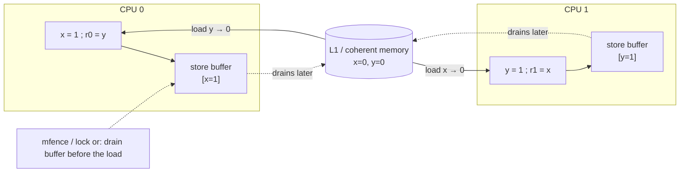

# 03 — x86-TSO, weaker models, and barriers

> Module 03 · Concurrency & Synchronization · Linux v6.18.63 · OpenBSD 8cada8c · Farsi: [03-x86-tso-and-barriers.fa.md](03-x86-tso-and-barriers.fa.md)

## 1. Summary

- x86 is **Total Store Order** (TSO): each core has a FIFO store buffer, so a core's store can become visible to others *after* its own later load. Store→load is the only reordering x86 lets other CPUs observe.
- Arm64 and POWER are weaker: they also reorder store→store, load→load and load→store unless you add barriers or acquire/release instructions. Code that "works on x86" can break there.
- A **compiler barrier** (`barrier()`) stops the compiler; a **CPU barrier** (`mfence`, `lock`-prefixed instruction, `smp_mb()`) stops the hardware. On x86 most kernel barriers are only compiler barriers, because TSO already gives the order.

## 2. Explanation

### 2.1 Intuition: the store buffer

A store must wait for exclusive ownership of the cache line (MESI), which can take ~100 ns. Instead of stalling, the core puts the store in a **store buffer** and keeps executing. Its own later loads see the buffered value (**store forwarding**), but other cores don't until the buffer drains to L1. The buffer drains in program order (FIFO), so other cores see this core's stores in order. What they can see out of order is a store followed by a load of a *different* address: the load already ran while the store was still buffered.

### 2.2 The four orderings

| Program order (same thread, different addresses) | x86-TSO | Arm64 / POWER (ARCH-SPECIFIC) | C11 `relaxed` |
|---|---|---|---|
| store → store | kept | may reorder | may reorder |
| load → load | kept | may reorder | may reorder |
| load → store | kept | may reorder | may reorder |
| **store → load** | **may reorder** | may reorder | may reorder |
| any `lock`-prefixed RMW / `xchg` | full barrier | (LSE atomics have their own semantics) | per `memory_order` |

Two litmus tests show the difference:

| Test | Threads | Interesting outcome | x86-TSO | Arm64 |
|---|---|---|---|---|
| **SB** (store buffering), lab 05 `sb.c` | `x=1; r0=y` ‖ `y=1; r1=x` | `r0=0, r1=0` | **observed** | observed |
| **MP** (message passing), lab 05 `solution/mp.c` | `data=1; flag=1` ‖ `r0=flag; r1=data` | `r0=1, r1=0` | never | observed (without release/acquire) |

SB needs store→load ordering, which x86 doesn't give: you need a full fence. MP needs store→store on the writer and load→load on the reader, which x86 gives for free. That's why on x86 `smp_store_release()`/`smp_load_acquire()` compile to plain `mov` plus a compiler barrier, while on Arm64 they become `stlr`/`ldar`.

### 2.3 Compiler barrier vs CPU barrier

| Barrier | Stops compiler reordering | Stops CPU reordering (x86) | Kernel / C11 |
|---|---|---|---|
| `barrier()` / `asm volatile("" ::: "memory")` | yes | no | `atomic_signal_fence(seq_cst)` |
| `smp_wmb()`, `smp_rmb()` on x86 | yes | not needed (TSO) | — |
| `smp_store_release()`, `smp_load_acquire()` on x86 | yes | not needed (TSO) | `memory_order_release` / `acquire` |
| `smp_mb()` | yes | **yes** (store→load) | `atomic_thread_fence(seq_cst)` |
| `smp_store_mb()` | yes | yes (`xchg`) | seq_cst store |

Lab 05's `relaxed` mode deliberately uses `atomic_signal_fence(memory_order_seq_cst)` between the store and the load: the compiler keeps the order, so every `0/0` outcome comes from the hardware store buffer, not the compiler.

### 2.4 What gcc actually emits

Real run: gcc 13 in Docker on the Windows host (WSL2), not the course VM — VM numbers are in the lab README. `objdump -d` of lab 05 `sb.c` (`gcc -O2`):

```text
  401548:	lock xadd %eax,0x2b44(%rip)        # 404094 <g_bar_count>
  4015b3:	xchg   %eax,(%rsi)
  4015c6:	lock orq $0x0,(%rsp)
  4015db:	xchg   %eax,0x2ab3(%rip)        # 404094 <g_bar_count>
```

- `lock xadd`: `atomic_fetch_add` in the barrier.
- `xchg %eax,(%rsi)`: the seq_cst store in `seqcst` mode. `xchg` with memory has an implicit `lock`, so it is a full barrier.
- `lock orq $0x0,(%rsp)`: `atomic_thread_fence(memory_order_seq_cst)` in `fence` mode. A locked no-op on the stack line, which is usually cheaper than `mfence` and orders normal memory the same way. VERSION-DEPENDENT: older gcc emitted `mfence`.

## 3. Diagram



## 4. Worked example

### 4.1 The kernel's barrier definitions for x86

```c
linux/arch/x86/include/asm/barrier.h · v6.18.63 · L21-71 (cut)
   21  #else
   22  #define __mb()	asm volatile("mfence":::"memory")
   23  #define __rmb()	asm volatile("lfence":::"memory")
   24  #define __wmb()	asm volatile("sfence" ::: "memory")
   25  #endif
   50  #define __dma_rmb()	barrier()
   51  #define __dma_wmb()	barrier()
   53  #define __smp_mb()	asm volatile("lock addl $0,-4(%%" _ASM_SP ")" ::: "memory", "cc")
   55  #define __smp_rmb()	dma_rmb()
   56  #define __smp_wmb()	barrier()
   57  #define __smp_store_mb(var, value) do { (void)xchg(&var, value); } while (0)
   59  #define __smp_store_release(p, v)					\
   60  do {									\
   61  	compiletime_assert_atomic_type(*p);				\
   62  	barrier();							\
   63  	WRITE_ONCE(*p, v);						\
   64  } while (0)
   66  #define __smp_load_acquire(p)						\
   67  ({									\
   68  	typeof(*p) ___p1 = READ_ONCE(*p);				\
   69  	compiletime_assert_atomic_type(*p);				\
   70  	barrier();							\
   71  	___p1;								\
```

Elixir: https://elixir.bootlin.com/linux/v6.18.63/source/arch/x86/include/asm/barrier.h#L21

- **L22–24**: on x86-64, `mb()`/`rmb()`/`wmb()` are real fence instructions. They are for **device I/O** (ordering against DMA and write-combining memory), where TSO's guarantees don't apply. (L14–20 are the 32-bit `ALTERNATIVE` versions that fall back to `lock addl` on CPUs without SSE2.)
- **L50–51**: DMA barriers are compiler-only: x86 keeps normal memory in order for devices too.
- **L53**: `smp_mb()` between CPUs is `lock addl $0` to a stack slot below `%rsp`, not `mfence`. The `lock` drains the store buffer, the add changes nothing. Same trick gcc uses (`lock orq`).
- **L55–56**: `smp_rmb()` and `smp_wmb()` cost nothing on x86. They exist for Arm64/POWER.
- **L57**: `smp_store_mb()` = store + full barrier in one `xchg`.
- **L59–64**: release store = compiler barrier, then a plain store. The barrier *before* the store stops the compiler from sinking earlier accesses below it; TSO does the rest.
- **L66–71**: acquire load = plain load, then a compiler barrier, so later accesses can't be hoisted above it.

### 4.2 A real SB instance inside the kernel: futex wake-up

```c
linux/kernel/futex/waitwake.c · file header comment · v6.18.63 · L58-96 (cut)
   58   * CPU 0                                 CPU 1
   59   * val = *futex;
   60   * sys_futex(WAIT, futex, val);
   61   *   futex_wait(futex, val);
   63   *   waiters++; (a)
   64   *   smp_mb(); (A) <-- paired with -.
   66   *   lock(hash_bucket(futex));      |
   68   *   uval = *futex;                 |
   69   *                                  |        *futex = newval;
   70   *                                  |        sys_futex(WAKE, futex);
   71   *                                  |          futex_wake(futex);
   73   *                                  `--------> smp_mb(); (B)
   74   *   if (uval == val)
   75   *     queue();
   77   *     schedule();                         if (waiters)
   86   * This yields the following case (where X:=waiters, Y:=futex):
   88   *	X = Y = 0
   90   *	w[X]=1		w[Y]=1
   91   *	MB		MB
   92   *	r[Y]=y		r[X]=x
   94   * Which guarantees that x==0 && y==0 is impossible; which translates back into
   95   * the guarantee that we cannot both miss the futex variable change and the
   96   * enqueue.
```

Elixir: https://elixir.bootlin.com/linux/v6.18.63/source/kernel/futex/waitwake.c#L58

- **L63–64**: the waiter writes `waiters` (X) then, after a full barrier, reads the futex word (Y).
- **L69, L73, L77**: the waker writes the futex word (Y) then, after a full barrier, reads `waiters` (X).
- **L88–92**: this is SB with variables renamed. Without (A) and (B), x86 could produce `x == 0 && y == 0`: the waiter sees the old value and sleeps, the waker sees no waiters and skips the wake-up. A lost wake-up, a hung thread.
- **L94–96**: with both barriers the bad outcome is impossible. Lab 05's `fence` mode is the user-space proof: `0/0` goes to zero once a full barrier separates store and load. The barrier on each side is needed; one alone does not help (the other CPU can still reorder).

## 5. Edge cases & pitfalls

- **One-sided fences don't work.** SB needs a full barrier in *both* threads. The futex code pairs (A) with (B) and says so.
- **Acquire/release can't fix SB.** A release store followed by an acquire load may still reorder (store→load). Only seq_cst ordering (or a full fence) forbids it.
- **x86 hides MP bugs.** Relaxed code that passes every x86 test can fail on Arm64. Lab 05's `mp.c` never shows `flag=1 data=0` on x86, and that's the danger: write release/acquire anyway.
- **`volatile` is not a barrier** for the CPU; on x86 it isn't even a compiler barrier for *other* non-volatile accesses.
- **`lfence` is mostly about speculation** (`barrier_nospec()`, L48), not memory ordering for normal loads.
- **Non-temporal stores (`movnti`) and WC memory** are outside TSO's rules: they need `sfence`. That's why `wmb()` is a real `sfence` on x86-64.
- **Measuring with timing loops**: SB outcomes depend on both threads starting close together. Lab 05 uses a spin barrier and per-iteration variables; a sleep-based start would show almost no reordering.

## 6. Exam key points

- x86-TSO: per-core FIFO store buffer with store forwarding. Only store→load (different addresses) can be observed reordered.
- SB `0/0` is allowed on x86; MP `1/0` is forbidden on x86 but allowed on Arm64/POWER.
- Full barrier on x86: `mfence`, any `lock`-prefixed RMW, `xchg` with memory. Linux `smp_mb()` = `lock addl $0,-4(%rsp)`; gcc's seq_cst fence = `lock orq $0,(%rsp)`.
- On x86, `smp_rmb()`, `smp_wmb()`, `smp_load_acquire()`, `smp_store_release()` are compiler barriers + plain `mov`.
- `barrier()` stops the compiler only. `mb()`/`rmb()`/`wmb()` are for device I/O.
- Barriers come in pairs: the futex waiter/waker `smp_mb()` pair is SB in disguise and prevents lost wake-ups.

## 7. Links

- Lesson: [4.2 What does the hardware actually promise?](../lesson.en.md#42-what-does-the-hardware-actually-promise)
- Walkthrough: [kernel-walkthrough.en.md](../kernel-walkthrough.en.md) (§1.2 `smp_store_release` in qspinlock unlock, §3 futex barrier pairing)
- Notes: [01 race conditions](01-race-conditions-critical-sections.en.md) (Peterson) · [02 atomics](02-atomics-c11-memory-model.en.md) · [04 spinlocks](04-spinlocks-qspinlock.en.md) · [07 futex](07-futex-user-kernel-split.en.md)
- Labs: [05 store-buffering litmus](../labs/05-litmus-sb/README.md) (SB in C11 and Rust; MP in the extension)
- Quiz: [Q3](../quiz.en.md) (which reordering x86-TSO allows) · [Q15](../quiz.en.md) (fence design for SB)
