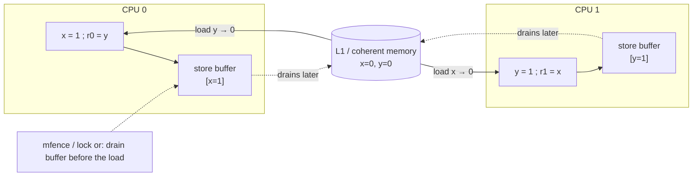

<div dir="rtl">

# ۰۳ — x86-TSO، مدل‌های ضعیف‌تر و barrierها

> ماژول ۰۳ · همروندی و همگام‌سازی · Linux v6.18.63 · OpenBSD 8cada8c · نسخهٔ انگلیسی: [03-x86-tso-and-barriers.en.md](03-x86-tso-and-barriers.en.md)

## ۱. خلاصه

- x86 مدل **Total Store Order** (TSO) دارد: هر هسته یک store buffer از نوع FIFO دارد، پس store یک هسته ممکن است *بعد از* load بعدیِ خود همان هسته برای بقیه دیده شود. store→load تنها جابه‌جایی‌ای است که x86 اجازه می‌دهد CPUهای دیگر ببینند.
- Arm64 و POWER ضعیف‌ترند: store→store، load→load و load→store را هم جابه‌جا می‌کنند، مگر barrier یا دستورهای acquire/release بگذارید. کدی که «روی x86 کار می‌کند» آن‌جا می‌تواند بشکند.
- **Compiler barrier** (`barrier()`) فقط کامپایلر را متوقف می‌کند؛ **CPU barrier** (`mfence`، دستور با پیشوند `lock`، `smp_mb()`) سخت‌افزار را. روی x86 بیشتر barrierهای کرنل فقط compiler barrierاند، چون TSO خودش ترتیب را می‌دهد.

## ۲. توضیح

### ۲.۱ شهود: store buffer

یک store باید منتظر مالکیت انحصاری cache line بماند (MESI) که ممکن است حدود ۱۰۰ نانوثانیه طول بکشد. هسته به‌جای توقف، store را در **store buffer** می‌گذارد و به اجرا ادامه می‌دهد. loadهای بعدی خودش مقدار بافرشده را می‌بینند (**store forwarding**)، ولی هسته‌های دیگر تا خالی‌شدن بافر به L1 آن را نمی‌بینند. بافر به ترتیب برنامه (FIFO) خالی می‌شود، پس هسته‌های دیگر storeهای این هسته را به ترتیب می‌بینند. چیزی که می‌توانند بی‌ترتیب ببینند یک store است و بعدش load از آدرسی *دیگر*: load وقتی اجرا شده که store هنوز در بافر بوده.

### ۲.۲ چهار ترتیب

| ترتیب برنامه (یک نخ، آدرس‌های متفاوت) | x86-TSO | Arm64 / POWER (ARCH-SPECIFIC) | `relaxed` در C11 |
|---|---|---|---|
| store → store | حفظ می‌شود | ممکن است جابه‌جا شود | ممکن است جابه‌جا شود |
| load → load | حفظ می‌شود | ممکن است جابه‌جا شود | ممکن است جابه‌جا شود |
| load → store | حفظ می‌شود | ممکن است جابه‌جا شود | ممکن است جابه‌جا شود |
| **store → load** | **ممکن است جابه‌جا شود** | ممکن است جابه‌جا شود | ممکن است جابه‌جا شود |
| هر RMW با `lock` یا `xchg` | barrier کامل | (اتمی‌های LSE معنای خودشان را دارند) | بسته به `memory_order` |

دو litmus test تفاوت را نشان می‌دهند:

| آزمون | نخ‌ها | نتیجهٔ جالب | x86-TSO | Arm64 |
|---|---|---|---|---|
| **SB** (store buffering)، <span dir="ltr">`sb.c`</span> در آزمایش ۰۵ | <span dir="ltr">`x=1; r0=y` ‖ `y=1; r1=x`</span> | <span dir="ltr">`r0=0, r1=0`</span> | **دیده می‌شود** | دیده می‌شود |
| **MP** (message passing)، <span dir="ltr">`solution/mp.c`</span> | <span dir="ltr">`data=1; flag=1` ‖ `r0=flag; r1=data`</span> | <span dir="ltr">`r0=1, r1=0`</span> | هرگز | دیده می‌شود (بدون release/acquire) |

SB به ترتیب store→load نیاز دارد که x86 نمی‌دهد: fence کامل لازم است. MP در نویسنده store→store و در خواننده load→load لازم دارد که x86 مجانی می‌دهد. برای همین روی x86 توابع `smp_store_release()` و `smp_load_acquire()` به یک `mov` ساده و یک compiler barrier ترجمه می‌شوند، ولی روی Arm64 به `stlr` و `ldar`.

### ۲.۳ Compiler barrier در برابر CPU barrier

| Barrier | جلوی جابه‌جایی کامپایلر | جلوی جابه‌جایی CPU (x86) | کرنل / C11 |
|---|---|---|---|
| `barrier()` / <span dir="ltr">`asm volatile("" ::: "memory")`</span> | بله | خیر | `atomic_signal_fence(seq_cst)` |
| `smp_wmb()` و `smp_rmb()` روی x86 | بله | لازم نیست (TSO) | — |
| `smp_store_release()` و `smp_load_acquire()` روی x86 | بله | لازم نیست (TSO) | `memory_order_release` / `acquire` |
| `smp_mb()` | بله | **بله** (store→load) | `atomic_thread_fence(seq_cst)` |
| `smp_store_mb()` | بله | بله (`xchg`) | store از نوع seq_cst |

حالت `relaxed` در آزمایش ۰۵ عمداً بین store و load از <span dir="ltr">`atomic_signal_fence(memory_order_seq_cst)`</span> استفاده می‌کند: کامپایلر ترتیب را نگه می‌دارد، پس هر نتیجهٔ <span dir="ltr">`0/0`</span> از store buffer سخت‌افزار می‌آید، نه از کامپایلر.

### ۲.۴ gcc واقعاً چه تولید می‌کند

real run: gcc 13 in Docker on the Windows host (WSL2), not the course VM — VM numbers are in the lab README. خروجی <span dir="ltr">`objdump -d`</span> برای <span dir="ltr">`sb.c`</span> آزمایش ۰۵ (<span dir="ltr">`gcc -O2`</span>):

</div>

```text
  401548:	lock xadd %eax,0x2b44(%rip)        # 404094 <g_bar_count>
  4015b3:	xchg   %eax,(%rsi)
  4015c6:	lock orq $0x0,(%rsp)
  4015db:	xchg   %eax,0x2ab3(%rip)        # 404094 <g_bar_count>
```

<div dir="rtl">

- `lock xadd`: همان `atomic_fetch_add` در barrier بین دورها.
- <span dir="ltr">`xchg %eax,(%rsi)`</span>: store از نوع seq_cst در حالت `seqcst`. `xchg` با حافظه یک `lock` ضمنی دارد، پس barrier کامل است.
- <span dir="ltr">`lock orq $0x0,(%rsp)`</span>: همان <span dir="ltr">`atomic_thread_fence(memory_order_seq_cst)`</span> در حالت `fence`. یک دستور بی‌اثر با `lock` روی خط stack که معمولاً از `mfence` ارزان‌تر است و حافظهٔ معمولی را به همان شکل مرتب می‌کند. VERSION-DEPENDENT: gccهای قدیمی‌تر `mfence` تولید می‌کردند.

## ۳. نمودار

</div>



<div dir="rtl">

## ۴. مثال حل‌شده

### ۴.۱ تعریف barrierهای کرنل برای x86

</div>

```c
linux/arch/x86/include/asm/barrier.h · v6.18.63 · L21-71 (cut)
   21  #else
   22  #define __mb()	asm volatile("mfence":::"memory")
   23  #define __rmb()	asm volatile("lfence":::"memory")
   24  #define __wmb()	asm volatile("sfence" ::: "memory")
   25  #endif
   50  #define __dma_rmb()	barrier()
   51  #define __dma_wmb()	barrier()
   53  #define __smp_mb()	asm volatile("lock addl $0,-4(%%" _ASM_SP ")" ::: "memory", "cc")
   55  #define __smp_rmb()	dma_rmb()
   56  #define __smp_wmb()	barrier()
   57  #define __smp_store_mb(var, value) do { (void)xchg(&var, value); } while (0)
   59  #define __smp_store_release(p, v)					\
   60  do {									\
   61  	compiletime_assert_atomic_type(*p);				\
   62  	barrier();							\
   63  	WRITE_ONCE(*p, v);						\
   64  } while (0)
   66  #define __smp_load_acquire(p)						\
   67  ({									\
   68  	typeof(*p) ___p1 = READ_ONCE(*p);				\
   69  	compiletime_assert_atomic_type(*p);				\
   70  	barrier();							\
   71  	___p1;								\
```

<div dir="rtl">

Elixir: <span dir="ltr">https://elixir.bootlin.com/linux/v6.18.63/source/arch/x86/include/asm/barrier.h#L21</span>

- **خط ۲۲ تا ۲۴**: روی x86-64، `mb()` و `rmb()` و `wmb()` دستورهای fence واقعی‌اند. این‌ها برای **I/O دستگاه** هستند (ترتیب در برابر DMA و حافظهٔ write-combining)، جایی که تضمین‌های TSO برقرار نیست. (خط ۱۴ تا ۲۰ نسخه‌های ۳۲ بیتی با `ALTERNATIVE` هستند که روی CPUهای بدون SSE2 به `lock addl` برمی‌گردند.)
- **خط ۵۰ و ۵۱**: barrierهای DMA فقط compiler barrierاند: x86 حافظهٔ معمولی را برای دستگاه‌ها هم مرتب نگه می‌دارد.
- **خط ۵۳**: `smp_mb()` بین CPUها یعنی `lock addl $0` روی خانه‌ای زیر `%rsp`، نه `mfence`. `lock` بافر را خالی می‌کند و add چیزی را تغییر نمی‌دهد. همان ترفندی که gcc به کار می‌برد (`lock orq`).
- **خط ۵۵ و ۵۶**: `smp_rmb()` و `smp_wmb()` روی x86 هزینه‌ای ندارند. برای Arm64 و POWER وجود دارند.
- **خط ۵۷**: `smp_store_mb()` یعنی store و barrier کامل در یک `xchg`.
- **خط ۵۹ تا ۶۴**: release store یعنی اول compiler barrier و بعد یک store ساده. barrier *قبل از* store نمی‌گذارد کامپایلر دسترسی‌های قبلی را به بعد از آن ببرد؛ بقیه را TSO انجام می‌دهد.
- **خط ۶۶ تا ۷۱**: acquire load یعنی یک load ساده و بعد compiler barrier، تا دسترسی‌های بعدی بالای آن نروند.

### ۴.۲ یک SB واقعی در خود کرنل: بیدارکردن futex

</div>

```c
linux/kernel/futex/waitwake.c · file header comment · v6.18.63 · L58-96 (cut)
   58   * CPU 0                                 CPU 1
   59   * val = *futex;
   60   * sys_futex(WAIT, futex, val);
   61   *   futex_wait(futex, val);
   63   *   waiters++; (a)
   64   *   smp_mb(); (A) <-- paired with -.
   66   *   lock(hash_bucket(futex));      |
   68   *   uval = *futex;                 |
   69   *                                  |        *futex = newval;
   70   *                                  |        sys_futex(WAKE, futex);
   71   *                                  |          futex_wake(futex);
   73   *                                  `--------> smp_mb(); (B)
   74   *   if (uval == val)
   75   *     queue();
   77   *     schedule();                         if (waiters)
   86   * This yields the following case (where X:=waiters, Y:=futex):
   88   *	X = Y = 0
   90   *	w[X]=1		w[Y]=1
   91   *	MB		MB
   92   *	r[Y]=y		r[X]=x
   94   * Which guarantees that x==0 && y==0 is impossible; which translates back into
   95   * the guarantee that we cannot both miss the futex variable change and the
   96   * enqueue.
```

<div dir="rtl">

Elixir: <span dir="ltr">https://elixir.bootlin.com/linux/v6.18.63/source/kernel/futex/waitwake.c#L58</span>

- **خط ۶۳ و ۶۴**: منتظر `waiters` (همان X) را می‌نویسد و بعد از یک barrier کامل، کلمهٔ futex (همان Y) را می‌خواند.
- **خط ۶۹، ۷۳ و ۷۷**: بیدارکننده کلمهٔ futex (Y) را می‌نویسد و بعد از barrier کامل `waiters` (X) را می‌خواند.
- **خط ۸۸ تا ۹۲**: این همان SB است با نام‌های دیگر. بدون (A) و (B)، x86 می‌تواند <span dir="ltr">`x == 0 && y == 0`</span> بدهد: منتظر مقدار قدیمی را می‌بیند و می‌خوابد، بیدارکننده منتظری نمی‌بیند و بیدارکردن را رد می‌کند. یک lost wake-up و یک نخ گیرکرده.
- **خط ۹۴ تا ۹۶**: با هر دو barrier نتیجهٔ بد ناممکن است. حالت `fence` در آزمایش ۰۵ اثبات همین در فضای کاربر است: وقتی barrier کامل بین store و load باشد، <span dir="ltr">`0/0`</span> به صفر می‌رسد. barrier در *هر دو* طرف لازم است؛ یکی به‌تنهایی کمکی نمی‌کند (CPU دیگر هنوز می‌تواند جابه‌جا کند).

## ۵. حالت‌های مرزی و دام‌ها

- **fence یک‌طرفه کار نمی‌کند.** SB در *هر دو* نخ barrier کامل لازم دارد. کد futex هم (A) را با (B) جفت کرده و صریحاً می‌گوید.
- **acquire/release نمی‌تواند SB را درست کند.** release store و بعد acquire load هنوز ممکن است جابه‌جا شوند (store→load). فقط ترتیب seq_cst (یا fence کامل) جلویش را می‌گیرد.
- **x86 باگ‌های MP را پنهان می‌کند.** کد relaxedی که همهٔ آزمون‌های x86 را رد می‌شود ممکن است روی Arm64 خراب شود. <span dir="ltr">`mp.c`</span> آزمایش ۰۵ روی x86 هرگز <span dir="ltr">`flag=1 data=0`</span> نشان نمی‌دهد و خطر همین است: release/acquire را به‌هرحال بنویسید.
- **`volatile` برای CPU barrier نیست**؛ روی x86 حتی برای دسترسی‌های غیر-volatile *دیگر* compiler barrier هم نیست.
- **`lfence` بیشتر دربارهٔ speculation است** (`barrier_nospec()`، خط ۴۸)، نه ترتیب حافظه برای loadهای معمولی.
- **storeهای non-temporal (`movnti`) و حافظهٔ WC** خارج از قواعد TSO هستند و `sfence` لازم دارند. برای همین `wmb()` روی x86-64 یک `sfence` واقعی است.
- **اندازه‌گیری با حلقه‌های زمانی**: نتایج SB به این بستگی دارد که دو نخ تقریباً هم‌زمان شروع کنند. آزمایش ۰۵ از spin barrier و متغیرهای جدا برای هر دور استفاده می‌کند؛ شروع با sleep تقریباً هیچ جابه‌جایی نشان نمی‌دهد.

## ۶. نکته‌های کلیدی امتحان

- x86-TSO: هر هسته store buffer از نوع FIFO با store forwarding دارد. فقط store→load (آدرس‌های متفاوت) جابه‌جا دیده می‌شود.
- نتیجهٔ <span dir="ltr">`0/0`</span> در SB روی x86 مجاز است؛ نتیجهٔ <span dir="ltr">`1/0`</span> در MP روی x86 ممنوع ولی روی Arm64 و POWER مجاز است.
- barrier کامل روی x86: `mfence`، هر RMW با پیشوند `lock`، `xchg` با حافظه. `smp_mb()` لینوکس = <span dir="ltr">`lock addl $0,-4(%rsp)`</span>؛ fence از نوع seq_cst در gcc = <span dir="ltr">`lock orq $0,(%rsp)`</span>.
- روی x86، `smp_rmb()`، `smp_wmb()`، `smp_load_acquire()` و `smp_store_release()` همه compiler barrier به‌اضافهٔ `mov` ساده‌اند.
- `barrier()` فقط کامپایلر را نگه می‌دارد. `mb()` و `rmb()` و `wmb()` برای I/O دستگاه هستند.
- barrierها جفتی‌اند: جفت `smp_mb()` منتظر و بیدارکننده در futex همان SB در لباس دیگر است و جلوی lost wake-up را می‌گیرد.

## ۷. پیوندها

- درس: [۴.۲ سخت‌افزار واقعاً چه قولی می‌دهد؟](../lesson.fa.md#42-what-does-the-hardware-actually-promise)
- مرور کد کرنل: [kernel-walkthrough.fa.md](../kernel-walkthrough.fa.md) (بخش ۱.۲: `smp_store_release` در unlock کردن qspinlock؛ بخش ۳: جفت barrierهای futex)
- یادداشت‌ها: [۰۱ race condition](01-race-conditions-critical-sections.fa.md) (Peterson) · [۰۲ اتمی‌ها](02-atomics-c11-memory-model.fa.md) · [۰۴ spinlock](04-spinlocks-qspinlock.fa.md) · [۰۷ futex](07-futex-user-kernel-split.fa.md)
- آزمایش‌ها: [۰۵ litmus از نوع store-buffering](../labs/05-litmus-sb/README.md) (SB در C11 و Rust؛ MP در تمرین تکمیلی)
- آزمون: [پرسش ۳](../quiz.fa.md) (x86-TSO کدام جابه‌جایی را مجاز می‌داند) · [پرسش ۱۵](../quiz.fa.md) (طراحی fence برای SB)

</div>
