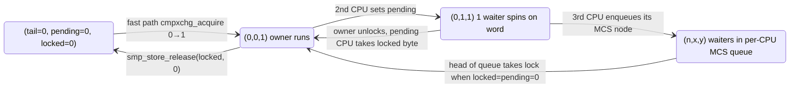

# 04 — Spinlocks: from test-and-set to qspinlock

> Module 03 · Concurrency & Synchronization · Linux v6.18.63 · OpenBSD 8cada8c · Farsi: [04-spinlocks-qspinlock.fa.md](04-spinlocks-qspinlock.fa.md)

## 1. Summary

- A spinlock makes a waiter busy-loop on the CPU instead of sleeping. It is the right tool only when the critical section is short and the holder cannot sleep.
- The hard part is not taking the lock but **waiting** well. Naive spinning makes the lock's cache line bounce between cores. Queue-based locks (MCS, Linux's qspinlock) let each waiter spin on its own line.
- In Linux, `spin_lock()` disables preemption, then runs a one-instruction fast path (`cmpxchg` 0 → 1 with acquire). Unlock is a single release store of the locked byte.

## 2. Explanation

### 2.1 Intuition: why spin at all?

Sleeping costs two context switches plus scheduler work, usually several microseconds. If the holder will release the lock in 50 ns, burning 50 ns of CPU is cheaper. Spinning also works where sleeping is **forbidden**: interrupt handlers, code that holds another spinlock, and the scheduler itself.

### 2.2 The evolution of the waiting loop

| Design | Lock word | Waiter spins on | Fair? | Problem it fixed / left |
|---|---|---|---|---|
| **TAS** (test-and-set) | 1 bit | the shared word, with an atomic `xchg` every iteration | no | every failed `xchg` takes the line exclusive → bus storm |
| **TTAS** (test-and-test-and-set) | 1 bit | a plain *read* of the shared word, `xchg` only when it looks free | no | reads hit the local cache. On release, all waiters rush at once (thundering herd) |
| **Ticket** (Linux 2.6.25–4.1) | `next` + `owner` counters | `owner == my_ticket` | FIFO | every waiter still reads one shared line, so each release invalidates N caches |
| **MCS** (Mellor-Crummey & Scott, 1991) | tail pointer | its **own** queue node | FIFO | one cache transfer per handoff. But a node per lock per waiter, and the lock is a pointer, too big for `spinlock_t` |
| **qspinlock** (Linux ≥ 4.2, x86 default) | 32 bits | owner byte, then a pending bit, then a per-CPU MCS node | FIFO (queue part) | MCS behaviour squeezed into 4 bytes |

**Cache-line bouncing** is the key cost. With MESI, a line can be *Modified* in only one cache. Every atomic RMW on the lock word moves that line to the writer's core, about 40–100 ns across sockets. TAS does that on every spin. MCS does it once per handoff.

### 2.3 The Linux layering

```text
spin_lock(spinlock_t *)                 include/linux/spinlock.h L349
 └─ raw_spin_lock(&lock->rlock)          macro → _raw_spin_lock → __raw_spin_lock
     └─ __raw_spin_lock()                include/linux/spinlock_api_smp.h L130
         ├─ preempt_disable()
         ├─ spin_acquire()               lockdep annotation (no-op without lockdep)
         └─ LOCK_CONTENDED(do_raw_spin_trylock, do_raw_spin_lock)
             └─ arch_spin_lock = queued_spin_lock()   include/asm-generic/qspinlock.h L107
                 └─ queued_spin_lock_slowpath()       kernel/locking/qspinlock.c L130
```

Why `preempt_disable()`? Suppose the holder were preempted. A waiter on the same CPU could then spin forever, because the holder can't run to release the lock. Waiters on other CPUs would waste a whole time slice. Disabling preemption turns "the holder may vanish" into "the holder runs until unlock".

### 2.4 The qspinlock word

From `include/asm-generic/qspinlock_types.h` (NR_CPUS < 16K):

| Bits | Field | Meaning |
|---|---|---|
| 0–7 | `locked` | owner present (byte, so unlock is a plain byte store) |
| 8 | `pending` | first waiter: spins on the word itself, no queue node needed |
| 9–15 | unused | |
| 16–17 | tail index | which of the 4 per-CPU MCS nodes (task, softirq, hardirq, NMI nesting) |
| 18–31 | tail CPU + 1 | the CPU at the queue's tail. 0 = queue empty |

So one waiter costs nothing extra (pending bit). A second or later waiter joins an MCS queue whose nodes are **per-CPU**, not per-lock: `static DEFINE_PER_CPU_ALIGNED(struct qnode, qnodes[_Q_MAX_NODES]);` (kernel/locking/qspinlock.c L80, `_Q_MAX_NODES` = 4 in qspinlock.h L16). That is how 4 bytes are enough. A CPU can only spin on one lock per context at a time, so 4 nodes per CPU suffice.

### 2.5 irqsave variants

If an interrupt handler takes lock L, process context must take L with `spin_lock_irqsave()`. Otherwise the CPU can take an interrupt while holding L, and the handler then spins on L on the same CPU. That is a self-deadlock that never resolves. The `_bh` variants do the same for softirqs.

| Variant | Also disables | Use when the lock is also taken in |
|---|---|---|
| `spin_lock` | preemption | process context only |
| `spin_lock_bh` | softirqs | softirq / tasklet |
| `spin_lock_irq` | local IRQs | hardirq, and IRQs are known to be on |
| `spin_lock_irqsave` | local IRQs, saving the old state | hardirq, unknown IRQ state |

## 3. Diagram



## 4. Worked example

### 4.1 The fast path and the unlock

```c
linux/include/asm-generic/qspinlock.h · queued_spin_lock() · v6.18.63 · L107-115
  107  static __always_inline void queued_spin_lock(struct qspinlock *lock)
  108  {
  109  	int val = 0;
  110  
  111  	if (likely(atomic_try_cmpxchg_acquire(&lock->val, &val, _Q_LOCKED_VAL)))
  112  		return;
  113  
  114  	queued_spin_lock_slowpath(lock, val);
  115  }
```

Elixir: https://elixir.bootlin.com/linux/v6.18.63/source/include/asm-generic/qspinlock.h#L107

- **L109**: the expected old value is 0: no owner, no pending, no queue.
- **L111**: one atomic compare-and-swap of the whole 32-bit word to `_Q_LOCKED_VAL` (1). On x86-64 this is `lock cmpxchg`. The `_acquire` suffix means loads and stores in the critical section cannot move above it. On failure, `val` now holds the word that was observed.
- **L114**: anything non-zero (an owner, pending, or a queue) goes to the slow path, which uses `val` to decide: set pending, or enqueue.

```c
linux/include/asm-generic/qspinlock.h · queued_spin_unlock() · v6.18.63 · L123-129
  123  static __always_inline void queued_spin_unlock(struct qspinlock *lock)
  124  {
  125  	/*
  126  	 * unlock() needs release semantics:
  127  	 */
  128  	smp_store_release(&lock->locked, 0);
  129  }
```

- **L128**: unlock is **not** an atomic RMW. It is a release store to the `locked` **byte** only. Release ordering ensures every write in the critical section is visible before the lock appears free. The pending and tail bits are untouched, so the queue survives. On x86-64 (TSO) `smp_store_release` is a plain `mov` plus a compiler barrier. ARCH-SPECIFIC.

### 4.2 The preemption wrapper

```c
linux/include/linux/spinlock_api_smp.h · __raw_spin_lock() · v6.18.63 · L130-144
  130  static inline void __raw_spin_lock(raw_spinlock_t *lock)
  131  {
  132  	preempt_disable();
  133  	spin_acquire(&lock->dep_map, 0, 0, _RET_IP_);
  134  	LOCK_CONTENDED(lock, do_raw_spin_trylock, do_raw_spin_lock);
  135  }
  ...
  139  static inline void __raw_spin_unlock(raw_spinlock_t *lock)
  140  {
  141  	spin_release(&lock->dep_map, _RET_IP_);
  142  	do_raw_spin_unlock(lock);
  143  	preempt_enable();
  144  }
```

- **L132 / L143**: preemption off for the whole critical section. `preempt_enable()` may reschedule right after unlock.
- **L133 / L141**: lockdep hooks (note 09). They compile to nothing without `CONFIG_DEBUG_LOCK_ALLOC`.
- **L134**: `LOCK_CONTENDED` (include/linux/lockdep.h L441) tries the trylock first so lock statistics can count contention. Without `CONFIG_LOCK_STAT` it is just `do_raw_spin_lock()` (L467).

### 4.3 What a VM changes: `virt_spin_lock()`

```c
linux/arch/x86/include/asm/qspinlock.h · virt_spin_lock() · v6.18.63 · L88-107
   88  static inline bool virt_spin_lock(struct qspinlock *lock)
   89  {
   90  	int val;
   92  	if (!static_branch_likely(&virt_spin_lock_key))
   93  		return false;
   95  	/*
   96  	 * On hypervisors without PARAVIRT_SPINLOCKS support we fall
   97  	 * back to a Test-and-Set spinlock, because fair locks have
   98  	 * horrible lock 'holder' preemption issues.
   99  	 */
  101   __retry:
  102  	val = atomic_read(&lock->val);
  104  	if (val || !atomic_try_cmpxchg(&lock->val, &val, _Q_LOCKED_VAL)) {
  105  		cpu_relax();
  106  		goto __retry;
```

A fair (FIFO) lock is a disaster when the *hypervisor* deschedules the vCPU that is next in line, because everyone queues behind a sleeping vCPU. So inside a guest without paravirt spinlocks, Linux falls back to the TTAS loop from §2.2 (L102 reads, L104 tries). ARCH-SPECIFIC (x86-64). Verified on aos-lab (2026-11-15): `dmesg` shows `Hypervisor detected: KVM` (VirtualBox exposes the KVM paravirt interface), `kvm-guest: PV spinlocks enabled` and `PV qspinlock hash table entries: 256`, with `CONFIG_PARAVIRT_SPINLOCKS=y` — so this guest uses the paravirt qspinlock path (vCPUs halt and get kicked), not the test-and-set fallback.

### 4.4 OpenBSD: `mtx_enter()`

```c
openbsd/sys/kern/kern_lock.c · mtx_enter() · 8cada8c · L406-435
  406  	if (mtx->mtx_wantipl != IPL_NONE)
  407  		s = splraise(mtx->mtx_wantipl);
  409  	owner = mtx_cas(mtx, 0, self);
  410  	if (owner == 0) {
  411  		/* we got the lock first go. this is the fast path */
  412  		goto locked;
  413  	}
  ...
  423  	for (spins = 0; spins < 40; spins++) {
  424  		if (ISSET(owner, 1)) {
  425  			/* don't spin if cpus are already parked */
  426  			break;
  427  		}
  428  		CPU_BUSY_CYCLE();
  429  		owner = mtx->mtx_owner;
  430  		if (owner == 0) {
  431  			owner = mtx_cas(mtx, 0, self);
  432  			if (owner == 0)
  433  				goto spinlocked;
  434  		}
  435  	}
```

- **L406–407**: an OpenBSD `struct mutex` carries the interrupt priority level it protects against. `splraise()` blocks those interrupts, which is the job Linux's `_irqsave` variants do. The IPL is part of the lock, not of the call site.
- **L409**: the owner is `self = (unsigned long)curcpu()`, a **CPU**, not a thread. Same fast path as Linux: CAS 0 → owner.
- **L423–434**: TTAS-style bounded spin (40 rounds), reading `mtx_owner` and CASing only when it is 0.
- After the loop (L438 on), the CPU *parks*: it queues a waiter record in a per-lock-hash "parking lot", sets bit 0 of the owner word, and spins on its **own** `w.wait` flag (L454). That is MCS-like local spinning. It is still busy-waiting, not sleeping.

| Design choice | Linux `spinlock_t` | OpenBSD `mtx` | Trade-off |
|---|---|---|---|
| Owner identity | none in the word (just a locked byte) | `cpu_info *` | OpenBSD can detect "locking against myself" (DIAGNOSTIC panic, L416) |
| IRQ masking | chosen per call (`_irqsave`, `_bh`) | fixed per lock (`mtx_wantipl`) | per-call is flexible. Per-lock can't be forgotten |
| Waiting | pending bit, then per-CPU MCS queue, FIFO | 40 TTAS spins, then park and spin on a private flag | Linux packs FIFO into 4 bytes. OpenBSD's word stays simple |
| Under PREEMPT_RT | becomes a sleeping rtmutex | no RT variant | RT latency vs simplicity (Module 7) |

## 5. Edge cases & pitfalls

- **Never sleep while holding a spinlock.** `kmalloc(GFP_KERNEL)`, `mutex_lock()` and `copy_from_user()` (a page fault) can all sleep. With `CONFIG_DEBUG_ATOMIC_SLEEP` the kernel prints "BUG: sleeping function called from invalid context" (from `might_sleep()`).
- **PREEMPT_RT changes the type.** On RT kernels `spin_lock()` calls `rt_spin_lock()` (`include/linux/spinlock_rt.h` L42–44), which is a sleeping, priority-inheriting lock. Code that must truly spin uses `raw_spinlock_t`. VERSION-DEPENDENT: RT has been in mainline since 6.12.
- **Spinlocks in user space are usually wrong.** The holder can be preempted, and the waiter then spins a whole time slice. That is why user space uses futex-backed mutexes (note 07).
- **The `irqsave` asymmetry.** Taking a lock with plain `spin_lock()` in process context and also in an IRQ handler is a latent deadlock that may show up once a month. Lockdep reports it as "inconsistent {HARDIRQ-ON-W} -> {IN-HARDIRQ-W} usage".
- **Unlock order** doesn't matter for correctness, but restore IRQ flags in the reverse order you saved them.
- **Lock holder preemption in VMs**: see §4.3. The vCPU holding the lock may be descheduled by the host.

## 6. Exam key points

- Spin when the critical section is shorter than two context switches and the holder can't sleep.
- TAS → TTAS → ticket → MCS → qspinlock: each step reduces cache-line traffic while waiting. MCS/qspinlock give one cache transfer per handoff.
- `spin_lock()` = `preempt_disable()` + `cmpxchg_acquire(0 → 1)`. `spin_unlock()` = `smp_store_release(locked, 0)` + `preempt_enable()`.
- qspinlock word: locked byte (0–7), pending (8), tail index (16–17), tail CPU+1 (18–31). MCS nodes are per-CPU, 4 per CPU for nesting contexts.
- Use the `_irqsave` / `_bh` variants when the same lock is taken in interrupt or softirq context.
- In a guest without PV spinlocks, x86 Linux falls back to test-and-set (`virt_spin_lock`).
- OpenBSD `mtx`: the owner is a CPU, the IPL is per lock, 40 spins then park. It still busy-waits.

## 7. Links

- Lesson: [4.3 Spin or sleep?](../lesson.en.md#43-spin-or-sleep)
- Walkthrough: [kernel-walkthrough.en.md](../kernel-walkthrough.en.md) (`include/linux/spinlock.h` section)
- Notes: [02 atomics](02-atomics-c11-memory-model.en.md) · [03 x86-TSO and barriers](03-x86-tso-and-barriers.en.md) · [05 mutex](05-mutex-optimistic-spinning.en.md) · [09 deadlock & lockdep](09-deadlock-coffman-lockdep.en.md)
- Labs: [01 data race](../labs/01-data-race/README.md) (cost of contended atomics) · [04 futex mutex](../labs/04-futex-mutex/README.md) (the extension adds a spin phase)
- Quiz: [Q4](../quiz.en.md) (spinlock vs mutex) · [Q8](../quiz.en.md) (`queued_spin_unlock` and `smp_store_release`)
