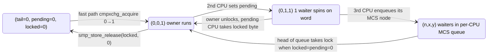

<div dir="rtl">

# ۰۴ — Spinlock: از test-and-set تا qspinlock

> ماژول ۰۳ · همروندی و همگام‌سازی · Linux v6.18.63 · OpenBSD 8cada8c · نسخهٔ انگلیسی: [04-spinlocks-qspinlock.en.md](04-spinlocks-qspinlock.en.md)

## ۱. خلاصه

- در spinlock، نخِ منتظر به‌جای خوابیدن روی CPU در یک حلقه می‌چرخد. این ابزار فقط وقتی درست است که critical section کوتاه باشد و نگه‌دارندهٔ قفل نتواند بخوابد.
- بخش سخت گرفتن قفل نیست، **خوب منتظر ماندن** است. چرخیدن ساده باعث می‌شود cache line قفل بین هسته‌ها پاس‌کاری شود. قفل‌های صف‌دار (MCS و qspinlock لینوکس) هر منتظر را روی cache line خودش نگه می‌دارند.
- در لینوکس، `spin_lock()` اول preemption را خاموش می‌کند و بعد یک مسیر سریع تک‌دستوری اجرا می‌کند (`cmpxchg` از ۰ به ۱ با acquire). آزادسازی فقط یک store با release روی بایت locked است.

## ۲. توضیح

### ۲.۱ شهود: اصلاً چرا بچرخیم؟

خوابیدن دو context switch و کار زمان‌بند هزینه دارد، که معمولاً چند میکروثانیه می‌شود. اگر نگه‌دارنده ۵۰ نانوثانیهٔ دیگر قفل را رها کند، سوزاندن ۵۰ نانوثانیه CPU ارزان‌تر است. چرخیدن جایی هم کار می‌کند که خوابیدن **ممنوع** است: interrupt handler، کدی که spinlock دیگری در دست دارد، و خود زمان‌بند.

### ۲.۲ تکامل حلقهٔ انتظار

| طرح | کلمهٔ قفل | منتظر روی چه می‌چرخد | منصفانه؟ | چه مشکلی را حل کرد / چه ماند |
|---|---|---|---|---|
| **TAS** (test-and-set) | ۱ بیت | خود کلمهٔ مشترک، با `xchg` اتمی در هر دور | نه | هر `xchg` ناموفق cache line را انحصاری می‌گیرد و باس را پر می‌کند |
| **TTAS** (test-and-test-and-set) | ۱ بیت | *خواندنِ* ساده، و `xchg` فقط وقتی آزاد به نظر برسد | نه | خواندن از cache محلی است، اما موقع آزادسازی همه با هم هجوم می‌آورند (thundering herd) |
| **Ticket** (لینوکس ۲.۶.۲۵ تا ۴.۱) | دو شمارندهٔ `next` و `owner` | `owner == my_ticket` | FIFO | همه هنوز یک خط مشترک را می‌خوانند، پس هر آزادسازی N cache را باطل می‌کند |
| **MCS** (Mellor-Crummey و Scott، ۱۹۹۱) | اشاره‌گر به tail | گرهٔ صفِ **خودش** | FIFO | هر واگذاری فقط یک انتقال cache دارد، اما کلمهٔ قفل یک اشاره‌گر است و در `spinlock_t` جا نمی‌شود |
| **qspinlock** (لینوکس ۴.۲ به بعد، پیش‌فرض x86) | ۳۲ بیت | اول بایت owner، بعد بیت pending، بعد گرهٔ MCS مخصوص هر CPU | FIFO (در بخش صف) | رفتار MCS در ۴ بایت |

**پاس‌کاری cache line** هزینهٔ اصلی است. در پروتکل MESI یک خط فقط در یک cache می‌تواند *Modified* باشد. هر RMW اتمی روی کلمهٔ قفل آن خط را به هستهٔ نویسنده می‌برد، که بین socketها حدود ۴۰ تا ۱۰۰ نانوثانیه طول می‌کشد. TAS این کار را در هر دور چرخش انجام می‌دهد و MCS فقط یک بار در هر واگذاری.

### ۲.۳ لایه‌های لینوکس

</div>

```text
spin_lock(spinlock_t *)                 include/linux/spinlock.h L349
 └─ raw_spin_lock(&lock->rlock)          macro → _raw_spin_lock → __raw_spin_lock
     └─ __raw_spin_lock()                include/linux/spinlock_api_smp.h L130
         ├─ preempt_disable()
         ├─ spin_acquire()               lockdep annotation (no-op without lockdep)
         └─ LOCK_CONTENDED(do_raw_spin_trylock, do_raw_spin_lock)
             └─ arch_spin_lock = queued_spin_lock()   include/asm-generic/qspinlock.h L107
                 └─ queued_spin_lock_slowpath()       kernel/locking/qspinlock.c L130
```

<div dir="rtl">

چرا `preempt_disable()`؟ فرض کنید نگه‌دارنده preempt شود. منتظری که روی همان CPU است ممکن است تا ابد بچرخد، چون نگه‌دارنده دیگر اجرا نمی‌شود که قفل را رها کند. منتظرهای CPUهای دیگر هم یک time slice کامل را هدر می‌دهند. با خاموش کردن preemption، «نگه‌دارنده ممکن است غیب شود» تبدیل می‌شود به «نگه‌دارنده تا unlock اجرا می‌شود».

### ۲.۴ کلمهٔ qspinlock

بر اساس `include/asm-generic/qspinlock_types.h` (برای NR_CPUS کمتر از 16K):

| بیت‌ها | فیلد | معنا |
|---|---|---|
| 0–7 | `locked` | صاحب قفل حاضر است. یک بایت کامل است، پس unlock یک store سادهٔ بایتی است |
| 8 | `pending` | اولین منتظر روی خود کلمه می‌چرخد و گرهٔ صف لازم ندارد |
| 9–15 | استفاده‌نشده | |
| 16–17 | tail index | کدام‌یک از ۴ گرهٔ MCS آن CPU (برای تودرتویی task، softirq، hardirq و NMI) |
| 18–31 | tail CPU + 1 | CPU انتهای صف. صفر یعنی صف خالی است |

پس یک منتظر هیچ هزینهٔ اضافه‌ای ندارد (بیت pending). منتظر دوم به بعد وارد صف MCS می‌شود، و گره‌های این صف **مخصوص هر CPU** هستند، نه مخصوص هر قفل: `DEFINE_PER_CPU_ALIGNED(struct qnode, qnodes[_Q_MAX_NODES])` در kernel/locking/qspinlock.c خط ۸۰، و `_Q_MAX_NODES` در qspinlock.h خط ۱۶ برابر ۴ است. راز جا شدن در ۴ بایت همین است. هر CPU در هر context فقط روی یک قفل منتظر می‌ماند، پس ۴ گره کافی است.

### ۲.۵ نسخه‌های irqsave

اگر interrupt handler قفل L را بگیرد، کد process context باید L را با `spin_lock_irqsave()` بگیرد. وگرنه ممکن است CPU وسط نگه‌داشتن L یک interrupt بگیرد و handler روی همان CPU منتظر L بچرخد. این بن‌بستی با خود است که هیچ‌وقت باز نمی‌شود. نسخه‌های `_bh` همین کار را برای softirq می‌کنند.

| نسخه | چه چیزی را هم خاموش می‌کند | وقتی که قفل در این‌جا هم گرفته می‌شود |
|---|---|---|
| `spin_lock` | preemption | فقط process context |
| `spin_lock_bh` | softirq | softirq / tasklet |
| `spin_lock_irq` | IRQهای محلی | hardirq، وقتی مطمئنیم IRQ روشن است |
| `spin_lock_irqsave` | IRQهای محلی + ذخیرهٔ وضعیت قبلی | hardirq، وقتی وضعیت IRQ معلوم نیست |

## ۳. نمودار

</div>



<div dir="rtl">

## ۴. مثال حل‌شده

### ۴.۱ مسیر سریع و آزادسازی

</div>

```c
linux/include/asm-generic/qspinlock.h · queued_spin_lock() · v6.18.63 · L107-115
  107  static __always_inline void queued_spin_lock(struct qspinlock *lock)
  108  {
  109  	int val = 0;
  110  
  111  	if (likely(atomic_try_cmpxchg_acquire(&lock->val, &val, _Q_LOCKED_VAL)))
  112  		return;
  113  
  114  	queued_spin_lock_slowpath(lock, val);
  115  }
```

<div dir="rtl">

Elixir: <span dir="ltr">https://elixir.bootlin.com/linux/v6.18.63/source/include/asm-generic/qspinlock.h#L107</span>

- **خط ۱۰۹**: مقدار قدیمی مورد انتظار صفر است: نه صاحبی، نه pending، نه صفی.
- **خط ۱۱۱**: یک compare-and-swap اتمی روی کل کلمهٔ ۳۲ بیتی، به `_Q_LOCKED_VAL` (یعنی ۱). روی x86-64 این همان `lock cmpxchg` است. پسوند `_acquire` یعنی loadها و storeهای داخل critical section نمی‌توانند به قبل از این دستور جابه‌جا شوند. اگر CAS شکست بخورد، `val` مقدار مشاهده‌شده را نگه می‌دارد.
- **خط ۱۱۴**: هر مقدار غیر صفر (صاحب، pending یا صف) به مسیر کند می‌رود. مسیر کند با `val` تصمیم می‌گیرد که pending را بگذارد یا وارد صف شود.

</div>

```c
linux/include/asm-generic/qspinlock.h · queued_spin_unlock() · v6.18.63 · L123-129
  123  static __always_inline void queued_spin_unlock(struct qspinlock *lock)
  124  {
  125  	/*
  126  	 * unlock() needs release semantics:
  127  	 */
  128  	smp_store_release(&lock->locked, 0);
  129  }
```

<div dir="rtl">

- **خط ۱۲۸**: unlock یک RMW اتمی **نیست**. فقط یک store با release روی **بایتِ** `locked` است. ترتیب release تضمین می‌کند همهٔ نوشتن‌های داخل critical section قبل از «آزاد دیده شدن قفل» قابل‌مشاهده باشند. بیت‌های pending و tail دست نمی‌خورند، پس صف از بین نمی‌رود. روی x86-64 (مدل TSO) دستور `smp_store_release` یک `mov` ساده به‌اضافهٔ یک compiler barrier است. ARCH-SPECIFIC.

### ۴.۲ پوستهٔ preemption

</div>

```c
linux/include/linux/spinlock_api_smp.h · __raw_spin_lock() · v6.18.63 · L130-144
  130  static inline void __raw_spin_lock(raw_spinlock_t *lock)
  131  {
  132  	preempt_disable();
  133  	spin_acquire(&lock->dep_map, 0, 0, _RET_IP_);
  134  	LOCK_CONTENDED(lock, do_raw_spin_trylock, do_raw_spin_lock);
  135  }
  ...
  139  static inline void __raw_spin_unlock(raw_spinlock_t *lock)
  140  {
  141  	spin_release(&lock->dep_map, _RET_IP_);
  142  	do_raw_spin_unlock(lock);
  143  	preempt_enable();
  144  }
```

<div dir="rtl">

- **خط ۱۳۲ و ۱۴۳**: در کل critical section، preemption خاموش است. `preempt_enable()` ممکن است درست بعد از unlock زمان‌بندی دوباره انجام دهد.
- **خط ۱۳۳ و ۱۴۱**: hookهای lockdep (یادداشت ۰۹). بدون `CONFIG_DEBUG_LOCK_ALLOC` این‌ها به هیچ تبدیل می‌شوند.
- **خط ۱۳۴**: `LOCK_CONTENDED` (فایل include/linux/lockdep.h خط ۴۴۱) اول trylock را امتحان می‌کند تا آمار قفل بتواند رقابت را بشمارد. بدون `CONFIG_LOCK_STAT` فقط همان `do_raw_spin_lock()` است (خط ۴۶۷).

### ۴.۳ ماشین مجازی چه چیزی را عوض می‌کند: `virt_spin_lock()`

</div>

```c
linux/arch/x86/include/asm/qspinlock.h · virt_spin_lock() · v6.18.63 · L88-107
   88  static inline bool virt_spin_lock(struct qspinlock *lock)
   89  {
   90  	int val;
   92  	if (!static_branch_likely(&virt_spin_lock_key))
   93  		return false;
   95  	/*
   96  	 * On hypervisors without PARAVIRT_SPINLOCKS support we fall
   97  	 * back to a Test-and-Set spinlock, because fair locks have
   98  	 * horrible lock 'holder' preemption issues.
   99  	 */
  101   __retry:
  102  	val = atomic_read(&lock->val);
  104  	if (val || !atomic_try_cmpxchg(&lock->val, &val, _Q_LOCKED_VAL)) {
  105  		cpu_relax();
  106  		goto __retry;
```

<div dir="rtl">

قفل منصفانه (FIFO) وقتی فاجعه است که *hypervisor* همان vCPUای را از اجرا خارج کند که نوبت بعدی مال اوست. آن‌وقت همه پشت یک vCPU خوابیده صف می‌کشند. برای همین داخل مهمانی که paravirt spinlock ندارد، لینوکس به همان حلقهٔ TTAS از بخش ۲.۲ برمی‌گردد (خط ۱۰۲ می‌خواند، خط ۱۰۴ امتحان می‌کند). ARCH-SPECIFIC (x86-64). روی aos-lab بررسی شد (2026-11-15): `dmesg` پیام‌های `Hypervisor detected: KVM` (VirtualBox رابط paravirt مربوط به KVM را ارائه می‌کند)، `kvm-guest: PV spinlocks enabled` و `PV qspinlock hash table entries: 256` را نشان می‌دهد و `CONFIG_PARAVIRT_SPINLOCKS=y` است؛ پس این مهمان از مسیر paravirt qspinlock استفاده می‌کند، نه از fallback از نوع test-and-set.

### ۴.۴ در OpenBSD: تابع `mtx_enter()`

</div>

```c
openbsd/sys/kern/kern_lock.c · mtx_enter() · 8cada8c · L406-435
  406  	if (mtx->mtx_wantipl != IPL_NONE)
  407  		s = splraise(mtx->mtx_wantipl);
  409  	owner = mtx_cas(mtx, 0, self);
  410  	if (owner == 0) {
  411  		/* we got the lock first go. this is the fast path */
  412  		goto locked;
  413  	}
  ...
  423  	for (spins = 0; spins < 40; spins++) {
  424  		if (ISSET(owner, 1)) {
  425  			/* don't spin if cpus are already parked */
  426  			break;
  427  		}
  428  		CPU_BUSY_CYCLE();
  429  		owner = mtx->mtx_owner;
  430  		if (owner == 0) {
  431  			owner = mtx_cas(mtx, 0, self);
  432  			if (owner == 0)
  433  				goto spinlocked;
  434  		}
  435  	}
```

<div dir="rtl">

- **خط ۴۰۶ و ۴۰۷**: یک `struct mutex` در OpenBSD سطح اولویت interruptای (IPL) را که از آن محافظت می‌کند با خودش دارد، و `splraise()` آن interruptها را مسدود می‌کند. در لینوکس این کار نسخه‌های `_irqsave` است. در OpenBSD این IPL بخشی از خود قفل است، نه محل فراخوانی.
- **خط ۴۰۹**: صاحب قفل `self = (unsigned long)curcpu()` است، یعنی یک **CPU**، نه یک نخ. مسیر سریع مثل لینوکس است: CAS از صفر به صاحب.
- **خط ۴۲۳ تا ۴۳۴**: چرخشِ محدود به سبک TTAS (۴۰ دور). `mtx_owner` را می‌خواند و فقط وقتی صفر است CAS می‌کند.
- بعد از حلقه (از خط ۴۳۸) CPU به «پارکینگ» می‌رود. رکورد انتظارش را در یک parking lot (بر اساس hash قفل) صف می‌کند، بیت صفرِ کلمهٔ owner را روشن می‌کند و روی پرچم **خودش**، `w.wait`، می‌چرخد (خط ۴۵۴). این چرخش محلی شبیه MCS است، ولی همچنان انتظار فعال است، نه خواب.

| انتخاب طراحی | `spinlock_t` لینوکس | `mtx` در OpenBSD | بده‌بستان |
|---|---|---|---|
| هویت صاحب | در کلمه نیست (فقط بایت locked) | `cpu_info *` | OpenBSD می‌تواند «قفل کردن روی خودم» را تشخیص دهد (panic در DIAGNOSTIC، خط ۴۱۶) |
| پوشاندن IRQ | در هر فراخوانی انتخاب می‌شود (`_irqsave`، `_bh`) | برای هر قفل ثابت است (`mtx_wantipl`) | انتخاب در هر فراخوانی انعطاف دارد. انتخاب در هر قفل فراموش نمی‌شود |
| انتظار | بیت pending و بعد صف MCS مخصوص هر CPU، به ترتیب FIFO | ۴۰ دور TTAS، بعد پارک و چرخیدن روی پرچم خصوصی | لینوکس FIFO را در ۴ بایت جا می‌دهد. کلمهٔ OpenBSD ساده می‌ماند |
| در PREEMPT_RT | به rtmutex خوابنده تبدیل می‌شود | نسخهٔ RT ندارد | تأخیر RT در برابر سادگی (ماژول ۷) |

## ۵. حالت‌های مرزی و دام‌ها

- **هرگز با spinlock در دست نخوابید.** `kmalloc(GFP_KERNEL)`، `mutex_lock()` و `copy_from_user()` (به خاطر page fault) همگی ممکن است بخوابند. با `CONFIG_DEBUG_ATOMIC_SLEEP` کرنل پیام <span dir="ltr">"BUG: sleeping function called from invalid context"</span> را چاپ می‌کند (از `might_sleep()`).
- **در PREEMPT_RT نوع قفل عوض می‌شود.** روی کرنل RT، `spin_lock()` تابع `rt_spin_lock()` را صدا می‌زند (<span dir="ltr">`include/linux/spinlock_rt.h`</span> خط ۴۲ تا ۴۴)، که قفلی خوابنده با priority inheritance است. کدی که واقعاً باید بچرخد از `raw_spinlock_t` استفاده می‌کند. VERSION-DEPENDENT: RT از نسخهٔ ۶.۱۲ در mainline است.
- **spinlock در فضای کاربر معمولاً اشتباه است.** نگه‌دارنده ممکن است preempt شود و منتظر یک time slice کامل بچرخد. برای همین فضای کاربر از mutex مبتنی بر futex استفاده می‌کند (یادداشت ۰۷).
- **ناهمخوانی `irqsave`.** اگر قفلی را در process context با `spin_lock()` ساده بگیرید و در IRQ handler هم همان را بگیرید، بن‌بستی پنهان دارید که شاید ماهی یک بار رخ دهد. lockdep آن را به صورت <span dir="ltr">"inconsistent {HARDIRQ-ON-W} -> {IN-HARDIRQ-W} usage"</span> گزارش می‌کند.
- **ترتیب unlock** برای درستی مهم نیست، اما پرچم‌های IRQ را به ترتیب عکسِ ذخیره بازگردانید.
- **preempt شدن نگه‌دارنده در VM**: بخش ۴.۳ را ببینید. ممکن است میزبان همان vCPUای را که قفل را دارد از اجرا خارج کند.

## ۶. نکته‌های کلیدی امتحان

- وقتی بچرخید که critical section از دو context switch کوتاه‌تر باشد و نگه‌دارنده نتواند بخوابد.
- مسیر TAS ← TTAS ← ticket ← MCS ← qspinlock: هر گام ترافیک cache line را در زمان انتظار کم‌تر کرده است. MCS و qspinlock در هر واگذاری فقط یک انتقال cache دارند.
- `spin_lock()` یعنی `preempt_disable()` به‌اضافهٔ `cmpxchg_acquire(0 → 1)`. `spin_unlock()` یعنی `smp_store_release(locked, 0)` به‌اضافهٔ `preempt_enable()`.
- کلمهٔ qspinlock: بایت locked (بیت ۰ تا ۷)، pending (بیت ۸)، tail index (بیت ۱۶ و ۱۷)، tail CPU+1 (بیت ۱۸ تا ۳۱). گره‌های MCS مخصوص هر CPU هستند، چهار تا برای contextهای تودرتو.
- وقتی همان قفل در interrupt یا softirq هم گرفته می‌شود از `_irqsave` و `_bh` استفاده کنید.
- در مهمانِ بدون PV spinlock، لینوکس x86 به test-and-set برمی‌گردد (`virt_spin_lock`).
- `mtx` در OpenBSD: صاحب یک CPU است، IPL برای هر قفل ثابت است، ۴۰ دور چرخش و بعد پارک. همچنان انتظار فعال است.

## ۷. پیوندها

- درس: [۴.۳ بچرخیم یا بخوابیم؟](../lesson.fa.md#43-spin-or-sleep)
- مرور کد کرنل: [kernel-walkthrough.fa.md](../kernel-walkthrough.fa.md) (بخش <span dir="ltr">`include/linux/spinlock.h`</span>)
- یادداشت‌ها: [۰۲ اتمی‌ها](02-atomics-c11-memory-model.fa.md) · [۰۳ مدل x86-TSO و barrierها](03-x86-tso-and-barriers.fa.md) · [۰۵ mutex](05-mutex-optimistic-spinning.fa.md) · [۰۹ بن‌بست و lockdep](09-deadlock-coffman-lockdep.fa.md)
- آزمایش‌ها: [۰۱ data race](../labs/01-data-race/README.md) (هزینهٔ اتمی‌های پررقابت) · [۰۴ futex mutex](../labs/04-futex-mutex/README.md) (تمرین تکمیلی یک فاز چرخش اضافه می‌کند)
- آزمون: [پرسش ۴](../quiz.fa.md) (spinlock یا mutex) · [پرسش ۸](../quiz.fa.md) (`queued_spin_unlock` و `smp_store_release`)

</div>
