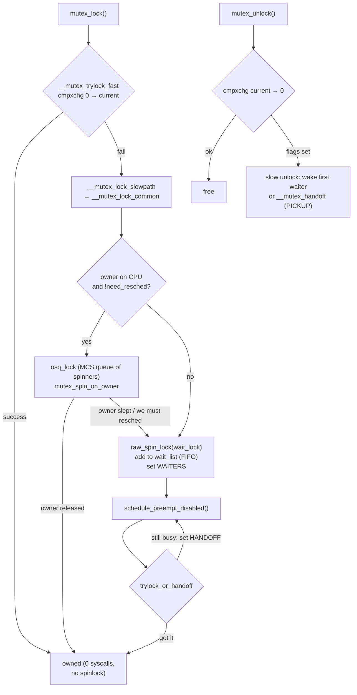

# 05 — The kernel mutex and its optimistic spinning

> Module 03 · Concurrency & Synchronization · Linux v6.18.63 · OpenBSD 8cada8c · Farsi: [05-mutex-optimistic-spinning.fa.md](05-mutex-optimistic-spinning.fa.md)

## 1. Summary

- `struct mutex` is a **sleeping** lock. A waiter may block, so it can only be used in process context. The mutex is owned by exactly one task, and only that task may unlock it.
- The uncontended path is one `cmpxchg` of the owner word from 0 to `current`, with no spinlock and no function call beyond `mutex_lock()`.
- On contention it first **spins optimistically** while the owner is running on another CPU (an MCS-queued "OSQ" of spinners). It goes to sleep on a FIFO wait list only when spinning stops paying off. A handoff flag prevents starvation.

## 2. Explanation

### 2.1 Intuition: the best of spin and sleep

A pure spinlock wastes CPU when the holder sleeps or runs for a long time. A pure sleeping lock pays two context switches even when the holder would release in 200 ns. The mutex guesses: **if the owner is currently on a CPU, it is probably about to finish, so spin. If the owner is asleep or preempted, sleep too.** This is "adaptive" locking (Solaris had it first). Linux calls it *optimistic spinning* (`CONFIG_MUTEX_SPIN_ON_OWNER`, `def_bool y` when `SMP && ARCH_SUPPORTS_ATOMIC_RMW`, kernel/Kconfig.locks L227).

### 2.2 The owner word

`lock->owner` is an `atomic_long_t` that holds a `struct task_struct *`. Task structs are cache-line aligned, so the low 3 bits are free for flags:

```c
linux/kernel/locking/mutex.h · MUTEX_FLAG_* · v6.18.63 · L23-36
   23  /*
   24   * @owner: contains: 'struct task_struct *' to the current lock owner,
   25   * NULL means not owned. Since task_struct pointers are aligned at
   26   * at least L1_CACHE_BYTES, we have low bits to store extra state.
   27   *
   28   * Bit0 indicates a non-empty waiter list; unlock must issue a wakeup.
   29   * Bit1 indicates unlock needs to hand the lock to the top-waiter
   30   * Bit2 indicates handoff has been done and we're waiting for pickup.
   31   */
   32  #define MUTEX_FLAG_WAITERS	0x01
   33  #define MUTEX_FLAG_HANDOFF	0x02
   34  #define MUTEX_FLAG_PICKUP	0x04
   36  #define MUTEX_FLAGS		0x07
```

| owner word | Meaning | `mutex_unlock()` does |
|---|---|---|
| `0` | free | — |
| `T` | held by task T, nobody waits | fast path: cmpxchg T → 0 |
| `T \| WAITERS` | held, sleepers on `wait_list` | slow path: wake the first waiter |
| `T \| WAITERS \| HANDOFF` | the first waiter was starved and asked for handoff | give the lock **directly** to that waiter (`T' \| PICKUP`) |

Because the word is exactly `current` when there are no flags, unlock's fast path is "cmpxchg from *me* to 0". Any flag makes that cmpxchg fail and forces the slow path, so the fast path never needs to look at the wait list.

### 2.3 The slow path in four phases

`__mutex_lock_common()` (kernel/locking/mutex.c L562):

| Phase | Lines | What happens |
|---|---|---|
| 1. Trylock + optimistic spin | L597–610 | `preempt_disable()`, then `__mutex_trylock()` or `mutex_optimistic_spin()`. On success return, never touching `wait_lock` |
| 2. Queue | L612–644 | take `wait_lock` (raw spinlock, IRQs off), trylock once more, append the waiter to `wait_list` (FIFO, L632), `set_current_state(state)` |
| 3. Sleep loop | L646–692 | trylock again, check signals (`-EINTR` for `_interruptible`), drop `wait_lock`, `schedule_preempt_disabled()`. After wakeup: `__mutex_trylock_or_handoff(lock, first)` |
| 4. First waiter spins | L695 on | the waiter at the head may spin again, as a *waiter-spinner*, instead of sleeping straight away |

**Starvation and handoff.** Optimistic spinners are not queued on `wait_list`, so a stream of new spinners could keep stealing the lock from a woken sleeper. After it wakes, the first waiter calls `__mutex_trylock_or_handoff(lock, true)`. If it still cannot get the lock, it sets `MUTEX_FLAG_HANDOFF` (L104 in `__mutex_trylock_common`). The next unlock then hands ownership straight to that waiter (`__mutex_handoff()`, L219). It writes `waiter | PICKUP`, and no spinner can grab the lock in between.

## 3. Diagram



## 4. Worked example

### 4.1 `mutex_lock()` and its fast path

```c
linux/kernel/locking/mutex.c · mutex_lock() · v6.18.63 · L269-276
  269  void __sched mutex_lock(struct mutex *lock)
  270  {
  271  	might_sleep();
  272  
  273  	if (!__mutex_trylock_fast(lock))
  274  		__mutex_lock_slowpath(lock);
  275  }
  276  EXPORT_SYMBOL(mutex_lock);
```

Elixir: https://elixir.bootlin.com/linux/v6.18.63/source/kernel/locking/mutex.c#L269

- **L269** `__sched`: the function goes into the `.sched.text` section. Stack-walkers such as `/proc/<pid>/wchan` then skip it and report the caller as the place the task sleeps.
- **L271** `might_sleep()`: a debug check (`CONFIG_DEBUG_ATOMIC_SLEEP`). It fires if this is called with a spinlock held or IRQs off, *even when the lock is free*. Bugs get found on the fast path, not only under contention.
- **L273–274**: one inline attempt, and the out-of-line slow path only on failure.

```c
linux/kernel/locking/mutex.c · __mutex_trylock_fast() · v6.18.63 · L150-168
  150  static __always_inline bool __mutex_trylock_fast(struct mutex *lock)
  151  {
  152  	unsigned long curr = (unsigned long)current;
  153  	unsigned long zero = 0UL;
  154  
  155  	MUTEX_WARN_ON(lock->magic != lock);
  156  
  157  	if (atomic_long_try_cmpxchg_acquire(&lock->owner, &zero, curr))
  158  		return true;
  159  
  160  	return false;
  161  }
  162  
  163  static __always_inline bool __mutex_unlock_fast(struct mutex *lock)
  164  {
  165  	unsigned long curr = (unsigned long)current;
  166  
  167  	return atomic_long_try_cmpxchg_release(&lock->owner, &curr, 0UL);
  168  }
```

- **L152**: the new owner value is the task pointer itself. "Who holds it" is answered by reading one word, which is also what lets spinners check `owner->on_cpu`.
- **L155**: with `CONFIG_DEBUG_MUTEXES`, it catches a mutex that was `memset` instead of `mutex_init()`ed.
- **L157**: `lock cmpxchg` on x86-64. Acquire ordering keeps the critical section after it.
- **L167**: unlock succeeds only if the word is *exactly* `current`, with no flag bits. That is how waiters force the slow unlock path.
- These two functions are compiled only `#ifndef CONFIG_DEBUG_LOCK_ALLOC` (the `#endif` at L169). With lockdep, every lock takes the slow path, so it can be annotated. VERSION-DEPENDENT / config-dependent.

### 4.2 Spinning on the owner

```c
linux/kernel/locking/mutex.c · mutex_spin_on_owner() · v6.18.63 · L340-364
  340  bool mutex_spin_on_owner(struct mutex *lock, struct task_struct *owner,
  341  			 struct ww_acquire_ctx *ww_ctx, struct mutex_waiter *waiter)
  342  {
  343  	bool ret = true;
  345  	lockdep_assert_preemption_disabled();
  347  	while (__mutex_owner(lock) == owner) {
  ...
  356  		barrier();
  ...
  361  		if (!owner_on_cpu(owner) || need_resched()) {
  362  			ret = false;
  363  			break;
  364  		}
```

- **L345**: preemption is off while spinning. As the comment at L348–355 says, that also acts as an RCU read-side section, so the owner's `task_struct` can't be freed under us.
- **L347**: spin as long as the **same** task owns the lock. A changed owner means the lock was released (and maybe re-taken). The caller then retries the trylock.
- **L356** `barrier()`: a compiler barrier, so `lock->owner` is re-read every loop.
- **L361**: stop spinning when the owner is **not running** (`owner_on_cpu()`, which also checks `vcpu_is_preempted()` for VMs), or when *we* should yield the CPU. Spinning on a sleeping owner can never succeed.

The caller, `mutex_optimistic_spin()` (L429), first takes `osq_lock(&lock->osq)` (L448). Only one spinner at a time spins on the owner word, and the others wait in an MCS queue (note 04). That avoids a "stampede of mutex spinners" (comment at L444–447).

### 4.3 A rule written in the source

```c
linux/kernel/locking/mutex.c · mutex_unlock() doc · v6.18.63 · L520-525
  520   * This function must not be used in interrupt context. Unlocking
  521   * of a not locked mutex is not allowed.
  522   *
  523   * The caller must ensure that the mutex stays alive until this function has
  524   * returned - mutex_unlock() can NOT directly be used to release an object such
  525   * that another concurrent task can free it.
```

Why? The slow unlock path still touches `lock->wait_lock` and `wait_list` *after* another task may already own the lock. If that task frees the object that contains the mutex, the unlocker writes to freed memory. Use a refcount, or RCU, for object lifetime.

### 4.4 OpenBSD: `rw_do_enter_write()`

OpenBSD has no separate sleeping mutex type. Its sleeping exclusive lock is the write side of `struct rwlock`.

```c
openbsd/sys/kern/kern_rwlock.c · rw_do_enter_write() · 8cada8c · L237-298
  237  	owner = rw_cas(&rwl->rwl_owner, 0, self);
  238  	if (owner == 0) {
  239  		/* wow, we won. so easy */
  ...
  243  	if (__predict_false(owner == self)) {
  244  		panic("%s rwlock %p: enter write deadlock",
  ...
  254  	if (!_kernel_lock_held()) {
  ...
  264  		for (spins = 0; spins < RW_SPINS; spins++) {
  265  			CPU_BUSY_CYCLE();
  266  			owner = atomic_load_long(&rwl->rwl_owner);
  267  			if (owner != 0)
  268  				continue;
  270  			owner = rw_cas(&rwl->rwl_owner, 0, self);
  ...
  292  	rw_inc(&rwl->rwl_waiters);
  293  	membar_producer();
  294  	do {
  295  		sleep_setup(&rwl->rwl_waiters, prio, rwl->rwl_name);
  296  		membar_consumer();
  297  		owner = atomic_load_long(&rwl->rwl_owner);
  298  		error = sleep_finish(RW_SLEEP_TMO, owner != 0);
```

- **L237**: same fast path, CAS 0 → `self` (the current `proc`).
- **L243–244**: a recursive write lock **panics** right away. Linux would simply hang on the second `mutex_lock()`, and lockdep would report "possible recursive locking detected".
- **L254**: there's no spinning while holding the big kernel lock, so KERNEL_LOCK waiters aren't held up.
- **L264** `RW_SPINS` = 1000 (L42). It is a **bounded count**, not "while the owner runs": OpenBSD does not check whether the owner is on a CPU.
- **L292–298**: announce the waiter, then `sleep_setup()`. The owner word is re-checked between setup and `sleep_finish()` (whose second argument says "really sleep?"), so a release in between isn't lost.

| Design choice | Linux `struct mutex` | OpenBSD `rwlock` (write) | Trade-off |
|---|---|---|---|
| Spin policy | while the owner is on a CPU (`owner_on_cpu`) | fixed 1000 busy cycles | Linux adapts to the hold time. OpenBSD is simpler and has a bounded worst case |
| Spinner queueing | OSQ (MCS) so only one spins on the word | none | OSQ scales to many CPUs |
| Waiter order | FIFO `wait_list` + handoff flag | sleep channel `&rwl_waiters` and `wakeup` | Linux bounds starvation explicitly |
| Recursive lock | deadlock (lockdep warns) | immediate `panic` | OpenBSD fails loudly. Linux relies on debug kernels |
| Reader support | none (use `rw_semaphore`) | same object | one OpenBSD primitive covers two Linux types |

## 5. Edge cases & pitfalls

- **Not in interrupt or softirq context**: the lock may sleep. `mutex_trylock()` is also forbidden there, because the owner tracking and priority logic assume process context.
- **Owner must unlock.** You can't lock in one task and unlock in another, unlike a semaphore (note 06). `CONFIG_DEBUG_MUTEXES` checks this.
- **`mutex_lock()` is uninterruptible**: a task stuck in it shows state `D` and can't be killed. Prefer `mutex_lock_interruptible()` or `mutex_lock_killable()` on paths reachable from user requests, and check their return value.
- **Lifetime**: see §4.3. Don't free the object containing the mutex while another task may still be inside `mutex_unlock()`.
- **Optimistic spinning in a VM** depends on `vcpu_is_preempted()` working. Without paravirt support the guest can't tell that the owner's vCPU was descheduled, and may spin uselessly. On aos-lab (verified 2026-11-15) the guest runs the KVM paravirt interface (`Hypervisor detected: KVM`, `kvm-guest: PV spinlocks enabled`) and `CONFIG_MUTEX_SPIN_ON_OWNER=y`, so `vcpu_is_preempted()` has real information there.
- **PREEMPT_RT**: `struct mutex` is backed by an rtmutex with priority inheritance (`kernel/locking/rtmutex.c`, Module 7). VERSION-DEPENDENT / config-dependent.

## 6. Exam key points

- The mutex owner word = `task_struct *` | 3 flag bits: WAITERS (0x1), HANDOFF (0x2), PICKUP (0x4).
- The fast lock is `cmpxchg_acquire(0 → current)`. The fast unlock is `cmpxchg_release(current → 0)`, and it fails whenever any flag is set.
- The slow path: trylock → optimistic spin (OSQ + `mutex_spin_on_owner` while `owner_on_cpu && !need_resched`) → FIFO `wait_list` → `schedule_preempt_disabled()`.
- HANDOFF stops spinners from starving a woken waiter. Unlock then gives the lock directly to the first waiter.
- Rules: process context only, the owner unlocks, no recursion, keep the mutex alive until `mutex_unlock()` returns.
- `might_sleep()` on the fast path catches "mutex under spinlock" bugs even without contention.
- OpenBSD rwlock (write): CAS fast path, 1000 bounded spins, sleep channel, panic on recursion.

## 7. Links

- Lesson: [4.3 Spin or sleep?](../lesson.en.md#43-spin-or-sleep)
- Walkthrough: [kernel-walkthrough.en.md](../kernel-walkthrough.en.md) (`kernel/locking/mutex.c` section, `mutex_lock()` L269)
- Notes: [04 spinlocks](04-spinlocks-qspinlock.en.md) · [06 semaphores & condvars](06-semaphores-condition-variables.en.md) · [07 futex](07-futex-user-kernel-split.en.md) (the user-space analogue) · [09 deadlock & lockdep](09-deadlock-coffman-lockdep.en.md)
- Labs: [04 futex mutex](../labs/04-futex-mutex/README.md) (the same 0/1/2 state idea in user space. The extension adds an optimistic spin) · [06 deadlock](../labs/06-deadlock/README.md)
- Quiz: [Q4](../quiz.en.md) (spinlock vs mutex) · [Q7](../quiz.en.md) (`__mutex_trylock_fast`)
