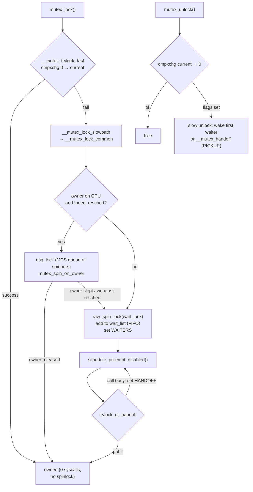

<div dir="rtl">

# ۰۵ — mutex کرنل و چرخش خوش‌بینانه‌اش

> ماژول ۰۳ · همروندی و همگام‌سازی · Linux v6.18.63 · OpenBSD 8cada8c · نسخهٔ انگلیسی: [05-mutex-optimistic-spinning.en.md](05-mutex-optimistic-spinning.en.md)

## ۱. خلاصه

- `struct mutex` قفلی **خوابنده** است. منتظر ممکن است block شود، پس فقط در process context قابل استفاده است. صاحب آن دقیقاً یک task است و فقط همان task می‌تواند آزادش کند.
- مسیر بدون رقابت یک `cmpxchg` روی کلمهٔ owner است، از ۰ به `current`. نه spinlockی در کار است و نه فراخوانی تابعی غیر از خود `mutex_lock()`.
- در رقابت، اول تا وقتی صاحب روی CPU دیگری در حال اجراست **خوش‌بینانه می‌چرخد** (چرخنده‌ها در صفی به نام OSQ از نوع MCS هستند). فقط وقتی چرخیدن بی‌فایده شد، در یک wait list به ترتیب FIFO می‌خوابد. پرچم handoff جلوی گرسنگی را می‌گیرد.

## ۲. توضیح

### ۲.۱ شهود: بهترینِ چرخیدن و خوابیدن

spinlock خالص وقتی نگه‌دارنده بخوابد یا مدت زیادی اجرا شود CPU را هدر می‌دهد. قفل خوابندهٔ خالص حتی وقتی نگه‌دارنده ۲۰۰ نانوثانیهٔ دیگر آزاد می‌کند هزینهٔ دو context switch را می‌پردازد. mutex حدس می‌زند: **اگر صاحب الان روی یک CPU است، احتمالاً به‌زودی تمام می‌کند، پس بچرخ. اگر خواب است یا preempt شده، تو هم بخواب.** این قفل «تطبیقی» (adaptive) است که اول در Solaris آمد. لینوکس به آن *optimistic spinning* می‌گوید: `CONFIG_MUTEX_SPIN_ON_OWNER`، که وقتی `SMP && ARCH_SUPPORTS_ATOMIC_RMW` برقرار باشد `def_bool y` است (kernel/Kconfig.locks خط ۲۲۷).

### ۲.۲ کلمهٔ owner

`lock->owner` یک `atomic_long_t` است که یک `struct task_struct *` در آن ذخیره می‌شود. task structها روی cache line تراز شده‌اند، پس ۳ بیت پایینی برای پرچم‌ها آزاد است:

</div>

```c
linux/kernel/locking/mutex.h · MUTEX_FLAG_* · v6.18.63 · L23-36
   23  /*
   24   * @owner: contains: 'struct task_struct *' to the current lock owner,
   25   * NULL means not owned. Since task_struct pointers are aligned at
   26   * at least L1_CACHE_BYTES, we have low bits to store extra state.
   27   *
   28   * Bit0 indicates a non-empty waiter list; unlock must issue a wakeup.
   29   * Bit1 indicates unlock needs to hand the lock to the top-waiter
   30   * Bit2 indicates handoff has been done and we're waiting for pickup.
   31   */
   32  #define MUTEX_FLAG_WAITERS	0x01
   33  #define MUTEX_FLAG_HANDOFF	0x02
   34  #define MUTEX_FLAG_PICKUP	0x04
   36  #define MUTEX_FLAGS		0x07
```

<div dir="rtl">

| کلمهٔ owner | معنا | کاری که `mutex_unlock()` می‌کند |
|---|---|---|
| `0` | آزاد | — |
| `T` | در دست task T، کسی منتظر نیست | مسیر سریع: cmpxchg از T به ۰ |
| `T \| WAITERS` | گرفته‌شده، و کسانی در `wait_list` خوابیده‌اند | مسیر کند: اولین منتظر را بیدار کن |
| `T \| WAITERS \| HANDOFF` | اولین منتظر گرسنه مانده و handoff خواسته | قفل را **مستقیم** به همان منتظر بده (`T' \| PICKUP`) |

چون وقتی پرچمی در کار نیست کلمه دقیقاً برابر `current` است، مسیر سریع unlock یعنی «cmpxchg از *خودم* به ۰». هر پرچمی این cmpxchg را شکست می‌دهد و کار را به مسیر کند می‌برد. برای همین مسیر سریع هیچ‌وقت لازم ندارد به wait list نگاه کند.

### ۲.۳ مسیر کند در چهار مرحله

تابع `__mutex_lock_common()` (فایل kernel/locking/mutex.c خط ۵۶۲):

| مرحله | خطوط | چه اتفاقی می‌افتد |
|---|---|---|
| ۱. trylock و چرخش خوش‌بینانه | ۵۹۷ تا ۶۱۰ | `preempt_disable()`، بعد `__mutex_trylock()` یا `mutex_optimistic_spin()`. اگر موفق شد برمی‌گردد و اصلاً به `wait_lock` دست نمی‌زند |
| ۲. صف | ۶۱۲ تا ۶۴۴ | گرفتن `wait_lock` (یک raw spinlock با IRQ خاموش)، یک trylock دیگر، افزودن منتظر به انتهای `wait_list` به ترتیب FIFO (خط ۶۳۲) و `set_current_state(state)` |
| ۳. حلقهٔ خواب | ۶۴۶ تا ۶۹۲ | دوباره trylock، بررسی signal (برای نسخهٔ `_interruptible` مقدار `-EINTR`)، رها کردن `wait_lock` و `schedule_preempt_disabled()`. بعد از بیداری: `__mutex_trylock_or_handoff(lock, first)` |
| ۴. چرخش اولین منتظر | از ۶۹۵ | منتظرِ سر صف ممکن است به‌جای خوابیدن فوری دوباره بچرخد، این بار به‌عنوان *waiter-spinner* |

**گرسنگی و handoff.** چرخنده‌های خوش‌بین در `wait_list` نیستند، پس جریانی از چرخنده‌های تازه ممکن است مدام قفل را از خوابیدهٔ بیدارشده بدزدند. اولین منتظر بعد از بیدار شدن `__mutex_trylock_or_handoff(lock, true)` را صدا می‌زند. اگر باز هم قفل را نگیرد، `MUTEX_FLAG_HANDOFF` را روشن می‌کند (خط ۱۰۴ در `__mutex_trylock_common`). unlock بعدی مالکیت را مستقیم به همین منتظر می‌دهد (`__mutex_handoff()`، خط ۲۱۹). مقدار `waiter | PICKUP` را می‌نویسد و هیچ چرخنده‌ای در این فاصله نمی‌تواند قفل را بقاپد.

## ۳. نمودار

</div>



<div dir="rtl">

## ۴. مثال حل‌شده

### ۴.۱ تابع `mutex_lock()` و مسیر سریعش

</div>

```c
linux/kernel/locking/mutex.c · mutex_lock() · v6.18.63 · L269-276
  269  void __sched mutex_lock(struct mutex *lock)
  270  {
  271  	might_sleep();
  272  
  273  	if (!__mutex_trylock_fast(lock))
  274  		__mutex_lock_slowpath(lock);
  275  }
  276  EXPORT_SYMBOL(mutex_lock);
```

<div dir="rtl">

Elixir: <span dir="ltr">https://elixir.bootlin.com/linux/v6.18.63/source/kernel/locking/mutex.c#L269</span>

- **خط ۲۶۹**، `__sched`: تابع در بخش `.sched.text` قرار می‌گیرد. ابزارهایی که stack را می‌پیمایند، مثل <span dir="ltr">`/proc/<pid>/wchan`</span>، از آن رد می‌شوند و فراخواننده را محل خوابیدن task گزارش می‌کنند.
- **خط ۲۷۱**، `might_sleep()`: بررسی دیباگ (`CONFIG_DEBUG_ATOMIC_SLEEP`). اگر این تابع با spinlock در دست یا IRQ خاموش صدا زده شود، *حتی وقتی قفل آزاد است* هشدار می‌دهد. پس باگ در مسیر سریع هم پیدا می‌شود، نه فقط وقتی رقابت هست.
- **خط ۲۷۳ و ۲۷۴**: یک تلاش inline، و فقط در صورت شکست مسیر کندِ جداگانه.

</div>

```c
linux/kernel/locking/mutex.c · __mutex_trylock_fast() · v6.18.63 · L150-168
  150  static __always_inline bool __mutex_trylock_fast(struct mutex *lock)
  151  {
  152  	unsigned long curr = (unsigned long)current;
  153  	unsigned long zero = 0UL;
  154  
  155  	MUTEX_WARN_ON(lock->magic != lock);
  156  
  157  	if (atomic_long_try_cmpxchg_acquire(&lock->owner, &zero, curr))
  158  		return true;
  159  
  160  	return false;
  161  }
  162  
  163  static __always_inline bool __mutex_unlock_fast(struct mutex *lock)
  164  {
  165  	unsigned long curr = (unsigned long)current;
  166  
  167  	return atomic_long_try_cmpxchg_release(&lock->owner, &curr, 0UL);
  168  }
```

<div dir="rtl">

- **خط ۱۵۲**: مقدار تازهٔ owner خودِ اشاره‌گر task است. «چه کسی قفل را دارد؟» با خواندن یک کلمه جواب داده می‌شود، و چرخنده‌ها هم به همین دلیل می‌توانند `owner->on_cpu` را بررسی کنند.
- **خط ۱۵۵**: با `CONFIG_DEBUG_MUTEXES`، mutexی را که به‌جای `mutex_init()` با `memset` صفر شده تشخیص می‌دهد.
- **خط ۱۵۷**: روی x86-64 این `lock cmpxchg` است. ترتیب acquire تضمین می‌کند critical section بعد از آن بماند.
- **خط ۱۶۷**: unlock فقط وقتی موفق است که کلمه *دقیقاً* `current` باشد و هیچ بیت پرچمی نداشته باشد. منتظرها با همین سازوکار unlock را به مسیر کند می‌برند.
- این دو تابع فقط در حالت `#ifndef CONFIG_DEBUG_LOCK_ALLOC` کامپایل می‌شوند (`#endif` در خط ۱۶۹). با lockdep همهٔ قفل‌ها از مسیر کند می‌روند تا بشود حاشیه‌نویسی‌شان کرد. VERSION-DEPENDENT و وابسته به config.

### ۴.۲ چرخیدن روی صاحب قفل

</div>

```c
linux/kernel/locking/mutex.c · mutex_spin_on_owner() · v6.18.63 · L340-364
  340  bool mutex_spin_on_owner(struct mutex *lock, struct task_struct *owner,
  341  			 struct ww_acquire_ctx *ww_ctx, struct mutex_waiter *waiter)
  342  {
  343  	bool ret = true;
  345  	lockdep_assert_preemption_disabled();
  347  	while (__mutex_owner(lock) == owner) {
  ...
  356  		barrier();
  ...
  361  		if (!owner_on_cpu(owner) || need_resched()) {
  362  			ret = false;
  363  			break;
  364  		}
```

<div dir="rtl">

- **خط ۳۴۵**: در زمان چرخیدن preemption خاموش است. طبق توضیح خطوط ۳۴۸ تا ۳۵۵ این حالت مثل یک بخش خوانشی RCU هم عمل می‌کند، پس `task_struct` صاحب قفل زیر دست ما آزاد نمی‌شود.
- **خط ۳۴۷**: تا وقتی **همان** task صاحب قفل است بچرخ. اگر صاحب عوض شد یعنی قفل آزاد شده (و شاید دوباره گرفته شده)، و فراخواننده trylock را دوباره امتحان می‌کند.
- **خط ۳۵۶**، `barrier()`: یک compiler barrier تا `lock->owner` در هر دور دوباره خوانده شود.
- **خط ۳۶۱**: وقتی صاحب **در حال اجرا نیست** چرخیدن را قطع کن (`owner_on_cpu()`، که برای VMها `vcpu_is_preempted()` را هم بررسی می‌کند)، یا وقتی *خودمان* باید CPU را رها کنیم. چرخیدن روی صاحبِ خوابیده هیچ‌وقت نتیجه نمی‌دهد.

فراخواننده، یعنی `mutex_optimistic_spin()` (خط ۴۲۹)، اول `osq_lock(&lock->osq)` را می‌گیرد (خط ۴۴۸). در هر لحظه فقط یک چرخنده روی کلمهٔ owner می‌چرخد و بقیه در یک صف MCS منتظرند (یادداشت ۰۴). این از «هجوم چرخنده‌ها» جلوگیری می‌کند (توضیح خطوط ۴۴۴ تا ۴۴۷).

### ۴.۳ قاعده‌ای که در خود سورس نوشته شده

</div>

```c
linux/kernel/locking/mutex.c · mutex_unlock() doc · v6.18.63 · L520-525
  520   * This function must not be used in interrupt context. Unlocking
  521   * of a not locked mutex is not allowed.
  522   *
  523   * The caller must ensure that the mutex stays alive until this function has
  524   * returned - mutex_unlock() can NOT directly be used to release an object such
  525   * that another concurrent task can free it.
```

<div dir="rtl">

چرا؟ مسیر کند unlock هنوز به `lock->wait_lock` و `wait_list` دست می‌زند، در حالی که ممکن است task دیگری قفل را گرفته باشد. اگر آن task شیءِ حاوی mutex را آزاد کند، unlock‌کننده در حافظهٔ آزادشده می‌نویسد. برای طول عمر شیء از refcount یا RCU استفاده کنید.

### ۴.۴ در OpenBSD: تابع `rw_do_enter_write()`

OpenBSD نوع جداگانه‌ای برای mutex خوابنده ندارد. قفل انحصاری خوابنده‌اش سمت نوشتنِ `struct rwlock` است.

</div>

```c
openbsd/sys/kern/kern_rwlock.c · rw_do_enter_write() · 8cada8c · L237-298
  237  	owner = rw_cas(&rwl->rwl_owner, 0, self);
  238  	if (owner == 0) {
  239  		/* wow, we won. so easy */
  ...
  243  	if (__predict_false(owner == self)) {
  244  		panic("%s rwlock %p: enter write deadlock",
  ...
  254  	if (!_kernel_lock_held()) {
  ...
  264  		for (spins = 0; spins < RW_SPINS; spins++) {
  265  			CPU_BUSY_CYCLE();
  266  			owner = atomic_load_long(&rwl->rwl_owner);
  267  			if (owner != 0)
  268  				continue;
  270  			owner = rw_cas(&rwl->rwl_owner, 0, self);
  ...
  292  	rw_inc(&rwl->rwl_waiters);
  293  	membar_producer();
  294  	do {
  295  		sleep_setup(&rwl->rwl_waiters, prio, rwl->rwl_name);
  296  		membar_consumer();
  297  		owner = atomic_load_long(&rwl->rwl_owner);
  298  		error = sleep_finish(RW_SLEEP_TMO, owner != 0);
```

<div dir="rtl">

- **خط ۲۳۷**: همان مسیر سریع، CAS از ۰ به `self` (یعنی `proc` جاری).
- **خط ۲۴۳ و ۲۴۴**: قفل نوشتنِ بازگشتی **فوراً panic** می‌کند. لینوکس در دومین `mutex_lock()` فقط گیر می‌کرد، و lockdep پیام <span dir="ltr">"possible recursive locking detected"</span> می‌داد.
- **خط ۲۵۴**: با قفل بزرگ کرنل (KERNEL_LOCK) در دست نمی‌چرخد، تا منتظرهای آن قفل معطل نشوند.
- **خط ۲۶۴**، `RW_SPINS` برابر ۱۰۰۰ (خط ۴۲): یک **شمارش ثابت** است، نه «تا وقتی صاحب اجرا می‌شود». OpenBSD بررسی نمی‌کند که صاحب روی CPU هست یا نه.
- **خط ۲۹۲ تا ۲۹۸**: اعلام حضور منتظر و بعد `sleep_setup()`. کلمهٔ owner بین setup و `sleep_finish()` دوباره بررسی می‌شود (آرگومان دوم یعنی «واقعاً بخوابم؟») تا آزادسازی‌ای که در این فاصله رخ داده گم نشود.

| انتخاب طراحی | `struct mutex` در لینوکس | `rwlock` در OpenBSD (نوشتن) | بده‌بستان |
|---|---|---|---|
| سیاست چرخش | تا وقتی صاحب روی CPU است (`owner_on_cpu`) | ۱۰۰۰ دور ثابت | لینوکس خودش را با مدت نگه‌داشتن قفل تطبیق می‌دهد. OpenBSD ساده‌تر است و بدترین حالتش محدود است |
| صف چرخنده‌ها | OSQ (از نوع MCS)، فقط یکی روی کلمه می‌چرخد | ندارد | OSQ با تعداد زیاد CPU مقیاس‌پذیر است |
| ترتیب منتظرها | `wait_list` به ترتیب FIFO + پرچم handoff | sleep channel روی `&rwl_waiters` و `wakeup` | لینوکس گرسنگی را صریحاً محدود می‌کند |
| قفل بازگشتی | بن‌بست (lockdep هشدار می‌دهد) | `panic` فوری | OpenBSD با صدای بلند شکست می‌خورد. لینوکس به کرنل دیباگ تکیه دارد |
| پشتیبانی از خواننده | ندارد (برای آن `rw_semaphore` هست) | همان شیء | یک primitive در OpenBSD جای دو نوع در لینوکس را می‌گیرد |

## ۵. حالت‌های مرزی و دام‌ها

- **نه در interrupt و نه در softirq**: قفل ممکن است بخوابد. `mutex_trylock()` هم آن‌جا ممنوع است، چون ردیابی مالکیت و منطق اولویت فرض می‌کنند در process context هستیم.
- **صاحب باید آزاد کند.** نمی‌شود در یک task قفل کرد و در task دیگری آزاد کرد. semaphore (یادداشت ۰۶) این اجازه را می‌دهد. `CONFIG_DEBUG_MUTEXES` این را بررسی می‌کند.
- **`mutex_lock()` قابل قطع نیست**: taskی که در آن گیر کرده حالت `D` دارد و kill نمی‌شود. در مسیرهایی که از درخواست کاربر می‌آیند `mutex_lock_interruptible()` یا `mutex_lock_killable()` را ترجیح دهید و مقدار برگشتی را بررسی کنید.
- **طول عمر**: بخش ۴.۳ را ببینید. شیءِ حاوی mutex را وقتی task دیگری ممکن است هنوز داخل `mutex_unlock()` باشد آزاد نکنید.
- **چرخش خوش‌بینانه در VM** به درست کار کردن `vcpu_is_preempted()` وابسته است. بدون پشتیبانی paravirt، مهمان نمی‌فهمد vCPU صاحب قفل از اجرا خارج شده، و ممکن است بیهوده بچرخد. روی aos-lab (بررسی‌شده در 2026-11-15) مهمان رابط paravirt مربوط به KVM را دارد (`Hypervisor detected: KVM` و `kvm-guest: PV spinlocks enabled`) و `CONFIG_MUTEX_SPIN_ON_OWNER=y` است، پس `vcpu_is_preempted()` آنجا اطلاعات واقعی دارد.
- **PREEMPT_RT**: پشتوانهٔ `struct mutex` یک rtmutex با priority inheritance است (<span dir="ltr">`kernel/locking/rtmutex.c`</span>، ماژول ۷). VERSION-DEPENDENT و وابسته به config.

## ۶. نکته‌های کلیدی امتحان

- کلمهٔ owner در mutex یعنی `task_struct *` به‌اضافهٔ ۳ بیت پرچم: WAITERS (0x1)، HANDOFF (0x2)، PICKUP (0x4).
- قفل سریع `cmpxchg_acquire(0 → current)` است. آزادسازی سریع `cmpxchg_release(current → 0)` است، و با روشن بودن هر پرچمی شکست می‌خورد.
- مسیر کند: trylock ← چرخش خوش‌بینانه (OSQ و `mutex_spin_on_owner` تا وقتی `owner_on_cpu && !need_resched`) ← `wait_list` به ترتیب FIFO ← `schedule_preempt_disabled()`.
- HANDOFF نمی‌گذارد چرخنده‌ها منتظرِ بیدارشده را گرسنه نگه دارند. unlock در این حالت قفل را مستقیم به اولین منتظر می‌دهد.
- قواعد: فقط process context، صاحب آزاد می‌کند، قفل بازگشتی ممنوع، و mutex باید تا برگشتن `mutex_unlock()` زنده بماند.
- `might_sleep()` در مسیر سریع باگ «mutex زیر spinlock» را حتی بدون رقابت پیدا می‌کند.
- rwlock در OpenBSD (سمت نوشتن): مسیر سریع CAS، ۱۰۰۰ دور چرخش محدود، sleep channel، و panic در قفل بازگشتی.

## ۷. پیوندها

- درس: [۴.۳ بچرخیم یا بخوابیم؟](../lesson.fa.md#43-spin-or-sleep)
- مرور کد کرنل: [kernel-walkthrough.fa.md](../kernel-walkthrough.fa.md) (بخش <span dir="ltr">`kernel/locking/mutex.c`</span>، تابع `mutex_lock()` در خط ۲۶۹)
- یادداشت‌ها: [۰۴ spinlock](04-spinlocks-qspinlock.fa.md) · [۰۶ semaphore و condition variable](06-semaphores-condition-variables.fa.md) · [۰۷ futex](07-futex-user-kernel-split.fa.md) (معادلش در فضای کاربر) · [۰۹ بن‌بست و lockdep](09-deadlock-coffman-lockdep.fa.md)
- آزمایش‌ها: [۰۴ futex mutex](../labs/04-futex-mutex/README.md) (همان ایدهٔ وضعیت‌های ۰، ۱ و ۲ در فضای کاربر. تمرین تکمیلی چرخش خوش‌بینانه اضافه می‌کند) · [۰۶ بن‌بست](../labs/06-deadlock/README.md)
- آزمون: [پرسش ۴](../quiz.fa.md) (spinlock یا mutex) · [پرسش ۷](../quiz.fa.md) (`__mutex_trylock_fast`)

</div>
