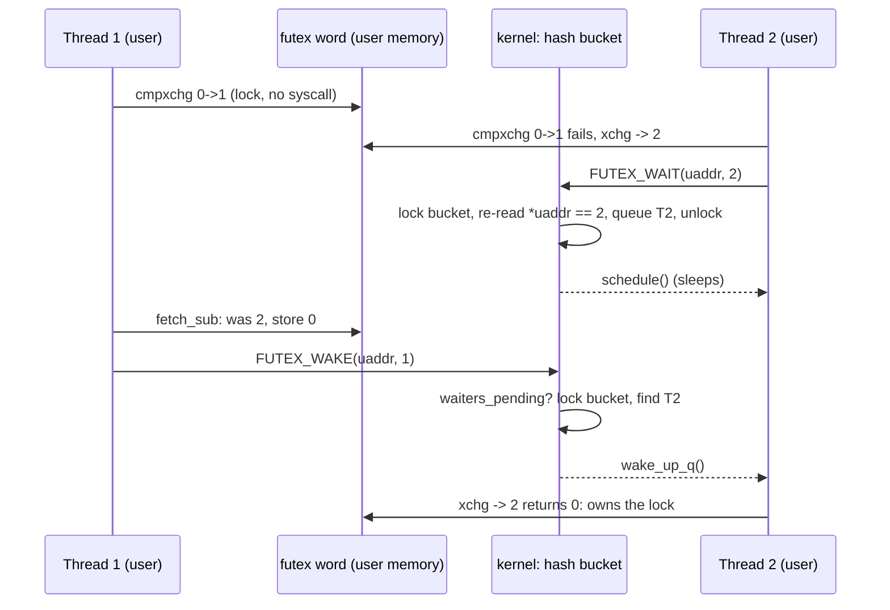

# 07 — Futex: the user/kernel split

> Module 03 · Concurrency & Synchronization · Linux v6.18.63 · OpenBSD 8cada8c · Farsi: [07-futex-user-kernel-split.fa.md](07-futex-user-kernel-split.fa.md)

## 1. Summary

- A **futex** ("fast user-space mutex") is a 32-bit integer in *user* memory plus a kernel wait queue keyed by that integer's address.
- Lock and unlock happen with one atomic instruction in user space; the kernel is entered **only** to sleep (`FUTEX_WAIT`) or to wake a sleeper (`FUTEX_WAKE`).
- The hard part is the race between "check the value" and "go to sleep". The kernel closes it by re-reading the value under the hash-bucket lock.

## 2. Explanation

### 2.1 Intuition: why not just use a syscall per lock?

A syscall costs hundreds of nanoseconds (entry, `do_syscall_64`, exit; Module 01). Most locks are **uncontended**: the thread that wants the lock finds it free. Paying a syscall for that case is wasted work. The futex design splits the job:

| Job | Where it runs | Cost |
|---|---|---|
| Decide "is it free? take it" | user space, one `lock cmpxchg` | ~20 ns, no kernel |
| Sleep when it is not free | kernel, `FUTEX_WAIT` | syscall + context switch |
| Wake one sleeper on unlock | kernel, `FUTEX_WAKE` | syscall, only if someone may sleep |

The kernel does **not** know what the integer means. It never decides who owns the lock. The value's meaning (0 = free, 1 = locked, 2 = contended) is a user-space convention, implemented by glibc's `pthread_mutex_t`, Go's runtime, Rust's `std::sync::Mutex`, and our lab.

### 2.2 The two operations

| Call | Meaning |
|---|---|
| `futex(uaddr, FUTEX_WAIT, val, timeout)` | "Put me to sleep **if `*uaddr` still equals `val`**." If the value differs, return `EAGAIN` (`-EWOULDBLOCK` inside the kernel) immediately. |
| `futex(uaddr, FUTEX_WAKE, n)` | "Wake up to `n` tasks sleeping on `uaddr`." Returns how many it woke. |

`FUTEX_PRIVATE_FLAG` (value 128; `FUTEX_WAIT_PRIVATE = 128`, `FUTEX_WAKE_PRIVATE = 129`) says the word is not shared with another process. The kernel can then key the wait queue by `(mm, virtual address)` instead of resolving the physical page, which is cheaper.

### 2.3 The lost wake-up problem

The check "value == val" and the act "sleep" must be atomic with respect to `FUTEX_WAKE`. Otherwise:

1. Waiter reads `*uaddr == 2` in user space and decides to sleep.
2. Owner unlocks: sets `*uaddr = 0`, calls `FUTEX_WAKE`. Nobody is queued yet, so nothing is woken.
3. Waiter enters the kernel and sleeps. Forever.

Linux prevents this by **re-reading `*uaddr` inside the kernel while holding the hash-bucket spinlock**, and only then queueing. A waker must take the same bucket lock to scan the queue. So the waker either runs before the re-read (the waiter sees the new value and returns `EAGAIN`) or after the queueing (the waker finds the waiter).

### 2.4 Kernel data structures

All waiters live in a hash table of buckets. The bucket is chosen by hashing the **futex key** (`get_futex_key()`: `mm` + address for private futexes; inode/page + offset for shared ones). Each bucket has a spinlock, a priority-sorted list of waiters (`plist`), and a `waiters` counter used to skip the lock when nobody waits.

**VERSION-DEPENDENT.** Since v6.16 a process may get a **private** futex hash (`futex_private_hash`, tuned with `prctl(PR_FUTEX_HASH, ...)`, `PR_FUTEX_HASH = 78` in `include/uapi/linux/prctl.h`), so threads of one process stop contending on the global table. `__futex_hash()` picks it first when it exists ([kernel/futex/core.c L373](https://elixir.bootlin.com/linux/v6.18.63/source/kernel/futex/core.c#L373)). Older kernels have only the global hash.

## 3. Diagram



## 4. Worked example

### 4.1 User side: the lab's 0/1/2 mutex

From [`../labs/04-futex-mutex/futex_mutex.c`](../labs/04-futex-mutex/futex_mutex.c) ("mutex 3" in Drepper, *Futexes Are Tricky*):

```c
static void fmutex_lock(atomic_uint *m)
{
    uint32_t c = cas(m, 0, 1);                   // fast path: 0 -> 1
    if (c == 0)
        return;
    if (c != 2)
        c = atomic_exchange(m, 2);               // announce "there may be waiters"
    while (c != 0) {
        atomic_fetch_add(&g_wait_calls, 1);
        futex(m, FUTEX_WAIT_PRIVATE, 2);         // sleeps only if *m is still 2
        c = atomic_exchange(m, 2);               // woke up: try to take it, keep "2"
    }
}

static void fmutex_unlock(atomic_uint *m)
{
    if (atomic_fetch_sub(m, 1) != 1) {           // was 2: someone may sleep
        atomic_store(m, 0);
        atomic_fetch_add(&g_wake_calls, 1);
        futex(m, FUTEX_WAKE_PRIVATE, 1);         // wake exactly one waiter
    }
}
```

- `cas(m, 0, 1)` is the whole uncontended lock: one `lock cmpxchg`, zero syscalls.
- State 2 means "locked and maybe waiters". A thread that must wait first writes 2, so the unlocker knows it has to call `FUTEX_WAKE`.
- `FUTEX_WAIT(..., 2)`: if the owner already unlocked (value is now 0), the kernel returns at once and the loop retries.
- After waking, the thread takes the lock with `xchg(m, 2)`, not 1: it cannot know whether others still sleep, so it stays pessimistic.
- `fetch_sub` returning 1 means the state was 1 (no waiters): the unlock costs no syscall. With one thread, the lab prints `futex_wait=0 futex_wake=0`. The real counts under contention are in the [lab README](../labs/04-futex-mutex/README.md).

### 4.2 Kernel entry: `do_futex()` dispatch

`linux/kernel/futex/syscalls.c · do_futex() · v6.18.63` — [L112](https://elixir.bootlin.com/linux/v6.18.63/source/kernel/futex/syscalls.c#L112)

```c
  125  	switch (cmd) {
  126  	case FUTEX_WAIT:
  127  		val3 = FUTEX_BITSET_MATCH_ANY;
  128  		fallthrough;
  129  	case FUTEX_WAIT_BITSET:
  130  		return futex_wait(uaddr, flags, val, timeout, val3);
  131  	case FUTEX_WAKE:
  132  		val3 = FUTEX_BITSET_MATCH_ANY;
  133  		fallthrough;
  134  	case FUTEX_WAKE_BITSET:
  135  		return futex_wake(uaddr, flags, val, val3);
```

- L125: `cmd` is `op & FUTEX_CMD_MASK`; the private flag was already turned into `flags` by `futex_to_flags(op)` (L115).
- L126–130: plain `FUTEX_WAIT` is a `WAIT_BITSET` that matches any bitset.
- L131–135: same for wake. `val` is "expected value" for WAIT and "how many to wake" for WAKE.

### 4.3 Waiter: `futex_wait_setup()`

`linux/kernel/futex/waitwake.c · futex_wait_setup() · v6.18.63` — [L595](https://elixir.bootlin.com/linux/v6.18.63/source/kernel/futex/waitwake.c#L595) (lines 620–666, trimmed)

```c
  620  retry:
  621  	ret = get_futex_key(uaddr, flags, &q->key, FUTEX_READ);
  ...
  627  		CLASS(hbr, hbr)(&q->key);
  628  		auto hb = hbr.hb;
  629  
  630  		futex_q_lock(q, hb);
  631  
  632  		ret = futex_get_value_locked(&uval, uaddr);
  ...
  647  		if (uval != val) {
  648  			futex_q_unlock(hb);
  649  			return -EWOULDBLOCK;
  650  		}
  ...
  663  		if (task == current)
  664  			set_current_state(TASK_INTERRUPTIBLE|TASK_FREEZABLE);
  665  		futex_queue(q, hb, task);
```

- L621: compute the key (private: `mm` + address).
- L627–628: find the bucket (the private hash if the process has one).
- L630: `futex_q_lock()` increments `hb->waiters` (barrier A) and takes `hb->lock`.
- L632: read `*uaddr` **after** the lock is held. The comment at L602–619 says why: if the bucket were locked after the test, "we could block indefinitely".
- L647–650: value changed → return `-EWOULDBLOCK` (user sees `EAGAIN`). This is how the lab's loop survives an unlock that happened just before the syscall.
- L663–665: mark the task sleeping, queue it; `futex_queue()` drops the lock. The caller then calls `schedule()`.

### 4.4 Waker: `futex_wake()` and the barrier pair

`linux/kernel/futex/waitwake.c · futex_wake() · v6.18.63` — [L155](https://elixir.bootlin.com/linux/v6.18.63/source/kernel/futex/waitwake.c#L155)

```c
  175  	/* Make sure we really have tasks to wakeup */
  176  	if (!futex_hb_waiters_pending(hb))
  177  		return ret;
  178  
  179  	spin_lock(&hb->lock);
  180  
  181  	plist_for_each_entry_safe(this, next, &hb->chain, list) {
  182  		if (futex_match (&this->key, &key)) {
  ...
  192  			this->wake(&wake_q, this);
  193  			if (++ret >= nr_wake)
  194  				break;
  195  		}
  196  	}
  197  
  198  	spin_unlock(&hb->lock);
  199  	wake_up_q(&wake_q);
```

- L176: fast exit without touching the lock if `hb->waiters == 0`.
- L179–196: scan the chain (several futexes can share a bucket, so `futex_match()` checks the key), collect up to `nr_wake` tasks.
- L199: actually wake them **after** dropping the spinlock, so the woken task does not immediately spin on `hb->lock`.

The fast exit at L176 is only safe because of two full barriers. `linux/kernel/futex/futex.h · futex_hb_waiters_pending() · v6.18.63` — [L409](https://elixir.bootlin.com/linux/v6.18.63/source/kernel/futex/futex.h#L409):

```c
  409  static inline int futex_hb_waiters_pending(struct futex_hash_bucket *hb)
  410  {
  411  #ifdef CONFIG_SMP
  412  	/*
  413  	 * Full barrier (B), see the ordering comment above.
  414  	 */
  415  	smp_mb();
  416  	return atomic_read(&hb->waiters);
```

The ordering comment at the top of `waitwake.c` (L86–96) reduces this to

```
X = Y = 0        (X = waiters, Y = futex word)
w[X]=1   w[Y]=1
MB       MB
r[Y]=y   r[X]=x
=> x==0 && y==0 is impossible
```

This is exactly the **store-buffering (SB) litmus test** of [note 03](03-x86-tso-and-barriers.en.md) and [lab 05](../labs/05-litmus-sb/README.md). Without barriers A (`smp_mb__after_atomic()` in `futex_hb_waiters_inc()`, L394) and B, x86-TSO lets both sides read the old value: the waiter misses the new futex value **and** the waker misses the waiter. Lab 05 counts how often that happens on real hardware when the fence is missing.

### 4.5 The bucket

`linux/kernel/futex/futex.h · struct futex_hash_bucket · v6.18.63` — [L143](https://elixir.bootlin.com/linux/v6.18.63/source/kernel/futex/futex.h#L143)

```c
  143  struct futex_hash_bucket {
  144  	atomic_t waiters;
  145  	spinlock_t lock;
  146  	struct plist_head chain;
  147  } ____cacheline_aligned_in_smp;
```

- `waiters`: the X of the SB argument. `lock`: serializes wait vs wake. `chain`: priority-ordered list (so RT tasks are woken first). `____cacheline_aligned_in_smp`: one bucket per cache line, no false sharing between buckets.

## 5. Edge cases & pitfalls

| Pitfall | What happens | Fix |
|---|---|---|
| Treating a WAIT return as "I own the lock" | WAIT returns on wake, on `EAGAIN`, on signals (`EINTR`), and spuriously | Always re-check the word in a loop |
| Unlocking with `store(0)` and always calling WAKE | Correct but every unlock is a syscall | Use state 2 to know when waiters may exist |
| Mixing `_PRIVATE` and non-private ops on the same word | Different keys → waiter never found | Use the same flag on both sides |
| Futex word in shared memory between processes | Needs the non-private (shared) key | Omit `FUTEX_PRIVATE_FLAG` |
| Expecting fairness | `FUTEX_WAKE(1)` wakes one waiter, but a running thread can grab the lock first (barging) | Accept it, or use a ticket/handoff protocol |
| Priority inversion | Plain futexes know nothing about owners | `FUTEX_LOCK_PI` → `rt_mutex` with priority inheritance (Module 07, `kernel/futex/pi.c`) |
| Lab "wait" counters vs `strace -c` | `strace` slows threads and changes contention | Compare with bpftrace counts, which barely perturb the run |

## 6. Exam key points

- Futex = user-space word + kernel wait queue keyed by its address; uncontended lock/unlock = **0 syscalls**.
- `FUTEX_WAIT(uaddr, val)` sleeps only if `*uaddr == val`, checked **under the bucket lock**; otherwise `EAGAIN`.
- `FUTEX_WAKE(uaddr, n)` wakes ≤ n waiters; returns the count.
- Linux order: lock bucket → re-read value → queue → unlock → `schedule()`.
- `hb->waiters` + barriers A/B let `futex_wake()` skip the lock when nobody waits; correctness is the SB litmus argument.
- 0/1/2 states: 1 = locked, 2 = locked + maybe waiters; unlock calls WAKE only if the old value was 2.
- Private flag (128) → cheaper key (`mm` + vaddr). v6.16+: optional per-process futex hash (VERSION-DEPENDENT).
- PI futexes route to `rt_mutex` (Module 07).

### OpenBSD comparison

`openbsd/sys/kern/sys_futex.c · futex_wait() · 8cada8c` — [L252](https://github.com/openbsd/src/blob/8cada8c/sys/kern/sys_futex.c#L252) (lines 278–306)

```c
  278  	futex_addrs(p, &f, uaddr, flags);
  279  	fsq = futex_get_slpque(&f);
  280  
  281  	/* Mark futex as waiting. */
  282  	f.ft_fsq = fsq;
  283  	f.ft_proc = p;
  284  	rw_enter_write(&fsq->fsq_lock);
  285  	/* Make the waiting futex visible to wake/requeue */
  286  	TAILQ_INSERT_TAIL(&fsq->fsq_list, &f, ft_entry);
  287  	rw_exit_write(&fsq->fsq_lock);
  ...
  296  	if ((error = copyin32(uaddr, &cval)) != 0)
  297  		goto exit;
  298  
  299  	/* If the value changed, stop here. */
  300  	if (cval != val) {
  301  		error = EAGAIN;
  302  		goto exit;
  303  	}
  304  
  305  	sleep_setup(&f, PWAIT|PCATCH, "fsleep");
  306  	error = sleep_finish(nsecs, f.ft_proc != NULL);
```

- L284–287: OpenBSD **enqueues first** (under a sleeping `rwlock`, not a spinlock), then drops the lock.
- L296–303: only then reads the user value; if it changed, it dequeues and returns `EAGAIN`.
- L305–306: sleep unless a waker already cleared `f.ft_proc`. A wake that happens between L287 and L305 finds the entry in the list and clears `ft_proc`, so `sleep_finish()` does not sleep: no lost wake-up.

| Design choice | Linux v6.18.63 | OpenBSD 8cada8c | Trade-off |
|---|---|---|---|
| Order in WAIT | lock bucket → read value → queue | queue → unlock → read value → sleep | Linux holds a spinlock across a user read (needs `futex_get_value_locked` + fault retry); OpenBSD avoids that but must dequeue on `EAGAIN` |
| Bucket lock | `spinlock_t` | `rwlock` (sleeping) | spinlock: cheaper, can't sleep on a fault; rwlock: can fault in `copyin32` |
| Wake fast path | `hb->waiters` + `smp_mb()`, skip lock | always takes the lock | Linux saves a lock on unlocks with no waiters |
| Operations | WAIT/WAKE, bitset, REQUEUE, PI, WAKE_OP, `futex_waitv` | WAIT, WAKE, REQUEUE | Linux: richer (glibc condvars, PI, Wine); OpenBSD: smaller attack surface |
| Hash | global, per-NUMA-node; optional per-process (v6.16+) | global sleep-queue table | per-process hash removes cross-process contention |

## 7. Links

- Lesson: [4.4 How does a sleeping lock avoid a syscall?](../lesson.en.md#44-how-does-a-sleeping-lock-avoid-a-syscall)
- Walkthrough: [kernel-walkthrough.en.md](../kernel-walkthrough.en.md) (futex section)
- Lab: [04 — raw futex mutex](../labs/04-futex-mutex/README.md); barrier argument tested in [05 — SB litmus](../labs/05-litmus-sb/README.md)
- Related notes: [03 — x86-TSO and barriers](03-x86-tso-and-barriers.en.md), [05 — mutex](05-mutex-optimistic-spinning.en.md), [06 — semaphores & condvars](06-semaphores-condition-variables.en.md)
- Quiz: [Q9](../quiz.en.md) (strace/bpftrace output of the futex lab), [Q10](../quiz.en.md) (`futex_wait_setup` ordering)
- Primary source: Ulrich Drepper, *Futexes Are Tricky* (2011); `man 2 futex`
