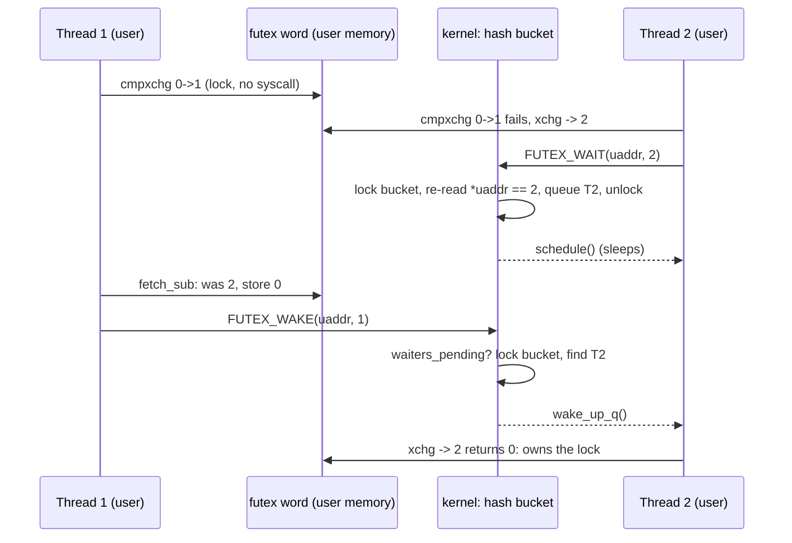

<div dir="rtl">

# ۰۷ — Futex: تقسیم کار بین فضای کاربر و کرنل

> ماژول ۰۳ · همروندی و همگام‌سازی · Linux v6.18.63 · OpenBSD 8cada8c · نسخهٔ انگلیسی: [07-futex-user-kernel-split.en.md](07-futex-user-kernel-split.en.md)

## ۱. خلاصه

- **futex** («mutex سریع فضای کاربر») یک عدد صحیح ۳۲ بیتی در حافظهٔ *کاربر* است، به‌اضافهٔ یک صف انتظار در کرنل که با آدرس همین عدد شناخته می‌شود.
- قفل‌کردن و آزادکردن با یک دستور atomic در فضای کاربر انجام می‌شود؛ کرنل **فقط** برای خواباندن (`FUTEX_WAIT`) یا بیدارکردن (`FUTEX_WAKE`) وارد کار می‌شود.
- بخش سخت، race بین «بررسی مقدار» و «رفتن به خواب» است. کرنل این را با خواندن دوبارهٔ مقدار زیر قفل hash bucket می‌بندد.

## ۲. توضیح

### ۲.۱ شهود: چرا برای هر قفل یک syscall نزنیم؟

هر syscall چند صد نانوثانیه هزینه دارد (ورود، `do_syscall_64`، خروج؛ ماژول ۰۱). بیشتر قفل‌ها **بدون رقابت** (uncontended) هستند: نخی که قفل را می‌خواهد آن را آزاد پیدا می‌کند. پرداخت هزینهٔ syscall برای این حالت هدر است. طراحی futex کار را تقسیم می‌کند:

| کار | کجا اجرا می‌شود | هزینه |
|---|---|---|
| تصمیم «آزاد است؟ بگیرش» | فضای کاربر، یک `lock cmpxchg` | حدود ۲۰ نانوثانیه، بدون کرنل |
| خوابیدن وقتی آزاد نیست | کرنل، `FUTEX_WAIT` | syscall + context switch |
| بیدارکردن یک نخ خوابیده هنگام unlock | کرنل، `FUTEX_WAKE` | syscall، فقط اگر ممکن است کسی خوابیده باشد |

کرنل **نمی‌داند** این عدد چه معنایی دارد و هیچ‌وقت تعیین نمی‌کند صاحب قفل کیست. معنای مقدار (۰ = آزاد، ۱ = قفل، ۲ = قفل با رقابت) یک قرارداد فضای کاربر است که `pthread_mutex_t` در glibc، runtime زبان Go، `std::sync::Mutex` در Rust و آزمایش ما پیاده‌اش می‌کنند.

### ۲.۲ دو عملیات اصلی

| فراخوانی | معنا |
|---|---|
| `futex(uaddr, FUTEX_WAIT, val, timeout)` | «مرا بخوابان **اگر `*uaddr` هنوز برابر `val` است**.» اگر مقدار فرق کند، فوراً `EAGAIN` برمی‌گردد (داخل کرنل `-EWOULDBLOCK`). |
| `futex(uaddr, FUTEX_WAKE, n)` | «حداکثر `n` نخ خوابیده روی `uaddr` را بیدار کن.» تعداد بیدارشده‌ها را برمی‌گرداند. |

پرچم `FUTEX_PRIVATE_FLAG` (مقدار ۱۲۸؛ پس `FUTEX_WAIT_PRIVATE = 128` و `FUTEX_WAKE_PRIVATE = 129`) می‌گوید این word با پردازهٔ دیگری مشترک نیست. آن‌وقت کرنل می‌تواند کلید صف را `(mm, virtual address)` بگذارد و لازم نیست صفحهٔ فیزیکی را پیدا کند؛ ارزان‌تر است.

### ۲.۳ مشکل lost wake-up

بررسی «مقدار == val» و عمل «خوابیدن» باید نسبت به `FUTEX_WAKE` اتمیک باشند. وگرنه:

۱. نخ منتظر در فضای کاربر می‌خواند `*uaddr == 2` و تصمیم می‌گیرد بخوابد.
۲. صاحب قفل unlock می‌کند: `*uaddr = 0` و بعد `FUTEX_WAKE`. هنوز کسی در صف نیست، پس کسی بیدار نمی‌شود.
۳. نخ منتظر وارد کرنل می‌شود و می‌خوابد؛ برای همیشه.

لینوکس جلوی این را این‌طور می‌گیرد: **مقدار `*uaddr` را داخل کرنل، در حالی که spinlock مربوط به hash bucket گرفته شده، دوباره می‌خواند** و فقط بعد از آن نخ را در صف می‌گذارد. بیدارکننده هم برای پیمایش صف باید همان قفل را بگیرد. پس بیدارکننده یا قبل از خواندن دوباره اجرا می‌شود (نخ منتظر مقدار جدید را می‌بیند و `EAGAIN` می‌گیرد) یا بعد از صف‌گذاری (بیدارکننده نخ منتظر را پیدا می‌کند).

### ۲.۴ ساختمان‌داده‌های کرنل

همهٔ نخ‌های منتظر در یک جدول hash از bucketها هستند. bucket با hash کردن **futex key** انتخاب می‌شود (`get_futex_key()`: برای futex خصوصی `mm` + آدرس؛ برای futex مشترک inode/صفحه + offset). هر bucket یک spinlock، یک فهرست مرتب‌شده بر اساس اولویت (`plist`) و یک شمارندهٔ `waiters` دارد که اجازه می‌دهد وقتی کسی منتظر نیست قفل گرفته نشود.

**VERSION-DEPENDENT.** از v6.16 به بعد، یک پردازه می‌تواند hash **خصوصی** futex داشته باشد (`futex_private_hash` که با `prctl(PR_FUTEX_HASH, ...)` تنظیم می‌شود؛ `PR_FUTEX_HASH = 78` در `include/uapi/linux/prctl.h`). این‌طور نخ‌های یک پردازه دیگر روی جدول سراسری با بقیه رقابت نمی‌کنند. `__futex_hash()` اگر hash خصوصی وجود داشته باشد اول آن را انتخاب می‌کند ([kernel/futex/core.c L373](https://elixir.bootlin.com/linux/v6.18.63/source/kernel/futex/core.c#L373)). کرنل‌های قدیمی‌تر فقط hash سراسری دارند.

## ۳. نمودار

</div>



<div dir="rtl">

## ۴. مثال حل‌شده

### ۴.۱ سمت کاربر: mutex سه‌حالته (۰/۱/۲) در آزمایش

از فایل [`../labs/04-futex-mutex/futex_mutex.c`](../labs/04-futex-mutex/futex_mutex.c) (همان «mutex 3» در مقالهٔ Drepper به نام *Futexes Are Tricky*):

</div>

```c
static void fmutex_lock(atomic_uint *m)
{
    uint32_t c = cas(m, 0, 1);                   // fast path: 0 -> 1
    if (c == 0)
        return;
    if (c != 2)
        c = atomic_exchange(m, 2);               // announce "there may be waiters"
    while (c != 0) {
        atomic_fetch_add(&g_wait_calls, 1);
        futex(m, FUTEX_WAIT_PRIVATE, 2);         // sleeps only if *m is still 2
        c = atomic_exchange(m, 2);               // woke up: try to take it, keep "2"
    }
}

static void fmutex_unlock(atomic_uint *m)
{
    if (atomic_fetch_sub(m, 1) != 1) {           // was 2: someone may sleep
        atomic_store(m, 0);
        atomic_fetch_add(&g_wake_calls, 1);
        futex(m, FUTEX_WAKE_PRIVATE, 1);         // wake exactly one waiter
    }
}
```

<div dir="rtl">

- `cas(m, 0, 1)` کل عمل lock در حالت بدون رقابت است: یک `lock cmpxchg` و صفر syscall.
- حالت ۲ یعنی «قفل است و شاید کسی منتظر باشد». نخی که باید صبر کند اول ۲ را می‌نویسد تا unlockکننده بفهمد باید `FUTEX_WAKE` بزند.
- `FUTEX_WAIT(..., 2)`: اگر صاحب قفل قبلاً آزاد کرده باشد (مقدار حالا ۰ است)، کرنل فوراً برمی‌گردد و حلقه دوباره امتحان می‌کند.
- بعد از بیدارشدن، نخ قفل را با `xchg(m, 2)` می‌گیرد نه با ۱: نمی‌داند آیا هنوز کسی خوابیده، پس بدبینانه رفتار می‌کند.
- اگر `fetch_sub` مقدار ۱ برگرداند یعنی حالت ۱ بوده (بدون منتظر)، پس unlock هیچ syscallی ندارد. با یک نخ، آزمایش `futex_wait=0 futex_wake=0` چاپ می‌کند. شمارش‌های واقعی زیر رقابت در [README آزمایش](../labs/04-futex-mutex/README.md) آمده است.

### ۴.۲ ورود به کرنل: توزیع در `do_futex()`

`linux/kernel/futex/syscalls.c · do_futex() · v6.18.63` — [L112](https://elixir.bootlin.com/linux/v6.18.63/source/kernel/futex/syscalls.c#L112)

</div>

```c
  125  	switch (cmd) {
  126  	case FUTEX_WAIT:
  127  		val3 = FUTEX_BITSET_MATCH_ANY;
  128  		fallthrough;
  129  	case FUTEX_WAIT_BITSET:
  130  		return futex_wait(uaddr, flags, val, timeout, val3);
  131  	case FUTEX_WAKE:
  132  		val3 = FUTEX_BITSET_MATCH_ANY;
  133  		fallthrough;
  134  	case FUTEX_WAKE_BITSET:
  135  		return futex_wake(uaddr, flags, val, val3);
```

<div dir="rtl">

- خط ۱۲۵: `cmd` همان `op & FUTEX_CMD_MASK` است؛ پرچم private قبلاً در خط ۱۱۵ با `futex_to_flags(op)` به `flags` تبدیل شده.
- خط‌های ۱۲۶ تا ۱۳۰: `FUTEX_WAIT` ساده در واقع یک `WAIT_BITSET` است که با هر bitset جور می‌شود.
- خط‌های ۱۳۱ تا ۱۳۵: برای wake هم همین‌طور. `val` در WAIT یعنی «مقدار مورد انتظار» و در WAKE یعنی «چند نخ بیدار شوند».

### ۴.۳ سمت منتظر: `futex_wait_setup()`

`linux/kernel/futex/waitwake.c · futex_wait_setup() · v6.18.63` — [L595](https://elixir.bootlin.com/linux/v6.18.63/source/kernel/futex/waitwake.c#L595) (خط‌های ۶۲۰ تا ۶۶۶، کوتاه‌شده)

</div>

```c
  620  retry:
  621  	ret = get_futex_key(uaddr, flags, &q->key, FUTEX_READ);
  ...
  627  		CLASS(hbr, hbr)(&q->key);
  628  		auto hb = hbr.hb;
  629  
  630  		futex_q_lock(q, hb);
  631  
  632  		ret = futex_get_value_locked(&uval, uaddr);
  ...
  647  		if (uval != val) {
  648  			futex_q_unlock(hb);
  649  			return -EWOULDBLOCK;
  650  		}
  ...
  663  		if (task == current)
  664  			set_current_state(TASK_INTERRUPTIBLE|TASK_FREEZABLE);
  665  		futex_queue(q, hb, task);
```

<div dir="rtl">

- خط ۶۲۱: محاسبهٔ کلید (برای futex خصوصی: `mm` + آدرس).
- خط‌های ۶۲۷ و ۶۲۸: پیدا کردن bucket (اگر پردازه hash خصوصی دارد، از آن).
- خط ۶۳۰: `futex_q_lock()` اول `hb->waiters` را زیاد می‌کند (barrier A) و بعد `hb->lock` را می‌گیرد.
- خط ۶۳۲: `*uaddr` **بعد از** گرفتن قفل خوانده می‌شود. توضیح خط‌های ۶۰۲ تا ۶۱۹ دلیلش را می‌گوید: اگر قفل bucket بعد از بررسی گرفته می‌شد، نخ «ممکن بود بی‌نهایت مسدود بماند».
- خط‌های ۶۴۷ تا ۶۵۰: مقدار عوض شده ← `-EWOULDBLOCK` (کاربر `EAGAIN` می‌بیند). حلقهٔ آزمایش ما با همین از unlockی که درست قبل از syscall رخ داده جان سالم به در می‌برد.
- خط‌های ۶۶۳ تا ۶۶۵: نخ را «در حال خواب» علامت می‌زند و در صف می‌گذارد؛ `futex_queue()` قفل را آزاد می‌کند و فراخواننده بعد `schedule()` را صدا می‌زند.

### ۴.۴ سمت بیدارکننده: `futex_wake()` و جفت barrierها

`linux/kernel/futex/waitwake.c · futex_wake() · v6.18.63` — [L155](https://elixir.bootlin.com/linux/v6.18.63/source/kernel/futex/waitwake.c#L155)

</div>

```c
  175  	/* Make sure we really have tasks to wakeup */
  176  	if (!futex_hb_waiters_pending(hb))
  177  		return ret;
  178  
  179  	spin_lock(&hb->lock);
  180  
  181  	plist_for_each_entry_safe(this, next, &hb->chain, list) {
  182  		if (futex_match (&this->key, &key)) {
  ...
  192  			this->wake(&wake_q, this);
  193  			if (++ret >= nr_wake)
  194  				break;
  195  		}
  196  	}
  197  
  198  	spin_unlock(&hb->lock);
  199  	wake_up_q(&wake_q);
```

<div dir="rtl">

- خط ۱۷۶: اگر `hb->waiters == 0` باشد، بدون دست‌زدن به قفل خارج می‌شود.
- خط‌های ۱۷۹ تا ۱۹۶: زنجیره را می‌پیماید (چند futex می‌توانند یک bucket داشته باشند، برای همین `futex_match()` کلید را مقایسه می‌کند) و حداکثر `nr_wake` نخ جمع می‌کند.
- خط ۱۹۹: بیدارکردن واقعی **بعد از** آزادکردن spinlock انجام می‌شود تا نخ بیدارشده بلافاصله پشت `hb->lock` نچرخد.

خروج سریع خط ۱۷۶ فقط به لطف دو barrier کامل درست است. `linux/kernel/futex/futex.h · futex_hb_waiters_pending() · v6.18.63` — [L409](https://elixir.bootlin.com/linux/v6.18.63/source/kernel/futex/futex.h#L409):

</div>

```c
  409  static inline int futex_hb_waiters_pending(struct futex_hash_bucket *hb)
  410  {
  411  #ifdef CONFIG_SMP
  412  	/*
  413  	 * Full barrier (B), see the ordering comment above.
  414  	 */
  415  	smp_mb();
  416  	return atomic_read(&hb->waiters);
```

<div dir="rtl">

توضیح بالای فایل `waitwake.c` (خط‌های ۸۶ تا ۹۶) کل استدلال را به این خلاصه می‌کند:

</div>

```
X = Y = 0        (X = waiters, Y = futex word)
w[X]=1   w[Y]=1
MB       MB
r[Y]=y   r[X]=x
=> x==0 && y==0 is impossible
```

<div dir="rtl">

این دقیقاً **litmus test از نوع store-buffering (SB)** در [یادداشت ۰۳](03-x86-tso-and-barriers.fa.md) و [آزمایش ۰۵](../labs/05-litmus-sb/README.md) است. بدون barrier A (`smp_mb__after_atomic()` در `futex_hb_waiters_inc()`، خط ۳۹۴ فایل `futex.h`) و barrier B، مدل x86-TSO اجازه می‌دهد هر دو طرف مقدار قدیمی را بخوانند: منتظر مقدار جدید futex را نبیند **و** بیدارکننده منتظر را نبیند. آزمایش ۰۵ می‌شمارد که وقتی fence نیست این اتفاق روی سخت‌افزار واقعی چند بار می‌افتد.

### ۴.۵ خود bucket

`linux/kernel/futex/futex.h · struct futex_hash_bucket · v6.18.63` — [L143](https://elixir.bootlin.com/linux/v6.18.63/source/kernel/futex/futex.h#L143)

</div>

```c
  143  struct futex_hash_bucket {
  144  	atomic_t waiters;
  145  	spinlock_t lock;
  146  	struct plist_head chain;
  147  } ____cacheline_aligned_in_smp;
```

<div dir="rtl">

- `waiters` همان X در استدلال SB است. `lock` عمل wait و wake را سریالی می‌کند. `chain` فهرست مرتب بر اساس اولویت است (نخ‌های RT اول بیدار می‌شوند). `____cacheline_aligned_in_smp` یعنی هر bucket یک cache line؛ بین bucketها false sharing نیست.

## ۵. حالت‌های مرزی و دام‌ها

| دام | چه می‌شود | راه درست |
|---|---|---|
| فرض اینکه برگشت از WAIT یعنی «قفل مال من است» | WAIT با بیدارشدن، با `EAGAIN`، با signal (`EINTR`) و گاهی بی‌دلیل (spurious) برمی‌گردد | همیشه word را در یک حلقه دوباره بررسی کنید |
| unlock با `store(0)` و همیشه زدن WAKE | درست است ولی هر unlock یک syscall می‌شود | از حالت ۲ برای فهمیدن احتمال وجود منتظر استفاده کنید |
| قاطی کردن عملیات `_PRIVATE` و غیرخصوصی روی یک word | کلیدها فرق می‌کنند ← منتظر هرگز پیدا نمی‌شود | در دو طرف یک پرچم یکسان |
| futex در حافظهٔ مشترک بین پردازه‌ها | کلید مشترک (shared) لازم است | `FUTEX_PRIVATE_FLAG` را نگذارید |
| انتظار انصاف (fairness) | `FUTEX_WAKE(1)` یک نخ را بیدار می‌کند ولی نخ در حال اجرا ممکن است زودتر قفل را بقاپد (barging) | بپذیرید، یا از پروتکل ticket/handoff استفاده کنید |
| priority inversion | futex ساده از صاحب قفل خبر ندارد | `FUTEX_LOCK_PI` ← `rt_mutex` با priority inheritance (ماژول ۰۷، `kernel/futex/pi.c`) |
| شمارنده‌های آزمایش در برابر `strace -c` | `strace` نخ‌ها را کند می‌کند و الگوی رقابت را تغییر می‌دهد | با شمارش bpftrace مقایسه کنید که اجرای برنامه را تقریباً تغییر نمی‌دهد |

## ۶. نکته‌های کلیدی امتحان

- futex = یک word در فضای کاربر + صف انتظار در کرنل با کلید آدرس آن؛ lock/unlock بدون رقابت = **صفر syscall**.
- `FUTEX_WAIT(uaddr, val)` فقط وقتی می‌خواباند که `*uaddr == val` باشد و این بررسی **زیر قفل bucket** انجام می‌شود؛ وگرنه `EAGAIN`.
- `FUTEX_WAKE(uaddr, n)` حداکثر n منتظر را بیدار می‌کند و تعدادشان را برمی‌گرداند.
- ترتیب در لینوکس: قفل bucket ← خواندن دوبارهٔ مقدار ← صف‌گذاری ← آزادکردن قفل ← `schedule()`.
- `hb->waiters` به‌همراه barrierهای A و B اجازه می‌دهد `futex_wake()` وقتی منتظری نیست قفل نگیرد؛ درستی‌اش همان استدلال litmus SB است.
- حالت‌ها: ۱ = قفل، ۲ = قفل + شاید منتظر؛ unlock فقط اگر مقدار قبلی ۲ بوده WAKE می‌زند.
- پرچم private (۱۲۸) ← کلید ارزان‌تر (`mm` + آدرس مجازی). از v6.16: hash اختیاری برای هر پردازه (VERSION-DEPENDENT).
- futexهای PI به `rt_mutex` می‌رسند (ماژول ۰۷).

### مقایسه با OpenBSD

`openbsd/sys/kern/sys_futex.c · futex_wait() · 8cada8c` — [L252](https://github.com/openbsd/src/blob/8cada8c/sys/kern/sys_futex.c#L252) (خط‌های ۲۷۸ تا ۳۰۶)

</div>

```c
  278  	futex_addrs(p, &f, uaddr, flags);
  279  	fsq = futex_get_slpque(&f);
  280  
  281  	/* Mark futex as waiting. */
  282  	f.ft_fsq = fsq;
  283  	f.ft_proc = p;
  284  	rw_enter_write(&fsq->fsq_lock);
  285  	/* Make the waiting futex visible to wake/requeue */
  286  	TAILQ_INSERT_TAIL(&fsq->fsq_list, &f, ft_entry);
  287  	rw_exit_write(&fsq->fsq_lock);
  ...
  296  	if ((error = copyin32(uaddr, &cval)) != 0)
  297  		goto exit;
  298  
  299  	/* If the value changed, stop here. */
  300  	if (cval != val) {
  301  		error = EAGAIN;
  302  		goto exit;
  303  	}
  304  
  305  	sleep_setup(&f, PWAIT|PCATCH, "fsleep");
  306  	error = sleep_finish(nsecs, f.ft_proc != NULL);
```

<div dir="rtl">

- خط‌های ۲۸۴ تا ۲۸۷: OpenBSD **اول در صف می‌گذارد** (زیر یک `rwlock` خوابیدنی، نه spinlock) و قفل را رها می‌کند.
- خط‌های ۲۹۶ تا ۳۰۳: فقط بعد از آن مقدار کاربر را می‌خواند؛ اگر عوض شده باشد از صف خارج می‌شود و `EAGAIN` برمی‌گرداند.
- خط‌های ۳۰۵ و ۳۰۶: می‌خوابد، مگر اینکه بیدارکننده قبلاً `f.ft_proc` را پاک کرده باشد. wakeی که بین خط ۲۸۷ و ۳۰۵ برسد ورودی را در فهرست پیدا می‌کند و `ft_proc` را پاک می‌کند، پس `sleep_finish()` نمی‌خوابد: lost wake-up رخ نمی‌دهد.

| انتخاب طراحی | Linux v6.18.63 | OpenBSD 8cada8c | بده‌بستان |
|---|---|---|---|
| ترتیب در WAIT | قفل bucket ← خواندن مقدار ← صف‌گذاری | صف‌گذاری ← آزادکردن قفل ← خواندن مقدار ← خواب | لینوکس هنگام خواندن حافظهٔ کاربر spinlock در دست دارد (به `futex_get_value_locked` و تلاش دوباره پس از fault نیاز دارد)؛ OpenBSD این مشکل را ندارد ولی در `EAGAIN` باید از صف خارج کند |
| قفل bucket | `spinlock_t` | `rwlock` (خوابیدنی) | spinlock ارزان‌تر است ولی نمی‌شود رویش page fault خورد؛ rwlock اجازهٔ fault در `copyin32` را می‌دهد |
| مسیر سریع wake | `hb->waiters` + `smp_mb()`، بدون قفل | همیشه قفل می‌گیرد | لینوکس در unlockهای بدون منتظر یک قفل صرفه‌جویی می‌کند |
| عملیات‌ها | WAIT/WAKE، bitset، REQUEUE، PI، WAKE_OP، `futex_waitv` | WAIT، WAKE، REQUEUE | لینوکس غنی‌تر (condvarهای glibc، PI، Wine)؛ OpenBSD سطح حملهٔ کوچک‌تر |
| hash | سراسری و به‌ازای هر NUMA node؛ اختیاری برای هر پردازه (v6.16+) | جدول سراسری sleep queue | hash مخصوص پردازه رقابت بین پردازه‌ها را حذف می‌کند |

## ۷. پیوندها

- درس: [۴.۴ چطور یک قفل خوابیدنی از syscall فرار می‌کند؟](../lesson.fa.md#44-how-does-a-sleeping-lock-avoid-a-syscall)
- راهنمای کرنل: [kernel-walkthrough.fa.md](../kernel-walkthrough.fa.md) (بخش futex)
- آزمایش: [۰۴ — mutex با futex خام](../labs/04-futex-mutex/README.md)؛ استدلال barrier در [۰۵ — litmus SB](../labs/05-litmus-sb/README.md) آزموده می‌شود
- یادداشت‌های مرتبط: [۰۳ — x86-TSO و barrierها](03-x86-tso-and-barriers.fa.md)، [۰۵ — mutex](05-mutex-optimistic-spinning.fa.md)، [۰۶ — semaphore و condvar](06-semaphores-condition-variables.fa.md)
- آزمون: [Q9](../quiz.fa.md) (خروجی strace/bpftrace آزمایش futex)، [Q10](../quiz.fa.md) (ترتیب در `futex_wait_setup`)
- منبع اصلی: Ulrich Drepper، *Futexes Are Tricky* (2011)؛ `man 2 futex`

</div>
